# 01. Project Overview & Operational Mission

## 1. Problem Statement

Coastal Karnataka spans 320 kilometres along the Arabian Sea, encompassing **1,879 administrative revenue units** across three distinct coastal districts:
1. **Dakshina Kannada** (369 units: urbanised coastal corridor and inland taluks)
2. **Udupi** (253 units: densely populated coastal plain and estuarine river basins)
3. **Uttara Kannada** (1,257 units: ecologically fragile, heavily forested coastline and Western Ghats interior)

During severe cyclonic storms and monsoon storm-surge events, local emergency authorities—District Disaster Management Authorities (DDMAs), Taluk Tehsildars, and Gram Panchayats—face acute planning hurdles:
- **Disparate Baseline Data:** Census infrastructure metrics, spatial hospital access, shelter capacity, and coastal proximity exist in isolated silos.
- **Conflation of Vulnerability and Hazard:** Standard relief allocations frequently treat acute coastal storm-surge exposure and remote interior healthcare isolation as identical problems, leading to misallocated evacuation logistics.
- **Black-Box AI Risks:** Off-the-shelf generative AI models hallucinate non-existent emergency shelters, provide dangerous medical advice, or cite fictitious meteorological alerts.
- **Cloud Dependency Vulnerability:** Fragile cloud-hosted emergency services collapse precisely when undersea cables break, cellular grids lose power, or satellite uplinks degrade.

---

## 2. Core Objectives

CYCLONE INTEL resolves these challenges through four foundational engineering objectives:

1. **Deterministic Spatial Multi-Criteria Decision Analysis (AHP/MCDA):**  
   Establish an authoritative, mathematically rigorous baseline preparedness score (0.0 to 100.0) grounded in physical infrastructure, healthcare access, shelter availability, early warning systems, and socioeconomic factors.
2. **Descriptive Vulnerability Archetyping (Unsupervised Learning):**  
   Discover empirical vulnerability archetypes using K-Means clustering ($k=4$) across 622 coastal units to group communities with shared structural intervention requirements.
3. **Surrogate ML Concordance & Boundary Auditing:**  
   Train a transparent, highly regularized Multinomial Logistic Regression model across 26 engineered features to detect boundary misclassifications and approximate AHP decision boundaries with $\ge 94\%$ test accuracy.
4. **Air-Gapped, Zero-Hallucination AI Decision Support:**  
   Deploy an edge-optimized conversational assistant (Qwen 2.5:0.5B running on local CPU via Ollama) strictly governed by 7 deterministic data tools and an active refusal gate that refuses out-of-scope or live meteorological predictions.

---

## 3. High-Level System Architecture

```mermaid
flowchart LR
    subgraph Data["1. Spatial & Census Data Layer"]
        C11["Census 2011 & SHRUG"]
        GEO["Geodesic Facility Distances\n(Hospitals, PHCs, Shelters)"]
        DEMO["Demographic Indicators\n(SC/ST, Density, Housing)"]
    end

    subgraph Analytical["2. Analytical & ML Engines"]
        AHP["Deterministic AHP/MCDA\n(0-100 Score -> Low/Med/High)"]
        LR["Logistic Regression Surrogate\n(26 Features -> Probabilities)"]
        KM["K-Means Archetypes (k=4)\n(622 Units in DK & Udupi)"]
        FB["Uttara Kannada Fallback Engine\n(1,257 Units Sector Triggers)"]
    end

    subgraph Decision["3. Operational Decision Support"]
        PB["Priority Band Allocator\n(Bands 1 to 4)"]
        REC["Deterministic Advisory Engine\n(18 Sector Rules)"]
    end

    subgraph Interface["4. Presentation & Interaction"]
        API["FastAPI REST Backend (:8000)\n27+ Endpoints"]
        SPA["React 18 TypeScript Dashboard (:80)"]
        LLM["Qwen 2.5:0.5B Assistant (:11434)\n7 Deterministic Tools + Refusal Gate"]
    end

    Data --> Analytical
    Analytical --> Decision
    Decision --> Interface
```

---

## 4. Reconciled Priority Band Census ($N = 1,879$)

Every administrative unit in the study universe is assigned to an authoritative, non-overlapping operational priority band:

| Priority Band | Operational Definition & Criteria | Total Units | Dakshina Kannada | Udupi | Uttara Kannada |
| :--- | :--- | :---: | :---: | :---: | :---: |
| **`BAND_1_CRITICAL`** | AHP Low preparedness tier (`preparedness_score < 40.0`). Urgent structural capacity intervention required. | **155** | 2 | 0 | 153 |
| **`BAND_2_SPECIALIZED`** | AHP Medium tier (`40.0 <= score < 60.0`) **AND** $\ge 1$ individual sector deficit triggers (`dist_coast_km < 5.0`, `score_shelters < 20.0`, or `score_medical < 35.0`). | **829** | 123 | 20 | 686 |
| **`BAND_3_MODERATE`** | AHP Medium tier (`40.0 <= score < 60.0`) **WITHOUT** individual sector deficit triggers. Standard reinforcement. | **299** | 45 | 43 | 211 |
| **`BAND_4_ADEQUATE`** | AHP High preparedness tier (`preparedness_score >= 60.0`). High baseline capacity; monitor and preserve infrastructure. | **596** | 199 | 190 | 207 |
| **TOTAL** | **Entire Coastal Karnataka Administrative Universe** | **1,879** | **369** | **253** | **1,257** |

> [!NOTE]
> **Band 1 Investigation Detail:**  
> In Dakshina Kannada, exactly 2 units fall below the 40.0 score threshold: `Sulya (TP)` (score 39.31) and `Kodimbala` (score 38.44). In Udupi, the lowest preparedness score is 46.66 (`Medium` tier), meaning **0 units in Udupi fall into Band 1**. In Uttara Kannada, 153 units have baseline scores below 40.0.

---

## 5. Feature Implementation & Verification Status

To ensure absolute transparency during evaluations, all platform features are clearly demarcated:

| Capability / Component | Status | Verification & Evidence | Location in Codebase |
| :--- | :---: | :--- | :--- |
| **AHP Deterministic Scoring** | **Implemented & Tested** | 1,879 units scored; mathematically verified consistency ratio ($CR = 0.042 < 0.10$). | `src/integration/decision_matrix.py` |
| **Logistic Regression Surrogate** | **Implemented & Tested** | 94.3% test accuracy, 95.4% AHP concordance; 26 input features validated. | `models/logistic_regression_tier.joblib` |
| **K-Means Archetyping ($k=4$)** | **Implemented & Tested** | 622 units clustered; silhouette score 0.3348, multi-seed stability $ARI = 0.9902$. | `models/kmeans_k4_model.joblib` |
| **Uttara Kannada Fallback** | **Implemented & Tested** | Zero out-of-study-area extrapolation; 1,257 units evaluated via 3-sector triggers. | `src/integration/decision_matrix.py` |
| **Deterministic Advisories** | **Implemented & Tested** | 18 rules mapping empirical indicators to actionable agency advisories. | `src/assistant/decision_support.py` |
| **Qwen 2.5:0.5B Tool Suite** | **Implemented & Tested** | 7 typed tools with bounds checking; 100% test pass rate on intent parsing. | `src/assistant/tools/registry.py` |
| **Conversational Refusal Gate** | **Implemented & Tested** | Rejects real-time weather forecasts, casualty predictions, and live IMD radar queries. | `src/assistant/llm/orchestrator.py` |
| **Deterministic Fallback Engine** | **Implemented & Tested** | Assembles structured responses when Ollama daemon is offline (zero downtime). | `src/assistant/llm/orchestrator.py` |
| **FastAPI REST Service** | **Implemented & Tested** | 27+ endpoints covering summary, unit dossiers, analytics, and assistant chat. | `src/api/main.py` |
| **React 18 TypeScript UI** | **Implemented & Tested** | 6 primary views; verified responsive layout with zero accessibility regressions. | `frontend/src/App.tsx` |
| **10-Stage GitHub Actions CI** | **Implemented & Tested** | 1,107 passing tests across model safety, Docker validation, and E2E regression. | `.github/workflows/ci-cd.yml` |
| **Protected CD & Rollback** | **Implemented & Tested** | Self-hosted runner deployment with atomic rollback upon health probe failure. | `.github/workflows/manual-deploy.yml` |
| **Real-time IMD Radar Feeds** | **Planned (Out of Scope)** | Excluded by design; CYCLONE INTEL focuses on structural preparedness baselines. | Documented in Refusal Gate |
| **Live IoT Water Level Sensors** | **Planned (Future Work)** | Future integration planned for river basin hydrological stations. | Research Roadmap |
