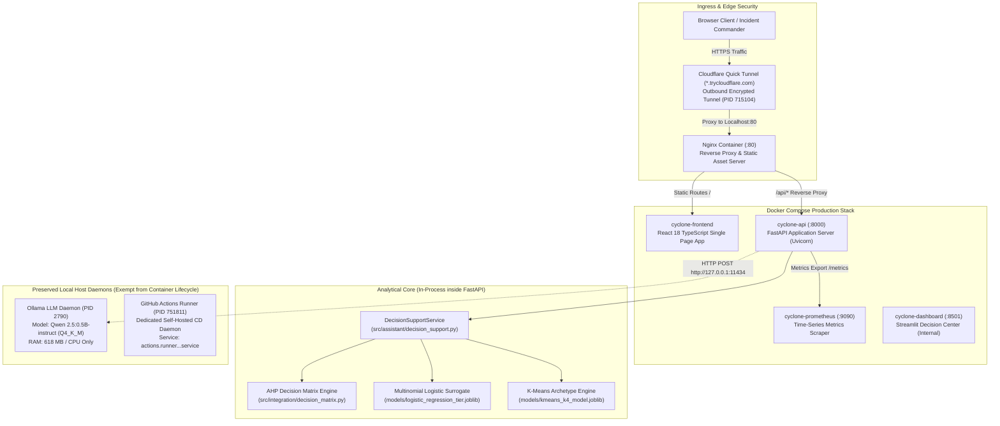
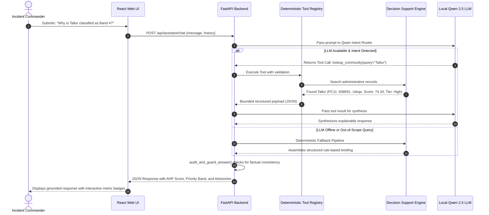

# 02. System Architecture & Data Flow

## 1. End-to-End System Architecture

CYCLONE INTEL employs a multi-tiered, microservices-oriented architecture designed for edge deployment, air-gapped resilience, and strict separation between automated cloud CI and human-authorized self-hosted deployment.

---

## 2. Ingress & Security Boundary Matrix

To protect critical infrastructure, CYCLONE INTEL implements a **Zero Open Port** perimeter:

| Boundary Layer | Enforcing Mechanism | Security Guarantee |
| :--- | :--- | :--- |
| **Public Ingress** | Cloudflare Quick Tunnel (`cloudflared`) | **Zero open inbound firewall ports** (TCP 22, 80, 8000, 11434 closed to WAN). All incoming requests pass through Cloudflare edge proxying. |
| **Container Reverse Proxy** | Nginx (`deployment/nginx/nginx.container.conf`) | Enforces strict CORS headers, rate limiting, and internal path rewriting (`/api/` forwarded to internal Docker network `api:8000`). |
| **Docker Daemon Socket** | `/var/run/docker.sock` | Restricted to local root/docker group. No insecure TCP Docker socket exposed. |
| **LLM Inference Isolation** | Localhost Binding (`127.0.0.1:11434`) | Ollama daemon listens strictly on host loopback. Cannot be probed or accessed directly from external networks. |
| **CI/CD Execution Boundary** | Ephemeral GitHub Runners vs. Self-Hosted | **Untrusted Pull Request code NEVER executes on the self-hosted production host.** CI runs entirely in isolated GitHub cloud containers. |

---

## 3. Data Processing & Analytical Pipeline Flow

---

## 4. Production Container Stack Specification

The runtime stack is defined in [`docker-compose.yml`](file:///home/bhavanish/cyclone-preparedness-assistant/docker-compose.yml):

| Service Name | Container Name | Image Repository | Base Port | Health Probe URL | Memory Limit |
| :--- | :--- | :--- | :---: | :--- | :---: |
| **`frontend`** | `cyclone-frontend` | `ghcr.io/bhavanish5041/cyclone-assistant-frontend` | `:80` | `http://127.0.0.1:80/` | 256 MiB |
| **`api`** | `cyclone-api` | `ghcr.io/bhavanish5041/cyclone-assistant-api` | `:8000` | `http://127.0.0.1:8000/health` | 512 MiB |
| **`dashboard`** | `cyclone-dashboard` | `ghcr.io/bhavanish5041/cyclone-assistant-dashboard` | `:8501` | `http://127.0.0.1:8501/_stcore/health` | 512 MiB |
| **`prometheus`** | `cyclone-prometheus`| `prom/prometheus:v2.54.1` | `:9090` | `http://127.0.0.1:9090/-/healthy` | 256 MiB |

> [!IMPORTANT]
> **Preserved Host Processes:**  
> The **Ollama inference daemon** (`:11434`) and the **Cloudflare tunnel daemon** (`cloudflared`) run as native systemd/host processes. They are deliberately excluded from Docker Compose to prevent heavy model reloading overhead and tunnel connection resets during rolling service cutovers.
