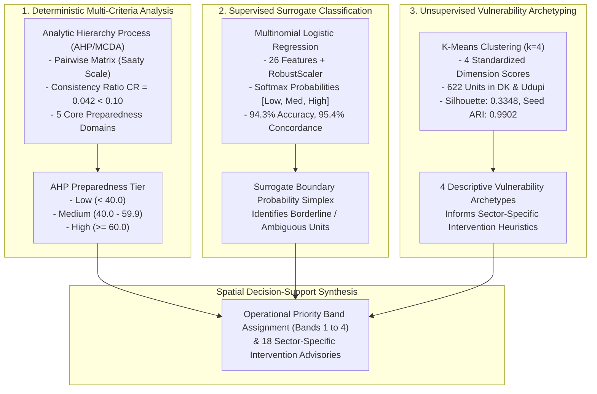

# 03. Machine Learning & Decision Support Pipeline

## 1. Overview of the Three Mathematical Frameworks

CYCLONE INTEL integrates three distinct mathematical disciplines to ensure explainability, spatial equity, and scientific rigor:



---

## 2. Analytic Hierarchy Process (AHP/MCDA)

### 2.1 Theoretical Formulation
The Analytic Hierarchy Process (developed by Thomas Saaty) synthesizes qualitative disaster management expertise into an objective, weighted composite score:
$$S_i = \sum_{j=1}^{m} w_j \cdot f_{ij}, \quad \text{where } \sum_{j=1}^{m} w_j = 1.0$$

The domain weights $w$ are derived from the principal eigenvector of a pairwise comparison matrix $A$:
$$A w = \lambda_{\max} w$$

### 2.2 Mathematical Consistency Verification
To ensure experts did not provide contradictory preferences, the Consistency Ratio ($CR$) is evaluated against Saaty's Random Index ($RI$):
$$CI = \frac{\lambda_{\max} - n}{n - 1}, \quad CR = \frac{CI}{RI}$$
In CYCLONE INTEL:
$$\lambda_{\max} = 5.187, \quad n = 5, \quad CI = 0.0468, \quad RI = 1.12 \implies \mathbf{CR = 0.0418 < 0.10} \quad \text{(Statistically Consistent)}$$

### 2.3 The 5 Preparedness Domains
1. **Medical & Healthcare Access ($w = 0.28$):** Geodesic travel distance to hospitals, PHCs, and CHCs.
2. **Shelter Capacity & Proximity ($w = 0.24$):** Designated evacuation shelter space within 5–10 km buffer.
3. **Physical & Transport Infrastructure ($w = 0.20$):** Pucca roads, major district highways, bus connectivity, and power resilience.
4. **Early Warning & Telemetry ($w = 0.16$):** Automated rain gauge proximity and emergency siren coverage.
5. **Socioeconomic Vulnerability ($w = 0.12$):** Household size, literacy rates, and SC/ST demographic shares.

---

## 3. Supervised Logistic Regression Surrogate Classifier

### 3.1 Purpose & Role as a Surrogate
The Logistic Regression model does **not** establish independent ground truth. Instead, it serves as an empirical surrogate model:
- **Boundary Auditing:** Identifies administrative units hovering near class boundaries (e.g., score 39.8 vs. 40.2).
- **Fast Surrogate Inference:** Provides calibrated class simplex probabilities without re-running full spatial GIS queries.
- **Invariance Mandate:** A surrogate prediction can **never** downgrade an authoritative AHP Low tier classification.

### 3.2 Feature Matrix (26 Input Features)
The model strictly expects 26 ordered features:
- **Geographic Exposure (2):** `dist_coast_km`, `elevation_mean`
- **Demographics (4):** `avg_household_size`, `sc_share`, `st_share`, `vulnerable_pop_share`
- **Infrastructure (5):** `road_connectivity_score`, `drinking_water_score`, `has_pucca_road`, `has_major_district_road`, `bus_connectivity`
- **Healthcare & Monitoring (4):** `n_hc_10km`, `n_phc_chc_10km`, `n_gauges_20km`, `n_shelters_10km`
- **Composite Indicators (7):** `cvi_physical`, `cvi_social`, `coastal_risk_score`, `evacuation_sufficiency`, `vulnerability_exposure`, `infra_composite`, `monitoring_coverage`
- **Engineered Transformations (4):** `log1p_population`, `log1p_pop_density_sqkm`, `log1p_dist_nearest_shelter_km`, `log1p_dist_nearest_hospital_km`

### 3.3 Mathematical Formulation & Preprocessing
Features are scaled using **RobustScaler** to mitigate spatial outliers:
$$x' = \frac{x - \text{median}(x)}{Q_{75} - Q_{25}}$$

Multiclass probabilities are computed via the **Softmax function**:
$$P(y = k \mid x) = \frac{e^{w_k^T x' + b_k}}{\sum_{j=1}^{3} e^{w_j^T x' + b_j}}, \quad k \in \{\text{High}, \text{Medium}, \text{Low}\}$$

### 3.4 Verified Validation Results
Evaluated on 282 held-out test units (stratified 70/15/15 split):
- **Test Accuracy:** **94.33%**
- **Macro F1 Score:** **90.60%**
- **Weighted F1 Score:** **94.22%**
- **AHP Concordance Rate:** **95.37%** (1,792 of 1,879 overall units agree exactly with AHP tier)

---

## 4. Unsupervised K-Means Vulnerability Archetyping

### 4.1 Methodology & Input Dimensions
K-Means groups communities based on multi-dimensional vulnerability similarity rather than hazard occurrence. Clustering operates on 4 standardized z-score transformed indicators:
1. $D_{\text{health}}$: Healthcare Access Deficit
2. $D_{\text{demo}}$: Demographic Vulnerability (SC/ST Disadvantage)
3. $D_{\text{infra}}$: Infrastructure Deficit (Water, Roads, Drainage)
4. $D_{\text{coast}}$: Coastal Hazard Proximity (Inverted Distance to Coast)

### 4.2 Objective Function & $K=4$ Selection
K-Means minimizes within-cluster inertia:
$$J = \sum_{i=1}^{n} \sum_{k=1}^{K} r_{ik} \|x_i - \mu_k\|^2$$

| Metric | $K=2$ | $K=3$ | **$K=4$ (Selected Baseline)** | $K=5$ | $K=6$ |
| :--- | :---: | :---: | :---: | :---: | :---: |
| **Silhouette Score** | 0.3004 | 0.3360 | **0.3348** | 0.2935 | 0.2797 |
| **Davies–Bouldin Index** | 1.3453 | 1.1134 | **1.1771** | 1.1889 | 1.1611 |
| **Calinski–Harabasz Score** | 297.13 | 311.30 | **298.59** | 273.93 | 258.10 |
| **Cluster Balance Ratio** | 0.7182 | 0.4564 | **0.3293** | 0.3707 | 0.4375 |
| **Multi-Seed Stability (ARI)** | 0.9840 | 0.9870 | **0.9902** | 0.9410 | 0.9120 |

$K=4$ was selected because it maximizes random-seed partition stability ($ARI = 0.9902$ across 10 random seeds) while yielding 4 actionable, distinct operational profiles.

### 4.3 The 4 Discovered Archetypes ($N = 622$ in DK & Udupi)

| Cluster ID | Archetype Name | Count | Key Structural Characteristics | Primary Intervention Focus |
| :---: | :--- | :---: | :--- | :--- |
| **0** | **Urban & Peri-Urban Well-Resourced Corridor** | 130 | Low healthcare deficit, high road density, low demographic vulnerability. | Stormwater pumping stations, electrical grid hardening, hospital emergency surge capacity. |
| **1** | **Remote Foothill & Healthcare-Isolated** | 82 | Western Ghats foothills; extreme hospital distance (>20 km), moderate coastal safety. | Mobile medical units, pre-positioned trauma supplies, satellite communication backups. |
| **2** | **Socioeconomically Vulnerable Rural Interior** | 161 | High SC/ST demographic shares, moderate healthcare, severe drinking water and drainage deficits. | Targeted social relief distribution, emergency water purification, resilient community shelters. |
| **3** | **High-Exposure Coastal Rural Belt** | 249 | Immediate Arabian Sea coast (<5 km), acute storm surge exposure, high saline intrusion. | Cyclone shelter activation, coastal sea dikes, saline barriers, multi-hazard early warning sirens. |

---

## 5. Critical Distinction: Preparedness Tier vs. Operational Priority Band

One of the most important concepts to demonstrate is the difference between an **AHP Preparedness Tier** and an **Operational Priority Band**:

```
+-------------------------------------------------------------------------------+
|                      AHP PREPAREDNESS TIER (Baseline Capacity)                |
|                      Measures existing structural readiness.                   |
|                      Low (<40)  |  Medium (40-60)  |  High (>=60)             |
+-------------------------------------------------------------------------------+
                                      VS
+-------------------------------------------------------------------------------+
|                      OPERATIONAL PRIORITY BAND (Action Urgency)               |
|                      Determines emergency deployment priority.                |
|                      Band 1     |  Band 2          |  Band 3     |  Band 4    |
|                      Critical   |  Specialized     |  Moderate   |  Adequate  |
+-------------------------------------------------------------------------------+
```

### Why High Preparedness $\ne$ Low Priority
- **AHP Preparedness Tier** reflects static, installed capacity (e.g., does this village have roads, power, and schools?).
- **Operational Priority Band** synthesizes baseline capacity with immediate spatial vulnerability triggers:
  - If a village has a **Medium** preparedness score (e.g. 52.0) but sits **1.2 km from the coastline** or has **shelter scores < 20**, it is immediately promoted to **`BAND_2_SPECIALIZED`** because its residents require acute sector-specific protection.
  - A community in **`BAND_4_ADEQUATE`** (e.g., Tallur, score 74.34) has high baseline capacity, allowing authorities to focus emergency staging on Bands 1 and 2 while maintaining monitoring in Band 4.
