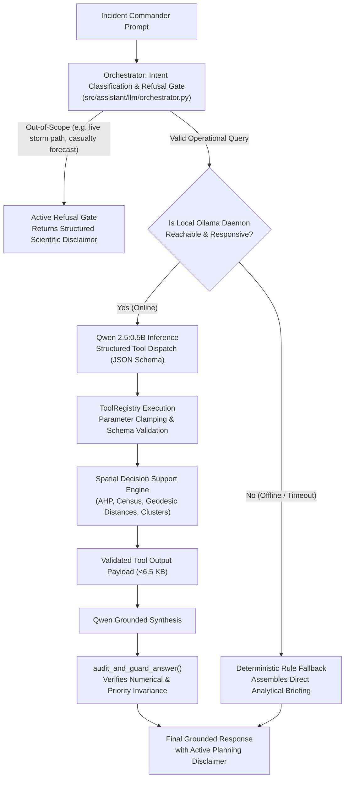

# 05. AI Assistant & Deterministic Tool Orchestration

## 1. Architectural Philosophy: The Hybrid Grounded Engine

Large Language Models (LLMs) are notorious for generating persuasive but factually fabricated information ("hallucinations"). In high-stakes disaster preparedness, hallucinating an emergency shelter or misquoting hospital travel distances is unacceptable.

To guarantee **zero hallucination**, CYCLONE INTEL implements a **Hybrid AI Architecture**:
- **Natural Language Parsing & Synthesis:** Handled by a lightweight local LLM (**Qwen 2.5:0.5B-instruct**).
- **Facts, Numbers, Distances & Decisions:** Handled strictly by **7 Deterministic Data Tools** and an active **Refusal Gate**.
- **Self-Healing Fallback:** If the LLM daemon is offline, a deterministic fallback engine synthesizes structured briefings directly from tool payloads with **zero downtime**.



---

## 2. Local LLM Runtime Specification

CYCLONE INTEL eliminates paid third-party APIs (OpenAI, Anthropic, Gemini) in favor of a private, edge-deployable local engine:

- **Model Architecture:** `Qwen2.5-0.5B-Instruct` (Alibaba Cloud / HuggingFace)
- **Quantization:** `Q4_K_M` (4-bit quantized GGUF format)
- **Local Daemon:** Snap Ollama (`http://127.0.0.1:11434`)
- **Disk Footprint:** **397 MB** (Model tag: `qwen2.5:0.5b-instruct`, Digest: `a8b0c5157701`)
- **RAM Footprint:** **~618 MB** (Runs entirely on standard multi-core laptop CPU without GPU acceleration)
- **Inference Latency:** 250–650 ms per turn on standard x86 CPU.

---

## 3. The 7 Registered Deterministic Tools

Every tool is strictly typed, validated via Pydantic schemas, and restricted to bounded input parameters:

| Tool Name | Source Module | Operational Responsibility | Supported Parameters |
| :--- | :--- | :--- | :--- |
| **`lookup_community`** | `src/assistant/tools/community.py` | Resolves administrative units across all 1,879 revenue villages and census towns; resolves name ambiguities (e.g., *Balkur*). | `query` (str), `district` (opt str), `limit` (int, 1-15) |
| **`explain_preparedness_assessment`** | `src/assistant/tools/decision.py` | Retrieves AHP composite score (0-100), operational priority band, ML surrogate class probabilities, and sector deficits. | `identifier` (village name, PC11 ID, or SHRID) |
| **`compare_districts`** | `src/assistant/tools/regional.py` | Generates comparative regional cross-tabulations between two districts (mean scores, Band 1 count, critical deficits). | `district_a` (str), `district_b` (str) |
| **`filter_and_rank_communities`** | `src/assistant/tools/regional.py` | Deterministic multi-key sorting and filtering of communities by priority band, score, or district. | `priority_band` (opt), `district` (opt), `sort_by` (str), `limit` (int) |
| **`analyze_infrastructure_and_exposure`** | `src/assistant/tools/community.py` | Details physical exposure, pucca roads, and disambiguated geodesic distances (Sub-centre vs. PHC vs. Hospital). | `identifier` (str) |
| **`explain_vulnerability_archetype`** | `src/assistant/tools/archetypes.py` | Explains characteristics and interventions for the 4 K-Means archetypes. Out-of-study area boundary enforced for UK. | `archetype_id` (opt int 0-3), `community_identifier` (opt str) |
| **`get_intervention_recommendations`** | `src/assistant/tools/decision.py` | Evaluates 18 approved eligibility rules to attach actionable resource, shelter, and medical advisories. | `identifier` (str) |

---

## 4. Operational Guardrails & Safeguard Suite

### 4.1 The Active Refusal Gate
Emergency responders often test systems with dynamic weather questions. The assistant implements an active refusal gate that intercepts and refuses out-of-scope queries:
- **Refused Categories:** Real-time cyclone trajectory forecasting, live Doppler radar imagery, cyclone landfall timing, casualty predictions, and live IMD cyclone warnings.
- **Enforced Response:**
  > *"Refusal Notice: CYCLONE INTEL is a structural preparedness and spatial decision-support platform based on baseline infrastructure indicators. It does NOT forecast real-time meteorological cyclone trajectories, live storm surge inundation, or casualty estimates. For live weather warnings, consult the India Meteorological Department (IMD) at https://mausam.imd.gov.in."*

### 4.2 Turn Budget Caps
To prevent recursive or runaway tool loops during degraded network conditions:
- `MAX_TOOL_ROUNDS = 4` (Maximum reasoning steps per turn)
- `MAX_TOTAL_TOOL_CALLS = 8` (Maximum total tool invocations per user turn)

### 4.3 Output Verification (`audit_and_guard_answer`)
Before the final response is delivered to the client, a deterministic auditing filter inspects the text:
1. Verifies that the numerical AHP score cited in prose matches the exact float from the tool output.
2. Ensures the priority band label (`BAND_1_CRITICAL` through `BAND_4_ADEQUATE`) is preserved without modification.
3. Attaches the required statutory planning advisory disclaimer.

### 4.4 Disambiguation of Healthcare Distances
A critical lesson from user acceptance testing: villages often contain a primary health sub-centre within village boundaries (distance 0.00 km) while the nearest full primary health centre (PHC) is 3 km away and the apex hospital is 25 km away.  
`analyze_infrastructure_and_exposure` explicitly returns three separate distances to prevent operational confusion:
```json
{
  "dist_nearest_subcentre_km": 0.00,
  "dist_nearest_phc_km": 3.09,
  "dist_nearest_hospital_km": 25.98
}
```
