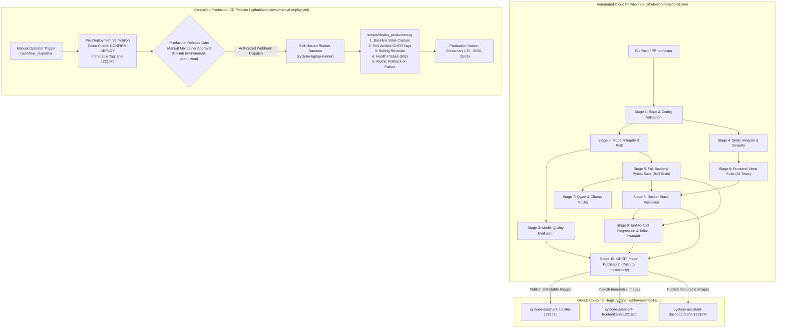

# 06. MLOps, CI/CD Pipeline & Deployment Architecture

## 1. End-to-End CI/CD Lifecycle Architecture

CYCLONE INTEL enforces **strict separation of concerns** between automated Continuous Integration (ephemeral cloud runners) and Continuous Deployment (human-authorized, self-hosted deployment directly on the production host).



---

## 2. The 10 Automated CI Quality Gates

Every pull request and merge to `master` must pass all 10 stages sequentially in clean, isolated GitHub-hosted environments (`ubuntu-latest`):

| Stage # | Stage Name | Verification Actions | Gate Pass Criteria |
| :---: | :--- | :--- | :--- |
| **1** | **Repo & Config Validation** | Checks `PAR1` magic bytes on all 6 Git LFS Parquet datasets; validates `docker-compose.yml` syntax; scans for leaked API credentials. | Zero syntax errors; all datasets intact. |
| **2** | **Model Integrity & Risk** | Verifies SHA256 cryptographic hashes in `models/model_registry.json`; tests 26-feature input schema; asserts probability simplex $\sum P_i = 1.0$. | Exact cryptographic hash match; tamper detection functional. |
| **3** | **Model Quality Evaluation** | Evaluates model against 130 curated test cases across 3 coastal districts. | Low-tier recall $\ge 70\%$; AHP concordance $\ge 85\%$. |
| **4** | **Static Analysis & Security** | Python bytecode compilation; `flake8` critical linting (`E9, F63, F7, F82`); `pip-audit` Python CVE audit; `npm audit` critical audit. | Zero critical CVEs; zero syntax/undefined variable errors. |
| **5** | **Full Backend Pytest Suite** | Executes full analytical backend suite across 46 test modules. | 940 tests passing with 0 failures. |
| **6** | **Frontend Tests & Build** | Executes Vitest suite verifying presentation components, responsive layouts, and builds production bundle (`npm run build`). | 31 Vitest tests passing; bundle compiled cleanly. |
| **7** | **Qwen & Ollama Mocks** | Verifies LLM client retry policies, fallback recovery, and tool schema adherence using offline mocks. | 22 tests passing with 0 network calls. |
| **8** | **Docker Stack Validation** | Builds isolated test containers (`cyclone-ci-api:test`, `cyclone-ci-frontend:test`) on non-conflicting ports (8008, 8088); probes 10 endpoints. | All 10 endpoints return HTTP 200; clean stack teardown. |
| **9** | **End-to-End Regression** | Tests complete user journeys across 9 functional modules; enforces **Tallur PC11 608691 invariant** (score 74.34, Band 4). | 20 E2E tests passing with 0 drift. |
| **10** | **Artifact Publication** | Multi-platform Docker Buildx action builds and pushes container images to GitHub Container Registry (Push to `master` only). | Images tagged with `sha-<short_sha>` and `latest`. |

---

## 3. GHCR Image Naming & Tagging Policy

Container images are published to the GitHub Container Registry under the repository owner namespace:

```
ghcr.io/bhavanish5041/cyclone-assistant-api
ghcr.io/bhavanish5041/cyclone-assistant-frontend
ghcr.io/bhavanish5041/cyclone-assistant-dashboard
```

### Strict Immutability Rule:
- **Mutable `latest` Forbidden in Production:**  
  Deploying mutable tags (`latest`, `master`, `main`) to production is strictly blocked by the pre-deployment verification gate.
- **Exact Commit-SHA Tags Mandated:**  
  All production deployments must specify an exact immutable tag produced by CI (e.g. `sha-1221e7c`). This ensures that deployed containers match the exact verified Git commit history.

---

## 4. Controlled Continuous Deployment (CD) Workflow

The continuous deployment workflow ([`.github/workflows/manual-deploy.yml`](file:///home/bhavanish/cyclone-preparedness-assistant/.github/workflows/manual-deploy.yml)) runs strictly upon **manual trigger** (`workflow_dispatch`).

### Security Boundaries:
1. **Pull Request Isolation:** Untrusted PR code is **NEVER** permitted to execute on the self-hosted runner.
2. **Explicit Safety Confirmation:** Operator must type `CONFIRM-DEPLOY`.
3. **Manual Environment Approval Gate:** Deployment cannot proceed to the self-hosted runner without explicit sign-off in the GitHub `production` environment.
4. **Dedicated Runner:** Executes on `cyclone-laptop-runner` (`[self-hosted, linux, cyclone-runner]`).

### Zero-Downtime Deployment Engine (`scripts/deploy_production.py`):
1. **Preflight Health Checks:** Verifies Docker daemon status, host disk space ($\ge 1\text{ GB}$ free), and remote image accessibility on GHCR.
2. **Baseline State Snapshot:** Records running container IDs and image digests to `.deployment_state.json`.
3. **Smart Change Detection:** Uses `git diff` against the last deployed commit SHA to identify changed services (or deploys all services if `--services all`).
4. **Sequential Service Cutover:** Stops and recreates containers in dependency order (API cutover verified first before frontend and dashboard).
5. **Post-Deployment Health Polling:** Polls service `/health` endpoints for up to 60 seconds.
6. **Automated Atomic Rollback:** If any service fails health probes or times out, the deployment engine immediately stops the new containers and restarts the exact baseline images recorded in step 2.
