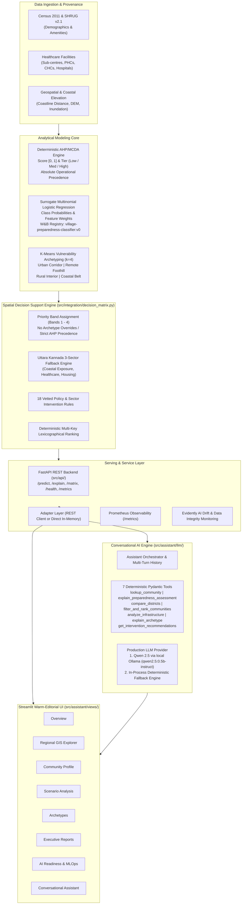
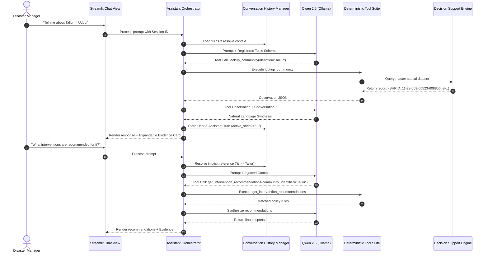

# 🌀 Cyclone Preparedness Intelligence Platform & Spatial Decision Support Assistant

[](https://www.python.org/)
[](https://fastapi.tiangolo.com)
[](https://streamlit.io)
[](https://wandb.ai)
[](https://www.evidentlyai.com/)
[](https://www.docker.com/)
[](https://pytest.org)

An end-to-end, scientifically defensible cyclone preparedness assessment, vulnerability archetyping, and spatial decision-support platform for coastal Karnataka, India. The system evaluates **1,879 administrative units** across **Dakshina Kannada**, **Udupi**, and **Uttara Kannada**, combining deterministic Multi-Criteria Decision Analysis (AHP), surrogate Machine Learning concordance, unsupervised spatial clustering, an 18-rule emergency intervention matrix, and a conversational AI assistant with strict anti-hallucination guardrails.

---

## 📑 Table of Contents

- [Executive Summary](#executive-summary)
- [System Architecture](#system-architecture)
- [Comprehensive Implementation Journey (What We Have Done)](#comprehensive-implementation-journey-what-we-have-done)
  - [Phase 1: Geospatial Analysis & Vulnerability Archetyping](#phase-1-geospatial-analysis--vulnerability-archetyping)
  - [Phase 2: Decision Support Engine, MLOps & Container Deployment](#phase-2-decision-support-engine-mlops--container-deployment)
  - [Phase 3: Modular Streamlit UI Redesign (Warm Editorial System)](#phase-3-modular-streamlit-ui-redesign-warm-editorial-system)
  - [Phase 4: Conversational AI Assistant & Closed-World Tool Suite](#phase-4-conversational-ai-assistant--closed-world-tool-suite)
  - [Phase 4 Post-Hardening: Local Qwen (Ollama) Integration & Multi-Turn History](#phase-4-post-hardening-local-qwen-ollama-integration--multi-turn-history)
- [Analytical Foundations & Scientific Methodology](#analytical-foundations--scientific-methodology)
- [Conversational AI & Tool Suite](#conversational-ai--tool-suite)
- [Modular Dashboard Architecture](#modular-dashboard-architecture)
- [MLOps, Monitoring & Governance](#mlops-monitoring--governance)
- [Repository Structure](#repository-structure)
- [Quickstart & Installation](#quickstart--installation)
- [Configuration Reference (.env)](#configuration-reference-env)
- [Testing & Validation](#testing--validation)

---

## Executive Summary

Coastal Karnataka faces recurrent threats from severe cyclonic storms, storm surges, and tidal inundations along the Arabian Sea. Disaster management authorities need defensible, transparent, and spatial prioritization to allocate critical resources—such as cyclone shelters, mobile medical units, power backhauls, and early-warning networks—before and during disaster events.

This platform bridges scientific spatial analysis with operational disaster management:
1. **1,879 Surveyed Administrative Units**: Standardized on canonical SHRUG v2.1 identifiers (`shrid2` schema: `11-SS-DDD-TTTTT-VVVVVV`), covering Dakshina Kannada (369 units), Udupi (253 units), and Uttara Kannada (1,257 fallback units).
2. **Deterministic AHP/MCDA Preparedness Scoring**: Absolute operational baseline computing composite scores in $[0, 1]$ categorized into Low, Medium, and High preparedness tiers.
3. **Surrogate ML Classification**: Multinomial Logistic Regression model trained to predict preparedness tiers with calibrated class probabilities and feature importances, validated against the baseline.
4. **Vulnerability Archetypes (K-Means, $k=4$)**: Unsupervised clustering across coastal proximity, accessibility, and demographic vulnerability (Urban Corridor, Remote Foothill, Rural Interior, Coastal Belt).
5. **Operational Decision Support Matrix**: Priority Bands 1 to 4 with 18 rule-based intervention triggers and deterministic null-safe ranking.
6. **Conversational LLM Assistant (Local Qwen via Ollama)**: Closed-world tool-calling conversational agent backed by 7 deterministic tools, multi-turn history tracking, and a zero-downtime offline deterministic fallback engine.
7. **Hardware-Constrained Production Deployment**: Single-container deployment tailored for Render Free Tier (512 MiB RAM Cgroup limit) as well as full multi-container Docker Compose with Prometheus.

---

## System Architecture



---

## Comprehensive Implementation Journey (What We Have Done)

### Phase 1: Geospatial Analysis & Vulnerability Archetyping
- **Canonical Key Reconciliation**: Solved spatial joining collisions across SHRUG v2.1 and Census 2011. Audited and eliminated string collisions (e.g. `'00None'` string collisions caused by non-unique `pc11_id` casts) by establishing `shrid2` (`11-SS-DDD-TTTTT-VVVVVV`) as the canonical unique primary key across all 1,879 administrative units.
- **Coastal Feature Engineering**: Calculated Euclidean distances to high-tide coastlines, elevation buffers, and coastal vulnerability metrics (`src/features/coastal.py`).
- **Spatial Accessibility & Healthcare Proximity**: Computed exact distances to nearest primary health sub-centres, Primary Health Centres (PHCs), Community Health Centres (CHCs), and tertiary apex hospitals (`src/features/accessibility.py`).
- **K-Means Clustering ($k=4$)**: Implemented multi-dimensional clustering across 622 units in Dakshina Kannada (369) and Udupi (253) (`src/models/clustering.py`):
  - **Cluster 0 (Urban Corridor)**: High connectivity, moderate coastal proximity, dense infrastructure.
  - **Cluster 1 (Remote Foothill)**: Interior Western Ghats foothills, low coastal risk but acute healthcare travel barriers.
  - **Cluster 2 (Rural Interior)**: Agricultural interior plain, moderate accessibility.
  - **Cluster 3 (Coastal Belt)**: Immediate littoral zone, critical cyclone surge exposure, high structural risk.

### Phase 2: Decision Support Engine, MLOps & Container Deployment
- **AHP/MCDA Scoring Engine**: Implemented defensible Analytic Hierarchy Process weights across demographics, housing quality, critical infrastructure, and coastal exposure. Assigned units to Low, Medium, or High baseline preparedness tiers.
- **Surrogate Logistic Regression**:
  - Trained and serialized a Multinomial Logistic Regression classifier (`models/logistic_regression_tier.joblib`) predicting baseline tiers with calibrated probabilities.
  - Documented complete model cards, schemas, and limitations (`models/render_artifact/`).
- **Integrated Decision Support Engine (`src/integration/decision_matrix.py`)**:
  - Synthesized AHP, surrogate ML, and K-Means into an operational decision matrix for all 1,879 units.
  - **Priority Bands (1 to 4)**: Defined actionable intervention urgency tiers. Enforced the scientific guardrail: *K-Means archetypes cannot artificially promote or alter priority bands*.
  - **18 Sector Intervention Rules**: Built deterministic triggers for cyclone shelter construction, mobile healthcare units, power redundancy, flood barriers, and emergency telecommunications.
  - **Uttara Kannada Fallback Engine**: Formulated an independent 3-sector fallback for the 1,257 out-of-study units lacking full K-Means coverage.
  - **Null-Safe Deterministic Ranking**: Implemented multi-key lexicographical ranking ensuring reproducible sorting with `na_position="last"`.
- **Production MLOps & Model Registry**:
  - Integrated Weights & Biases (W&B) for model lineage, experiment tracking, and artifact registry (`village-preparedness-classifier:v0`).
  - Added robust offline-first fallback caching (`.wandb_artifacts_cache/`) enabling execution without live internet or API keys.
- **Model Quality & Data Drift Monitoring**:
  - Integrated **Evidently AI** (`src/monitoring/model_quality.py`) for automated data drift detection, missing value auditing, and data integrity test suites generating both structured JSON and interactive HTML reports (`reports/model_monitoring/`).
- **Prometheus Observability**:
  - Instrumented FastAPI with Prometheus metrics (`src/monitoring/prometheus_metrics.py`), capturing inference latency histograms, prediction counters, and error rates via `/metrics`.
- **FastAPI Microservice**:
  - Production REST API (`src/api/main.py`) with strict Pydantic v2 schemas (`src/api/schemas.py`).
  - Dual-mode architecture: seamlessly toggle between REST HTTP mode and direct in-memory Python execution.
- **Containerization & CI/CD**:
  - Authored `Dockerfile.api`, `Dockerfile.dashboard`, and `docker-compose.yml`.
  - Authored `Dockerfile.render`: An ultra-lean, single-container image built on `python:3.14-slim`, bundling immutable model artifacts and running in unprivileged user space (`appuser:10001`) under Render Free Tier's 512 MiB RAM Cgroup limit.
  - Built GitHub Actions CI/CD pipeline (`.github/workflows/ci-cd.yml`) executing 430+ automated tests, reproducible dataset verification, and container smoke testing.

### Phase 3: Modular Streamlit UI Redesign (Warm Editorial System)
- **Decomposition of Monolithic Dashboard**: Restructured into a clean, modular view architecture (`src/assistant/views/`) driven by a central router (`src/assistant/app.py`).
- **Warm Editorial Visual Design**: Created a custom design language (`src/assistant/theme.py`, `src/assistant/ui_components.py`) utilizing warm chocolate, sand, cream, and terracotta tones with high-contrast accessibility.
- **7 Core Analytical Views**:
  1. **Overview (`overview.py`)**: Executive KPIs, regional preparedness score distributions, and district-level aggregations.
  2. **Regional GIS Explorer (`gis_explorer.py`)**: Interactive Folium choropleths, risk heatmaps, facility markers, and coastal boundary overlays.
  3. **Community Profile (`community_profile.py`)**: Village-by-village deep dive with AHP score breakdowns, demographic indicators, and exact facility distances.
  4. **Scenario Analysis (`scenario_analysis.py`)**: Real-time what-if simulations with cyclone intensity sliders, storm surge inundation buffers, and resource reallocation.
  5. **Vulnerability Archetypes (`archetypes.py`)**: Radar diagrams, archetype profiles, and spatial distribution of clusters across DK and Udupi.
  6. **Executive Reports (`reports.py`)**: Automated markdown synthesis and PDF-ready executive briefs.
  7. **AI & Model Readiness (`ai_readiness.py`)**: Real-time monitoring dashboard surfacing Evidently drift metrics, W&B model lineage, and Prometheus stats.

### Phase 4: Conversational AI Assistant & Closed-World Tool Suite
- **Deterministic Closed-World Tool Suite (7 Registered Tools)**:
  - Strict Pydantic v2 argument validation with boundary checks.
  - Zero hallucinations: all answers are computed directly from the verified spatial decision engine.
- **Local Qwen Function-Calling & Intent Orchestration**:
  - Prompt-grounded intent extraction and tool dispatch via local Ollama (`qwen2.5:0.5b-instruct`).
  - Standardized JSON schema exports with closed-world execution bounds.
- **Zero-Downtime Deterministic Fallback**:
  - In-process spatial decision support fallback when external LLM APIs encounter rate limits (HTTP 429), quota exhaustion, or offline environments.
- **Scientific Correctness & Ground Truth Hardening**:
  - Audited and verified authoritative administrative unit counts: **1,879 total units** (Dakshina Kannada: 369, Udupi: 253, Uttara Kannada: 1,257).
  - Verified Udupi Priority-Band distribution: **Band 1: 0, Band 2: 20, Band 3: 43, Band 4: 190**.
  - Disambiguated healthcare distance measurements (e.g., Tallur village: in-village primary sub-centre 0.00 km vs PHC 3.09 km vs apex hospital 34.79 km).

### Phase 4 Post-Hardening: Local Qwen (Ollama) Integration & Multi-Turn History
- **Local Qwen LLM Provider Integration**:
  - Integrated local self-hosted Qwen 2.5 (`qwen2.5:0.5b-instruct`) via Ollama as the sole production conversational LLM provider, guaranteeing zero cloud API costs and absolute data privacy.
  - Seamless fallback cascade: `Qwen (Ollama)` $\rightarrow$ `In-Process Deterministic Fallback Engine`.
- **Multi-Turn Conversation History (`src/assistant/llm/history.py`)**:
  - Stateful session tracking preserving conversational context across turns.
  - Retains active community focus (e.g., asking "What is its score?" followed by "What interventions are recommended?" maintains the selected village context).
  - Telemetry capture: tracks execution latency, token counts, tool call sequences, and formats transparent expandable evidence cards in the UI.

---

## Analytical Foundations & Scientific Methodology

### 1. Analytic Hierarchy Process (AHP/MCDA) Baseline
The baseline preparedness score is computed deterministically using multi-criteria weighted scoring across normalized indices:

$$\text{Preparedness Score} = \sum_{i=1}^{M} w_i \cdot I_i, \quad \sum w_i = 1.0$$

Where $I_i$ includes healthcare spatial accessibility, pucca housing ratios, road connectivity, electricity availability, and coastal elevation buffers.
- **High Preparedness**: $\text{Score} \ge 0.65$
- **Medium Preparedness**: $0.40 \le \text{Score} < 0.65$
- **Low Preparedness**: $\text{Score} < 0.40$

> **Scientific Guardrail:** The AHP score represents the primary legal and operational truth for resource allocation.

### 2. Surrogate Multinomial Logistic Regression
A supervised classification model predicts preparedness tiers from 26 raw features:

$$P(Y = c \mid \mathbf{x}) = \frac{e^{\mathbf{w}_c^T \mathbf{x} + b_c}}{\sum_{k} e^{\mathbf{w}_k^T \mathbf{x} + b_k}}$$

The model serves as an explainable surrogate, generating calibrated class probabilities ($P(\text{Low}), P(\text{Med}), P(\text{High})$) and feature importance coefficients that corroborate the AHP baseline.

### 3. Priority Bands & Decision Logic
The decision-support matrix maps administrative units into 4 operational priority bands:

| Priority Band | Label | Criteria | Operational Directive |
| :---: | :---: | :---: | :--- |
| **Band 1** | Critical Emergency | Low AHP tier AND (Coastal exposure $<5\text{ km}$ OR high isolation) | Immediate pre-cyclone evacuation and life-safety deployment |
| **Band 2** | High Priority | Low AHP tier inland OR Medium AHP tier with severe healthcare deficits | Priority staging of medical supplies, mobile generators, relief kits |
| **Band 3** | Moderate Priority | Medium AHP tier with adequate physical access | Secondary reinforcement and shelter capacity monitoring |
| **Band 4** | Standard Resilient | High AHP tier | Standard monitoring, mutual aid staging hub |

*Guardrail:* K-Means Archetypes provide descriptive socioeconomic context only; they are strictly prohibited from altering or promoting priority bands.

---

## Conversational AI & Tool Suite

The platform features a closed-world conversational agent that queries the underlying spatial decision engine directly.

### Registered Deterministic Tools (`src/assistant/tools/`)

| Tool Name | Parameters | Description |
| :--- | :--- | :--- |
| `lookup_community` | `identifier` (name, SHRID2, or PC11 ID) | Fetches complete village profile, district, subdistrict, population, and coordinates. |
| `explain_preparedness_assessment` | `community_identifier` | Returns detailed AHP score decomposition, surrogate ML probabilities, and concordance. |
| `compare_districts` | `district_a`, `district_b` | Performs comparative statistical analysis between coastal districts. |
| `filter_and_rank_communities` | `district`, `priority_band`, `sort_by`, `limit` | Filters and lexicographically ranks units by vulnerability or distance with null safety. |
| `analyze_infrastructure_and_exposure` | `community_identifier`, `sector` | Evaluates infrastructure gaps (healthcare distances, road access, elevation buffers). |
| `explain_vulnerability_archetype` | `archetype_id`, `community_identifier` | Explains K-Means cluster properties or inspects a community's archetype assignment. |
| `get_intervention_recommendations` | `community_identifier` | Evaluates unit metrics against the 18 sector-specific eligibility rules and returns recommendations. |

### Multi-Turn Context Retention Flow



---

## Modular Dashboard Architecture

The dashboard is structured into 7 dedicated analytical pages:

```
src/assistant/views/
├── overview.py             # Executive summary & district KPIs
├── gis_explorer.py         # Interactive Folium geospatial choropleths & facility layers
├── community_profile.py    # Deep-dive on individual village metrics & AHP breakdown
├── scenario_analysis.py    # Real-time what-if simulations & storm surge hazard modeling
├── archetypes.py           # K-Means radar profiles, cluster descriptions & spatial plots
├── reports.py              # Exportable executive reports and policy briefs
├── ai_readiness.py         # Model telemetry, Evidently drift metrics & Prometheus stats
└── chat_assistant.py       # Conversational AI assistant with tool execution telemetry
```

---

## MLOps, Monitoring & Governance

1. **Weights & Biases (W&B) Model Registry**:
   - Model lineage tracked under `village-preparedness-classifier:v0`.
   - Immutable artifact packaging in `models/render_artifact/` ensures fully functional deployment without requiring external registry network access during startup.
2. **Evidently AI Quality & Drift Detection**:
   - Automated monitoring cycle (`src/monitoring/model_quality.py`) compares production inference data against baseline training distributions.
   - Generates interactive HTML dashboards and structured JSON metrics for continuous data integrity verification.
3. **Prometheus Observability**:
   - Exposes operational metrics on `/metrics`:
     - `model_inference_latency_seconds`: Latency histogram partitioned by endpoint.
     - `model_predictions_total`: Counter partitioned by predicted tier (`low`, `medium`, `high`).
     - `model_inference_errors_total`: Error tracking counter.
4. **Hardware Cgroup Compliance**:
   - Optimized for Render Free Tier (single-process direct mode, lazy dataset loading, sub-400 MiB memory consumption under 512 MiB limit).

---

## Repository Structure

```
cyclone-preparedness-assistant/
├── .github/workflows/
│   └── ci-cd.yml                # Automated CI/CD pipeline (lint, test, build, docker verify)
├── configs/                     # System and logging configuration files
├── data/
│   ├── processed/               # Cleaned, joined, and enriched Parquet datasets
│   └── raw/                     # Original Census, SHRUG, and GIS shapefiles
├── docker/
│   ├── requirements-api.txt     # Pinned dependencies for FastAPI microservice
│   ├── requirements-dashboard.txt # Pinned dependencies for Streamlit frontend
│   └── requirements-render.txt  # Minimal dependencies for Render free-tier container
├── docs/                        # Complete milestone reports and architectural designs
├── models/
│   ├── logistic_regression_tier.joblib  # Serialized surrogate ML pipeline
│   ├── label_encoder.joblib             # Label encoder for preparedness classes
│   └── render_artifact/                 # Immutable deployment artifact bundle
├── monitoring/
│   └── prometheus.yml           # Prometheus scraping configuration
├── reports/
│   └── model_monitoring/        # Generated Evidently AI HTML and JSON reports
├── scripts/                     # Standalone CLI tools, data pipelines & memory benchmarks
├── src/
│   ├── api/                     # FastAPI application, routes, and Pydantic schemas
│   ├── assistant/               # Streamlit application, UI theme, and views
│   │   ├── llm/                 # LLM providers, multi-turn history, orchestrator
│   │   ├── tools/               # 7 Deterministic tools for spatial decision querying
│   │   └── views/               # 7 Modular UI dashboard views + chat assistant
│   ├── data/                    # Data provenance, inventory, and cleaning routines
│   ├── features/                # Feature engineering (coastal, accessibility, prioritization)
│   ├── geo/                     # GIS spatial boundary utilities and coordinate transforms
│   ├── integration/             # Decision matrix, priority banding, and dataset joins
│   ├── models/                  # K-Means clustering and Logistic Regression training
│   ├── monitoring/              # Evidently drift reports and Prometheus metrics
│   └── tracking/                # W&B experiment tracking and artifact logger
├── tests/                       # 35 test suites (438 unit, integration, UI, LLM tests)
├── .env.example                 # Environment configuration template
├── docker-compose.yml           # Multi-container deployment (API + Dashboard + Prometheus)
├── Dockerfile.api               # Production image for FastAPI backend
├── Dockerfile.dashboard         # Production image for Streamlit frontend
├── Dockerfile.render            # Unified production image for Render Free Tier
├── pyproject.toml               # Project metadata and test configuration
└── requirements.txt             # Pinned production requirements
```

---

## Quickstart & Installation

### Prerequisites
- Python 3.12+ or 3.14+
- Docker and Docker Compose (optional, for containerized run)
- Git LFS (for large model and GeoParquet files)

### 1. Local Setup (Direct Mode)

Clone the repository and set up a virtual environment:

```bash
git clone https://github.com/Bhavanish5041/cyclone-preparedness-assistant.git
cd cyclone-preparedness-assistant

# Create virtual environment
python3 -m venv .venv
source .venv/bin/activate

# Install pinned dependencies
pip install -r requirements.txt

# Configure environment
cp .env.example .env
```

Launch the Streamlit dashboard in **Direct Mode** (runs backend in-memory, no API server required):

```bash
# In .env, ensure CYCLONE_ADAPTER_MODE=direct
streamlit run src/assistant/app.py --server.port 8501
```

Access the dashboard at `http://localhost:8501`.

---

### 2. Multi-Container Deployment (Docker Compose)

Launch the full microservice stack (FastAPI backend + Streamlit dashboard + Prometheus):

```bash
docker compose up --build -d
```

- **Streamlit Dashboard**: `http://localhost:8501`
- **FastAPI Documentation**: `http://localhost:8000/docs`
- **Prometheus Metrics**: `http://localhost:8000/metrics`
- **Prometheus Dashboard**: `http://localhost:9090`

---

### 3. Render Free Tier Deployment

The project includes an optimized single-container configuration (`Dockerfile.render`) designed specifically for Render's free tier (512 MiB RAM limit):

```bash
docker build -t cyclone-render -f Dockerfile.render .
docker run -p 10000:10000 -e PORT=10000 cyclone-render
```

---

## Configuration Reference (.env)

| Variable | Default Value | Description |
| :--- | :--- | :--- |
| `API_PORT` | `8000` | Port for FastAPI REST service |
| `DASHBOARD_PORT` | `8501` | Port for Streamlit dashboard |
| `CYCLONE_ADAPTER_MODE` | `direct` | `direct` (in-memory execution) or `rest` (HTTP API client) |
| `CYCLONE_API_BASE_URL` | `http://localhost:8000` | Target URL when in REST mode |
| `LLM_PROVIDER` | `ollama` | Production LLM provider (`ollama`) |
| `OLLAMA_BASE_URL` | `http://127.0.0.1:11434` | Local Ollama daemon endpoint URL |
| `OLLAMA_MODEL` | `qwen2.5:0.5b-instruct` | Production Qwen model identifier |
| `OLLAMA_TIMEOUT` | `30.0` | Timeout in seconds for Ollama requests |
| `WANDB_MODEL_ARTIFACT` | `village-preparedness-classifier:v0` | Model artifact version in W&B |
| `WANDB_CACHE_DIR` | `/app/.wandb_artifacts_cache` | Local path for offline model artifact caching |

> **Note on Offline Execution:** If the local Ollama daemon is offline or unconfigured, the conversational assistant automatically engages the **In-Process Deterministic Fallback Engine**, providing full analytical responses without external network access or cost.

---

## Testing & Validation

The platform contains **35 test suites** comprising **438 automated tests** covering end-to-end functionality, mathematical correctness, data consistency, and memory constraints:

```bash
# Run complete test suite
./.venv/bin/pytest tests/ -v

# Run assistant and tool tests
./.venv/bin/pytest tests/test_assistant_*.py tests/test_qwen_orchestration.py tests/test_ollama_integration.py -v

# Run decision engine and data consistency tests
./.venv/bin/pytest tests/test_decision_engine.py tests/test_data_consistency_phase4_4_1.py -v

# Run model monitoring and Evidently tests
./.venv/bin/pytest tests/test_model_quality_monitoring.py -v
```

### Verification Highlights
- **Mathematical Consistency**: Verified exact distribution of Priority Bands in Udupi (0 Band 1, 20 Band 2, 43 Band 3, 190 Band 4).
- **Healthcare Distance Disambiguation**: Audited facility distances to prevent conflation between in-village sub-centres (0.00 km) and primary health centres (PHCs).
- **Memory Profiles**: Profiled container execution under strict 512 MiB memory limits with zero memory leaks.
- **Fail-Safe Robustness**: Verified zero-downtime degradation under HTTP 429 quota exhaustion, schema mismatch errors, and network timeouts.

---

## License

This project is licensed under the Apache License 2.0. See the `LICENSE` file for details.
