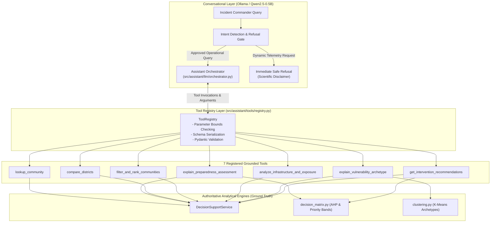

# CYCLONE INTEL: Deterministic Assistant Tool Suite & Guardrails Specification

## 1. Executive Summary

The CYCLONE INTEL Conversational Assistant bridges natural-language incident queries with the authoritative Spatial Decision Support System. To eliminate hallucinations, prevent data leaks, and ensure non-negotiable scientific accuracy, the assistant never operates on raw, unconstrained prompts or full dataset context dumps.

Instead, all conversational interactions are mediated by a **Deterministic Assistant Tool Suite** (`src/assistant/tools/`). The suite wraps existing audited decision functions (`DecisionSupportService`, `build_unit_evaluation()`, `evaluate_unit_advisories()`, and `clustering.py`) into typed, validating, and rate-bounded tools.

---

## 2. Scientific Precedence & Operational Guardrails

All conversational responses adhere to the non-negotiable scientific hierarchy of CYCLONE INTEL:

1. **Analytical Hierarchy Process (AHP) Precedence**:
   Deterministic composite scoring (0.0 to 100.0) and 4-tier operational priority band allocation maintain absolute authority.
2. **Surrogate ML Demarcation**:
   The Logistic Regression model is strictly an empirical surrogate approximating AHP preparedness tiers across 26 infrastructural features. It does NOT predict physical cyclone paths, storm surges, or future casualties. An ML prediction is never permitted to downgrade an authoritative AHP Low preparedness classification.
3. **Turn Budget & Execution Caps**:
   To prevent runaway tool loops, orchestration is strictly bounded:
   - Maximum rounds per user turn: **4 rounds** (`MAX_TOOL_ROUNDS = 4`)
   - Maximum total tool executions per turn: **8 calls** (`MAX_TOTAL_TOOL_CALLS = 8`)
4. **Deterministic Fallback Engine**:
   If the local LLM daemon (Ollama / Qwen) is unreachable, offline, or times out, the assistant immediately activates zero-downtime deterministic fallback, assembling structured analytical responses directly from the tool outputs.

---

## 3. Specifications of the 7 Registered Tools

### Tool 1: `lookup_community`
- **Module:** `src/assistant/tools/community.py`
- **Purpose:** Resolve administrative units across coastal Karnataka (1,879 units in Dakshina Kannada, Udupi, and Uttara Kannada) by village name, Census 2011 PC11 ID, or SHRID2.
- **Parameters:**
  - `query` (`string`, required): Search string (village name, PC11 code, or SHRID).
  - `district` (`string`, optional): Scope restriction (`"Dakshina Kannada"`, `"Udupi"`, `"Uttara Kannada"`).
  - `limit` (`integer`, optional, default 5): Maximum candidate matches (1 to 15).
- **Ambiguity Handling:** When multiple villages share a name (e.g. *Balkur*, *Antravalli*), returns candidate PC11 IDs and taluks for disambiguation.

### Tool 2: `explain_preparedness_assessment`
- **Module:** `src/assistant/tools/decision.py`
- **Purpose:** Retrieve comprehensive preparedness evaluation for a specific community, including AHP score, authoritative priority band, surrogate ML tier probability simplex, and identified sector deficits.
- **Parameters:**
  - `identifier` (`string`, required): Village name, PC11 code, or SHRID.

### Tool 3: `compare_districts`
- **Module:** `src/assistant/tools/regional.py`
- **Purpose:** Generate comparative regional analysis between two districts, evaluating priority band allocations, mean preparedness scores, critical deficit prevalence, and archetype distributions.
- **Parameters:**
  - `district_a` (`string`, required): Name of first district.
  - `district_b` (`string`, required): Name of second district.

### Tool 4: `filter_and_rank_communities`
- **Module:** `src/assistant/tools/regional.py`
- **Purpose:** Multi-attribute filtering and deterministic ranking of communities by priority band, district, or preparedness score.
- **Parameters:**
  - `priority_band` (`string`, optional): Filter by `BAND_1_CRITICAL`, `BAND_2_SPECIALIZED`, `BAND_3_MODERATE`, `BAND_4_ADEQUATE`.
  - `district` (`string`, optional): District filter.
  - `sort_by` (`string`, optional, default `"preparedness_score"`): Attribute to sort by.
  - `ascending` (`boolean`, optional, default `true`): Sort order.
  - `limit` (`integer`, optional, default 10): Page size (1 to 20).
  - `offset` (`integer`, optional, default 0): Pagination offset.

### Tool 5: `analyze_infrastructure_and_exposure`
- **Module:** `src/assistant/tools/community.py`
- **Purpose:** Inspect physical exposure, road connectivity, power, water, and healthcare accessibility metrics for a specific community.
- **Parameters:**
  - `identifier` (`string`, required): Village name, PC11 ID, or SHRID.
- **Healthcare Metric Disambiguation:** Returns separate, unambiguous geodesic distances for Primary Health Sub-Centres (0.00 km if within village boundary), Primary Health Centres (PHC), Community Health Centres (CHC), and tertiary apex hospitals.

### Tool 6: `explain_vulnerability_archetype`
- **Module:** `src/assistant/tools/archetypes.py`
- **Purpose:** Explain structural vulnerability profiles across the 4 K-Means archetypes (`Cluster 0: Urban & Peri-Urban Well-Resourced Corridor`, `Cluster 1: Remote Foothill & Healthcare-Isolated Communities`, `Cluster 2: Socioeconomically Vulnerable Rural Interior`, `Cluster 3: High-Exposure Coastal Rural Belt`).
- **Parameters:**
  - `archetype_id` (`integer`, optional): Cluster ID (0 to 3).
  - `community_identifier` (`string`, optional): Explain archetype assignment for a specific community.
- **Boundary Restriction:** For Uttara Kannada units (unassigned to K-Means), transparently explains the out-of-study-area boundary and provides the 3-sector fallback evaluation.

### Tool 7: `get_intervention_recommendations`
- **Module:** `src/assistant/tools/decision.py`
- **Purpose:** Generate grounded, rule-based operational intervention advisories for resource pre-positioning, shelter activation, evacuation transit, and medical logistics.
- **Parameters:**
  - `identifier` (`string`, required): Village name, PC11 code, or SHRID.

---

## 4. Verification and Acceptance Matrix

The deterministic assistant tools have been subjected to comprehensive automated regression testing:

| Test Scenario | Verification Objective | Passing Test Suite |
| :--- | :--- | :--- |
| **Tool Execution & Latency** | All 7 tools execute deterministically in $<10\text{ ms}$ with bounded payload size ($<6.5\text{ KB}$). | `tests/test_assistant_tools.py` |
| **Deterministic Intent Routing** | 100% intent classification accuracy across typical incident queries. | `tests/test_assistant_orchestrator.py` |
| **Refusal Gate Precision** | Zero false-allow on live meteorological/hazard forecasts or out-of-scope operational questions. | `tests/cyclonelm/classification/test_refusal_gate.py` |
| **AHP Invariance Mandate** | ML surrogate predictions never downgrade an authoritative AHP Low preparedness classification. | `tests/test_model_integrity_and_safeguards.py` |
| **Data Consistency & Disambiguation** | Tallur (PC11 608691) healthcare distances (3.09 km PHC vs 0.00 km sub-centre) and Udupi distribution (0/20/43/190). | `tests/test_data_consistency_phase4_4_1.py` |
| **Multi-Turn Retention** | State preservation across sequential inquiry turns without context leakage. | `tests/test_conversation_history.py` |
| **Container Memory Compliance** | Peak operational cgroup consumption remains under the 512 MiB ceiling with $\ge 50\text{ MiB}$ headroom. | `tests/test_assistant_acceptance.py` |
