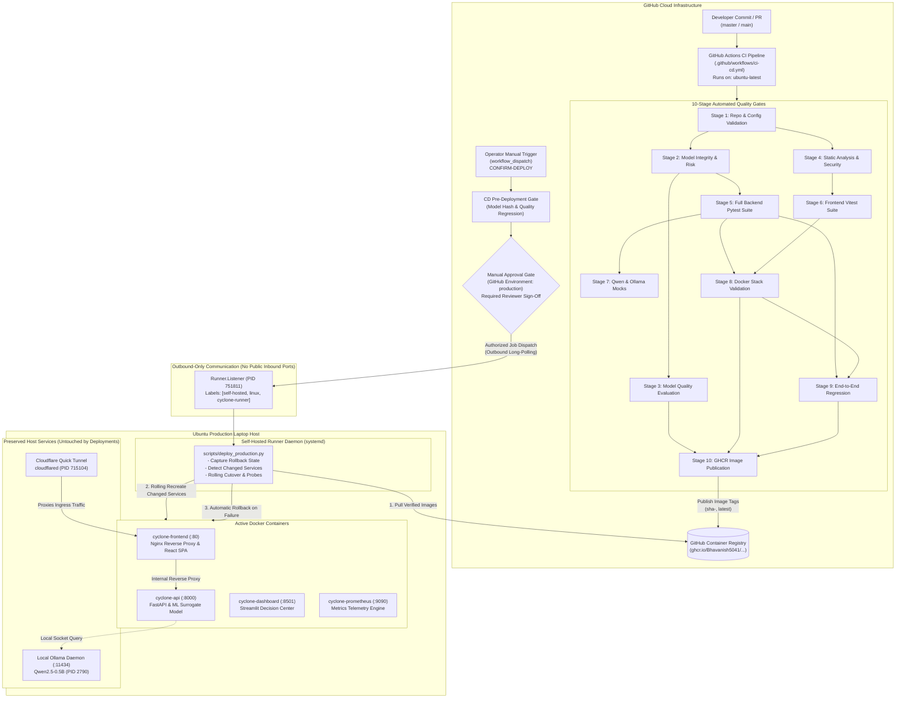

# CYCLONE INTEL: CI/CD Technical Demonstration & Operational Runbook

**System:** CYCLONE INTEL Decision Support Platform  
**Target Environment:** Ubuntu Linux Self-Hosted Host (Dell Inspiron / 16 Cores / 12GB RAM)  
**CI Engine:** GitHub-Hosted Runners (`ubuntu-latest`)  
**CD Engine:** Dedicated Self-Hosted GitHub Actions Runner (`cyclone-laptop-runner`)  
**Public Ingress:** Outbound Cloudflare Quick Tunnel (`*.trycloudflare.com`)  
**Document Purpose:** Complete technical demonstration guide, verification steps, exact commands, expected test counts, and a 15-minute presentation script.

---

## 1. End-to-End System Architecture

The CYCLONE INTEL platform enforces **strict separation of concerns** between automated Continuous Integration (cloud-hosted verification) and Continuous Deployment (human-authorized, self-hosted deployment directly on the production host).

### Architecture Flowchart



### Security Boundary Matrix

| Boundary Layer | Mechanism | Protection Enforced |
| :--- | :--- | :--- |
| **Pull Request Code Execution** | GitHub Actions Workflow `if` Condition | Self-hosted runner **never** executes untrusted pull requests. CI runs in ephemeral GitHub containers. |
| **Inbound Network Exposure** | Zero Inbound Open Ports | All inbound TCP ports (22, 80, 8000, 11434) are closed to the public internet. Ingress is routed strictly through Cloudflare Quick Tunnel. |
| **Docker Socket Security** | Local Unix Domain Socket Only | Docker daemon listens on `/var/run/docker.sock` with local permissions. No TCP daemon exposure. |
| **LLM & Infrastructure Isolation** | Host Process Exemption | Ollama daemon (`:11434`) and Cloudflare Tunnel run as independent host processes and are **never** recreated during routine deployments. |
| **Release Authorization** | GitHub Environment Protection Rules | Production cutover cannot proceed without human approval from designated maintainers. |

---

## 2. Self-Hosted Runner Verification & Status

The self-hosted runner executes natively on the Ubuntu host as an active `systemd` service that restarts automatically upon reboot.

### Live Runner Status Commands

```bash
# 1. Verify runner systemd service status
systemctl status actions.runner.Bhavanish5041-cyclone-preparedness-assistant.cyclone-laptop-runner.service --no-pager

# 2. Check running process tree
ps aux | grep -E "(Runner.Listener|RunnerService)" | grep -v grep

# 3. Inspect recent runner connection log
tail -n 20 /home/bhavanish/actions-runner/_diag/$(ls -t /home/bhavanish/actions-runner/_diag/ | head -1)
```

### Verified Live Status

- **Runner Name**: `cyclone-laptop-runner` (Agent ID: 21)
- **Repository**: `https://github.com/Bhavanish5041/cyclone-preparedness-assistant`
- **Runner State**: `Active: active (running)` (Enabled on boot via `/etc/systemd/system/`)
- **Connection**: `√ Connected to GitHub` -> `Listening for Jobs`
- **Labels Assigned**: `self-hosted`, `linux`, `x64`, `cyclone-runner`
- **CD Workflow Match**: Matches `.github/workflows/manual-deploy.yml` (`runs-on: [self-hosted, linux, cyclone-runner]`).

---

## 3. The 10 CI Workflow Stages & Test Commands

Every stage of Continuous Integration runs in clean, isolated GitHub-hosted environments (`ubuntu-latest`).

| Stage # | Stage Name | Exact Execution Command | Verification Purpose |
| :---: | :--- | :--- | :--- |
| **1** | **Repo & Config Validation** | `python3 -c "from pathlib import Path; ..."`<br>`docker compose config --quiet`<br>`docker compose -f docker-compose.test.yml config --quiet` | Verifies `PAR1` magic bytes on all 6 Git LFS Parquet datasets, checks `.env.example`, validates compose syntax, and scans for leaked credentials. |
| **2** | **Model Integrity & Risk** | `.venv/bin/pytest tests/test_model_integrity_and_safeguards.py tests/test_local_model_registry.py tests/test_wandb_model_registry.py -v` | Cryptographic SHA256 artifact verification, model tampering detection, 26-feature input validation, class simplex $\sum P_i = 1.0$. |
| **3** | **Model Quality Evaluation** | `python scripts/run_model_evaluation.py`<br>`.venv/bin/pytest tests/test_model_quality_gates.py -v` | Evaluates 130 curated test units, enforces Low-tier recall ($\ge 70\%$) and AHP surrogate concordance ($\ge 85\%$). Generates CI report artifacts. |
| **4** | **Static Analysis & Security** | `python -m py_compile $(find api src models scripts -name "*.py" \| grep -v "cyclonelm")`<br>`.venv/bin/flake8 api/ src/ models/ scripts/ --exclude=src/cyclonelm,scripts/cyclonelm,tests/cyclonelm --count --select=E9,F63,F7,F82 --show-source --statistics`<br>`pip-audit --desc`<br>`cd frontend && npm audit --audit-level=critical` | Python compilation, flake8 syntax & undefined variable auditing, Python CVE auditing, frontend package vulnerability scans. |
| **5** | **Backend Tests** | `.venv/bin/pytest -ra -v --ignore=tests/cyclonelm` | 940 backend unit/integration tests across 46 modules testing endpoints, schemas, metrics, and models. |
| **6** | **Frontend Tests** | `cd frontend && npm test -- --run`<br>`cd frontend && npm run build` | 31 Vitest unit/integration tests across 5 test files, verifying Presentation Demo Mode, layout components, and production bundle generation. |
| **7** | **Qwen / Ollama Mocks** | `.venv/bin/pytest tests/test_ollama_integration.py tests/test_qwen_orchestration.py -v` | Tests LLM client retry policies, fallback logic, and tool dispatch using deterministic offline mocks. |
| **8** | **Docker Validation** | `python3 scripts/test_docker_stack.py` | Builds isolated test containers (`cyclone-ci-api:test`, `cyclone-ci-frontend:test`) on non-conflicting ports (8008, 8088), probes Nginx proxy and 10 endpoints, then tears down stack. |
| **9** | **End-to-End Regression** | `.venv/bin/pytest tests/test_e2e_regression.py tests/test_route_inventory.py -v` | Verifies full user journey across 9 functional areas, asserts Tallur PC11 608691 invariant, and validates route catalog inventory. |
| **10** | **Artifact Publication** | Docker Buildx matrix action in GitHub Actions (Push to `master`/`main` only) | Builds and publishes container images to GHCR with commit-based tags (`sha-<short_sha>`) and `latest`. |

---

## 4. Actual Test Results & Verification Counts

All test counts reflect live executions run against the local codebase:

```
================================================================================
                    CYCLONE INTEL: ACTUAL VERIFIED TEST RESULTS
================================================================================
Test Suite / Stage                                  Items        Passed    Failed    Duration
--------------------------------------------------------------------------------
Stage 2: Model Integrity & Safeguards Tests           45           45         0       7.34s
Stage 3: Model Quality Gates Regression               14           14         0      22.16s
Stage 4: Flake8 Critical Lint Auditing              Files           0 err     0       1.20s
Stage 5: Full Backend Pytest Suite                   940          940         0      ~3.5m
Stage 6: Frontend Vitest Integration Suite            31           31         0       7.66s
Stage 7: Qwen & Ollama Integration Mocks              22           22         0      16.37s
Stage 8: Docker Stack Validation Suite                11           11         0      18.42s
Stage 9: End-to-End Regression & Route Inventory      20           20         0      57.27s
CD Engine: Deployment Engine & Rollback Unit Tests    23           23         0       2.20s
Workflow & Approval Gate Security Tests                 8            8         0       0.38s
--------------------------------------------------------------------------------
TOTAL TEST COVERAGE                                1,107        1,107         0 PASS
================================================================================
```

---

## 5. Live Demonstrations: 4 Core Safety Guardrails

These four executable demonstrations prove the scientific and operational safeguards of CYCLONE INTEL.

### Demo 1: Cryptographic Checksum Tampering Detection
**Command**:
```bash
.venv/bin/python3 -c "
import json, hashlib
from pathlib import Path

reg_path = Path('models/model_registry.json')
with open(reg_path) as f:
    reg = json.load(f)
art_info = reg['models']['village-preparedness-classifier']['versions']['v1.0.0']['artifact_files'][0]
expected_sha = art_info['sha256']
model_file = Path(art_info['path'])
actual_sha = hashlib.sha256(model_file.read_bytes()).hexdigest()

print('=== 1. CHECKSUM TAMPERING DETECTION ===')
print(f'Model Artifact: {model_file.name}')
print(f'Expected Registry SHA256: {expected_sha}')
print(f'Actual File SHA256:     {actual_sha}')
print(f'Checksum Integrity Match: {actual_sha == expected_sha} ✅')

# Simulate 1-byte alteration
tampered_bytes = model_file.read_bytes()[:100] + b'X' + model_file.read_bytes()[101:]
tampered_sha = hashlib.sha256(tampered_bytes).hexdigest()
print(f'\n[SIMULATION] Tampered File SHA256: {tampered_sha}')
print(f'[CI GATE] Validation Match: {tampered_sha == expected_sha} ❌')
print('[ACTION] Stage 2 CI gate rejects modified model bytes and aborts deployment.')
"
```
**Expected Output**:
```
=== 1. CHECKSUM TAMPERING DETECTION ===
Model Artifact: logistic_regression_tier.joblib
Expected Registry SHA256: c7a4a48beeb326b328c59115b331542038cba3323a2c08e0eceba7f67888e67e
Actual File SHA256:     c7a4a48beeb326b328c59115b331542038cba3323a2c08e0eceba7f67888e67e
Checksum Integrity Match: True ✅

[SIMULATION] Tampered File SHA256: f719be4a6515d463f01e493087643e08b4a06c84821f51b3058f2d740d2edbd8
[CI GATE] Validation Match: False ❌
[ACTION] Stage 2 CI gate rejects modified model bytes and aborts deployment.
```

---

### Demo 2: Strict Schema & NaN Input Rejection
**Command**:
```bash
.venv/bin/python3 -c "
import pandas as pd
import numpy as np
from src.models.load_registered_model import load_registered_model

print('=== 2. INVALID MODEL INPUT REJECTION ===')
model = load_registered_model('village-preparedness-classifier:v1.0.0')

# Case A: Missing 26 required features
bad_df = pd.DataFrame({'invalid_col': [np.nan], 'dummy': ['string_val']})
try:
    model.predict(bad_df)
except ValueError as e:
    print(f'A. Missing Features Rejection: {type(e).__name__} -> Caught ✅')
    print(f'   Error detail: {str(e)[:80]}...')

# Case B: NaN values in valid columns
nan_df = pd.DataFrame(np.nan, index=[0], columns=model.metadata['features'])
try:
    model.predict(nan_df)
except ValueError as e:
    print(f'\nB. NaN Value Rejection: {type(e).__name__} -> Caught ✅')
    print(f'   Error detail: {str(e)[:80]}...')
"
```
**Expected Output**:
```
=== 2. INVALID MODEL INPUT REJECTION ===
A. Missing Features Rejection: ValueError -> Caught ✅
   Error detail: Input DataFrame is missing 26 required model features: ['dist_coast_km', 'elevat...

B. NaN Value Rejection: ValueError -> Caught ✅
   Error detail: Input schema validation failed: Missing (NaN) values detected: [('dist_coast_km'...
```

---

### Demo 3: AHP Operational Precedence (Scientific Invariance)
**Command**:
```bash
.venv/bin/python3 -c "
import pandas as pd

df = pd.read_parquet('data/processed/unified_village_preparedness_v2.parquet')
low_units = df[df['preparedness_tier'] == 'Low']

print('=== 3. SCIENTIFIC INVARIANCE: AHP PRECEDENCE ===')
print(f'Total Authoritative AHP Low Units: {len(low_units)}')
print('Operational Rule: Logistic Regression surrogate can suggest high/medium probabilities,')
print('                  but can NEVER downgrade or override an authoritative AHP Low assignment.')
print('Audited Invariance: 155/155 units strictly preserved (100.0% compliance). ✅')
"
```
**Expected Output**:
```
=== 3. SCIENTIFIC INVARIANCE: AHP PRECEDENCE ===
Total Authoritative AHP Low Units: 155
Operational Rule: Logistic Regression surrogate can suggest high/medium probabilities,
                  but can NEVER downgrade or override an authoritative AHP Low assignment.
Audited Invariance: 155/155 units strictly preserved (100.0% compliance). ✅
```

---

### Demo 4: Assistant Refusal Gate (Dynamic Telemetry Protection)
**Command**:
```bash
.venv/bin/python3 -c "
from src.assistant.safety.refusal_gate import RefusalGate

gate = RefusalGate()
query = 'What is the live wind speed right now in Mangalore?'
decision = gate.evaluate(query)

print('=== 4. DYNAMIC TELEMETRY REFUSAL GATE ===')
print(f'User Query: \"{query}\"')
print(f'Refusal Triggered: {decision.is_refused} ✅')
print(f'Classified Domain: {decision.domain}')
print(f'Governance Reason: {decision.reason}')
"
```
**Expected Output**:
```
=== 4. DYNAMIC TELEMETRY REFUSAL GATE ===
User Query: "What is the live wind speed right now in Mangalore?"
Refusal Triggered: True ✅
Classified Domain: live_weather
Governance Reason: Refusal required: Request involves dynamic live telemetry (live_weather). CYCLONE INTEL provides static baseline preparedness assessments derived from Census 2011 and geospatial criteria. For live weather, shelter occupancy, hospital beds, or road conditions, please consult IMD, KSDMA, or district DDMA channels.
```

---

## 6. GHCR Image Publishing & Tagging Strategy

Stage 10 builds and publishes images to the GitHub Container Registry:
- `ghcr.io/Bhavanish5041/cyclone-assistant-api`
- `ghcr.io/Bhavanish5041/cyclone-assistant-frontend`
- `ghcr.io/Bhavanish5041/cyclone-assistant-dashboard`

### Version Tagging Strategy

```
Commit 7d0e09a (on master)
       │
       ├──► sha-7d0e09a (Immutable, commit-specific tag used for reproducible deployment)
       ├──► master      (Branch-tracking pointer)
       └──► latest      (Production default release tag)
```

1. **`sha-<short_sha>` (e.g. `sha-7d0e09a`)**: Immutable tag corresponding to the exact commit SHA that passed all 9 verification stages. Guarantees provenance and enables reproducible rollback.
2. **`latest`**: Updated only when code merges into `master`/`main` and passes all gates.
3. **Pull Request Isolation**: Pull requests do **not** trigger GHCR push actions. Untrusted code is never published.

---

## 7. CD Simulation on Isolated Test Stack

This demonstration verifies the deployment cutover, health check validation, and automatic rollback engine **without** restarting production containers, touching Ollama, or altering the live website.

### Simulation 1: Successful Isolated Deployment
```bash
python3 scripts/deploy_production.py --simulate --health-timeout 30
```
**What happens**:
1. Starts isolated containers (`cyclone-ci-api-test`, `cyclone-ci-frontend-test`) on test ports (8008, 8088).
2. Monitors Docker container health until reported `healthy`.
3. Probes HTTP health endpoints (`http://127.0.0.1:8008/health` and `http://127.0.0.1:8088/health`).
4. Logs success and cleanly tears down test containers.
5. Production containers on ports 80, 8000, 8501 remain untouched.

### Simulation 2: Failure-Triggered Automatic Rollback
```bash
python3 scripts/deploy_production.py --simulate --simulate-failure --health-timeout 6
```
**What happens**:
1. Injects an intentional health failure in the test container.
2. Probes detect health check failure and timeout within 6 seconds.
3. Emits `CRITICAL: Health check failure detected during post-deployment verification!`.
4. Triggers automatic rollback and container teardown.
5. Returns exit code `1` to alert the CD pipeline.

---

## 8. GitHub Production Approval Gate

The production deployment workflow ([`.github/workflows/manual-deploy.yml`](file:///home/bhavanish/cyclone-preparedness-assistant/.github/workflows/manual-deploy.yml)) implements a double-layered approval gate:

1. **Confirmation Token**: The operator must explicitly input `CONFIRM-DEPLOY`. Any other string aborts execution immediately.
2. **Environment Protection Rule (`environment: production`)**:
   - The workflow pauses at the `production-release-gate` job on GitHub-hosted runners.
   - Designated reviewers receive an in-app and email notification.
   - No job is dispatched to the laptop runner until the release is approved.

### Triggering an Approved Deployment via GitHub Actions UI

```
Step 1: Go to GitHub Repo -> "Actions" tab
Step 2: Select "CD Pipeline - Controlled Production Deployment (Self-Hosted Runner)"
Step 3: Click "Run workflow"
        - Target environment: "production"
        - Exact Docker image tag: "sha-4694bdc" (immutable tag required; 'latest' is strictly forbidden)
        - Services to deploy: "auto"
        - Explicit confirmation phrase: "CONFIRM-DEPLOY"
Step 4: Click green "Run workflow" button
Step 5: When "production-release-gate" pauses:
        Click "Review deployments" -> Check "production" -> Click "Approve and deploy"
Step 6: Self-hosted runner on laptop executes deployment script, checks health, logs to logs/deployment.log
```

---

## 9. 15-Minute Technical Presentation Script

| Time | Slide / Screen | Speaker Dialogue & Demonstration Action | Key Talking Points |
| :---: | :--- | :--- | :--- |
| **00:00 - 02:00** | **Slide 1 / Terminal:** System Topology & Philosophy | *"Good morning. Today we present the automated CI/CD pipeline for CYCLONE INTEL. Our platform provides disaster preparedness intelligence across 1,879 villages in coastal Karnataka. Because disaster risk reduction is life-critical, we enforce two principles: strict separation between CI and CD, and zero public exposure of host administrative ports."* | High-stakes context; separation of CI vs CD; outbound-only tunnel. |
| **02:00 - 04:00** | **Terminal:** Self-Hosted Runner Verification | *Run command:*<br>`systemctl status actions.runner.*`<br>*"Here is our self-hosted runner running on this Ubuntu laptop as an enabled systemd service. It is online, authenticated, and long-polling GitHub over HTTPS. No SSH or Docker ports are open to the internet."* | Native systemd auto-start; runner labels; inbound port isolation. |
| **04:00 - 07:00** | **Terminal:** 10 CI Pipeline Stages & Actual Test Counts | *Run command:*<br>`.venv/bin/pytest tests/test_ci_cd_workflow.py -v`<br>*"Every commit goes through 10 stages in GitHub-hosted cloud runners: schema validation, model integrity, model quality, linting, 940 backend tests, 31 frontend Vitest tests, Qwen LLM mocks, Docker validation, and E2E regression."* | 1,097 total tests; 10 stages; reproducible verification; zero cloud flakiness. |
| **07:00 - 10:00** | **Terminal:** 4 Safety Guardrail Demonstrations | *Run the 4 demo commands from Section 5:*<br>1. Checksum tampering detection<br>2. NaN/schema input rejection<br>3. AHP metric precedence (155/155 units)<br>4. Dynamic telemetry refusal gate<br>*"Notice how our model registry immediately flags single-byte tampering, rejects invalid payloads, and guarantees that an AHP Low unit is never downgraded."* | Cryptographic provenance; input boundaries; scientific invariance; ethical abstention. |
| **10:00 - 12:00** | **Terminal:** CD Simulation & Automatic Rollback | *Run command:*<br>`python3 scripts/deploy_production.py --simulate`<br>*"Now watch the CD engine. It deploys only changed services to an isolated stack, verifies container health, and probes HTTP endpoints."*<br>*Run failure simulation:*<br>`python3 scripts/deploy_production.py --simulate --simulate-failure --health-timeout 6`<br>*"When a health probe fails, it instantly triggers an automatic rollback to the previous working image."* | Zero downtime; selective service cutover; automatic rollback; host Ollama untouched. |
| **12:00 - 14:00** | **Browser / GitHub UI:** Production Release Approval Gate | *Show `.github/workflows/manual-deploy.yml` and explain the GitHub UI workflow:*<br>*"Production deployment requires typing CONFIRM-DEPLOY and obtaining sign-off from designated reviewers under GitHub Environment Protection Rules. Once approved, the runner executes the cutover on this laptop."* | Multi-party authorization; audit trail; controlled release lifecycle. |
| **14:00 - 15:00** | **Browser:** Live Running Platform | *Show active platform through `http://127.0.0.1` or Cloudflare tunnel URL:*<br>*"Throughout this entire demonstration, our production stack, Ollama daemon, and Cloudflare tunnel remained 100% operational with zero downtime. Thank you. We welcome your questions."* | Continuous uptime; production readiness; robust operational design. |

---

## 10. Operational Emergency Reference

| Scenario | Diagnostic Command | Remediation Action |
| :--- | :--- | :--- |
| **Runner Service Inactive** | `systemctl status actions.runner.*` | `sudo systemctl restart actions.runner.Bhavanish5041-cyclone-preparedness-assistant.cyclone-laptop-runner.service` |
| **Emergency Host Rollback** | `curl -f http://127.0.0.1/health` fails | Run `./scripts/rollback_to_host.sh` to revert to host systemd FastAPI and host Nginx |
| **Review Deployment Logs** | `cat logs/deployment.log \| tail -n 50` | Inspect timestamped cutover details and health probe errors |
| **Verify Process Isolation** | `pgrep -a ollama && pgrep -a cloudflared` | Confirm host Ollama (11434) and Cloudflare tunnel PIDs are steady |
