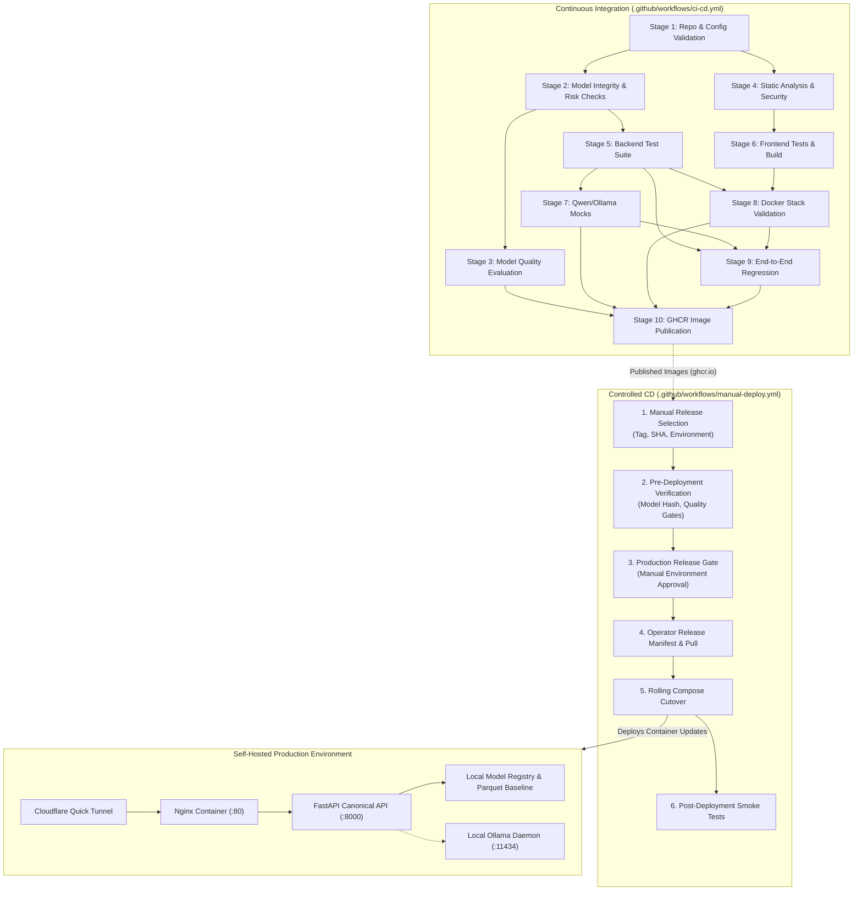

# CYCLONE INTEL: CI/CD Pipeline Architecture & Operational Guide

## 1. Architectural Overview & Design Philosophy

The CYCLONE INTEL platform provides critical decision support for cyclone preparedness across 1,879 administrative units in coastal Karnataka (Dakshina Kannada, Udupi, and Uttara Kannada). Due to the high-stakes humanitarian nature of disaster risk reduction, the engineering architecture enforces:

1. **Strict Separation of CI and CD**: Continuous Integration validates code, model schemas, statistical quality, and container artifacts. Continuous Deployment is strictly gated, requiring manual authorization, verified image tags, and human operator confirmation.
2. **Scientific Invariance Enforcement**: The Analytical Hierarchy Process (AHP) composite metric maintains absolute operational authority. Logistic Regression functions strictly as an empirical AHP-tier surrogate and must never downgrade an authoritative AHP Low classification.
3. **Boundary-Preserving Security**: The production stack is self-hosted on a secured local host and proxied to disaster management stakeholders via an outbound Cloudflare Quick Tunnel (`*.trycloudflare.com`). No inbound SSH or Docker daemon ports are exposed to GitHub Actions runners.
4. **Offline Resilience & Mock Decoupling**: Routine CI operates entirely using deterministic tools and lightweight mocks for large language models (Qwen2.5-0.5B / Ollama), eliminating multi-gigabyte weight downloads and non-deterministic cloud flakiness during routine verification.

---

## 2. Trigger Matrix: CI vs. CD Workflows

| Workflow | File Path | Triggers | Automation Level | Purpose |
| :--- | :--- | :--- | :--- | :--- |
| **Continuous Integration** | `.github/workflows/ci-cd.yml` | `push` (master, main) `pull_request` (master, main) `workflow_dispatch` | Fully Automated | Validates code quality, model integrity, quality gates, full test suites, Docker stacks, and publishes versioned images. |
| **Controlled Deployment** | `.github/workflows/manual-deploy.yml` | `workflow_dispatch` ONLY | Manual & Human-Gated | Validates deployment parameters, checks target health, enforces environment approval, and coordinates zero-downtime cutover. |
| **Qwen Integration** | `.github/workflows/qwen-integration.yml` | `workflow_dispatch` ONLY | Manual on Demand | Downloads Ollama daemon and pulls `qwen2.5:0.5b-instruct` to verify live LLM generation latency and token throughput. |

---

## 3. The 10 CI Pipeline Stages

### Stage 1: Repository & Configuration Validation
- **Dependencies:** None (root stage).
- **Environment:** Ubuntu Latest, Python 3.14, Node.js 22.
- **Verification Tasks:**
  1. Git LFS integrity: verifies `PAR1` magic bytes on all 6 core parquet datasets.
  2. Environment configuration schema validation (`.env.example`).
  3. Docker Compose configuration syntax (`docker compose config --quiet`).
  4. GitHub Actions workflow syntax validation across all YAML files.
  5. Automated secret scanning to guarantee zero committed access keys, private keys, or personal tokens.

### Stage 2: Model Integrity & Model Risk Checks
- **Dependencies:** `stage-1-repo-config-validation`
- **Verification Tasks:**
  1. Local Model Registry schema validity (`models/model_registry.json`).
  2. Cryptographic SHA256 verification of serialized model pipelines and encoders.
  3. Model tampering detection: verifies that corrupting artifact bytes triggers validation failure.
  4. Model artifact loading, versioning (`v1.0.0`), and surrogate provenance.
  5. Strict 26-feature input schema verification and column permutation invariance.
  6. Rejection of NaNs, infinities, non-numeric values, and non-DataFrame payloads.
  7. Output prediction schema and class probability simplex verification ($\sum P_i = 1.0$).
  8. Promotion and emergency rollback lifecycle in isolated registry copies.
  9. Preservation of all 155 authoritative AHP Low units (100% non-downgrading compliance).
  10. Verification of 622 descriptive K-Means coastal units and 1,257 unassigned Uttara Kannada units.

### Stage 3: Model Quality Evaluation
- **Dependencies:** `stage-2-model-integrity-and-risk`
- **Verification Tasks:**
  1. Executes `src/evaluation/model_quality_pipeline.py` across 130 curated test cases and 282 held-out test units.
  2. Computes test accuracy, macro F1, weighted F1, per-class precision/recall, and confusion matrix.
  3. Verifies low-tier recall ($\ge 70\%$) and AHP surrogate concordance ($\ge 85\%$).
  4. Computes conversational intent accuracy, tool argument correctness, and multi-intent completeness.
  5. Verifies zero unsupported claims/hallucinations ($0.0\%$) and $100\%$ refusal precision/recall.
  6. Profiles disaggregated CPU latency: deterministic pipeline $<250\text{ ms}$, deterministic tool $<10\text{ ms}$.
  7. Publishes `reports/model_quality_report.json` and `reports/model_quality_summary.md` as CI artifacts.

### Stage 4: Static Analysis & Security
- **Dependencies:** `stage-1-repo-config-validation`
- **Verification Tasks:**
  1. Python bytecode compilation (`python -m py_compile`) across all non-research source files.
  2. Python linting (`flake8`) for syntax errors, undefined names, and critical style regressions.
  3. Python dependency vulnerability audit (`pip-audit`).
  4. Frontend TypeScript strict compilation (`tsc -b`).
  5. Production frontend bundle build (`vite build`).
  6. Frontend package dependency audit (`npm audit`).

### Stage 5: Full Backend Test Suite
- **Dependencies:** `stage-2-model-integrity-and-risk`
- **Verification Tasks:**
  1. Runs complete backend test suite: 543 unit and integration tests across 43 test modules.
  2. Tests FastAPI endpoints, Pydantic contracts, decision engine algorithms, and Prometheus metrics.
  3. Excludes experimental CycloneLM research dependencies to ensure deterministic CI runs.

### Stage 6: Frontend Tests
- **Dependencies:** `stage-4-static-analysis-and-security`
- **Verification Tasks:**
  1. Executes Vitest component, layout, and page test suites.
  2. Validates interactive Presentation Demo Mode: step progression, Tallur dossier inspection, and sample prompts.
  3. Tests error boundaries and loading fallbacks.

### Stage 7: Qwen & Ollama Integration (Mocks in CI)
- **Dependencies:** `stage-5-backend-tests`
- **Verification Tasks:**
  1. Runs `tests/test_ollama_integration.py` and `tests/test_qwen_orchestration.py`.
  2. Validates client timeout handling, connection retries, and deterministic fallback routines using isolated mocks.

### Stage 8: Docker Validation (Isolated Test Stack)
- **Dependencies:** `stage-5-backend-tests`, `stage-6-frontend-tests`
- **Verification Tasks:**
  1. Builds isolated images (`cyclone-ci-api:test`, `cyclone-ci-frontend:test`).
  2. Starts dedicated test Compose project (`cyclone-ci-test`) on isolated ports (8088, 8008).
  3. Validates container healthchecks, Nginx static asset serving, and reverse proxy routing to FastAPI.
  4. Probes representative endpoints: `/health`, `/ready`, `/api/dashboard/overview`, `/api/communities`, `/docs`.
  5. Completely tears down test stack and networks (`docker compose down -v`).
  6. Never impacts running host or production containers.

### Stage 9: End-to-End Regression & Route Inventory
- **Dependencies:** `stage-5-backend-tests`, `stage-7-qwen-ollama-mocks`, `stage-8-docker-validation`
- **Verification Tasks:**
  1. Executes `tests/test_e2e_regression.py` validating the 9 core functional modules.
  2. Asserts the Tallur PC11 608691 invariant: AHP score 74.34, High tier, Priority Band 4.
  3. Executes `tests/test_route_inventory.py` to prevent documentation drift between live routes and API catalog.

### Stage 10: Artifact Publication to GHCR
- **Dependencies:** `stage-3-model-quality-evaluation`, `stage-7-qwen-ollama-mocks`, `stage-8-docker-validation`, `stage-9-e2e-regression`
- **Execution Condition:** Push to `master` or `main` (not on PRs).
- **Verification Tasks:**
  1. Seeds offline W&B cache for API container.
  2. Normalizes repository owner to lowercase per Docker OCI specification.
  3. Tags container images with Git commit SHA (`sha-<short_sha>`) and `latest`.
  4. Pushes `cyclone-assistant-api`, `cyclone-assistant-frontend`, and `cyclone-assistant-dashboard` to GitHub Container Registry.
  5. Emphasizes operational boundary: publishing images does NOT trigger automatic deployment.

---

## 4. Controlled Continuous Deployment (CD) Architecture

### Deployment Topology & Security Guardrails
The production CYCLONE INTEL platform is deployed on a dedicated self-hosted Linux host and published via Cloudflare Quick Tunnel:
- **Outbound Tunnel Only**: Traffic reaches the platform strictly through outbound Cloudflare Quick Tunnel (`*.trycloudflare.com`). No inbound SSH, TCP ports (80, 8000, 11434), or Docker sockets are exposed publicly.
- **Dedicated Self-Hosted Runner**: Installed in `/home/bhavanish/actions-runner` with labels `[self-hosted, linux, cyclone-runner]` and configured for automatic startup on system reboot via systemd.
- **Strict PR Isolation**: The runner NEVER executes untrusted pull-request code. CD is gated strictly to `workflow_dispatch` initiated by repository maintainers on the authoritative repository (`Bhavanish5041/cyclone-preparedness-assistant`).
- **Ollama and Cloudflare Tunnel Isolation**: Host Ollama (`:11434`) and Cloudflare tunnel processes are completely excluded from deployment cutovers, ensuring zero LLM disruption or public tunnel flapping.

### CD Workflow Execution Sequence (`.github/workflows/manual-deploy.yml`)
1. **Explicit Dispatch**: Operator triggers deployment via GitHub Actions UI with target environment (`production`), image tag (`sha-<sha>`), and confirmation phrase (`CONFIRM-DEPLOY`).
2. **Pre-Deployment Gate (GitHub-Hosted)**: Workflow checks out target commit, verifies model registry hashes, runs model quality gates regression, and validates parameters.
3. **Manual Approval Gate**: GitHub Actions enforces Environment Protection Rules (`environment: production`), halting execution until the designated reviewer signs off in the GitHub UI.
4. **Automated Cutover Engine (Self-Hosted Runner)**:
   - Captures previous container image IDs and states to `/tmp/cyclone_deploy_rollback_state.json`.
   - Detects changed services (`api`, `frontend`, `dashboard`) via commit diff or explicit parameter.
   - Pulls verified images from GitHub Container Registry (`ghcr.io/Bhavanish5041/...`).
   - Executes zero-downtime rolling restart via `docker compose up -d --no-deps <changed-services>`.
   - Conducts multi-layer health probes (Docker container health + HTTP `/health` checks).
   - If any health check fails or times out: automatically executes immediate rollback to previous working images and exits with failure.
   - Records timestamped deployment audit records to `logs/deployment.log`.
5. **Post-Deployment Smoke Tests**: If the public tunnel URL is provided, workflow executes automated post-deployment smoke tests against the live public URL.
