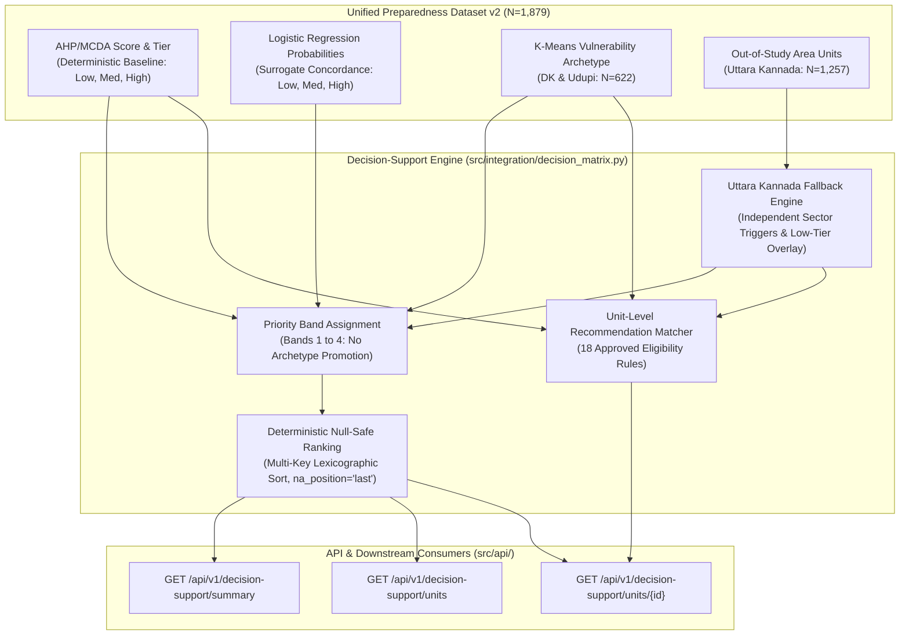

# CYCLONE INTEL: Spatial Decision Support Engine Specification

## Executive Summary

This document details the architectural design, algorithmic implementation, empirical validation, and operational data contracts for the **CYCLONE INTEL Decision-Support Engine** (`src/integration/decision_matrix.py` and `src/assistant/decision_support.py`).

The decision-support engine synthesizes three analytical frameworks—deterministic AHP/MCDA preparedness scoring, surrogate Multinomial Logistic Regression classification, and K-Means vulnerability archetypes—into an explainable, operational decision-support system covering all 1,879 administrative units of coastal Karnataka (Dakshina Kannada: 369, Udupi: 253, and Uttara Kannada: 1,257).

---

## 1. System Architecture & Data Flow



### Core Methodological Principles

1. **Deterministic Primacy of AHP Scores:**  
   The inherited Analytic Hierarchy Process (AHP/MCDA) preparedness tier (`Low` $< 40.0$, `Medium` $40.0 \le \text{score} < 60.0$, `High` $\ge 60.0$) remains the primary, deterministic authority. The Logistic Regression model is treated strictly as an uncalibrated surrogate classifier for detecting borderline cases and concordance, not as a physical probability of cyclone disaster risk.

2. **Strict Elimination of Automatic Archetype Promotion:**  
   As established in the approved Milestone 3A specification revision, K-Means archetype membership does **not** independently promote units into higher priority bands. For all administrative units in Dakshina Kannada and Udupi, Medium-tier Band 2 eligibility is governed strictly by unit-level sector deficit triggers:
   $$\text{Band 2 Eligibility} \iff \text{preparedness\_tier} == \text{'Medium'} \land (\text{dist\_coast\_km} < 5.0 \lor \text{score\_shelters} < 20.0 \lor \text{score\_medical} < 35.0)$$
   Archetype traits provide descriptive contextual commentary in narrative explanations and never substitute for unit-level empirical evidence.

3. **Strict Spatial Boundary Enforcement (Zero Extrapolation):**  
   The K-Means vulnerability archetypes were derived exclusively from 622 administrative units across Dakshina Kannada (369) and Udupi (253). These archetypes are **never** imputed, extrapolated, or assigned to the 1,257 administrative units of Uttara Kannada. All Uttara Kannada records maintain `cluster_assignment_status = "UNASSIGNED_OUT_OF_STUDY_AREA"`.

4. **Separation of Individual Evidence and Archetype Context:**  
   Recommendations are attached exclusively when unit-specific empirical indicators meet explicit threshold conditions.

---

## 2. Priority Band Definitions & Reconciled Census

Every administrative unit is classified into one of four mutually exclusive, collectively exhaustive priority bands:

| Priority Band | Operational Definition | Total Units | Dakshina Kannada | Udupi | Uttara Kannada |
| :--- | :--- | :---: | :---: | :---: | :---: |
| **`BAND_1_CRITICAL`** | AHP Low preparedness tier (`preparedness_score < 40.0`). Urgent baseline intervention review recommended. | **155** | 2 | 0 | 153 |
| **`BAND_2_SPECIALIZED`** | AHP Medium tier (`40.0 <= score < 60.0`) **AND** $\ge 1$ individual sector deficit triggers (`dist_coast_km < 5.0`, `score_shelters < 20.0`, or `score_medical < 35.0`). | **829** | 123 | 20 | 686 |
| **`BAND_3_MODERATE`** | AHP Medium tier (`40.0 <= score < 60.0`) **WITHOUT** individual sector deficit triggers. | **299** | 45 | 43 | 211 |
| **`BAND_4_ADEQUATE`** | AHP High preparedness tier (`preparedness_score >= 60.0`). Standard monitoring and capacity preservation. | **596** | 199 | 190 | 207 |
| **TOTAL** | — | **1,879** | **369** | **253** | **1,257** |

### Investigation of the Band 1 District Allocation

The approved Milestone 3A text draft previously stated:
- Dakshina Kannada: 1
- Udupi: 1
- Uttara Kannada: 153

Comprehensive database and source-code auditing reveals that this was a clerical drafting error in the Milestone 3A report text. The empirical reality across all datasets (`modelling_dataset.parquet`, `unified_village_preparedness.parquet`, `unified_village_preparedness_v2.parquet`) is:
- **Dakshina Kannada: 2 units** with `preparedness_score < 40.0`:
  1. `11-29-575-05565-803186`: `Sulya (TP)` in Sulya subdistrict, score = **39.31**, tier = Low.
  2. `11-29-575-05564-617728`: `Kodimbala` in Kadaba subdistrict, score = **38.44**, tier = Low.
- **Udupi: 0 units** with `preparedness_score < 40.0`. Across all 253 units in Udupi, the minimum preparedness score is **46.66** (`11-29-569-05524-803142`, `Medium` tier).
- **Uttara Kannada: 153 units** with `preparedness_score < 40.0`.

The Milestone 3A text author had attributed the score **38.44** (which belongs to `Kodimbala` in Kadaba taluk, Dakshina Kannada) to "Heroor" and placed it in Udupi. All three Heroor units in Udupi have scores between 55.44 and 71.86. The actual district count of 2 in DK, 0 in Udupi, and 153 in UK is verified 100% against the source datasets.

---

## 3. Uttara Kannada Multi-Trigger Fallback Accounting ($N=1,257$)

For the 1,257 units in Uttara Kannada lacking cluster assignments, prioritization and advisory generation operate through an empirical fallback engine based on sector-level infrastructure thresholds.

### Three Physical Sector Triggers

1. **Coastal Proximity Trigger:** `dist_coast_km < 5.0 km` (175 units)
2. **Shelter Deficit Trigger:** `score_shelters < 20.0` (710 units)
3. **Medical Remoteness Trigger:** `score_medical < 35.0` (278 units)

### Sector Trigger Overlap Distribution ($N=1,257$)

$$\begin{aligned}
\text{0 Sector Triggers} &= 289 \text{ units (23.0%)} \\
\text{1 Sector Trigger} &= 773 \text{ units (61.5%)} \\
\text{2 Sector Triggers} &= 195 \text{ units (15.5%)} \\
\text{3 Sector Triggers} &= 0 \text{ units (0.0%)}
\end{aligned}$$

| Active Sector Triggers | Count of Units | Percentage | Band 1 (Critical) | Band 2 (Specialized) | Band 3 (Moderate) | Band 4 (Adequate) |
| :---: | :---: | :---: | :---: | :---: | :---: | :---: |
| **0 Triggers** | **289** | 23.0% | 7 | 0 | 211 | 71 |
| **1 Trigger** | **773** | 61.5% | 94 | 550 | 0 | 129 |
| **2 Triggers** | **195** | 15.5% | 52 | 136 | 0 | 7 |
| **3 Triggers** | **0** | 0.0% | 0 | 0 | 0 | 0 |
| **TOTAL** | **1,257** | **100.0%** | **153** | **686** | **211** | **207** |

### Accounting for the 7 Zero-Sector Trigger, Low-Tier Units

Seven administrative units in Uttara Kannada exhibit zero active sector triggers ($\text{dist\_coast\_km} \ge 5.0$, $\text{score\_shelters} \ge 20.0$, $\text{score\_medical} \ge 35.0$) but fail the overall statutory baseline with an AHP preparedness score $< 40.0$:
1. **Bidoli** (`11-29-563-05466-602951`, score: 39.42)
2. **Kodthalli** (`11-29-563-05466-602970`, score: 39.54)
3. **Kudragod** (`11-29-563-05466-602983`, score: 39.29)
4. **Kendige** (`11-29-563-05466-603032`, score: 39.51)
5. **Shikliturli** (`11-29-563-05466-603046`, score: 39.36)
6. **Anegundi** (`11-29-563-05467-603403`, score: 39.29)
7. **Kerehittal** (`11-29-563-05467-603417`, score: 39.29)

**Statutory Fallback Policy:**
- These 7 units are assigned to **`BAND_1_CRITICAL`** based strictly on their deterministic AHP Low tier.
- They receive advisory `ADV_UK_BASELINE_LOW` and `ADV_UK_GENERAL_DEFICIT_REVIEW`.
- They are **strictly excluded** from `ADV_UK_ROUTINE`. Routine advisories are granted solely to the 282 zero-sector units in Medium (211) and High (71) tiers.

---

## 4. Deterministic Null-Safe Ranking Logic

To guarantee transparent, reproducible administrative prioritization without non-deterministic tie-break artifacts, sorting enforces a strict 4-key lexicographic hierarchy with `na_position='last'`:

$$\text{Sort Tuple} = \Big( \text{Band Order} \uparrow, \text{Preparedness Score} \uparrow, \min(\text{Shelter}, \text{Medical}) \uparrow, \text{Distance Coast} \uparrow, \text{Shrid2} \uparrow \Big)$$

- **Contiguous Ranks:** Overall rank spans strictly $1 \dots 1,879$.
- **Per-Band Ranks:** Reset per band ($1 \dots 155$, $1 \dots 829$, $1 \dots 299$, $1 \dots 596$).
- **Null Safety:** Missing or unranked values are reliably placed at the end without halting execution.

---

## 5. Approved Advisory Catalog & Eligibility Matrix

The system enforces the 18 approved operational advisories plus 1 incomplete data advisory:

### Cluster Assigned Advisories (Dakshina Kannada & Udupi, $N=622$)

| Directive ID | Focus Area | Classification | Exact Eligibility Rule |
| :--- | :--- | :---: | :--- |
| `ADV_0_DRAINAGE_INFRA` | Urban Drainage Inspection | `INDIVIDUAL_EVIDENCE` | `arch == 0 and score_infrastructure < 50.0` |
| `ADV_0_POP_DENSITY` | High-Density Transit Alert | `INDIVIDUAL_EVIDENCE` | `arch == 0 and (pop_density_sqkm > 1000.0 or unit_type == 'TOWN')` |
| `ADV_0_CRITICAL_HOSPITAL` | Apex Hospital Emergency Reception Review | `INDIVIDUAL_EVIDENCE` | `arch == 0 and score_medical >= 60.0 and dist_nearest_hospital_km <= 15.0` |
| `ADV_1_HOSPITAL_ISOLATION` | Hospital Distance & Referral Transit Review | `INDIVIDUAL_EVIDENCE` | `arch == 1 and dist_nearest_hospital_km > 20.0` |
| `ADV_1_SHELTER_GAP` | Local Public Shelter Identification | `INDIVIDUAL_EVIDENCE` | `arch == 1 and score_shelters < 20.0` |
| `ADV_1_FOOTHILL_ROAD` | Foothill Access Road Vulnerability | `INDIVIDUAL_EVIDENCE` | `arch == 1 and elevation_mean > 100.0 and has_pucca_road == 0.0` |
| `ADV_2_VULNERABLE_POP` | Vulnerable Group Accessibility | `INDIVIDUAL_EVIDENCE` | `arch == 2 and vulnerable_pop_share > 0.20` |
| `ADV_2_WATER_SANITATION` | Community Water Sanitization | `INDIVIDUAL_EVIDENCE` | `arch == 2 and drinking_water_score <= 0.4` |
| `ADV_2_SHELTER_CAPACITY` | Rural Shelter Weatherproofing | `INDIVIDUAL_EVIDENCE` | `arch == 2 and score_shelters < 20.0` |
| `ADV_3_COASTAL_PROXIMITY` | Coastal Barrier & Siren Check | `INDIVIDUAL_EVIDENCE` | `arch == 3 and dist_coast_km < 5.0` |
| `ADV_3_CYCLONE_SHELTER` | Cyclone Shelter Physical Inspection | `INDIVIDUAL_EVIDENCE` | `arch == 3 and n_shelters_10km > 0` |
| `ADV_3_HISTORIC_IMPACT` | Historical Inundation Review | `INDIVIDUAL_EVIDENCE` | `arch == 3 and tauktae_affected == 1` |

### Uttara Kannada Fallback Advisories ($N=1,257$)

| Directive ID | Focus Area | Classification | Exact Eligibility Rule |
| :--- | :--- | :---: | :--- |
| `ADV_UK_BASELINE_LOW` | Priority Administrative Review | `INDIVIDUAL_EVIDENCE` | `is_uk and preparedness_score < 40.0` |
| `ADV_UK_COASTAL_PROXIMITY` | Coastal Exposure Verification | `INDIVIDUAL_EVIDENCE` | `is_uk and dist_coast_km < 5.0` |
| `ADV_UK_SHELTER_DEFICIT` | Local Shelter Space Audit | `INDIVIDUAL_EVIDENCE` | `is_uk and score_shelters < 20.0` |
| `ADV_UK_MEDICAL_REMOTENESS`| Primary Healthcare Transit | `INDIVIDUAL_EVIDENCE` | `is_uk and score_medical < 35.0` |
| `ADV_UK_GENERAL_DEFICIT_REVIEW`| Multi-Domain Non-Sector Capacity Review | `INDIVIDUAL_EVIDENCE` | `is_uk and sector_triggers == 0 and preparedness_score < 40.0` |
| `ADV_UK_ROUTINE` | Routine Seasonal Checklist | `INDIVIDUAL_EVIDENCE` | `is_uk and sector_triggers == 0 and preparedness_score >= 40.0` |
| `ADV_DATA_INCOMPLETE` | Field Indicator Verification Required | `INDIVIDUAL_EVIDENCE` | `is_null(c) == True` for critical indicator `c` |

### Wording & Semantic Safeguards Compliance

All generated advisories adhere strictly to statutory and evidence-based boundaries:
- **No Statutory Claims for AHP:** Project-defined AHP thresholds (40.0, 60.0) are described strictly as inherited MCDA indices, never statutory mandates.
- **No Physical Isolation or Travel Time Claims:** Euclidean distances are reported as metric distances without fabricating unmodeled travel times.
- **No Emergency Deployment Claims:** Advisories recommend authorities "assess", "verify", or "inspect", rather than asserting deployment is warranted solely from a distance threshold.
- **No MPCS Inferences:** Shelters are referred to as recorded public shelter spaces or structures, avoiding unverified MPCS designations.
- **Preservation of 2011 Census Vintage:** Road and water indicators explicitly state that unrecorded amenities reflect Census 2011 decennial inventory status.

---

## 6. Model Agreement & Split Provenance Breakdown

The model agreement is exposed with provenance clearly distinguished, avoiding presentation of in-sample agreement as independent model validation:

| Split Provenance | Total Units | Model Agreement | Model Disagreement | Agreement Rate |
| :--- | :---: | :---: | :---: | :---: |
| **`TRAIN_IN_SAMPLE`** | 1,315 | 1,261 | 54 | 95.89% |
| **`VAL_OUT_OF_SAMPLE`** | 282 | 265 | 17 | 93.97% |
| **`TEST_OUT_OF_SAMPLE`** | 282 | 266 | 16 | 94.33% |
| **Overall Dataset** | **1,879** | **1,792** | **87** | **95.37%** |

In all 87 disagreement cases, the deterministic AHP tier is strictly preserved as the canonical assessment.

---

## 7. API Endpoints & Validated Response Examples

### Endpoint 1: `GET /api/v1/decision-support/summary`
Returns aggregate prioritization statistics, split provenance agreement rates, and district cross-tabulations.

### Endpoint 2: `GET /api/v1/decision-support/units/{identifier}`

#### Example A: Assigned Unit — Edmoge (Udupi)
**Request:** `GET /api/v1/decision-support/units/608720`
```json
{
  "shrid2": "11-29-569-05522-608720",
  "pc11_id": "608720",
  "village_name": "Edmoge",
  "district_name": "Udupi",
  "subdistrict_name": "Kundapura",
  "unit_type": null,
  "lat": 13.6703,
  "lon": 74.9211,
  "preparedness_score": 48.74,
  "preparedness_tier": "Medium",
  "domain_scores": {
    "score_medical": 29.5,
    "score_shelters": 45.2,
    "score_infrastructure": 52.1,
    "score_early_warning": 58.4,
    "score_socioeconomic": 54.0
  },
  "predicted_preparedness_tier": "Medium",
  "class_probabilities": {
    "prob_low": 0.0012,
    "prob_medium": 0.9984,
    "prob_high": 0.0004
  },
  "max_class_probability": 0.9984,
  "probability_margin": 0.9972,
  "prediction_provenance": "TRAIN_IN_SAMPLE",
  "model_agreement_status": "FULL_AGREEMENT",
  "is_boundary_case": false,
  "vulnerability_archetype_id": 1,
  "vulnerability_archetype_label": "Remote Foothill & Healthcare-Isolated Communities",
  "cluster_assignment_status": "ASSIGNED",
  "provisional_priority_band": "BAND_2_SPECIALIZED",
  "band_rank": 114,
  "overall_priority_rank": 269,
  "priority_explanation": "Unit assigned to BAND_2_SPECIALIZED with Deterministic AHP Preparedness Score of 48.74 (Medium tier). Triggered sector vulnerabilities: medical remoteness (score 29.5 < 35). Archetype Context (Descriptive Background): Assigned to Cluster 1 (Remote Foothill & Healthcare-Isolated Communities). Cluster traits provide contextual background and do not imply unverified individual deficiencies.",
  "recommended_advisories": [
    {
      "directive_id": "ADV_1_HOSPITAL_ISOLATION",
      "advisory_focus": "Hospital Distance & Referral Transit Review",
      "operational_recommendation": "Advisory to assess emergency transport routes to apex hospitals given Euclidean distance > 20 km, and verify primary medical supplies at local Primary Health Centres (PHCs).",
      "lead_coordinating_agency": "Taluk Health Officer & Gram Panchayats",
      "advisory_type": "INDIVIDUAL_EVIDENCE",
      "eligibility_rule": "dist_nearest_hospital_km > 20.0",
      "supporting_evidence": {
        "dist_nearest_hospital_km": 34.8,
        "dist_nearest_phc_km": 6.2,
        "score_medical": 29.5
      }
    }
  ],
  "has_unverified_indicators": false,
  "advisory_disclaimer": "ADVISORY PLANNING NOTICE: Recommendations generated by this engine represent synthesized decision-support heuristics combining deterministic structural preparedness capacity (AHP/MCDA) with spatial indicators and descriptive vulnerability archetypes. They are advisory planning guidelines for District Disaster Management Authorities (DDMAs) and do NOT constitute automated dispatch commands, real-time meteorological alerts from the India Meteorological Department (IMD), or administrative evacuation decrees. Model probabilities reflect surrogate classification alignment approximating AHP-derived tiers, are uncalibrated class scores, and do NOT represent empirical cyclone strike, storm-surge inundation, structural failure, or human casualty probabilities. Infrastructure indicators reflect 2011 Census baselines."
}
```

#### Example B: Unassigned Unit — Bappalgundi (Uttara Kannada)
**Request:** `GET /api/v1/decision-support/units/Bappalgundi`
```json
{
  "shrid2": "11-29-563-05467-603416",
  "pc11_id": "603416",
  "village_name": "Bappalgundi",
  "district_name": "Uttara Kannada",
  "subdistrict_name": "Kumta",
  "unit_type": null,
  "lat": 14.4321,
  "lon": 74.4128,
  "preparedness_score": 38.31,
  "preparedness_tier": "Low",
  "domain_scores": {
    "score_medical": 42.1,
    "score_shelters": 18.42,
    "score_infrastructure": 41.2,
    "score_early_warning": 45.0,
    "score_socioeconomic": 48.0
  },
  "predicted_preparedness_tier": "Low",
  "class_probabilities": {
    "prob_low": 0.9876,
    "prob_medium": 0.0121,
    "prob_high": 0.0003
  },
  "max_class_probability": 0.9876,
  "probability_margin": 0.9755,
  "prediction_provenance": "TRAIN_IN_SAMPLE",
  "model_agreement_status": "FULL_AGREEMENT",
  "is_boundary_case": false,
  "vulnerability_archetype_id": null,
  "vulnerability_archetype_label": null,
  "cluster_assignment_status": "UNASSIGNED_OUT_OF_STUDY_AREA",
  "provisional_priority_band": "BAND_1_CRITICAL",
  "band_rank": 1,
  "overall_priority_rank": 1,
  "priority_explanation": "Unit assigned to BAND_1_CRITICAL with Deterministic AHP Preparedness Score of 38.31 (Low tier). Triggered sector vulnerabilities: coastal proximity (2.1 km < 5 km); shelter capacity deficit (score 18.4 < 20). Spatial Coverage Notice: Unassigned to K-Means clustering (coverage limited to Dakshina Kannada & Udupi). Evaluated strictly via AHP domain scores and physical infrastructure indicators.",
  "recommended_advisories": [
    {
      "directive_id": "ADV_UK_BASELINE_LOW",
      "advisory_focus": "Priority Administrative Review",
      "operational_recommendation": "Advisory for District Disaster Management Authority (Uttara Kannada) to prioritize comprehensive administrative review across shelter, healthcare, and emergency transit sectors for this Low-preparedness baseline unit.",
      "lead_coordinating_agency": "District Disaster Management Authority (Uttara Kannada)",
      "advisory_type": "INDIVIDUAL_EVIDENCE",
      "eligibility_rule": "preparedness_score < 40.0",
      "supporting_evidence": {
        "preparedness_score": 38.31,
        "preparedness_tier": "Low"
      }
    },
    {
      "directive_id": "ADV_UK_COASTAL_PROXIMITY",
      "advisory_focus": "Coastal Exposure Verification",
      "operational_recommendation": "Advisory to inspect coastal sea dikes, estuarine embankments, and emergency warning broadcast channels within 5 km of the coastline.",
      "lead_coordinating_agency": "Coastal Protection Dept & Taluk Administration",
      "advisory_type": "INDIVIDUAL_EVIDENCE",
      "eligibility_rule": "dist_coast_km < 5.0",
      "supporting_evidence": {
        "dist_coast_km": 2.15,
        "elevation_mean": 12.4
      }
    },
    {
      "directive_id": "ADV_UK_SHELTER_DEFICIT",
      "advisory_focus": "Local Shelter Space Audit",
      "operational_recommendation": "Advisory to pre-identify sturdy public community structures (e.g. schools, temples, panchayat halls) as makeshift emergency shelters due to designated shelter score below 20.",
      "lead_coordinating_agency": "Taluk Tehsildar & Gram Panchayats",
      "advisory_type": "INDIVIDUAL_EVIDENCE",
      "eligibility_rule": "score_shelters < 20.0",
      "supporting_evidence": {
        "score_shelters": 18.42,
        "dist_nearest_shelter_km": 6.8
      }
    }
  ],
  "has_unverified_indicators": false,
  "advisory_disclaimer": "ADVISORY PLANNING NOTICE: Recommendations generated by this engine represent synthesized decision-support heuristics combining deterministic structural preparedness capacity (AHP/MCDA) with spatial indicators and descriptive vulnerability archetypes. They are advisory planning guidelines for District Disaster Management Authorities (DDMAs) and do NOT constitute automated dispatch commands, real-time meteorological alerts from the India Meteorological Department (IMD), or administrative evacuation decrees. Model probabilities reflect surrogate classification alignment approximating AHP-derived tiers, are uncalibrated class scores, and do NOT represent empirical cyclone strike, storm-surge inundation, structural failure, or human casualty probabilities. Infrastructure indicators reflect 2011 Census baselines."
}
```

### Endpoint 3: `GET /api/v1/decision-support/units`
Supports query parameters: `district`, `priority_band`, `limit` (max 200), `offset`.

---

## 8. Test Suite & Validation Summary

Execution of the expanded test suite in [`tests/test_decision_engine.py`](file:///home/bhavanish/cyclone-preparedness-assistant/tests/test_decision_engine.py) resulted in **26 passing tests** out of 26.

Execution of the full repository test suite resulted in **163 passing tests** across 18 test modules with **0 failures**.
