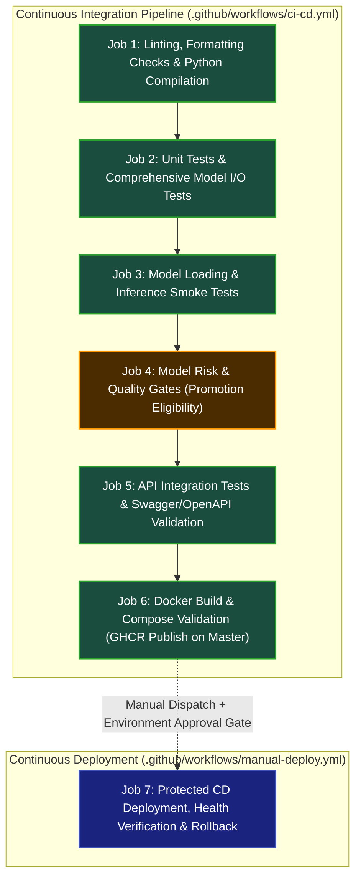

# GitHub Actions CI/CD Architecture (7 Jobs Total)

## Overview & Architecture Principles

To eliminate pipeline redundancy, ensure strict execution order, and prevent unvetted code from deploying to production, the CYCLONE INTEL CI/CD pipeline is consolidated into **exactly seven jobs total** across the repository workflows:
- **6 CI Jobs** defined in `.github/workflows/ci-cd.yml`
- **1 Protected CD Job** defined in `.github/workflows/manual-deploy.yml`

---

## Job Specification & Matrix

| Job # | Job ID | Workflow File | Scope | Trigger | Dependencies (`needs`) | Purpose & Responsibility | Failure Behavior |
|---|---|---|---|---|---|---|---|
| **1** | `job-1-lint-and-compile` | `ci-cd.yml` | **CI** | `push` (master/main), `pull_request`, `workflow_dispatch` | *None* (Root) | Python byte-compilation (`py_compile`), Flake8 linting (`flake8`), YAML configuration validation | Fails workflow immediately on syntax error, unformatted code, or YAML invalidity |
| **2** | `job-2-unit-and-model-tests` | `ci-cd.yml` | **CI** | Automatic after Job 1 | `job-1-lint-and-compile` | Unit tests for both models (LR and K-Means), decision support engine, tool calling, and orchestrator | Fails workflow on any assertion or schema failure |
| **3** | `job-3-model-smoke-tests` | `ci-cd.yml` | **CI** | Automatic after Job 2 | `job-2-unit-and-model-tests` | Operational artifact loading smoke test (`scripts/model_smoke_test.py`), scaler compatibility, single inference verification | Fails workflow if model files missing, unpicklable, or wrong scaler |
| **4** | `job-4-model-quality-gates` | `ci-cd.yml` | **CI** | Automatic after Job 3 | `job-3-model-smoke-tests` | Central model risk & quality gates (`src/models/quality_checks.py`), promotion eligibility verification, reports upload | Fails workflow if accuracy < 0.85, Macro F1 < 0.80, Silhouette < 0.30, or mean ARI < 0.95 |
| **5** | `job-5-api-swagger-integration` | `ci-cd.yml` | **CI** | Automatic after Job 4 | `job-4-model-quality-gates` | Full API integration testing (`tests/test_swagger_api.py`), Swagger/OpenAPI validation, negative payload tests | Fails workflow if any endpoint returns unexpected status or malformed schema |
| **6** | `job-6-docker-validation` | `ci-cd.yml` | **CI** | Automatic after Job 5 | `job-5-api-swagger-integration` | Docker Compose config validation, image builds for API, Frontend, Dashboard; GHCR publish on master | Fails workflow on Docker build failure or compose syntax error |
| **7** | `job-7-protected-cd-deployment` | `manual-deploy.yml` | **CD** | `workflow_dispatch` only | *Manual* (Requires `CONFIRM-DEPLOY` token + GitHub Environment approval) | Protected zero-downtime deployment, health verification timeout, automatic rollback guard, audit log upload | Aborts immediately on unconfirmed token, mutable tag, or failed post-deploy health check |

---

## Detailed Job Descriptions

### Job 1: Linting, Formatting Checks & Python Compilation
- **Purpose**: Verify code hygiene, static types, and syntax across all Python files before executing compute-heavy tests.
- **Commands**:
  - `python -m compileall src/ api/ scripts/ tests/`
  - `flake8 src api tests scripts --count --max-line-length=127 --statistics`
  - YAML syntax check for `.github/workflows/*.yml` and `docker-compose*.yml`
- **Failure Impact**: Fast-fails the run within 20 seconds.

### Job 2: Unit Tests & Comprehensive Model I/O Tests
- **Purpose**: Execute actual model inference test suite covering single/batch records, boundary values, missing/extra features, wrong types, NaNs, and Infs for both Logistic Regression and K-Means.
- **Commands**:
  - `pytest tests/test_model_quality.py tests/test_clustering.py tests/test_wandb_tracking.py tests/test_wandb_model_registry.py -v`
  - `pytest tests/test_decision_engine.py tests/test_assistant_tools.py tests/test_qwen_orchestration.py -v`
- **Failure Impact**: Prevents progressing to smoke testing if behavioral contracts fail.

### Job 3: Model Loading & Inference Smoke Tests
- **Purpose**: Visibly confirm operational model loading and runtime execution without evaluating full dataset statistics.
- **Checks**:
  - Artifact files exist (`models/logistic_regression_tier.joblib`, `models/kmeans_k4_model.joblib`)
  - Scalers bound (`RobustScaler`, `StandardScaler`)
  - Feature schemas present (26 features for LR, 4 features for K-Means)
  - One valid inference succeeds
  - Invalid inputs rejected with explicit `ValueError`
- **Commands**:
  - `python scripts/model_smoke_test.py`
  - `pytest tests/test_model_reproduction.py -v`

### Job 4: Model Risk & Quality Gates (Promotion Eligibility)
- **Purpose**: Enforce quantitative model performance and stability thresholds evaluated on fixed held-out datasets.
- **Configurable Gates (`configs/model_quality_gates.json`)**:
  - Logistic Regression: Accuracy $\ge 0.85$, Macro F1 $\ge 0.80$, Low-Tier Recall $\ge 0.70$, Generalization Gap $\le 0.08$
  - K-Means ($k=4$): Silhouette $\ge 0.30$, Davies-Bouldin $\le 1.30$, Calinski-Harabasz $\ge 250.0$, Cluster Balance $\ge 0.25$, Multi-Seed Mean ARI $\ge 0.95$, Min ARI $\ge 0.90$
- **Promotion Rule**: Only models passing all 8 dimensions receive `PROMOTION_ELIGIBLE` status.
- **Artifacts Uploaded**:
  - `reports/model_quality_gate_report.json`
  - `reports/model_quality_gate_summary.md`
  - `reports/model_quality_report.json`

### Job 5: API Integration Tests & Swagger/OpenAPI Validation
- **Purpose**: Validate all FastAPI endpoints against the real OpenAPI 3.1 specification.
- **Checks**:
  - `/openapi.json`, `/docs`, `/redoc` accessibility
  - Happy-path validation for all routes (200/201 status, correct schemas)
  - Negative validation (400/404/422 status on missing fields, wrong types, malformed JSON)
  - Real model inference via `/api/models/predict`
- **Commands**:
  - `pytest tests/test_swagger_api.py tests/test_new_api.py tests/test_api_model_inference.py tests/test_route_inventory.py -v`

### Job 6: Docker Build & Compose Validation
- **Purpose**: Build and validate container images and verify Docker Compose syntax.
- **Checks**:
  - `docker compose config --quiet`
  - `docker compose -f docker-compose.test.yml config --quiet`
  - Builds `cyclone-api`, `cyclone-dashboard`, and `cyclone-frontend`
  - On `master` push only: Tags and publishes immutable images (`sha-<commit_sha>`) to GHCR (`ghcr.io/bhavanish5041/cyclone-preparedness-assistant/...`).

### Job 7: Protected CD Deployment, Health Verification & Rollback
- **Purpose**: Execute safe, zero-downtime production deployment with rollback protection.
- **Security Safeguards**:
  - Manual trigger only (`workflow_dispatch`). Untrusted PR code cannot execute.
  - Requires safety token: `confirm_deployment: CONFIRM-DEPLOY`
  - Prohibits mutable tags (`latest`, `master`, `main`); mandates immutable `sha-*` or `v*` tags.
  - GitHub Environment approval gate (`environment: production`).
  - Automatic rollback guard if health checks fail within 60 seconds.
  - Artifact upload: `logs/deployment.log`.

---

## Scientific Safeguards & Domain Limitations

1. **AHP Precedence**: Machine Learning models serve as empirical computational surrogates for spatial analysis and boundary detection. They do NOT override deterministic Analytical Hierarchy Process (AHP) emergency resource allocations.
2. **Non-Causal Archetypes**: K-Means clustering discovered archetypes are descriptive planning categories, NOT casualty predictions or validated storm-surge damage hazard classes.
3. **Probability Simplex**: Logistic Regression probabilities must sum strictly to $1.0$ and are not represented as calibrated physical hazard forecasts.
