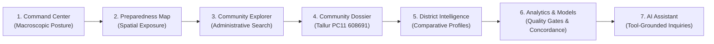

# CYCLONE INTEL: Presentation Demo Mode Guide & Speaker Script

## 1. Overview & Objective

The **Presentation Demo Mode** provides an executive, full-screen walkthrough of the CYCLONE INTEL platform tailored for presentations, policy reviews, and technical assessments.

Unlike typical software demonstrations that use synthetic dummy data, the CYCLONE INTEL Demo Mode operates directly against the **actual production dataset** (1,879 surveyed revenue units across coastal Karnataka) and executes live queries through deterministic AHP tools.

### Key Capabilities
- **Visible Entry Point**: Single-click access via the `Demo Mode` button in the top navigation bar, or via URL parameter `?demo=true`.
- **7-Step Guided Walkthrough**: Sequential progression covering macroscopic command KPIs, geospatial maps, administrative registers, deep-dive village dossiers, cross-district comparisons, ML quality metrics, and conversational AI decision support.
- **Clickable Live AI Prompts**: Six pre-configured queries that trigger live deterministic tool calling and multi-criteria AHP assessment without hardcoded fake responses.
- **Presenter Session Management**: Step jump pills, keyboard navigation, full-screen toggle, and instant session reset.
- **Reliability & Safeguards**: Automatic backend health detection, offline Qwen warning indicators, and clear non-live baseline disclaimers.

---

## 2. Walkthrough Steps & Presenter Talking Points



### Step 1: Command Center (Macroscopic Regional Preparedness Posture)
- **View**: Regional Dashboard Overview (`#/overview`)
- **Key Visuals**: KPI metrics banner (1,879 administrative units, 3 districts, 622 coastal clusters, 1,257 unassigned UK units), 4 operational priority bands donut chart, coastal vulnerability watch.
- **Speaker Script**:
  > *"Welcome to CYCLONE INTEL. We are looking at the macroscopic preparedness posture across coastal Karnataka—covering Dakshina Kannada, Udupi, and Uttara Kannada. Every community is evaluated using an authoritative Multi-Criteria Analytical Hierarchy Process (AHP). Out of 1,879 units, 155 are classified in Priority Band 1 (Critical), requiring immediate resource pre-positioning before storm landfall."*

### Step 2: Community Preparedness Map (Geospatial Spatial Intelligence)
- **View**: Interactive Map (`#/map`)
- **Key Visuals**: Leaflet map with color-coded CircleMarkers representing operational priority bands (Red: Band 1 Critical, Orange: Band 2 Specialized, Green: Band 3 Moderate, Blue: Band 4 Adequate).
- **Speaker Script**:
  > *"Here we visualize spatial vulnerability along the 320 km coastline. Communities are mapped by geographic coordinates and color-coded by their operational priority band. We see high vulnerability clusters concentrated around low-elevation estuarine zones and river inlets where storm surge penetration is most severe."*

### Step 3: Community Explorer (Administrative Unit Register)
- **View**: Communities Table (`#/communities`)
- **Key Visuals**: Sortable table with search bar, district and priority band filter pills, pagination, and indicator chips.
- **Speaker Script**:
  > *"The Community Explorer provides complete transparency into all 1,879 revenue villages and Census Towns. Incident commanders can filter by district, target priority bands, or search by Census 2011 code (PC11) or SHRID identifier. Every ranking is completely reproducible."*

### Step 4: Community Dossier — Deep Dive: Tallur (PC11: 608691)
- **View**: Side-Drawer Dossier for Tallur, Udupi (`11-29-569-05522-608691`)
- **Key Visuals**: Authoritative AHP score (74.34), Preparedness Tier (High), Operational Priority Band (Band 4 Adequate), domain score radar chart (medical 71.94, shelters 68.59, infrastructure 68.0, early warning 82.11, socioeconomic 88.58), Cyclone Tauktae 2021 historical exposure badge.
- **Speaker Script**:
  > *"Let us inspect Tallur, a coastal revenue village in Kundapura taluk, Udupi. Tallur achieves an authoritative AHP preparedness score of 74.34, placing it in the High tier and Band 4 Adequate. Notice the crucial distinction between AHP preparedness (74.34) and operational priority band (Band 4). While Tallur has robust early warning and shelter proximity, its estuarine low-lying position caused historical inundation during Cyclone Tauktae in 2021, demonstrating why granular dossiers are essential."*

### Step 5: District Intelligence (Cross-District Comparative Profiles)
- **View**: Comparative District Profiles (`#/districts`)
- **Key Visuals**: Side-by-side cards comparing Dakshina Kannada, Udupi, and Uttara Kannada; mean preparedness score differentials, critical unit counts (UK: 153 vs DK: 2 vs Udupi: 0).
- **Speaker Script**:
  > *"Here we examine the regional disparities between the three districts. Dakshina Kannada and Udupi benefit from higher healthcare density and pucca road connectivity. In contrast, Uttara Kannada contains 153 of the 155 Band 1 critical units due to complex Western Ghats topography, dispersed coastal hamlets, and extended travel times to tertiary trauma centers."*

### Step 6: Analytics & Models (Scientific Safeguards & Quality Gates)
- **View**: Analytical Distributions & Confusion Matrix (`#/analytics`)
- **Key Visuals**: Score histogram, K-Means archetypes (622 coastal units) alongside 1,257 unassigned UK units, surrogate Logistic Regression confusion matrix, test accuracy (94.3%), concordance rate (95.4%).
- **Speaker Script**:
  > *"This view highlights our scientific safeguards. The Logistic Regression model achieves 94.3% test accuracy and 95.4% concordance with authoritative AHP scores across 26 features. Crucially, as enforced by our CI quality gates, machine learning predictions can NEVER downgrade an authoritative AHP Low classification. Furthermore, K-Means clustering is strictly descriptive: 622 coastal units are assigned to 4 structural archetypes, while 1,257 Uttara Kannada units are explicitly preserved as unassigned with verified fallback heuristics."*

### Step 7: AI Decision Support Assistant (Tool-Grounded Conversational Interface)
- **View**: Conversational Assistant (`#/assistant`)
- **Key Visuals**: Chat interface with 6 pre-configured sample query cards, tool execution chips (`lookup_community`, `explain_preparedness_assessment`, `compare_districts`), scientific precedence disclaimer note.
- **Speaker Script**:
  > *"Finally, we demonstrate the conversational Decision Support Assistant. Backed by Qwen and 7 deterministic AHP tools, it operates under a strict closed-world assumption: it answers only from verified dataset evidence and refuses speculation or live weather forecasting."*

---

## 3. Sample Live Interactions & Expected Grounded Responses

Clicking each card in Step 7 sends the exact prompt to the live backend:

### Interaction 1: Explain why Tallur is classified as Band 4
- **Prompt**: `"Explain why Tallur is classified as Band 4."`
- **Tool Triggered**: `explain_preparedness_assessment(identifier="Tallur")`
- **Expected Grounded Content**:
  - Authoritative AHP score: `74.34 / 100`
  - Preparedness Tier: `High`
  - Priority Band: `Band 4 (Adequate)`
  - Key Drivers: Shelter proximity ($<1\text{ km}$), early warning score ($82.11$), medical readiness ($71.94$).

### Interaction 2: Compare Dakshina Kannada and Udupi
- **Prompt**: `"Compare Dakshina Kannada and Udupi."`
- **Tool Triggered**: `compare_districts(district_a="Dakshina Kannada", district_b="Udupi")`
- **Expected Grounded Content**:
  - Dakshina Kannada: 369 units, mean score 61.06, 2 Band 1 critical units.
  - Udupi: 253 units, mean score 62.45, 0 Band 1 critical units.
  - Highlights superior shelter access in Udupi and trauma care concentration in Mangaluru (DK).

### Interaction 3: Explain the four vulnerability archetypes
- **Prompt**: `"Explain the four vulnerability archetypes."`
- **Tool Triggered**: `explain_vulnerability_archetype()`
- **Expected Grounded Content**:
  - Archetype 0: Urban & Peri-Urban Well-Resourced Corridor
  - Archetype 1: Remote Inland & Foothill Settlements
  - Archetype 2: Semi-Resilient Rural Interior
  - Archetype 3: High-Exposure Coastal Rural Belt
  - Explicitly states that 1,257 Uttara Kannada units are handled via fallback guidance.

### Interaction 4: Identify Band 1 communities using the actual dataset
- **Prompt**: `"Identify Band 1 communities using the actual dataset."`
- **Tool Triggered**: `filter_and_rank_communities(priority_band="BAND_1_CRITICAL", limit=5)`
- **Expected Grounded Content**:
  - Returns top critical units (e.g., Bappalgundi, Puratbomnalli) with composite scores $\le 25.0$ and severe deficits in shelter distance ($>50\text{ km}$).

### Interaction 5: Explain how AHP preparedness tiers differ from operational priority bands
- **Prompt**: `"Explain how AHP preparedness tiers differ from operational priority bands."`
- **Tool Triggered**: Deterministic decision policy grounding
- **Expected Grounded Content**:
  - Preparedness Tiers (High $\ge 65$, Medium $45-65$, Low $< 45$) reflect intrinsic physical readiness.
  - Priority Bands (Band 1 to Band 4) incorporate operational hazard exposure, shelter distance, and deficit triggers.

### Interaction 6: Explain preparedness measures based on dataset-backed vulnerabilities
- **Prompt**: `"Explain preparedness measures based on dataset-backed vulnerabilities."`
- **Tool Triggered**: `get_intervention_recommendations(identifier="Tallur")`
- **Expected Grounded Content**:
  - Actionable advisories: Pre-monsoon storm-surge shelter readiness, de-siltation of estuarine drainage channels, and verification of backup VHF communication channels.

---

## 4. Presenter Controls & Keyboard Shortcuts

- **Toggle Demo Mode**: Click `Demo Mode` in top header, or press `Ctrl + Shift + D`.
- **Next Step**: Click `Next >` or press `Right Arrow`.
- **Previous Step**: Click `< Prev` or press `Left Arrow`.
- **Jump to Step**: Click the circular numbered pills `1` through `7` in the floating demo dock.
- **Toggle Fullscreen**: Click the Crosshair / Fullscreen icon in the demo dock.
- **Reset Demo Session**: Click `Reset Session` to clear chat history, close active drawers, and return to Step 1.
- **Exit Demo**: Click `Exit Demo` to return to the standard operational dashboard.

---

## 5. Live Presentation Run Commands

To launch and run the stack locally for the presentation:

```bash
# 1. Ensure production Docker containers are healthy
docker ps

# 2. Open browser to the live production dashboard
# Local URL:
http://localhost/

# Or activate demo mode directly:
http://localhost/?demo=true
```
