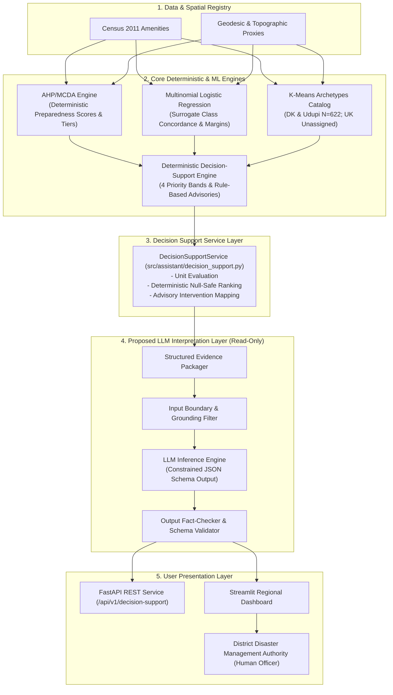
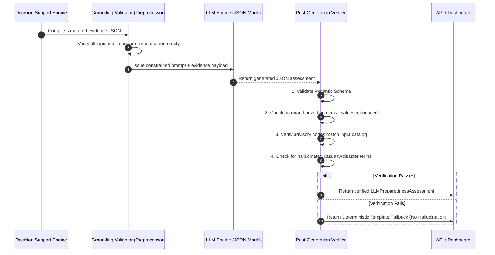
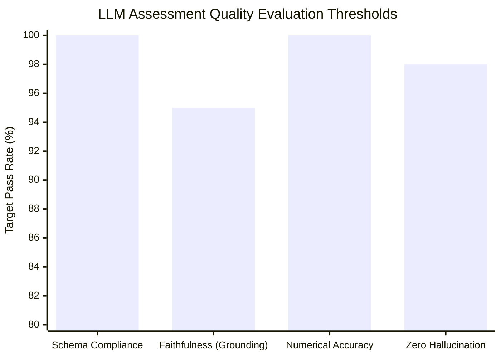

# LLM Preparedness Assessment Architecture & Technical Design

**Document ID:** `docs/llm_preparedness_assessment_design.md`  
**Milestone:** Phase 2.1 — LLM Preparedness Assessment Architecture  
**Status:** Technical Design Specification (Pre-Implementation Architectural Proposal)  
**Target Integration Layer:** Post-Decision Support Interpretation & Explainability Layer  

---

## 1. Architectural Placement & Data Flow

### 1.1 Where the LLM Fits in the System

The Cyclone Preparedness Assistant utilizes a layered, deterministic analytical pipeline. The proposed Large Language Model (LLM) component is positioned **strictly downstream** of the core analytical engines. It functions as a read-only **interpretation, explainability, and natural-language synthesis layer**.



### 1.2 Absolute System Invariants & Non-Negotiable Boundaries

The LLM operates under strict cryptographic and architectural containment:
1. **Zero Numerical Modification:** The LLM can **never** alter, recalculate, or overwrite preparedness scores, domain sub-scores, or priority rankings.
2. **Zero Rule Override:** The LLM can **never** change a priority band (e.g. promoting `BAND_2_SPECIALIZED` to `BAND_1_CRITICAL` or demoting `BAND_1_CRITICAL`).
3. **Zero Resource Fabrication:** The LLM can **never** invent relief shelter capacities, food rations, boat quantities, medical personnel counts, or evacuation vehicle availability.
4. **Zero Physical Hazard Extrapolation:** The LLM can **never** generate probabilistic storm surge heights, cyclone wind speed forecasts, or casualty predictions.
5. **Clear Epistemological Separation:** The LLM must explicitly distinguish between:
   - *Deterministic AHP Capacity Scores* (expert multi-criteria index).
   - *Surrogate ML Probabilities* (algebraic approximation of AHP boundaries).
   - *Observed 2011 Census Infrastructure* (historical static baseline).
   - *Rule-Based Advisories* (deterministic matches from the approved catalog).

---

## 2. Structured Data Passed to the LLM (Evidence Payload)

The LLM is invoked only with a strictly serialized, machine-validated JSON payload compiled by `DecisionSupportService`. No raw unstructured data is passed.

### Example Grounding Payload:

```json
{
  "unit_context": {
    "shrid2": "11-29-575-05565-803186",
    "village_name": "Sulya (TP)",
    "district_name": "Dakshina Kannada",
    "subdistrict_name": "Sulya",
    "unit_type": "Town Panchayat",
    "population": 19999,
    "households": 4612,
    "pop_density_sqkm": 874.1,
    "elevation_mean_m": 112.4,
    "dist_coast_km": 48.7
  },
  "deterministic_ahp_assessment": {
    "preparedness_score": 39.31,
    "preparedness_tier": "Low",
    "priority_band": "BAND_1_CRITICAL",
    "overall_priority_rank": 1,
    "domain_sub_scores": {
      "score_shelters": 0.0,
      "score_medical": 18.42,
      "score_infrastructure": 38.10,
      "score_early_warning": 45.00,
      "score_socioeconomic": 54.20
    }
  },
  "surrogate_ml_assessment": {
    "predicted_preparedness_tier": "Low",
    "prob_low": 0.8842,
    "prob_medium": 0.1150,
    "prob_high": 0.0008,
    "probability_margin": 0.7692,
    "is_boundary_case": false,
    "model_agreement_status": "FULL_AGREEMENT",
    "prediction_provenance": "TEST_OUT_OF_SAMPLE"
  },
  "vulnerability_archetype": {
    "cluster_assignment_status": "ASSIGNED",
    "archetype_id": 3,
    "archetype_label": "High Inundation & Healthcare Isolation",
    "spatial_boundary_note": "Assigned unit within audited Dakshina Kannada study area."
  },
  "matched_advisories": [
    {
      "code": "ADV_SHELTER_URGENT_AUDIT",
      "sector": "Shelter & Evacuation",
      "priority": "HIGH",
      "description": "Zero registered cyclone shelters within 10km. Conduct immediate structural audit of public schools/community halls for emergency designated refuge."
    },
    {
      "code": "ADV_HEALTHCARE_MOBILE_DISPATCH",
      "sector": "Healthcare Access",
      "priority": "HIGH",
      "description": "Healthcare sub-score (18.42) below critical threshold (35.0). Pre-position mobile medical outreach teams."
    }
  ],
  "evidence_metadata_and_caveats": {
    "census_vintage": 2011,
    "missing_indicators": ["nearest_gauge_name"],
    "infrastructure_baseline_year": 2011,
    "disclaimer": "Static Census 2011 amenities and geodesic proximities; does not reflect real-time post-2011 infrastructure construction or current staffing."
  }
}
```

---

## 3. Prompt Specification & Structured Output Schema

### 3.1 Prompt Strategy & System Prompt

To prevent prompt injection, hallucinations, and ungrounded extrapolations, the system prompt employs **closed-domain reasoning** and **constrained JSON generation**.

```text
SYSTEM INSTRUCTION:
You are an expert Disaster Preparedness Technical Evaluator assisting District Disaster Management Authorities (DDMAs) in coastal Karnataka.

Your sole duty is to interpret the provided JSON evidence payload and generate a structured, human-readable preparedness assessment.

STRICT OPERATIONAL RULES:
1. CLOSED WORLD REASONING: Use ONLY facts, figures, scores, and advisories provided in the input JSON. Do not invent external data.
2. PRESERVE NUMERICAL PURITY: Never modify the preparedness_score (39.31) or priority_band (BAND_1_CRITICAL).
3. EXPLICIT SEPARATION:
   - Refer to AHP as "AHP multi-criteria preparedness capacity".
   - Refer to Logistic Regression as "Surrogate classifier concordance" or "Model likelihood score".
   - Never refer to model probabilities as physical cyclone strike probabilities.
4. RECOMMENDATION RIGOR: Recommend ONLY actions derived from the provided `matched_advisories` catalog. Never recommend procuring unlisted hardware, aircraft, or fictional military units.
5. VINTAGE CAVEAT: Explicitly acknowledge that infrastructure and demographic counts reflect Census 2011 baselines.
6. MISSING INFORMATION: If an indicator is null, unrecorded, or missing, state that clearly in `missing_information`. Do not guess.
7. COMPLY WITH SCHEMA: Output strictly valid JSON conforming to the AssessmentReport schema. No Markdown backticks or surrounding text.
```

### 3.2 Structured Output Schema (Pydantic Model)

```python
from typing import List, Optional
from pydantic import BaseModel, Field

class RecommendedAction(BaseModel):
    advisory_code: str = Field(..., description="Exact code from matched_advisories")
    action_summary: str = Field(..., description="Operational summary for field deployment")
    target_sector: str = Field(..., description="Sector e.g. Shelter, Medical, Infrastructure")
    urgency_level: str = Field(..., description="CRITICAL, HIGH, or STANDARD")

class LLMPreparednessAssessment(BaseModel):
    executive_assessment: str = Field(
        ...,
        description="High-level 2-3 sentence synthesis of structural preparedness status and primary vulnerability drivers."
    )
    preparedness_strengths: List[str] = Field(
        ...,
        description="Specific domains or amenities where the unit scored adequately (e.g. socioeconomic score)."
    )
    identified_gaps: List[str] = Field(
        ...,
        description="Empirical deficits identified in sub-scores (e.g. zero shelters within 10km, medical score < 35.0)."
    )
    priority_explanation: str = Field(
        ...,
        description="Detailed explanation of why the unit was assigned its deterministic priority band (e.g. Band 1 due to score < 40.0)."
    )
    model_agreement_observations: str = Field(
        ...,
        description="Analysis of agreement between deterministic AHP tier and Logistic Regression surrogate prediction, including probability margin and boundary status."
    )
    recommended_actions: List[RecommendedAction] = Field(
        ...,
        description="Specific operational interventions matching the input advisory items."
    )
    missing_information: List[str] = Field(
        ...,
        description="List of unrecorded or missing data points (e.g. unverified drinking water source, unmapped telemetry gauge)."
    )
    evidence_limitations: List[str] = Field(
        ...,
        description="Explicit caveats regarding Census 2011 vintage, geodesic distance simplifications, and archetype spatial bounds."
    )
```

---

## 4. Grounding and Hallucination Prevention Architecture



### Hallucination Prevention Controls:
1. **Pydantic Structural Enforcement:** The LLM output is parsed directly into the `LLMPreparednessAssessment` schema. Parsing failure immediately triggers a fallback to the existing deterministic template generator (`src/integration/decision_matrix.py`).
2. **Advisory Code Whitelist:** Every item in `recommended_actions` must contain an `advisory_code` matching the input list. If an unknown code appears, the item is stripped.
3. **Blacklisted Term Regex Scanning:** Outputs are scanned for prohibited hallucinated constructs, including:
   - Fatalities / casualties ("*expected 50 deaths*").
   - Physical meteorological claims ("*Category 4 cyclone will make landfall in 48 hours*").
   - Unlisted assets ("*deploy Indian Navy aircraft carrier*", "*utilize 500 bed field hospital*").
4. **Deterministic Fallback Guarantee:** If the LLM service times out ($> 3000\text{ ms}$), fails schema validation, or trips a safety guardrail, the system returns the pre-existing rule-based template with zero disruption to the user.

---

## 5. Epistemological Disambiguation: Evidence vs Model Predictions

To prevent end-user confusion, the prompt and schema strictly enforce clear labeling of four distinct analytical categories:

| Analytical Layer | Source & Nature | Permitted Interpretation | Prohibited Interpretation |
| :--- | :--- | :--- | :--- |
| **Observed Evidence** | Census 2011, MoHFW geocodes, SRTM elevation | Physical amenity existence (e.g. "Has Pucca road", "Distance to hospital = 14km") | Assuming 2026 real-time operational readiness or staff presence |
| **AHP Preparedness Index** | Deterministic MCDA formula ($0-100$) | Multi-criteria capacity baseline and primary authority for priority bands | Physical disaster probability or casualty risk |
| **Logistic Regression Output** | ML classification pipeline (`RobustScaler` + `LogReg`) | Statistical concordance and boundary-case detection relative to AHP | Independent physical cyclone risk or ground-truth disaster forecast |
| **Vulnerability Archetypes** | K-Means clustering ($K=4$, DK & Udupi only) | Descriptive contextual profiles of structural traits | Individual priority band promotion or extrapolation to Uttara Kannada |

---

## 6. Handling Outdated and Missing Census 2011 Data

The 15-year vintage of Census 2011 data presents a core operational risk. The LLM handles this via mandatory disclosure sections:
1. **Mandatory Vintage Caveat:** The `evidence_limitations` section must state:
   *"Demographic figures (population: 19,999) and infrastructure amenities reflect the 2011 Census baseline. Recent urbanization, private healthcare expansion, and new road construction post-2011 are not captured."*
2. **Explicit Null Logging:** If an amenity is unrecorded (e.g. `drinking_water_score = 0.0` due to unclassified rural taps), the LLM must classify this in `missing_information` as an *"Unverified / Unmapped Amenity"* rather than asserting the village has no water.
3. **No Temporal Extrapolation:** The LLM is forbidden from estimating 2026 population growth using compounding rates unless an audited statistical projection column is explicitly provided in the payload.

---

## 7. Explaining AHP / ML Disagreement Cases

Across the 1,879 study units, there are **87 cases ($4.63\%$)** where the deterministic AHP tier differs from the Logistic Regression predicted tier (e.g., AHP is `Medium`, but ML predicts `Low` or `High`).

The LLM is prompted to explain these divergences objectively using the following protocol:
- **AHP Primacy:** Re-affirm that the deterministic AHP tier governs the official priority band.
- **Sensitivity Explanation:** Identify the specific sub-indicators driving the model's divergence. For example:
  - *Case 1 (AHP `Medium`, ML `Low`):* The unit meets the mathematical threshold for Medium tier overall, but exhibits extreme individual deficits in road connectivity and hospital distance that heavily weight the logistic regression model toward Low.
  - *Case 2 (AHP `Medium`, ML `High`):* The unit has high population density and pucca road access, creating high statistical similarity to High-tier clusters, despite intermediate shelter scores.
- **Margin Commentary:** Note whether the case is a boundary case ($\text{margin} < 0.10$), indicating classification sensitivity near the $40.0$ or $60.0$ AHP cutoff thresholds.

---

## 8. Grounded Recommendations Without Capability Invention

Disaster managers need actionable interventions, but unconstrained LLMs frequently hallucinate unrealistic capabilities.

### Catalog Grounding Mechanism:
The LLM cannot formulate free-text operational proposals. It must construct `recommended_actions` by synthesizing only from the `matched_advisories` supplied in the payload.

| Input Matched Advisory Code | Permitted LLM Operational Synthesis | Prohibited LLM Hallucination |
| :--- | :--- | :--- |
| `ADV_SHELTER_URGENT_AUDIT` | "DDMA should dispatch public works engineers to inspect designated school buildings in Sulya for emergency shelter structural integrity." | "Construct 5 new multi-purpose cyclone shelters with 2,000 person capacity before landfall." |
| `ADV_HEALTHCARE_MOBILE_DISPATCH` | "Coordinate with District Health Officer to schedule mobile medical dispensary visits to address the 18.42 healthcare sub-score." | "Deploy 10 trauma surgeons, air ambulances, and 50 ventilators to the village." |
| `ADV_COASTAL_INUNDATION_WATCH` | "Alert Gram Panchayat coastal wardens for early flood monitoring due to low elevation ($< 5\text{m}$) and coastal proximity." | "Install automated tidal surge barriers along 10km of beachfront." |

---

## 9. Evaluation Framework for Generated Assessments

Before enabling LLM assessments in production, generated outputs must be evaluated across four quantitative dimensions:



### Evaluation Protocol:
1. **Schema Compliance Rate ($100\%$ Target):** Fraction of generated assessments successfully parsed by `LLMPreparednessAssessment.model_validate_json()`. Target: $100\%$.
2. **Numerical & Entity Accuracy ($100\%$ Target):** Automated regex verification that all numbers in the generated text (scores, distances, population counts) match the input JSON exactly. Zero tolerance for modified scores.
3. **Faithfulness / Grounding Score ($\ge 95\%$ Target):** Evaluated using RAGAS / LLM-as-a-judge (e.g. Gemini 1.5 Pro judge prompt) checking whether every assertion in `identified_gaps` and `executive_assessment` is directly entailed by the input context.
4. **Advisory Whitelist Adherence ($100\%$ Target):** Verification that every recommended action maps to a valid catalog code.

---

## 10. Human Review, Safety Boundaries, and Operational Disclaimer

### 10.1 Human-in-the-Loop Architecture
- **Advisory Decision Support Only:** The output is explicitly presented as an *interpretive briefing memo* for the Deputy Commissioner / DDMA Incident Commander.
- **No Automated Execution:** The system has no hooks to dispatch sirens, trigger bulk SMS gateways, or order physical evacuations.
- **Mandatory UI Disclaimer Banner:**
  > **DECISION-SUPPORT NOTICE:** This automated preparedness briefing was synthesized from multi-criteria spatial indicators and historical Census data. It provides advisory planning context for disaster preparedness officers and does not supersede local administrative judgment, physical ground reconnaissance, or real-time meteorological cyclone warnings from the India Meteorological Department (IMD).

---

## 11. Infrastructure Evaluation: Hosted API vs Locally Hosted Model

| Evaluation Dimension | Option A: Hosted LLM API (e.g. Gemini 1.5 Flash / Claude 3.5 Haiku) | Option B: Locally Hosted Model (e.g. Llama 3 8B / Mistral 7B on vLLM) | Recommendation & Rationale |
| :--- | :--- | :--- | :--- |
| **Data Privacy & Sovereignty** | Data leaves local server; transmits village demographics and infrastructure deficits to external cloud API. | **100% On-Premise.** All village census data, vulnerability scores, and district boundaries remain within state/district servers. | **Winner: Local Model** (Critical for government disaster risk datasets and state IT security policies). |
| **Financial Cost** | Pay-per-token (~$0.0001 per assessment). Cost-effective for low query volumes (~$5/month for coastal Karnataka). | Requires dedicated GPU hardware (e.g. NVIDIA RTX 4090 or A10G, ~$1,500 - $3,000 capital expense or $150/mo cloud instance). | **Winner: Hosted API** (Zero upfront hardware investment). |
| **Latency & Throughput** | ~800ms - 2000ms per request depending on network. Dependent on external internet connectivity. | ~400ms - 1000ms using local vLLM / Ollama server. **Functions completely offline during cyclone emergencies.** | **Winner: Local Model** (During a cyclone, coastal internet undersea cables / cellular towers often fail. Local offline execution is vital for emergency operations). |
| **Deployment Complexity** | Trivial: HTTP client call (`requests` / `httpx`) with API key management and backoff retries. | Substantial: Requires CUDA, PyTorch, vLLM / Ollama daemon management, GPU memory tuning, model weight caching. | **Winner: Hosted API** (Low engineering overhead). |
| **Constrained JSON Reliability** | High: Native structured output modes (JSON schema mode) supported out-of-the-box. | High: Grammar-constrained decoding (e.g. `outlines`, `vllm` guided decoding) reliably enforces Pydantic schemas. | **Tie** |

### Strategic Recommendation:
1. **Phase 2 Development & CI/CD Testing:** Use a lightweight mock or developer-tier hosted API (e.g. Gemini 1.5 Flash) with strict schema validation.
2. **Phase 3 Production Deployment for District EOCs (Emergency Operation Centers):** Deploy an on-premise quantized 8B model (e.g. `Llama-3-8B-Instruct-Q4_K_M` via Ollama/vLLM) on local municipal workstation hardware to guarantee **100% offline operational capability during coastal communication blackouts** and ensure absolute governmental data sovereignty.
