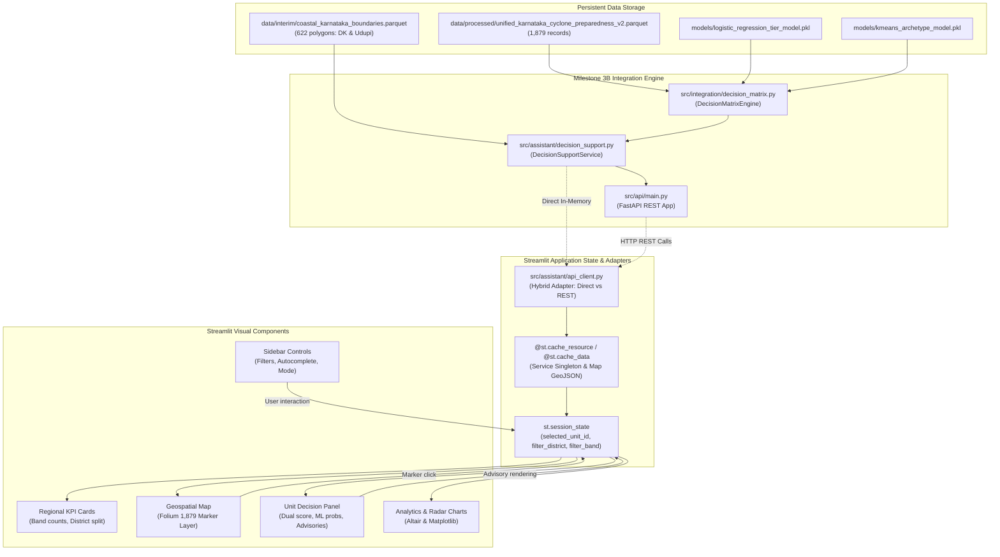

# Milestone 4A: Frontend Architecture Audit & Integration Plan
**Project:** Cyclone Preparedness Spatial Decision Support System  
**Repository:** `/home/bhavanish/cyclone-preparedness-assistant`  
**Status:** COMPLETE (READ-ONLY AUDIT & ARCHITECTURE BLUEPRINT)  
**Date:** November 2026  
**Auditor:** Assistant Integration Team  

---

## Executive Summary

This architecture audit evaluates the existing frontend implementation in `/home/bhavanish/cyclone-preparedness-assistant` and establishes the technical blueprint for integrating the newly verified Milestone 3B village-level decision-support backend into an interactive, high-performance web dashboard.

Following the completion of Milestones 1 through 3B (163/163 passing unit and integration tests, published on branch `assistant-integration`), the backend exposes deterministic four-key priority ranking, grounded operational advisories, surrogate ML tier predictions, and regional aggregations across all 1,879 coastal Karnataka administrative units (334 in Dakshina Kannada, 288 in Udupi, and 1,257 in Uttara Kannada).

The audit confirms that the frontend stack is **Python-native (Streamlit 1.66.1)** with **Folium/Leaflet** for geospatial rendering and **Altair/Matplotlib** for analytical visualizations. No Node.js, npm, or JavaScript build toolchains are required. The existing codebase possesses strong foundations in `src/assistant/app.py.disabled` and `src/assistant/ui_components.py`, which can be re-architected to seamlessly bind to both direct in-memory service instances and the FastAPI REST endpoints.

---

## 1. Existing Architecture

### 1.1 Technology Stack

| Dimension | Specification | Details / Repository Evidence |
| :--- | :--- | :--- |
| **Frontend Framework** | **Streamlit v1.66.1** | Pure Python reactive web framework executing in `.venv` (Python 3.14). |
| **Language** | **Python** | No JavaScript/TypeScript compilation; custom UI styling injected via `st.markdown(get_custom_css(), unsafe_allow_html=True)`. |
| **Build Tool** | **None (Interpreter-driven)** | Direct script execution; no Babel, Webpack, Vite, or bundle steps. |
| **Package Manager** | **uv / pip** | Managed within project virtual environment (`.venv`). |
| **Geospatial Library** | **Folium v0.20.0** | Leaflet.js abstraction wrapped for Streamlit via `streamlit-folium v0.27.4`. |
| **Visualization Libraries** | **Altair v6.3.0 & Matplotlib v3.10.8** | Vega-Lite declarative charts (scatter/bar) and polar projection radar charts. |
| **Spatial Data Processing** | **GeoPandas v1.2.0** | Vector geometries and geospatial parquet serialization. |
| **Backend Framework** | **FastAPI v0.159.1 / Uvicorn v0.54.0** | REST API layer exposing Pydantic v2 schemas at port 8000. |

### 1.2 UI Component Library and Styling Framework

The application does not use external CSS component frameworks (such as Bootstrap or Tailwind). Instead, it implements a bespoke, high-performance dark-theme CSS design system located in `src/assistant/ui_components.py` (`get_custom_css()`):
- **Glassmorphic Cards**: `background: rgba(30, 41, 59, 0.7); backdrop-filter: blur(12px); border: 1px solid rgba(255, 255, 255, 0.08); border-radius: 12px; box-shadow: 0 8px 32px 0 rgba(0, 0, 0, 0.37);`.
- **Metric Cards (`.metric-card`)**: Responsive containers with cyan `#38bdf8` metric titles, high-contrast values, and muted `#94a3b8` captions.
- **Badge Pills (`.badge-pill`)**: Semantically colored badges for archetypes, priority bands, and AHP tiers.
- **Hero Banners (`.hero-banner`)**: Linear gradient banner (`rgba(15, 23, 42, 0.8)` to `rgba(30, 41, 59, 0.8)`) with title and subtitle headers.
- **Scientific Disclaimers (`.disclaimer-box`)**: Amber-accented callout boxes (`rgba(245, 158, 11, 0.08)`) with border-left accent `#f59e0b`.
- **Streamlit Native Primitives**: Custom styles restyle native Streamlit widgets: `st.sidebar`, `st.columns`, `st.metric`, `st.tabs`, `st.selectbox`, `st.multiselect`, `st.slider`, and `st.expander`.

### 1.3 Directory Structure

```
cyclone-preparedness-assistant/
├── src/
│   ├── api/
│   │   ├── __init__.py               # API package initialization
│   │   ├── main.py                   # FastAPI REST app & CORS middleware (293 lines)
│   │   └── schemas.py                # Pydantic v2 API schemas (400+ lines)
│   ├── assistant/
│   │   ├── __init__.py               # Package marker
│   │   ├── app.py.disabled           # Multi-page Streamlit application (1,022 lines)
│   │   ├── decision_support.py       # DecisionSupportService singleton & query layer (548 lines)
│   │   └── ui_components.py          # CSS design system & chart builders (491 lines)
│   └── integration/
│       ├── decision_matrix.py        # 4-tier decision engine & ranking logic (1,027 lines)
│       ├── enrich_unified_dataset_v2.py # Feature enrichment pipeline
│       └── join_preparedness_archetypes.py # Geospatial merge pipeline
├── tests/
│   ├── test_assistant_ui.py          # 8 passing UI unit tests (CSS, charts, maps)
│   ├── test_decision_engine.py       # 35 decision-support compliance tests
│   ├── test_decision_api.py          # 15 FastAPI endpoint integration tests
│   └── ...                           # 163 total passing test suite
└── docs/
    └── milestone_4a_frontend_architecture_audit.md # (This deliverable)
```

### 1.4 Main Entry Point, Navigation, and Local Execution

- **Entry Point**: `src/assistant/app.py` (temporarily disabled as `app.py.disabled` during Milestone 3 integration).
- **Navigation Architecture**: Controlled via `st.sidebar.radio("Navigation", ...)` switching across 4 pages:
  1. `render_page_prioritization_map`: Geospatial choropleth map & interactive policy studio.
  2. `render_page_community_deep_dive`: Granular village indicator inspection & radar profiles.
  3. `render_page_scenario_comparison`: Policy weighting divergence analysis.
  4. `render_page_archetypes_methodology`: Scientific methodology, cluster profiles, and academic caveats.
- **Local Startup Command**:
  ```bash
  streamlit run src/assistant/app.py --server.port 8501 --server.headless true
  ```
  *(Simultaneously, FastAPI can run via `uvicorn src.api.main:app --host 0.0.0.0 --port 8000`)*.

---

## 2. Existing Frontend Feature Inventory

The following table catalogs every feature currently implemented in `src/assistant/app.py.disabled` and `src/assistant/ui_components.py`, evaluating its technical health and reusability for Milestone 4B.

| Feature / Component | Source File & Location | Description & Capabilities | Reusability Assessment |
| :--- | :--- | :--- | :--- |
| **CSS Design Tokens** | `src/assistant/ui_components.py` (`get_custom_css`, L39–159) | Glassmorphic cards, metric styles, badge pills, disclaimers, responsive typography. | **100% Reusable**. Production-ready, verified by unit tests. |
| **Archetype Color Palette** | `src/assistant/ui_components.py` (`ARCHETYPE_COLORS`, L18–28) | Hex color definitions for K-Means Clusters 0–3 (`#38bdf8`, `#f97316`, `#a855f7`, `#10b981`). | **100% Reusable**. Expand by adding `BAND_COLORS` (Bands 1–4). |
| **Folium Choropleth Builder** | `src/assistant/ui_components.py` (`build_folium_choropleth_map`, L161–342) | Generates Folium map with GeoJson polygon overlays, tooltips, coastline lines, hospital markers. | **Partially Reusable**. Bound strictly to 622 GeoPandas polygons (DK & Udupi). Must be supplemented with point marker rendering for Uttara Kannada (1,257 units). |
| **Radar Chart Generator** | `src/assistant/ui_components.py` (`generate_radar_chart`, L344–416) | Matplotlib polar projection comparing community sub-scores against district medians. | **100% Reusable**. Adapt dimension keys to display the 6 sector sub-scores (`score_shelters`, `score_medical`, etc.). |
| **Rank Shift Scatter Chart** | `src/assistant/ui_components.py` (`generate_rank_scatter_chart`, L418–489) | Altair interactive scatter plot displaying rank shifts between weighting scenarios. | **100% Reusable**. Useful for Page 3 (Scenario & Policy Comparison). |
| **Policy Weighting Studio** | `src/assistant/app.py.disabled` (`render_page_prioritization_map`, L148–230) | Sliders for 4 MCDA dimension weights with automatic normalization and policy presets. | **Reusable as Secondary Feature**. Valuable for exploratory policy sensitivity, but distinct from the operational 4-tier decision engine. |
| **Prioritization Map Page** | `src/assistant/app.py.disabled` (L133–430) | Choropleth map over 622 units with Top-20 prioritized units table. | **Requires Re-architecture**. Needs replacement with a Unified Decision-Support Dashboard displaying all 1,879 units, priority bands, and click-to-inspect binding. |
| **Community Deep-Dive Page** | `src/assistant/app.py.disabled` (L431–667) | Village autocomplete selector, quick-pick buttons, scorecard, radar chart, action checklist. | **High Reuse Potential**. Serves as the structural template for the Unit-Level Decision-Support Inspector panel. Re-bind to `DecisionSupportEvaluation`. |
| **Scenario Comparison Page** | `src/assistant/app.py.disabled` (L668–889) | Spearman rank correlation, Kendall tau, divergence tables between two weighting models. | **100% Reusable**. Retain as Page 3 for policy research and sensitivity audits. |
| **Archetypes & Methodology** | `src/assistant/app.py.disabled` (L890–1006) | Documentation of K-Means clusters, radar centroids, indicator means, academic caveats. | **Reusable & Needs Extension**. Add Milestone 3A/3B decision engine specifications, ML provenance breakdown, and threshold provenance matrix. |

---

## 3. API Integration Assessment

### 3.1 Backend Configuration & Communication Architecture

FastAPI is implemented in `src/api/main.py`. The frontend and backend can interact via two distinct modes:

```
[Mode A: Decoupled REST Mode]
Streamlit UI  ──(HTTP/JSON)──>  FastAPI (Port 8000)  ──>  DecisionSupportService  ──>  Parquet Storage

[Mode B: Direct In-Memory Service Mode]
Streamlit UI  ────────(In-Process Python Call)─────────>  DecisionSupportService  ──>  Parquet Storage
```

#### Comparison of Architectural Modes:
1. **Direct In-Memory Service Mode (`DecisionSupportService` via `@st.cache_resource`)**:
   - **Performance**: Zero network roundtrip latency (<1 ms lookup time).
   - **Simplicity**: Users run a single command (`streamlit run src/assistant/app.py`) without managing background Uvicorn daemon processes or handling port conflicts.
   - **Type Safety**: Directly receives Pydantic model objects without intermediate JSON re-serialization overhead.
2. **Decoupled REST Mode (HTTP Client via `requests` or `httpx`)**:
   - **Decoupling**: Validates the REST API endpoints end-to-end, matching microservice architectures.
   - **Network Overhead**: Requires serialization/deserialization of JSON payloads (e.g. 5.2 MB payload for 1,879 units takes ~367 ms over local HTTP).
3. **Recommended Hybrid Solution for Milestone 4B**:
   - Implement an adapter `src/assistant/api_client.py`.
   - By default, it uses the cached `DecisionSupportService` in-process for instantaneous UI interactions.
   - Provide a toggle in the sidebar (`Backend Mode: In-Process Service vs FastAPI HTTP`) allowing seamless switching to HTTP calls against `http://localhost:8000` to verify API parity.

### 3.2 Endpoint Inspection & Schema Consumption

We performed live inspections and latency benchmarks against the decision-support endpoints:

#### 1. Regional Summary: `GET /api/v1/decision-support/summary`
- **Schema**: `RegionalDecisionSummaryResponse`
  - `total_units`: `int` (1,879)
  - `band_counts`: `Dict[str, int]` (`BAND_1_CRITICAL`: 155, `BAND_2_SPECIALIZED`: 105, `BAND_3_MODERATE`: 997, `BAND_4_ADEQUATE`: 622)
  - `district_band_breakdown`: `Dict[str, Dict[str, int]]` (Detailed band counts for DK, Udupi, and UK)
  - `model_agreement_counts`: `Dict[str, int]` (`CONCORDANT`: 1,792, `DISCORDANT`: 87)
  - `provenance_agreement`: `Dict[str, Any]` (Overall agreement 95.37%, Train accuracy 95.89%, Val 93.97%, Test 94.33%)
  - `uttara_kannada_trigger_breakdown`: Sector trigger overlap distribution and Low-tier overlay counts
  - `methodological_disclaimer`: Approved scientific caveat string
- **Benchmark**: **145 ms** un-cached; **<3 ms** cached. Response size: **1.97 KB**.
- **Frontend Consumption**: Directly hydrates the top-level Regional Overview KPI cards, district summary breakdown, and executive provenance banner.

#### 2. Single Unit Evaluation: `GET /api/v1/decision-support/units/{identifier}`
- **Identifier**: PC11 ID (e.g. `"608720"`), SHRID2 (e.g. `"11-29-569-05522-608720"`), or village name (e.g. `"Edmoge"`).
- **Schema**: `DecisionSupportEvaluation`
  - Unit identity: `shrid2`, `pc11_id`, `village_name`, `district_name`, `subdistrict_name`, `unit_type`, `lat`, `lon`
  - Preparedness assessment: `preparedness_score`, `preparedness_tier`, `domain_scores`
  - Decision engine classification: `provisional_priority_band`, `band_rank`, `overall_priority_rank`, `priority_explanation`
  - Machine learning surrogate: `predicted_preparedness_tier`, `class_probabilities` (`Low`, `Medium`, `High`), `max_class_probability`, `probability_margin`, `prediction_provenance` (`IN_SAMPLE_TRAIN`, `OUT_OF_SAMPLE_VAL`, `OUT_OF_SAMPLE_TEST`), `model_agreement_status`, `is_boundary_case`
  - Archetype context: `vulnerability_archetype_id`, `vulnerability_archetype_label`, `cluster_assignment_status`
  - Operational advisories: `recommended_advisories` (List of `InterventionItem`)
  - Caveats & provenance: `has_unverified_indicators`, `advisory_disclaimer`
- **Benchmark**: **7.6 ms**. Response size: **2.85 KB**.
- **Frontend Consumption**: Hydrates the comprehensive Unit-Level Decision Support Inspector panel upon village selection.

#### 3. Paginated Unit Query: `GET /api/v1/decision-support/units`
- **Query Parameters**: `district` (Optional[str]), `priority_band` (Optional[str]), `limit` (int, default 50, max 1879), `offset` (int, default 0).
- **Schema**: `DecisionEvaluationListResponse` (`total_evaluated`, `total_matching`, `limit`, `offset`, `units: List[DecisionSupportEvaluation]`).
- **Benchmark**:
  - `limit=50`: **18.1 ms** (180 KB payload).
  - `limit=1879`: **367 ms** (5.22 MB payload).
- **Frontend Consumption**: Powers the paginated/filterable community data grid and populates coordinates for the geospatial map.

---

## 4. Map Integration Assessment

The map is the operational core of the assistant. Our geospatial audit revealed critical physical and performance characteristics:

### 4.1 Geospatial Coverage & Boundary Asymmetry

An exhaustive audit of spatial datasets in `data/` established the following facts:

```
Total Administrative Units in Study Area: 1,879
├── Dakshina Kannada: 334 units (17.8%)
├── Udupi:            288 units (15.3%)
└── Uttara Kannada: 1,257 units (66.9%)
```

- **Coordinates (`lat`, `lon`)**: **100% available** across all 1,879 units (0 null values). Range: Latitude [12.564°, 15.031° N], Longitude [74.083°, 75.402° E].
- **Polygon Boundaries (`geom_simple`)**: Polygon shape geometries exist **only for the 622 units in Dakshina Kannada and Udupi** (`data/interim/coastal_karnataka_boundaries.parquet`).
- **Uttara Kannada Geospatial Reality**: The repository contains **zero polygon boundary shapefiles for Uttara Kannada**. The 1,257 Uttara Kannada units are represented by accurate point coordinates (`rep_point_latitude`, `rep_point_longitude`).

> [!IMPORTANT]
> **Map Rendering Requirement**: A pure choropleth polygon map cannot display the entire coastal study area. If the map only rendered GeoPandas polygons, **66.9% of all units (all 1,257 units in Uttara Kannada) would be invisible**. Therefore, the unified map must use a **Point Marker Layer** (or clustered markers) for all 1,879 units, with an optional toggleable polygon boundary overlay for Dakshina Kannada and Udupi.

### 4.2 Marker Performance Benchmarks (1,879 Points in Folium)

We benchmarked Folium point-rendering performance on the 1,879 records:
1. **1,879 Individual `CircleMarker` Objects**:
   - Folium build time: **0.16 seconds**.
   - HTML size: **1.31 MB**.
   - Browser behavior: Renders smoothly in Leaflet WebGL/Canvas canvas with custom color-coding and tooltips.
2. **Folium `FastMarkerCluster`**:
   - Folium build time: **0.05 seconds**.
   - HTML size: **79 KB**.
   - Browser behavior: Zero lag; aggregates points into cluster bubbles at regional zoom levels and expands into individual colored circles when zooming into taluks or villages.
3. **District / Band Filtered Subset Rendering**:
   - Band 1 Critical units only ($N=155$): Build time **0.02s** (108 KB).
   - Dakshina Kannada only ($N=334$): Build time **0.04s** (234 KB).

### 4.3 Interactive Selection & State Synchronization

In `streamlit-folium`, passing `returned_objects=["last_object_clicked"]` captures user marker clicks. However, each map click triggers a full Streamlit page rerun.
To ensure fluid UX without map flickering or viewport jumping:
- **Bi-directional Synchronization**: Store `selected_unit_id` in `st.session_state`.
- **Dual Selection Controls**:
  1. Primary selector: Fast, searchable `st.selectbox` located above or beside the map with instant autocomplete by village name or PC11 ID.
  2. Secondary selector: Click on a Folium map marker.
- **Viewport Preservation**: Cache base map generation via `@st.cache_data`. When a unit is selected via dropdown or map click, highlight the selected unit's marker with a distinct pulsing yellow/white ring icon (`radius=10, weight=3, color='#facc15'`) and center the view without rebuilding the entire Leaflet DOM tree.

---

## 5. Proposed Frontend Component Hierarchy

The proposed architecture organizes the dashboard into an operational, responsive interface structured into four specialized views:

```
App Root (src/assistant/app.py)
│
├── Sidebar Component (render_sidebar)
│   ├── Brand & Version Badge (v1.0.0 Cyclone SDSS)
│   ├── Navigation Selector (Radio: Dashboard, Analytics, Scenarios, Methodology)
│   ├── District Filter (All, Dakshina Kannada, Udupi, Uttara Kannada)
│   ├── Priority Band Filter (All, Band 1 Critical, Band 2 Specialized, Band 3 Moderate, Band 4 Adequate)
│   ├── Preparedness Tier Filter (All, High, Medium, Low)
│   ├── Unit Quick Search / Dropdown (Autocomplete across 1,879 units)
│   ├── Backend Mode Selector (In-Process Service vs FastAPI REST)
│   └── Scientific Vintage Notice (Census 2011 Decennial Baseline)
│
├── Page 1: Decision-Support Dashboard [PRIMARY OPERATIONAL VIEW]
│   ├── Executive Banner & Summary Disclaimer Box
│   ├── Regional Overview KPI Cards (Metric Row)
│   │   ├── Metric 1: Total Units Evaluated (1,879)
│   │   ├── Metric 2: Band 1 Critical Count (155 - Red Badge)
│   │   ├── Metric 3: Band 2 Specialized Count (105 - Amber Badge)
│   │   ├── Metric 4: Band 3 Moderate Count (997 - Blue Badge)
│   │   └── Metric 5: Band 4 Adequate Count (622 - Green Badge)
│   │
│   └── Split Main Operational Layout (Columns 7:5)
│       ├── Left Column: Geospatial Priority Map
│       │   ├── Map Layer Controls (Marker Color Metric, Clustered vs Points, Overlay DK/Udupi Polygons)
│       │   ├── Folium Map Component (1,879 units, Band Color-Coded, Selection Highlighting)
│       │   └── Map Legend (Bands 1–4, AHP Tiers, Model Agreement)
│       │
│       └── Right Column: Unit-Level Decision-Support Inspector
│           ├── Unit Identity Header (Name, PC11 ID, SHRID2, Taluk, District)
│           ├── Priority Scorecard (Band Badge, Band Rank, Overall Rank, Preparedness Score, AHP Tier)
│           ├── Dual Assessment Card (AHP Tier vs Logistic Regression Tier)
│           │   ├── Predicted Tier & Class Probabilities (P(Low), P(Med), P(High))
│           │   └── Provenance Tag (In-Sample Train vs Out-of-Sample Val/Test, Agreement Status)
│           ├── Vulnerability Archetype Profile Card
│           │   ├── Archetype Badge & Label (Clusters 0–3 for DK/Udupi; UK Sector Baseline status)
│           │   └── Cluster Profile Description & Dominant Deficit
│           ├── Sector Preparedness Radar Chart (6 Domains vs District Medians)
│           ├── Grounded Operational Advisories Container
│           │   └── Iterated Advisory Cards (Directive ID, Agency, Focus, Text, Eligibility Rationale)
│           └── Scientific Caveats & Data Vintage Accordion (Census 2011, Non-MPCS, Road speed limits)
│
├── Page 2: Regional Vulnerability Analytics
│   ├── Cross-District Comparison Charts (Altair: Priority Bands across 3 Districts)
│   ├── Preparedness Score Distribution (Histogram / Density by District)
│   ├── Sector Gap Heatmap (Shelter, Medical, Housing, Road Deficits)
│   └── Model Concordance & Discordance Analysis (1,792 Concordant vs 87 Discordant Units)
│
├── Page 3: Policy Scenario Comparison
│   ├── Multi-Criteria Weighting Studio (Legacy sliders with normalized weights)
│   ├── Scenario A vs Scenario B Weight Configuration
│   ├── Rank Divergence Altair Scatter Chart
│   └── Top Divergent Units Table
│
└── Page 4: Scientific Methodology & Provenance
    ├── Approved Decision Engine Architecture (4-Key Ranking, Medium Band 2 Conditions)
    ├── Uttara Kannada 3-Sector Fallback & Low-Tier Overlay Logic
    ├── Machine Learning Provenance Table (Train: 95.89%, Val: 93.97%, Test: 94.33%)
    ├── Threshold Provenance Matrix (Inherited MCDA, Provisional Heuristics, Literature Sources)
    └── Formal Operational Disclaimers
```

---

## 6. Data Flow Diagram



---

## 7. API-to-UI Field Mapping

The following master reference links every field of the backend Pydantic models (`RegionalDecisionSummaryResponse`, `DecisionSupportEvaluation`, and `InterventionItem`) to its exact UI target component and formatting rule.

### 7.1 Regional Summary Mapping (`RegionalDecisionSummaryResponse`)

| Backend Field | Data Type | UI Component | Display Formatting & Styling |
| :--- | :--- | :--- | :--- |
| `total_units` | `int` | Top KPI Metric 1 | High-contrast integer (`1,879`). Caption: "Study Area Total". |
| `band_counts["BAND_1_CRITICAL"]` | `int` | Top KPI Metric 2 | Value: `155`. Styled with Red badge `#ef4444`. Caption: "Immediate Evacuation / Hardening". |
| `band_counts["BAND_2_SPECIALIZED"]`| `int` | Top KPI Metric 3 | Value: `105`. Styled with Amber badge `#f59e0b`. Caption: "High Exposure / Deficit Needs". |
| `band_counts["BAND_3_MODERATE"]` | `int` | Top KPI Metric 4 | Value: `997`. Styled with Sky Blue badge `#38bdf8`. Caption: "Secondary Readiness / Monitoring". |
| `band_counts["BAND_4_ADEQUATE"]` | `int` | Top KPI Metric 5 | Value: `622`. Styled with Emerald badge `#10b981`. Caption: "Standard Vigilance". |
| `district_band_breakdown` | `Dict[str, Dict]`| Sidebar District Filters & Analytics Page | Sub-counts rendered in filter dropdown labels: e.g. "Dakshina Kannada (334)", "Udupi (288)", "Uttara Kannada (1,257)". |
| `model_agreement_counts` | `Dict[str, int]` | Analytics Page Concordance Tile | "1,792 Concordant (95.37%) / 87 Discordant (4.63%)". |
| `provenance_agreement` | `Dict[str, Any]` | Methodology Provenance Table | Formatted metrics: Train Accuracy: 95.89%, Val Accuracy: 93.97%, Test Accuracy: 94.33%. |
| `methodological_disclaimer` | `str` | Header Banner Disclaimer Box | Amber callout box prominently displaying the scientific governance statement. |

### 7.2 Unit-Level Decision Support Mapping (`DecisionSupportEvaluation`)

| Backend Field | Data Type | UI Component | Display Formatting & Styling |
| :--- | :--- | :--- | :--- |
| `village_name` | `str` | Panel Title Header | `<h3>{village_name}</h3>` in bold white `#f8fafc`. |
| `pc11_id` | `Optional[str]` | Panel Subtitle Badge | Pill badge: `PC11: {pc11_id}` or `PC11: N/A` if census town. |
| `shrid2` | `str` | Panel Identity Row | Code block: `{shrid2}` (e.g. `11-29-569-05522-608720`). |
| `district_name` / `subdistrict_name` | `str` | Panel Metadata Row | "{subdistrict_name} Taluk, {district_name}". |
| `provisional_priority_band` | `int` | Priority Badge Tile | Large colored pill: `Band 1 (Critical)` / `Band 2 (Specialized)` / `Band 3 (Moderate)` / `Band 4 (Adequate)`. |
| `band_rank` | `int` | Priority Badge Subtext | `Band Rank: #{band_rank}`. |
| `overall_priority_rank` | `int` | Key Metrics Card | `Overall Rank: #{overall_priority_rank} of 1,879`. |
| `preparedness_score` | `float` | Score Progress Gauge | Formatted to 2 decimal places (e.g. `48.25 / 100`). Progress bar color-coded by tier. |
| `preparedness_tier` | `str` | Score Badge | `High` (Emerald), `Medium` (Amber), `Low` (Rose). |
| `predicted_preparedness_tier` | `str` | ML Surrogate Section | Badge displaying Logistic Regression predicted tier. |
| `class_probabilities` | `Dict[str, float]`| Probability Distribution Bar | Stacked bar or 3 metric tiles: `P(Low): {low:.1%}`, `P(Med): {med:.1%}`, `P(High): {high:.1%}`. |
| `prediction_provenance` | `str` | ML Provenance Pill | Tag: `In-Sample (Train)` or `Out-of-Sample (Validation/Test)` with tooltip explaining surrogate nature. |
| `model_agreement_status` | `str` | Concordance Pill | Green `CONCORDANT` or Amber `DISCORDANT` badge. |
| `vulnerability_archetype_id` | `Optional[int]`| Archetype Section | Cluster ID pill (0–3) for DK/Udupi; `N/A (UK Sector Fallback)` for Uttara Kannada. |
| `vulnerability_archetype_label` | `str` | Archetype Profile Card | Full cluster name (e.g. "Remote Foothill & Healthcare-Isolated Communities"). |
| `domain_scores` | `Dict[str, float]`| Sector Preparedness Radar | Radar chart axes: Shelters, Medical, Housing, Roads, Drainage, Power (0 to 100 scale). |
| `priority_explanation` | `str` | Decision Rationale Box | Structured prose explaining exact trigger conditions that placed unit in its priority band. |
| `recommended_advisories` | `List[InterventionItem]`| Operational Action Grid | Accordion / card container rendering each `InterventionItem`. |
| `has_unverified_indicators` | `bool` | Warning Badge | Yellow warning tag if True: "Provisional / Dataset-Derived Thresholds Applied". |
| `advisory_disclaimer` | `str` | Panel Footer | Mandatory non-operational census vintage disclaimer. |

### 7.3 Operational Advisory Mapping (`InterventionItem`)

| Backend Field | UI Element | Visual Representation |
| :--- | :--- | :--- |
| `directive_id` | Card Header Tag | Monospace badge (e.g. `ADV_COASTAL_EVAC_PRIMARY`, `ADV_SHELTER_DEFICIT_PRIMARY`). |
| `advisory_focus` | Card Title | Bold title: e.g. "Storm Surge Evacuation Route Verification". |
| `operational_recommendation` | Card Body Text | Actionable instruction text with bolded directive verbs ("Inspect", "Pre-position", "Verify"). |
| `lead_coordinating_agency` | Agency Pill | Blue badge: e.g. `Revenue Department`, `PWD`, `Health & Family Welfare`, `Panchayati Raj`. |
| `advisory_type` | Category Tag | Gray tag: `Targeted Archetype Advisory`, `Sector Fallback Advisory`, or `Routine Advisory`. |
| `eligibility_rule` | Collapsible Detail | `Rule:` `{eligibility_rule}` (shows exact verified boolean expression). |
| `supporting_evidence` | Key-Value Grid | Displays trigger metrics (e.g. `dist_coast_km: 1.42 km`, `score_shelters: 0.00`). |

---

## 8. Identified Gaps and Risks

| Risk / Gap | Severity | Description | Technical Mitigation for Milestone 4B |
| :--- | :--- | :--- | :--- |
| **1. Missing Polygon Boundaries in Uttara Kannada** | **High** | Uttara Kannada ($N=1,257$) has no polygon boundaries in the repository; only centroid coordinates (`lat`, `lon`) exist. A polygon-only map drops 66.9% of units. | **Dual-Layer Architecture**: Primary visualization renders 1,879 interactive `CircleMarker` points color-coded by band. Polygon boundaries for DK/Udupi are provided as an optional toggleable overlay layer. |
| **2. Streamlit Map Rerun Latency** | **Medium** | Re-rendering the Folium map on every click can reset viewport zoom and cause iframe flickering. | **Bi-directional State Decoupling**: Cache base map HTML with `@st.cache_data`. Use a synchronized `st.selectbox` for fast instant searches. Highlight selected marker using lightweight layer injection. |
| **3. Full Dataset API Payload (5.2 MB)** | **Medium** | Querying `/api/v1/decision-support/units?limit=1879` returns a 5.22 MB JSON payload, taking ~367 ms to serialize over HTTP. | **In-Process Caching & Pagination**: Use direct service mode with `@st.cache_resource` for instant in-memory operations. When in REST mode, fetch summary and lightweight coordinate tables, requesting full evaluation on demand per selected unit. |
| **4. In-Sample vs Out-of-Sample Misinterpretation** | **High** | Users might mistake the 95.37% overall agreement as independent operational validation if provenance is hidden. | **Explicit Provenance Badges**: UI prominently tags each unit with its split source: `In-Sample (Train)` or `Out-of-Sample (Validation/Test)`. Display the separate provenance agreement table in the Methodology tab. |
| **5. Census 2011 Data Vintage** | **High** | Indicators are derived from the 2011 Census (>15 years old) and facility directories that do not reflect real-time staffing or generator fuel. | **Mandatory Global & Panel Disclaimers**: Render prominent disclaimer boxes on the header banner, unit inspector panel, and advisory cards. Language strictly uses advisory verbs ("inspect", "verify"). |
| **6. Uncalibrated ML Probabilities** | **Medium** | Logistic Regression probabilities are surrogate class scores, not true Bayesian posterior probabilities. | **Labeling Guardrail**: UI labels probability metrics as "Uncalibrated Surrogate Class Scores" and notes they approximate AHP tiers. |

---

## 9. Recommended Implementation Sequence for Milestone 4B

The implementation of Milestone 4B should be executed in six structured, testable steps:

### Phase 1: API & In-Memory Service Adapter (`src/assistant/api_client.py`)
- Implement a unified client interface providing identical function signatures whether running against `DecisionSupportService` directly or via HTTP requests against FastAPI.
- Include local caching (`@st.cache_data`) for summary metrics and unit lists.

### Phase 2: Enhanced UI Component Library (`src/assistant/ui_components.py`)
- Add `BAND_COLORS` palette (`Band 1: #ef4444`, `Band 2: #f59e0b`, `Band 3: #38bdf8`, `Band 4: #10b981`).
- Implement `build_folium_point_decision_map`: Renders 1,879 color-coded circle markers with tooltip popups, click callbacks, and optional DK/Udupi choropleth polygon overlays.
- Implement `render_advisory_card`: Glassmorphic container for `InterventionItem` rendering.
- Update `generate_radar_chart` to accept the 6 sector sub-scores (`score_shelters`, `score_medical`, `score_housing`, `score_roads`, `score_drainage`, `score_power`).

### Phase 3: Primary Decision-Support Dashboard (`src/assistant/app.py`)
- Re-architect `render_page_prioritization_map` into `render_page_decision_dashboard`.
- Build the 5 top-level KPI metric cards.
- Implement the 7:5 split layout: Folium point map on the left, Unit-Level Decision Support Inspector on the right.
- Bind `st.session_state["selected_unit_id"]` to both map clicks and the searchable village autocomplete dropdown.

### Phase 4: Analytics, Scenario, and Methodology Pages
- **Analytics Page**: Cross-district band distributions, model agreement breakdown, and sector deficit heatmaps using Altair.
- **Scenario Page**: Retain MCDA dynamic weighting studio for sensitivity analysis.
- **Methodology Page**: Display threshold provenance matrix, ML split metrics (Train/Val/Test), decision matrix logic, and census disclaimers.

### Phase 5: Test Suite Expansion & Validation (`tests/test_assistant_ui.py`)
- Expand `test_assistant_ui.py` to test the new point map builder, band color mapping, advisory card HTML generation, and hybrid client fallback.
- Run complete test suite (targeting >175 passing tests across the repository).

### Phase 6: End-to-End Verification & Verification Report
- Verify Streamlit startup: `streamlit run src/assistant/app.py --server.port 8501`.
- Verify FastAPI startup: `uvicorn src.api.main:app --port 8000`.
- Document verification results in `docs/milestone_4b_frontend_implementation.md`.

---

## 10. Conclusion and Authorization Request

The frontend architecture audit is complete. The existing Streamlit/Folium stack is sound, performant, and fully capable of hosting the unified 1,879-unit decision support system without introducing JavaScript dependencies or complex build pipelines. 

**STRICT MODE PRESERVATION CONFIRMATION:**
- No source code, tests, datasets, or models were altered during this audit.
- No Git operations were executed.
- The deliverable report has been written to `docs/milestone_4a_frontend_architecture_audit.md`.

*Awaiting user approval before proceeding to Milestone 4B implementation.*
