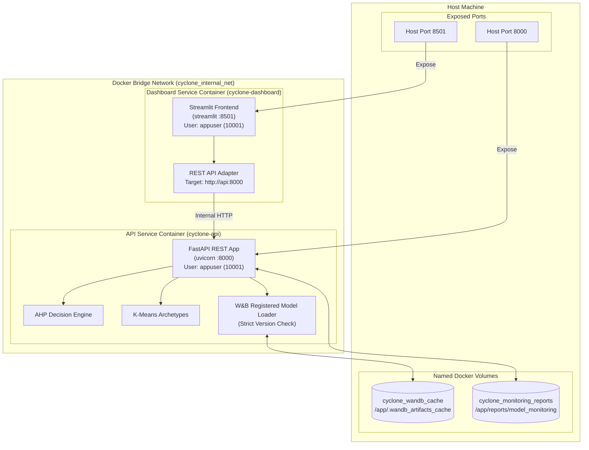

# Phase 2.5 — Docker Containerization and Service Orchestration Specification

**Project:** Coastal Karnataka Cyclone Preparedness & Decision-Support System  
**Milestone:** Phase 2.5 Containerization & Service Orchestration  
**Status:** Complete & Verified  
**Date:** 2026-11-08  
**Verification Baseline:** 258 Passing Pytest Suite Tests, Multi-Container Orchestration Healthy  

---

## 1. Executive Summary & Architecture Overview

Phase 2.5 containerizes the complete cyclone preparedness decision-support application into isolated, reproducible, and production-oriented containers orchestrated via Docker Compose:

1. **FastAPI Inference & Decision-Support Backend (`api` service):**
   - Base image: `python:3.14-slim`.
   - Security profile: Non-root execution as `appuser:appgroup` (UID/GID `10001`).
   - Serves deterministic AHP scores, K-Means vulnerability archetypes, Evidently AI monitoring auditing, and registered W&B Logistic Regression capacity-tier inferences.
   - Graceful lifecycle management with startup loading of `WANDB_MODEL_ARTIFACT` and strict shutdown hooks.
   - Internal port: `8000` (mapped to host port `8000`).
   - Healthcheck: Automated `curl -f http://localhost:8000/health` polling.

2. **Streamlit Regional Dashboard Frontend (`dashboard` service):**
   - Base image: `python:3.14-slim`.
   - Security profile: Non-root execution as `appuser:appgroup` (UID/GID `10001`).
   - Configured in REST adapter mode (`CYCLONE_ADAPTER_MODE=rest`), routing all analytical queries over the internal bridge network to `http://api:8000`.
   - Dedicated headless configuration (`--server.headless=true`, pre-created `~/.streamlit` owned by `appuser`).
   - Internal port: `8501` (mapped to host port `8501`).
   - Healthcheck: Automated `curl -f http://localhost:8501/_stcore/health` polling.

3. **Inter-Service Networking (`cyclone_internal_net`):**
   - Custom Docker bridge network providing isolated service name resolution.
   - Streamlit communicates with FastAPI via `http://api:8000`, completely decoupled from the host network.

4. **Persistent Named Volumes:**
   - `cyclone_wandb_cache`: Mounted to `/app/.wandb_artifacts_cache` inside `api`. Persists downloaded and verified W&B model artifacts (`village-preparedness-classifier:v0`) across container recreation cycles, guaranteeing offline startup resilience.
   - `cyclone_monitoring_reports`: Mounted to `/app/reports/model_monitoring` inside `api`. Persists Evidently AI data drift, target drift, and model quality reports across container lifecycles.



---

## 2. Prerequisites & Prerequisites Check

Before building or launching the containerized stack, ensure the following tools are available on the deployment host:

- **Docker Engine:** Version 20.10+ (Verified on Docker `29.1.3`).
- **Docker Compose:** Compose V2 plugin or standalone CLI (Verified on Compose `v2.32.4`).
- **Disk Space:** At least 4 GB available disk space for container images, base Python wheels, and persistent model caches.
- **Weights & Biases Account (Optional for Offline, Required for Re-registration/New Artifacts):**
  - Offline operation with the pre-seeded volume does **not** require W&B credentials or internet connectivity.
  - Fetching new/un-cached versions from W&B requires a valid `WANDB_API_KEY`.

---

## 3. Environment Variable Configuration

The project uses `.env` for container orchestration configuration. A template file [`.env.example`](file:///home/bhavanish/cyclone-preparedness-assistant/.env.example) is provided in the repository root.

### Environment Variable Reference

| Variable | Default Value | Description |
| :--- | :--- | :--- |
| `WANDB_MODEL_ARTIFACT` | `village-preparedness-classifier:v0` | Exact registered artifact address and explicit tag. |
| `WANDB_ENTITY` | `bhavanishreddy69-na` | W&B entity/organization owning the registry artifact. |
| `WANDB_PROJECT` | `cyclone-preparedness-assistant` | W&B project namespace. |
| `WANDB_API_KEY` | *(empty / unset)* | W&B user API key (32/40 character hex string). Omit for offline cached startup. |
| `CYCLONE_API_BASE_URL` | `http://api:8000` | Target base URL for Streamlit REST client within Compose network. |
| `CYCLONE_ADAPTER_MODE` | `rest` | Dashboard client mode (`rest` uses FastAPI HTTP; `direct` uses local Python modules). |
| `CYCLONE_LOG_LEVEL` | `INFO` | Logging verbosity for backend services. |
| `PORT` | `8000` | Port uvicorn binds to inside the container. |
| `STREAMLIT_SERVER_PORT` | `8501` | Port Streamlit binds to inside the container. |

> [!IMPORTANT]
> The `.env` file and any API keys are explicitly excluded from version control via `.gitignore` and `.dockerignore`. Never commit secrets, tokens, or credential strings to git.

### Initializing Environment File

```bash
# Copy template to active local .env
cp .env.example .env

# Edit .env with your environment-specific credentials if retrieving new artifacts:
# WANDB_API_KEY=your_actual_key_here
```

---

## 4. Secure Authentication for Weights & Biases

To prevent credential leakage into Docker images or version control:

1. **Local Development / Docker Compose:**
   - Define `WANDB_API_KEY` in the local `.env` file.
   - Docker Compose reads `.env` automatically and passes `WANDB_API_KEY` to the `api` container at runtime without baking it into the image layers.
2. **Docker Secrets (Swarm or Production Kubernetes):**
   - For orchestrators supporting secrets, mount the key into `/run/secrets/wandb_api_key` and reference it in the container entrypoint.
3. **Offline Operation (Air-Gapped / Pre-Cached):**
   - If `WANDB_API_KEY` is omitted, the model loader inspects `/app/.wandb_artifacts_cache/` first. If the verified artifact files exist, the container boots in complete offline isolation without connecting to W&B servers.

---

## 5. Build, Execution, and Orchestration

### Building Images

Both containers can be built concurrently using Docker Compose:

```bash
docker compose build
```

To build a specific service individually:

```bash
docker compose build api
docker compose build dashboard
```

### Starting the Services

To launch both services in detached mode with automated health check monitoring:

```bash
docker compose up -d
```

Compose manages the startup sequence:
1. `cyclone-api` boots, mounts the persistent volumes, initializes `DecisionSupportService` (622 units), loads the registered model artifact `v0`, and starts listening on `:8000`.
2. Docker runs healthchecks against `http://localhost:8000/health`.
3. Once `cyclone-api` transitions to `healthy`, Docker Compose launches `cyclone-dashboard`.
4. `cyclone-dashboard` runs Streamlit on `:8501`, connecting to `http://api:8000`.

### Checking Service Status

```bash
docker compose ps
```

Expected output:
```text
NAME                IMAGE                                COMMAND                  SERVICE     STATUS                    PORTS
cyclone-api         cyclone-assistant-api:latest         "uvicorn src.api.mai…"   api         Up 20 seconds (healthy)   0.0.0.0:8000->8000/tcp
cyclone-dashboard   cyclone-assistant-dashboard:latest   "streamlit run src/a…"   dashboard   Up 14 seconds (healthy)   0.0.0.0:8501->8501/tcp
```

### Inspecting Container Logs

```bash
# Follow logs from both services
docker compose logs -f

# Follow logs from API service only
docker compose logs -f api

# Follow logs from Dashboard service only
docker compose logs -f dashboard
```

### Stopping and Tearing Down

```bash
# Stop containers gracefully
docker compose stop

# Remove containers and network (preserves named volumes)
docker compose down

# Remove containers, network, AND persistent volumes (clean slate)
docker compose down -v
```

---

## 6. Verification and Health Testing

### Verification Checklist & Curl Commands

#### 1. System Health & Model Status
```bash
curl -s http://localhost:8000/health | jq .
```
Expected response fields:
- `"status": "healthy"`
- `"dataset_loaded": true`
- `"total_units": 622`
- `"model_loaded": true`
- `"model_artifact_name": "village-preparedness-classifier"`
- `"model_artifact_version": "v0"`
- `"model_feature_schema_status": "VALID_26_FEATURES"`

#### 2. Dedicated Model Health Endpoint
```bash
curl -s http://localhost:8000/api/v1/model/health | jq .
```
Expected response fields:
- `"status": "healthy"`
- `"artifact_name": "village-preparedness-classifier"`
- `"artifact_version": "v0"`
- `"features_count": 26`
- `"target_classes": ["High", "Low", "Medium"]`
- `"target_nature": "AHP_CAPACITY_TIER_SURROGATE"`

#### 3. Dashboard Health Endpoint
```bash
curl -i -s http://localhost:8501/_stcore/health
```
Expected response:
```http
HTTP/1.1 200 OK
content-type: text/plain; charset=utf-8

ok
```

#### 4. Containerized Model Prediction (Village Example: Panjikal)
```bash
curl -s -X POST http://localhost:8000/api/v1/model/predict \
  -H "Content-Type: application/json" \
  -d '{"area_id": "11-29-575-05562-617533"}' | jq .
```
Expected response fields:
- `"village_name": "Panjikal"`
- `"predicted_preparedness_tier": "High"`
- `"class_probabilities": {"prob_high": 0.999642, "prob_low": 0.0, "prob_medium": 0.000358}`
- `"probability_margin": 0.999284`
- `"max_probability": 0.999642`
- `"deterministic_ahp_tier": "High"`
- `"ahp_agreement_status": "FULL_AGREEMENT"`
- `"disclaimer": "OPERATIONAL NOTICE: Model predictions and class probabilities represent an empirical surrogate approximating AHP-derived village preparedness tiers..."`

#### 5. Inter-Container Network Connectivity Check
```bash
docker compose exec dashboard curl -s http://api:8000/health | jq .status
# Expected: "healthy"
```

---

## 7. Model Caching and Offline Resilience

### How Caching Works
1. When Docker images are built, the verified local artifacts from `.wandb_artifacts_cache/` are copied into the image at `/app/.wandb_artifacts_cache/`.
2. When the `cyclone_wandb_cache` named volume is initialized, Docker seeds the volume with the contents of `/app/.wandb_artifacts_cache/`.
3. At startup, `load_registered_model()` checks if the target artifact exists in `/app/.wandb_artifacts_cache/`:
   - If present and valid (containing `logistic_regression_tier.joblib`, `label_encoder.joblib`, and `logistic_regression_metadata.json`), it loads immediately without initializing `wandb.Api()` or contacting remote servers.
   - If absent, it attempts to authenticate with `wandb.Api()` and download the artifact into the cache volume.

### Strict Governance & Fallback Safety
- If the configured artifact version is not in the cache and cannot be fetched from W&B (e.g. invalid version, offline without cache, or missing API key), the loader **raises `WandbRetrievalError`** and FastAPI aborts startup with exit code `3`.
- The system **never** silently falls back to an arbitrary or unversioned local model.

---

## 8. Monitoring Persistence

Evidently AI monitoring reports generated during audit runs or scheduled jobs are written to `/app/reports/model_monitoring/`. Because this directory is mapped to the `cyclone_monitoring_reports` named volume:
- HTML reports and JSON metric summaries persist indefinitely across container restarts, image updates, and host reboots.
- Historical data drift and prediction distribution shifts remain accessible for auditing.

---

## 9. Troubleshooting Guide

| Issue | Root Cause | Resolution |
| :--- | :--- | :--- |
| **API fails startup with `WandbRetrievalError`** | Non-existent artifact tag or missing cache + missing `WANDB_API_KEY`. | Verify `WANDB_MODEL_ARTIFACT` in `.env`. Ensure tag is `v0` or `candidate`, or supply a valid `WANDB_API_KEY`. |
| **Dashboard reports `Cannot connect to API`** | Network misconfiguration or `api` container unhealthy. | Check `docker compose ps`. Verify `CYCLONE_API_BASE_URL=http://api:8000` is set in `.env` (not `localhost`). |
| **Port conflict on `8000` or `8501`** | A local process is already binding host ports. | Check active ports with `ss -tulpn \| grep -E ':(8000\|8501)'`. Kill local processes or adjust host port mappings in `docker-compose.yml`. |
| **Permission denied in `/home/appuser/.streamlit`** | Container user UID mismatch. | Dockerfiles explicitly pre-create `/home/appuser/.streamlit` owned by `appuser:appgroup` (`10001:10001`). Rebuild with `docker compose build --no-cache dashboard`. |
| **Evidently report writing fails** | Target report directory not writable. | Named volume `cyclone_monitoring_reports` is chowned to `10001:10001` in `Dockerfile.api`. Ensure host permissions do not override container UID. |

---

## 10. Governance & Security Invariants

In accordance with Phase 2 governance guidelines:
- Non-root least privilege execution is strictly enforced for all application containers (`10001:10001`).
- No API keys or tokens are stored in Dockerfiles, image layers, or git-tracked configuration files.
- The 26 canonical features and their exact transformation pipelines remain unmodified.
- Deterministic AHP calculations and K-Means archetype cluster models maintain absolute precedence over empirical classifier surrogate scores.
- The full test baseline of 258 pytest tests passes cleanly on the codebase.
