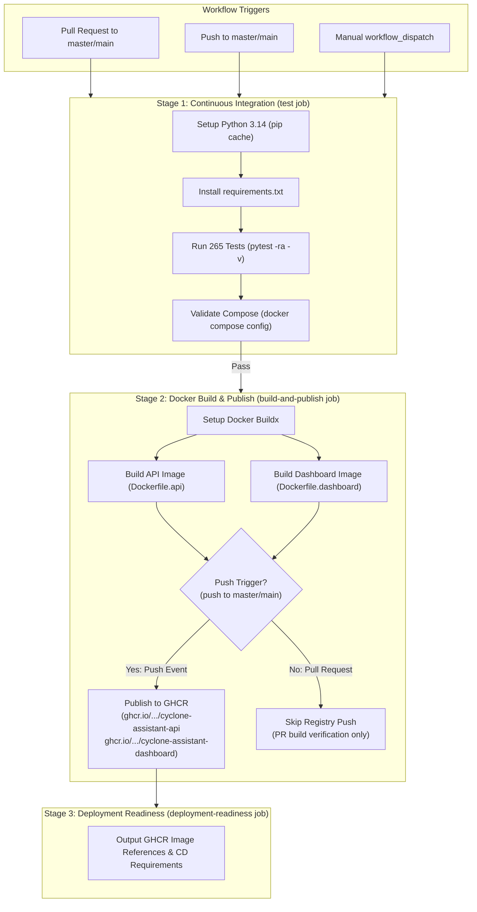

# Phase 2.6 — GitHub Actions CI/CD Pipeline Specification

**Project:** Coastal Karnataka Cyclone Preparedness & Decision-Support System  
**Milestone:** Phase 2.6 GitHub Actions CI/CD Pipeline  
**Status:** Implemented & Locally Verified  
**Date:** 2026-11-08  
**Verification Baseline:** 265 Passing Tests (Including 7 Pipeline Contract Tests), Compose Config Validated  

---

## 1. Workflow Architecture & Design

The GitHub Actions CI/CD pipeline automates verification, Docker image construction, and image publishing for the cyclone preparedness assistant. The workflow is defined in [`.github/workflows/ci-cd.yml`](file:///home/bhavanish/cyclone-preparedness-assistant/.github/workflows/ci-cd.yml).

The pipeline follows a strict, sequential gating model:
1. **Continuous Integration (`test` job):**
   - Checks out the repository.
   - Sets up Python 3.14 with pip dependency caching.
   - Installs pinned production dependencies from `requirements.txt`.
   - Executes the full 265-test pytest suite (including AHP decision logic, K-Means archetypes, registered model inference, Evidently monitoring, and pipeline contracts).
   - Validates `docker-compose.yml` structural integrity using `docker compose config --quiet`.
   - Tests run entirely offline without requiring external W&B credentials or cloud network calls.

2. **Container Build & Registry Publishing (`build-and-publish` job):**
   - Strictly gated: Depends on the `test` job passing (`needs: test`).
   - Uses a parallel build matrix for `api` and `dashboard` services.
   - Configures Docker Buildx and GitHub Actions layer caching (`type=gha`).
   - Extracts semantic metadata and tags via `docker/metadata-action`.
   - On **Pull Requests**: Builds both container images to verify Dockerfile validity and layer compilation, but **does not authenticate or push to GHCR** (`push: false`).
   - On **Push to Default Integration Branch (`master`/`main`)**: Authenticates to GitHub Container Registry using `GITHUB_TOKEN` and publishes both container images with immutable SHA tags, branch tags, and `latest`.

3. **Deployment Readiness Gate (`deployment-readiness` job):**
   - Formally verifies that all CI tests passed and that container images are published to GHCR.
   - Logs immutable artifact identifiers and documents remaining CD deployment requirements.



---

## 2. Trigger Conditions & Branch Decisions

### Publishing Branch Selection
- **Active Repository Branch:** `master`
- **Origin HEAD Reference:** `refs/remotes/origin/HEAD -> origin/master`
- **Decision:** The workflow configures `master` as the primary integration and publishing branch, while also including `main` for forward compatibility if the repository is ever renamed.

### Trigger Specification
```yaml
"on":
  push:
    branches:
      - master
      - main
  pull_request:
    branches:
      - master
      - main
  workflow_dispatch:
```

### Concurrency Control
```yaml
concurrency:
  group: ${{ github.workflow }}-${{ github.ref }}
  cancel-in-progress: ${{ github.event_name == 'pull_request' }}
```
Stale pull-request builds are cancelled automatically when new commits are pushed, conserving CI runner compute.

---

## 3. GitHub Permissions & Least Privilege Model

The workflow enforces a strict least-privilege security model:
- **Top-Level Default:**
  ```yaml
  permissions:
    contents: read
  ```
- **`test` Job:**
  - `contents: read` (read-only access to repository code).
- **`build-and-publish` Job:**
  - `contents: read` (read source code and Dockerfiles).
  - `packages: write` (required to push OCI images to `ghcr.io`).
- **PR Security Guardrail:**
  - The login step and registry push action are explicitly disabled on pull requests:
    ```yaml
    if: ${{ github.event_name != 'pull_request' && (github.ref == 'refs/heads/master' || github.ref == 'refs/heads/main') }}
    ```
  - Untrusted PRs cannot leak secrets or overwrite container images in the registry.

---

## 4. Container Images and Tagging Strategy

### Image Names in GHCR
Images are published under the repository owner's namespace in GitHub Container Registry:
- **FastAPI Backend:**
  `ghcr.io/<owner>/cyclone-assistant-api`
- **Streamlit Frontend:**
  `ghcr.io/<owner>/cyclone-assistant-dashboard`

*(Note: Docker/OCI standards mandate lowercase image names; `docker/metadata-action` automatically normalizes repository owner names to lowercase).*

### Tagging Policy
Every published build produces multiple identifiers to avoid reliance on `latest`:
1. **Commit SHA Tag (Immutable):**
   `sha-<7-char-sha>` (e.g., `sha-a1b2c3d`)  
   *Enables reproducible rollbacks and exact deployment provenance.*
2. **Branch Tracking Tag (Mutable):**
   `<branch-name>` (e.g., `master` or `main`)  
   *Tracks the latest successful build of the integration branch.*
3. **Latest Tag (Stable Default):**
   `latest`  
   *Enabled exclusively on pushes to the default branch (`master` or `main`).*

---

## 5. Inspecting Workflow Results on GitHub

When code is pushed to GitHub:
1. Navigate to the repository page: `https://github.com/Bhavanish5041/cyclone-preparedness-assistant`.
2. Click the **Actions** tab.
3. Select the workflow run: **CI/CD Pipeline - Test, Build & Publish**.
4. Review the stages:
   - **`Pytest Test Suite & Configuration Validation`**: Inspect test outputs, individual assertions, and `docker compose config` validation.
   - **`Build & Publish (api)`**: Inspect Buildx layer caching and image metadata.
   - **`Build & Publish (dashboard)`**: Inspect Streamlit frontend image construction.
   - **`Deployment Readiness Verification`**: Review output image digests and deployment summary.
5. Published packages appear in the repository sidebar under **Packages**.

---

## 6. How to Pull and Run Published GHCR Images

Once images are published to GHCR, operators can pull and run them on any Docker host:

### Authentication (if package visibility is Private)
```bash
echo $CR_PAT | docker login ghcr.io -u <GITHUB_USERNAME> --password-stdin
```
*(If the package visibility is set to Public in repository settings, no authentication is needed to pull).*

### Pulling Specific Version
```bash
# Pull by immutable commit SHA
docker pull ghcr.io/bhavanish5041/cyclone-assistant-api:sha-a1b2c3d
docker pull ghcr.io/bhavanish5041/cyclone-assistant-dashboard:sha-a1b2c3d

# Or pull the latest stable release
docker pull ghcr.io/bhavanish5041/cyclone-assistant-api:latest
docker pull ghcr.io/bhavanish5041/cyclone-assistant-dashboard:latest
```

### Running via Docker Compose
Operators can configure production `docker-compose.prod.yml`:
```yaml
services:
  api:
    image: ghcr.io/bhavanish5041/cyclone-assistant-api:latest
    ports:
      - "8000:8000"
    environment:
      - WANDB_MODEL_ARTIFACT=village-preparedness-classifier:v0
    volumes:
      - wandb_cache:/app/.wandb_artifacts_cache
      - monitoring_reports:/app/reports/model_monitoring

  dashboard:
    image: ghcr.io/bhavanish5041/cyclone-assistant-dashboard:latest
    ports:
      - "8501:8501"
    environment:
      - CYCLONE_API_BASE_URL=http://api:8000

volumes:
  wandb_cache:
  monitoring_reports:
```

---

## 7. Remaining Continuous Deployment (CD) Requirements

While Continuous Integration (testing, validation, layer caching) and Container Packaging (GHCR publishing) are fully operational in the pipeline, **automatic deployment to a live production environment requires the following external infrastructure decisions**:

1. **Production Hosting Environment:**
   - Selection of deployment platform:
     - Cloud Container Services (e.g., Google Cloud Run, AWS ECS/Fargate, Azure Container Apps).
     - Kubernetes cluster (e.g., GKE, EKS, AKS) with Helm charts or Kustomize manifests.
     - Dedicated VM host running Docker Compose with an automated webhook / runner.
2. **Deployment Secrets & Credentials:**
   - Cloud service account keys (e.g., `GCP_SA_KEY`, `AWS_ACCESS_KEY_ID`, or SSH private keys for remote host dispatch).
3. **Domain & TLS Termination:**
   - Reverse proxy configuration (Nginx, Traefik, Caddy, or Cloud Load Balancer) with SSL/TLS certificates.
4. **Environment Promotion & Approvals:**
   - Staging vs. Production environment protection rules and required manual reviewer approvals in GitHub repository settings.

---

## 8. Static Validation and Verification Results

The workflow and Docker configurations were validated locally without mutating git history:
- **YAML Syntax:** Verified via PyYAML 6.0.3.
- **Workflow Contract Tests:** 7 unit tests in [`tests/test_ci_cd_workflow.py`](file:///home/bhavanish/cyclone-preparedness-assistant/tests/test_ci_cd_workflow.py) pass cleanly.
- **Docker Compose Configuration:** `docker compose config --quiet` passes with zero exit code.
- **Pytest Baseline:** All **265 tests** pass in 12.82 seconds.
- **Git State:** Preserved documentation integrity; no Git commits or pushes executed.
