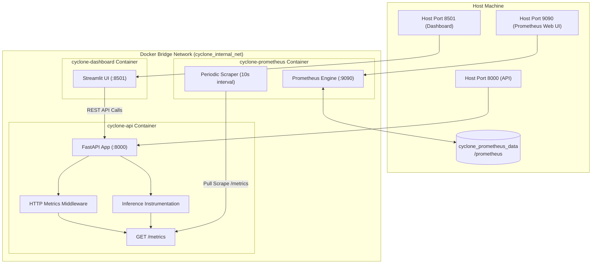

# Phase 2.7 — Production Observability with Prometheus Specification

**Project:** Coastal Karnataka Cyclone Preparedness & Decision-Support System  
**Milestone:** Phase 2.7 Production Observability with Prometheus  
**Status:** Complete & Verified  
**Date:** 2026-11-08  
**Verification Baseline:** 275 Passing Pytest Tests, Live Scrape Target UP in Docker Compose  

---

## 1. Observability Architecture Overview

Phase 2.7 introduces production-grade Prometheus observability into the cyclone preparedness system to monitor application health, request throughput, inference latency, error classification, and ML model availability in real time.

The observability system consists of:
1. **Instrumented FastAPI Backend (`cyclone-api`):**
   - ASGI HTTP middleware capturing request rates, HTTP status codes, and latency histograms for all incoming routes.
   - Bounded endpoint normalizer preventing cardinality explosion by masking path parameters (e.g., converting `/api/v1/units/608720` into `/api/v1/units/{identifier}`).
   - Model inference instrumentation capturing inference execution times, prediction tier counts, boundary case occurrences, and AHP vs ML agreement.
   - Standard exposition endpoint exposed at `GET /metrics` formatted according to Prometheus text exposition specifications.

2. **Official Prometheus Scraper (`cyclone-prometheus`):**
   - Official image `prom/prometheus:latest` orchestrated within `docker-compose.yml`.
   - Connected via the internal bridge network (`cyclone_internal_net`), scraping `http://api:8000/metrics` every 10 seconds.
   - Scrape health check configured via BusyBox `wget` querying `http://localhost:9090/-/healthy`.
   - Metrics data persisted via the named volume `cyclone_prometheus_data`.



---

## 2. Available Prometheus Metrics

All metrics follow Prometheus naming standards (`<namespace>_<subsystem>_<name>_<unit>`) and enforce strictly bounded label sets to guarantee bounded memory consumption.

| Metric Name | Type | Labels | Description |
| :--- | :--- | :--- | :--- |
| `cyclone_http_requests_total` | Counter | `method`, `endpoint`, `status_code` | Total HTTP requests processed across all API routes. |
| `cyclone_http_request_duration_seconds` | Histogram | `method`, `endpoint` | Request duration distribution with buckets: `[0.005, 0.01, 0.025, 0.05, 0.1, 0.25, 0.5, 1.0, 2.5, 5.0, 10.0]`. |
| `cyclone_model_inference_requests_total` | Counter | `status` (`success`, `error`) | Rate of model inference executions. |
| `cyclone_model_inference_duration_seconds` | Histogram | `model_version` (`v0`) | Inference compute latency with buckets: `[0.001, 0.005, 0.01, 0.025, 0.05, 0.1, 0.25, 0.5, 1.0, 2.5]`. |
| `cyclone_model_inference_errors_total` | Counter | `error_type` (`validation_error`, `not_found`, `runtime_error`, `model_unavailable`) | Failures encountered during inference preparation or execution. |
| `cyclone_model_predictions_tier_total` | Counter | `tier` (`High`, `Medium`, `Low`, `unknown`) | Empirical preparedness tier distribution produced by the registered classifier. |
| `cyclone_model_boundary_cases_total` | Counter | `tier` (`High`, `Medium`, `Low`) | Count of predictions falling within boundary ambiguity thresholds (`probability_margin < 0.10`). |
| `cyclone_model_ahp_disagreements_total` | Counter | `agreement_status`, `ahp_tier`, `predicted_tier` | Discordance tracking comparing baseline AHP tier against ML predicted tier. |
| `cyclone_model_loaded` | Gauge | *(none)* | Current model availability in memory (`1.0` = loaded, `0.0` = unavailable). |
| `cyclone_model_info` | Gauge | `artifact_name`, `artifact_version` | Constant `1.0` gauge recording active registered artifact version provenance (`v0`). |

### Cardinality Protection Policy
Prometheus server performance degrades drastically when metrics use unbounded labels. To prevent cardinality explosions:
- **Never Used as Labels:** Census PC11 IDs, SHRIDs, village names, user input strings, latitude/longitude coordinates, or timestamp strings.
- **Route Normalization:** Parameterized route paths (e.g. `/api/v1/units/608720`) are mapped to their route schema template `/api/v1/units/{identifier}`. Unmatched 404 paths are labeled as `"unmatched"`.
- **Value Whitelisting:** HTTP methods, tier names, and error types are validated against finite whitelists (`ALLOWED_METHODS`, `ALLOWED_TIERS`, `ALLOWED_ERROR_TYPES`).

---

## 3. Difference Between Service Observability and Model Monitoring

A critical requirement of Phase 2 is maintaining architectural separation between live operational telemetry and statistical quality evaluation:

| Dimension | Service Observability (Prometheus) | Model Quality Monitoring (Evidently / Batch) |
| :--- | :--- | :--- |
| **Operational Goal** | Monitor API availability, error rates, latency percentiles, and traffic surges. | Assess statistical data drift, target drift, calibration degradation, and prediction shifts. |
| **Data Scope** | Single live request stream in real time. | Batch datasets (reference baseline vs current production slice). |
| **Statistical Validity** | No statistical inference; simple event counting and timer histograms. | Rigorous two-sample statistical tests (Kolmogorov-Smirnov, Wasserstein distance, PSI). |
| **Storage / Retention** | Time-series database (TSDB) in memory and short-to-medium rolling retention. | Static HTML audit reports and JSON metric summaries written to `/reports/model_monitoring/`. |
| **Drift Assertion** | **Never asserts live data drift** on single individual inference requests. | Formally asserts drift when a statistically sufficient sample slice is evaluated. |

---

## 4. Prometheus Scrape Configuration

Prometheus configuration is declared in [`monitoring/prometheus/prometheus.yml`](file:///home/bhavanish/cyclone-preparedness-assistant/monitoring/prometheus/prometheus.yml):

```yaml
global:
  scrape_interval: 15s
  evaluation_interval: 15s
  scrape_timeout: 10s

scrape_configs:
  - job_name: "cyclone-assistant-api"
    metrics_path: "/metrics"
    scrape_interval: 10s
    scrape_timeout: 5s
    static_configs:
      - targets: ["api:8000"]
        labels:
          environment: "production"
          service: "cyclone-api"
          system: "cyclone-decision-support"
```

---

## 5. Docker Orchestration and Startup

Prometheus is integrated directly into [`docker-compose.yml`](file:///home/bhavanish/cyclone-preparedness-assistant/docker-compose.yml):

```yaml
  prometheus:
    image: prom/prometheus:latest
    container_name: cyclone-prometheus
    restart: unless-stopped
    ports:
      - "${PROMETHEUS_PORT:-9090}:9090"
    volumes:
      - ./monitoring/prometheus/prometheus.yml:/etc/prometheus/prometheus.yml:ro
      - prometheus_data:/prometheus
    command:
      - "--config.file=/etc/prometheus/prometheus.yml"
      - "--storage.tsdb.path=/prometheus"
      - "--web.enable-lifecycle"
    networks:
      - cyclone-net
    depends_on:
      api:
        condition: service_healthy
    healthcheck:
      test: ["CMD", "wget", "-q", "--tries=1", "--spider", "http://localhost:9090/-/healthy"]
      interval: 15s
      timeout: 5s
      retries: 3
      start_period: 10s

volumes:
  prometheus_data:
    name: cyclone_prometheus_data
```

### Starting the Services
```bash
docker compose up -d
```

### Verifying Service Health
```bash
docker compose ps
```
Expected output:
```text
NAME                 IMAGE                                SERVICE      STATUS                    PORTS
cyclone-api          cyclone-assistant-api:latest         api          Up 2 minutes (healthy)    0.0.0.0:8000->8000/tcp
cyclone-dashboard    cyclone-assistant-dashboard:latest   dashboard    Up 2 minutes (healthy)    0.0.0.0:8501->8501/tcp
cyclone-prometheus   prom/prometheus:latest               prometheus   Up 2 minutes (healthy)    0.0.0.0:9090->9090/tcp
```

---

## 6. Inspecting Metrics and Operational Dashboards

### Direct Metrics Scraping (cURL)
```bash
# Query API raw metrics
curl -s http://localhost:8000/metrics | grep cyclone_
```

### Prometheus Web UI
Access the Prometheus expression browser at:  
`http://localhost:9090`

### Example PromQL Queries
1. **Model Loaded Status:**
   ```promql
   cyclone_model_loaded
   ```
2. **Inference Request Rate (Per Minute):**
   ```promql
   rate(cyclone_model_inference_requests_total[1m]) * 60
   ```
3. **95th Percentile HTTP Request Latency:**
   ```promql
   histogram_quantile(0.95, sum(rate(cyclone_http_request_duration_seconds_bucket[5m])) by (le, endpoint))
   ```
4. **Predicted Tier Ratio:**
   ```promql
   sum by (tier) (cyclone_model_predictions_tier_total) / ignoring(tier) group_left sum(cyclone_model_predictions_tier_total)
   ```
5. **Discordance Rate (AHP vs ML Disagreements):**
   ```promql
   sum(cyclone_model_ahp_disagreements_total{agreement_status="BORDERLINE_DISAGREEMENT"})
   ```

---

## 7. Operational Limitations & Remaining Observability Gaps

While Prometheus provides real-time operational and service-level transparency, the following areas remain for full enterprise monitoring:
1. **Grafana Visualization Layer:** Prometheus serves time-series data; a dedicated Grafana dashboard service can be layered over Prometheus for visual dashboards.
2. **Alertmanager Integration:** Prometheus alert rules (e.g. alerting when error rate exceeds 5% or model loaded drops to 0) require configuring Alertmanager for PagerDuty/Slack routing.
3. **Distributed Tracing:** Request traces spanning frontend to backend (e.g., OpenTelemetry / Jaeger) are not currently linked by trace IDs.
4. **Production Authentication:** Prometheus port 9090 is accessible for local inspection. In public cloud environments, ingress authentication (e.g. Basic Auth or OAuth proxy) should protect the metrics endpoint.
