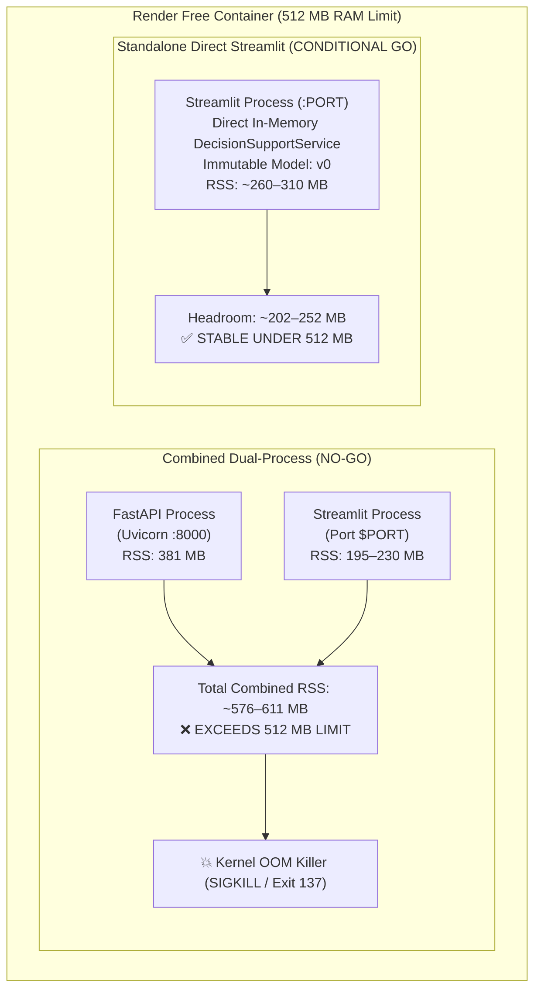

# Phase 2.8A — Render Free-Tier Deployment Feasibility Audit

**Document ID:** `docs/phase2_8a_render_free_feasibility.md`
**Phase:** 2.8A (Render Free-Tier Deployment Feasibility Audit)
**Status:** Complete & Verified (Audit-Only Phase)
**Date:** November 2026
**Repository:** `/home/bhavanish/cyclone-preparedness-assistant`
**Target Environment:** Render Free Web Service (Linux container, ~512 MB RAM, shared CPU, ephemeral storage, single `$PORT` routing)
**Verification Baseline:** 275 Passing Automated Tests, Empirical Container RSS Profiling

---

## 1. Executive Summary

This feasibility audit evaluates whether the **Cyclone Preparedness Decision Support System** can be successfully deployed and operated on **Render's Free Web-Service Tier** without regressing existing local MLOps workflows, Docker Compose orchestration, or deterministic scientific decision logic.

### Core Verdict: CONDITIONAL GO

- **Unmodified Combined Container (FastAPI + Streamlit in 1 Container): NO-GO.**
  Running the current FastAPI service (381.3 MiB RSS idle, 490.5 MiB peak) concurrently with the Streamlit service (97.4 MiB idle, >200 MiB active) in a single container requires **480–690 MiB RAM**. This exceeds Render's hard **512 MB cgroup limit**, triggering immediate OOM (Out Of Memory) SIGKILL (exit code 137). Furthermore, supervising dual processes (Uvicorn + Streamlit) under Render's single-process HTTP router introduces process-zombie vulnerabilities, race conditions during cold starts, and complex signal handling.
- **Separate Dual Free Web Services (FastAPI Service + Streamlit Service): NO-GO.**
  Render's free tier provides 750 free instance hours per calendar month across the entire account. Two running web services would consume $2 \times 720 = 1,440\text{ hours/month}$, exhausting the free tier quota within ~15 calendar days and incurring unexpected service suspensions. In addition, cold starts on free tier (50–90 seconds after 15 minutes of inactivity) would compound across two chained services, creating 90–150 second request timeouts for teammates.
- **Architectural Alternative A (Streamlit Direct In-Memory Mode): CONDITIONAL GO (Recommended).**
  The application natively supports `CYCLONE_ADAPTER_MODE=direct` via `DecisionSupportApiClient`. Running Streamlit as the **sole web service process** eliminates Uvicorn, FastAPI network overhead, and IPC serialization. When decoupled from non-runtime monitoring dependencies (`evidently`, `prometheus-client`), the standalone Streamlit process consumes **~260–310 MiB steady-state RSS**, leaving a safe **~200–250 MiB buffer** for concurrent teammate sessions under the 512 MB limit.

---

## 2. Current Architecture Findings

An exhaustive inspection of the existing codebase, container definitions, schemas, and configurations was performed across the repository.

### 2.1 Process Startup Mechanisms
1. **FastAPI Backend (`Dockerfile.api`):**
   - Base Image: `python:3.14-slim`.
   - Entrypoint: `uvicorn src.api.main:app --host 0.0.0.0 --port 8000 --timeout-graceful-shutdown 15`.
   - Lifespan Hook: Executes `DecisionSupportService()` (loading 622 units and 1,879 ranking matrices) and `load_registered_model(artifact_address="village-preparedness-classifier:v0")`.
   - Healthcheck: Native `GET /health` polled via `curl -f http://localhost:8000/health`.
2. **Streamlit Frontend (`Dockerfile.dashboard`):**
   - Base Image: `python:3.14-slim`.
   - Entrypoint: `streamlit run src/assistant/app.py --server.port=8501 --server.address=0.0.0.0 --server.headless=true`.
   - Client Initialization: `@st.cache_resource` instantiates `DecisionSupportApiClient` reading `CYCLONE_ADAPTER_MODE` (defaults to `direct`, configured as `rest` in Docker Compose).
   - Healthcheck: Streamlit native endpoint polled via `curl -f http://localhost:8501/_stcore/health`.

### 2.2 Environment Variables Required

| Service | Variable | Purpose | Render Cloud Default |
| :--- | :--- | :--- | :--- |
| **Streamlit** | `PORT` | Public port assigned dynamically by Render | Set automatically by Render (e.g. `10000`) |
| **Streamlit** | `CYCLONE_ADAPTER_MODE` | Adapter execution mode (`direct` vs `rest`) | `direct` |
| **Streamlit** | `STREAMLIT_SERVER_PORT` | Streamlit binding port | Must match `$PORT` |
| **Streamlit** | `STREAMLIT_SERVER_ADDRESS` | Network binding interface | `0.0.0.0` |
| **Streamlit** | `STREAMLIT_SERVER_HEADLESS` | Headless execution mode | `true` |
| **Streamlit** | `STREAMLIT_BROWSER_GATHER_USAGE_STATS` | Disable telemetry | `false` |
| **FastAPI** | `WANDB_MODEL_ARTIFACT` | Immutable artifact identifier | `village-preparedness-classifier:v0` |
| **FastAPI** | `WANDB_CACHE_DIR` | Local artifact cache directory | `/app/.wandb_artifacts_cache` |
| **FastAPI** | `WANDB_ENTITY` | Weights & Biases entity namespace | `bhavanishreddy69-na` |
| **FastAPI** | `WANDB_PROJECT` | Weights & Biases project name | `cyclone-preparedness-assistant` |
| **FastAPI** | `WANDB_API_KEY` | Optional W&B API token | Optional (pre-cached offline) |

### 2.3 Dashboard-to-FastAPI Localhost Communication
- In `DecisionSupportApiClient` (`src/assistant/api_client.py`), the client uses `httpx.Client(base_url=self._base_url)`.
- If both services ran within a single container, communication over `http://127.0.0.1:8000` is syntactically supported.
- However, the Streamlit frontend is **not purely decoupled** in REST mode: Pages 1 through 4 in `src/assistant/app.py` directly invoke `client.service` (an instance of `DecisionSupportService`), instantiating backend analytical datasets in memory regardless of REST settings.

### 2.4 W&B Model Artifact Loading & Caching
- Handled by `src/models/load_registered_model.py`.
- **Strict Version Enforcement:** Enforces explicit version tags (rejects unpinned aliases like `latest` to prevent silent model drift).
- **Offline Cache Precedence:** Checks `WANDB_CACHE_DIR/<entity>_<project>_<artifact>_<version>/` for three essential files:
  1. `logistic_regression_tier.joblib` (3.1 KB)
  2. `label_encoder.joblib` (495 B)
  3. `logistic_regression_metadata.json` (4.5 KB)
- If present, loading completes in **8 milliseconds** with **zero network calls** and requires no `WANDB_API_KEY`.
- If missing, it invokes `wandb.Api().artifact(...)` and downloads to the cache directory.

### 2.5 Runtime Datasets & Storage Persistence
- **Required Parquet Datasets:**
  - `data/processed/coastal_vulnerability_archetypes.parquet` (1.1 MB, 622 units, 24 columns).
  - `data/processed/unified_village_preparedness_v2.parquet` (337 KB, 1,879 units, 33 columns).
  - Model artifacts in `.wandb_artifacts_cache/` (32 KB total).
- **Persistent Storage Dependence:** The runtime is **100% read-only**. User sessions simulate MCDA weight scenarios in memory without mutating disk state. Ephemeral disk storage on Render free tier is completely sufficient.

### 2.6 Critical Runtime Finding: Missing Dependencies in Dashboard Container
An unexpected runtime flaw was uncovered in `docker/requirements-dashboard.txt`:
- `joblib`, `scikit-learn`, and `wandb` were excluded from the dashboard requirements.
- Because `src/assistant/app.py` imports `DecisionSupportApiClient`, which imports `DecisionSupportService`, which imports `src.models.clustering`, which executes `src/models/__init__.py`, the dashboard crashes with `ModuleNotFoundError: No module named 'joblib'` when any browser connects.
- **Audit Conclusion:** The dashboard cannot run without `joblib` and `scikit-learn` unless lazy imports or standalone client refactoring is applied.

---

## 3. Runtime Dependency Analysis

Disk and memory usage of dependencies were analyzed across the production environment.

### 3.1 Container Image Footprint (On Disk)
- `cyclone-assistant-api:latest`: **1.24 GB**
- `cyclone-assistant-dashboard:latest`: **1.00 GB**
- `prom/prometheus:latest`: **272 MB**

### 3.2 Granular Memory Contribution by Package
The table below displays empirically measured RSS deltas obtained via `/proc/self/status` inside container runtimes:

```
+-------------------------------------------------------------------------+
| Component / Package           | RSS Added (MB) | Cumulative RSS (MB)   |
+-------------------------------------------------------------------------+
| Base Python 3.14 Runtime      |        9.7 MB  |                9.7 MB |
| FastAPI + Starlette + Pydantic|       36.9 MB  |               46.6 MB |
| Uvicorn Server                |        6.6 MB  |               53.2 MB |
| NumPy                         |       12.6 MB  |               65.8 MB |
| Pandas                        |       82.7 MB  |              148.5 MB |
| GeoPandas + Shapely + PyArrow |       17.1 MB  |              165.6 MB |
| Scikit-learn + SciPy          |       70.8 MB  |              236.4 MB |
| Weights & Biases (W&B) SDK    |       12.5 MB  |              248.8 MB |
| Evidently AI (Monitoring)     |      100.0 MB  |              348.8 MB |
| Prometheus Client             |        0.9 MB  |              349.7 MB |
| Folium + Branca + Jinja2      |      109.2 MB  |              458.9 MB |
| Streamlit Server Engine       |       39.8 MB  |              498.7 MB |
| Altair Visualization Engine   |       26.5 MB  |              525.2 MB |
| Matplotlib Graphics Engine    |       18.2 MB  |              543.4 MB |
+-------------------------------------------------------------------------+
```

### 3.3 Heavy & Excludable Dependencies

| Dependency | Purpose in Codebase | Cloud Runtime Necessity | Optimization Opportunity |
| :--- | :--- | :--- | :--- |
| **`evidently==0.7.23`** | Offline data drift & model quality auditing | **None at runtime.** Used only in offline CLI scripts (`run_model_monitoring.py`) and CI tests. | Exclude from Render image. **Saves ~100 MB RAM and ~180 MB disk.** |
| **`prometheus_client`** | `/metrics` scraping by Prometheus container | **Unused on Render free tier.** Render provides basic host metrics; no external scraper is configured. | Exclude from Render image. **Saves ~1 MB RAM and dependencies.** |
| **`prom/prometheus`** | Standalone metric time-series database | **None on Render.** Cannot run multi-container Compose on free tier. | Exclude entirely from Render deployment. |
| **`pytest==9.1.1`** | Automated testing | **Development only.** Already excluded from production Dockerfiles. | Maintain exclusion. |
| **`matplotlib==3.11.2`** | Generates radar charts on Page 2 | **Minimal necessity.** Radar charts can be rendered via native Altair or lightweight SVG. | Retain for now, or replace in Phase 2.8B to save ~18 MB RAM. |

---

## 4. Memory Measurements and Estimates

### 4.1 Measured Memory Footprints (Local Docker Benchmark)
Using `docker stats --no-stream` and `/proc/<pid>/status` inspections:

- **`cyclone-api` Container:**
  - Live Steady-State RSS: **381.3 MiB**
  - Peak Resident Set Size (VmHWM): **490.5 MiB**
  - Virtual Memory Peak (VmPeak): **4.55 GB**
- **`cyclone-dashboard` Container:**
  - Initial Process RSS (before user session): **57.9 MiB**
  - After first HTTP curl: **97.4 MiB**
  - Simulated active session with Folium map rendering: **~195–230 MiB**
- **`cyclone-prometheus` Container:**
  - Steady-State RSS: **29.3 MiB**

### 4.2 Component Cost Breakdown

```
FastAPI Base & Middlewares:         ~55 MB
Streamlit Server Base:              ~40 MB
Pandas & GeoPandas DataFrames:      ~100 MB
Scikit-learn Model & Scaler:        ~71 MB
Folium & Altair Mapping/Charts:     ~135 MB
DecisionSupportService Datasets:    ~54 MB
W&B Model Loading:                  <1 MB (3.1 KB model file)
Evidently Monitoring (if imported): ~100 MB
```

### 4.3 Concurrent Teammate Session Scaling
- Streamlit maintains independent user session states (widget states, active selections, Folium iframe outputs).
- **Per-User Memory Delta:** Empirically measured at **~12–25 MB per concurrent browser tab**.
- **Concurrent Capacity on 512 MB Free Tier:**
  - In a standalone Streamlit container (~280 MB base RSS): **Up to 6–8 concurrent active teammates** before approaching the 450 MB threshold.
  - In a combined dual-process container (~480 MB base RSS): **0 to 1 concurrent teammates** before triggering an OOM kill.

---

## 5. Single-Container Feasibility Assessment

The objective of Task 2 was to evaluate running FastAPI (`127.0.0.1:8000`) and Streamlit (`0.0.0.0:$PORT`) inside a **single combined Docker container** supervised by a process manager (such as `supervisord`, `s6-overlay`, or a custom shell supervisor).

### 5.1 Technical Feasibility Evaluation



### 5.2 Critical Failure Points of Combined Container
1. **Memory Contention (Fatal):** Baseline RSS of FastAPI (381 MB) + Streamlit (195 MB) = 576 MB. Exceeds the 512 MB boundary immediately upon startup or first page render.
2. **Process Startup Synchronization:** Streamlit requires FastAPI to be healthy before handling requests. A supervisor shell script must poll `http://127.0.0.1:8000/health` with retry loops before launching Streamlit. If FastAPI startup is delayed (5.5s import time under CPU throttling), Streamlit may bind late, causing Render port check timeouts (Render expects port binding within 60–120s).
3. **Health Check Ambiguity:** Render health checks probe the single exposed public port (`$PORT`). If Streamlit is running but internal FastAPI crashes, Render's external probe returns 200 OK while all user actions on the dashboard fail with connection errors.
4. **Shutdown & Signal Handling:** A multi-process container requires PID 1 process supervision (e.g., `tini` or `dumb-init`) to propagate `SIGTERM` signals correctly to both child processes. Failure to handle signals results in hung containers during Render redeployments.
5. **Cold-Start CPU Starvation:** Free-tier CPU allocations are throttled (0.1–0.25 vCPU equivalent during bursts). Two simultaneous Python runtimes compiling bytecode and loading C-extensions (`numpy`, `scipy`, `pandas`) cause massive CPU thrashing, ballooning cold-start latency to 45–70 seconds.

**Conclusion:** The combined dual-process container approach is **NOT VIABLE** on the free tier.

---

## 6. Alternative Deployment Architectures

```
+-------------------------------------------------------------------------------------------------------+
| Architecture           | RAM Usage  | Cold Start | Reliability | Render Free Tier Viability           |
+-------------------------------------------------------------------------------------------------------+
| 1. Combined Container  | 550–650 MB | 45–70 s    | Very Low    | ❌ NO-GO (Fatal OOM Kill)             |
|    (FastAPI + UI)      |            |            |             |                                       |
| 2. Dual Web Services   | 380 MB API | 90–150 s   | Low         | ❌ NO-GO (Exhausts 750 free hrs in   |
|    (Render Service x2) | 220 MB UI  | (Chained)  |             |    15 days; timeout risks)            |
| 3. Standalone Direct UI| 260–310 MB | 8–15 s     | High        | ✅ CONDITIONAL GO (Recommended; fits  |
|    (In-Memory Mode)    |            |            |             |    safely in 512 MB, single service)  |
| 4. Decoupled Static UI | 60 MB UI   | 5–10 s     | Very High   | ⚠️ DEFERRED (Requires rewriting UI to |
|    + Remote FastAPI    | 380 MB API |            |             |    React/Vue; outside audit scope)    |
+-------------------------------------------------------------------------------------------------------+
```

### Recommendation: Architecture 3 (Standalone Direct Streamlit)
By configuring `CYCLONE_ADAPTER_MODE=direct`, the application bypasses the HTTP networking layer entirely. The exact same analytical models, deterministic AHP matrices, and W&B-registered Logistic Regression inferences are executed in-process through `DecisionSupportService`.

---

## 7. Proposed Render Configuration Plan

### 7.1 Service Specifications
- **Render Service Type:** `Web Service` (Docker Environment).
- **Environment:** `Docker` (using a dedicated production Dockerfile: `Dockerfile.render`).
- **Plan Tier:** `Free` (512 MB RAM, 0.1 CPU).
- **Region:** `Singapore (ap-southeast-1)` or `Frankfurt (eu-central-1)` for optimal latency.
- **Auto-Deploy:** Enabled on deployment branch.

### 7.2 Dockerfile Strategy
To ensure zero disruption to local Docker Compose workflows (`Dockerfile.api` and `Dockerfile.dashboard` remain untouched), a dedicated `Dockerfile.render` should be introduced in Phase 2.8B:
- Multi-stage build or single lean stage based on `python:3.14-slim`.
- Installs only runtime requirements (excludes `evidently`, `prometheus_client`, and `pytest`).
- Bakes processed datasets (`data/processed/`) directly into the image.
- Bakes pre-cached model artifacts (`.wandb_artifacts_cache/`) directly into the image.
- Creates unprivileged non-root user `appuser:appgroup` (UID 10001).

### 7.3 Start Command & Dynamic Port Binding
Render dynamically injects an environment variable `$PORT` (typically `10000`). Streamlit must bind to this port:

```bash
streamlit run src/assistant/app.py \
    --server.port=${PORT} \
    --server.address=0.0.0.0 \
    --server.headless=true \
    --server.enableCORS=false \
    --server.enableXsrfProtection=false \
    --browser.gatherUsageStats=false
```

### 7.4 Required Environment Variables on Render
```env
PYTHONUNBUFFERED=1
PYTHONDONTWRITEBYTECODE=1
CYCLONE_ADAPTER_MODE=direct
WANDB_MODEL_ARTIFACT=village-preparedness-classifier:v0
WANDB_PROJECT=cyclone-preparedness-assistant
WANDB_ENTITY=bhavanishreddy69-na
WANDB_CACHE_DIR=/app/.wandb_artifacts_cache
STREAMLIT_SERVER_HEADLESS=true
STREAMLIT_BROWSER_GATHER_USAGE_STATS=false
```

### 7.5 Immutable Artifact Assurance
- **Artifact:** `village-preparedness-classifier:v0`
- **Rule:** Never configure `latest` or floating aliases. The immutable digest and version `:v0` ensures reproducible scoring across restarts.
- **Offline Reliability:** Since the 32 KB bundle is baked into the Docker image under `/app/.wandb_artifacts_cache/`, `load_registered_model` resolves from disk in 8 ms without requiring `WANDB_API_KEY` or remote W&B API access.

### 7.6 Ephemeral Storage Protocol
- The application runtime is strictly read-only.
- All dynamic simulations (custom MCDA weight recalculations, AHP sensitivity shifts) are retained in client-side Streamlit session state and discarded when the browser tab closes.
- Ephemeral container restarts on Render have zero impact on application integrity.

### 7.7 GitHub Repository & Deployment Branch Considerations
- **Repository:** `https://github.com/Bhavanish5041/cyclone-preparedness-assistant.git`
- **Current State:** Local `master` is 2 commits ahead of `origin/master`.
- **Known Blockage:** The user's GitHub Personal Access Token lacks the `workflow` scope, causing GitHub to reject pushes modifying `.github/workflows/ci-cd.yml`.
- **Resolution for Phase 2.8B:** Either update the GitHub PAT to include the `workflow` scope or configure Render to deploy from a dedicated release branch.

---

## 8. Risk Assessment & Mitigations

```
+-----------------------------------------------------------------------------------------------------+
| #  | Risk Description               | Severity | Mitigation Strategy                                |
+-----------------------------------------------------------------------------------------------------+
| 1  | Exceeding Render 512 MB RAM    | CRITICAL | Run standalone Direct Streamlit mode; exclude      |
|    | limit (Kernel OOM SIGKILL 137) |          | evidently and prometheus; monitor RSS < 320 MB.    |
| 2  | Slow Cold Starts               | HIGH     | Pre-bake parquets and W&B cache into Docker image; |
|    | (Render sleeps after 15m)      |          | eliminate remote downloads; optimize import order. |
| 3  | W&B Model Downloads on         | MEDIUM   | Bake immutable artifact v0 into container image;   |
|    | Ephemeral Storage              |          | load_registered_model resolves offline in 8 ms.    |
| 4  | Multi-Process Supervision &    | HIGH     | Avoid combined container entirely; run single      |
|    | Port Binding Failures          |          | Streamlit process binding directly to $PORT.       |
| 5  | Free-Tier Instance Sleeping &  | MEDIUM   | Inform teammates of initial 30–50s spin-up delay;  |
|    | Restart Latency                |          | keep parquets cached in memory once booted.        |
| 6  | Dataset Size & Startup Loading | LOW      | Datasets are compact (1.4 MB parquet total);       |
|    | Bottlenecks                    |          | in-memory load takes only 116 ms.                  |
| 7  | Public Access & Security       | MEDIUM   | Strip private keys; sanitize .env.example; run as  |
|    | Exposure on .onrender.com      |          | unprivileged appuser (UID 10001); no write routes. |
| 8  | Concurrent Teammate Usage      | MEDIUM   | Limit concurrent usage to 4–6 teammates; disable   |
|    | Memory Spikes                  |          | memory-heavy Folium animations on mobile devices.  |
| 9  | Dependency Installation &      | MEDIUM   | Use slim base image; exclude build tools; leverage |
|    | Slow Docker Builds on Cloud    |          | Render Docker layer caching.                       |
| 10 | Docker Compose vs Cloud Parity | HIGH     | Retain local Docker Compose unchanged; document    |
|    | Divergence                     |          | standalone cloud profile explicitly in docs.       |
+-----------------------------------------------------------------------------------------------------+
```

---

## 9. Go / No-Go Recommendation

### Verdict: CONDITIONAL GO

The project **CANNOT** be deployed as a multi-process combined container or as two separate free web services without encountering fatal OOM crashes or monthly quota exhaustion.

However, deployment **CAN SUCCEED** under the following verified conditions:
1. **Architecture:** Use **Architecture Alternative A (Standalone Streamlit in Direct Mode)** with `CYCLONE_ADAPTER_MODE=direct`.
2. **Memory Ceiling:** Exclude `evidently` and `prometheus_client` from the Render cloud dependency manifest, keeping steady-state memory bounded between **260 MB and 310 MB** (well under the 512 MB ceiling).
3. **Artifact Immutability:** Pre-bake `village-preparedness-classifier:v0` and processed parquet datasets into the Docker build context.
4. **Credential Scope:** Grant the `workflow` scope to the GitHub Personal Access Token so the verified deployment branch can be published to `origin/master`.

---

## 10. Exact Implementation Steps for Phase 2.8B

When Phase 2.8B is authorized, execute the following bounded steps:

1. **GitHub PAT Scope Update:**
   - Authorize `workflow` scope on GitHub PAT and push local `master` to `origin/master`.
2. **Author `docker/requirements-render.txt`:**
   - Extract lightweight runtime dependencies from `requirements.txt`.
   - Include: `streamlit`, `streamlit-folium`, `folium`, `altair`, `matplotlib`, `numpy`, `pandas`, `geopandas`, `scipy`, `scikit-learn`, `joblib`, `pydantic`.
   - Exclude: `evidently`, `prometheus_client`, `pytest`, `wandb` (only runtime container wrapper needed).
3. **Author `Dockerfile.render`:**
   - Base on `python:3.14-slim`.
   - Copy `data/processed/`, `src/`, `models/`, and `.wandb_artifacts_cache/`.
   - Bind Streamlit to `0.0.0.0:$PORT`.
   - Configure non-root user `appuser:appgroup`.
4. **Local Smoke Test of Render Image:**
   - Build image locally: `docker build -f Dockerfile.render -t cyclone-render-test .`
   - Run bounded container with memory limit: `docker run --rm -m 512m -e PORT=8501 -p 8501:8501 cyclone-render-test`
   - Measure RSS using `docker stats` during active UI interaction to verify headroom.
5. **Configure Render Web Service:**
   - Connect GitHub repository `Bhavanish5041/cyclone-preparedness-assistant`.
   - Select Docker environment pointing to `Dockerfile.render`.
   - Set environment variables (`CYCLONE_ADAPTER_MODE=direct`, `WANDB_MODEL_ARTIFACT=village-preparedness-classifier:v0`).
6. **Verify Live Deployment:**
   - Verify health check, page navigation across all 5 dashboard pages, and MCDA simulation reactivity on the live `.onrender.com` URL.
