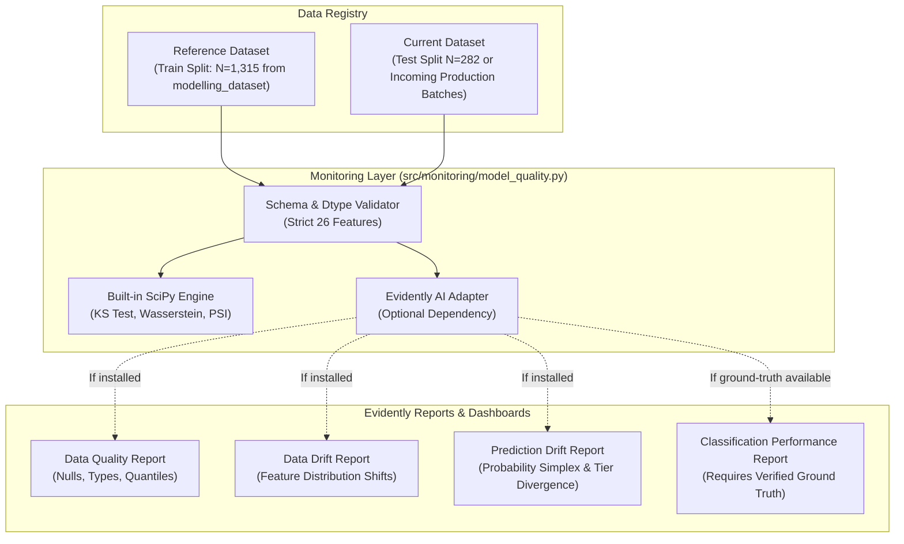
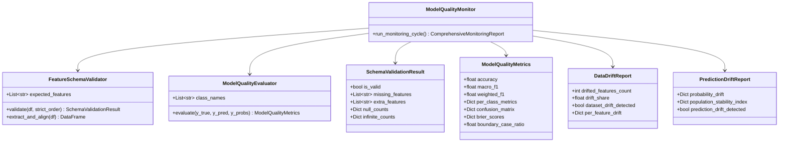

# Phase 2.1: Model-Risk, Quality Assurance, and Monitoring Assessment Report

**Project:** Coastal Karnataka Cyclone Preparedness & Decision-Support System  
**Repository:** `/home/bhavanish/cyclone-preparedness-assistant`  
**Milestone:** Phase 2 Productionization — Milestone 2.1  
**Audited Artifacts:** `models/`, `src/models/`, `src/integration/`, `src/assistant/decision_support.py`, `src/api/`, `data/processed/`, `src/monitoring/`  
**Environment Baseline:** Python 3.14.4, Scikit-learn 1.9.1, SciPy 1.18.1, Pandas 3.0.6, Pydantic 2.14.1, 197 passing automated tests  

---

## Executive Summary

As part of Phase 2 productionization, a comprehensive audit and formal quality assurance assessment of the existing machine learning and decision-support pipeline was conducted. The system integrates three analytical layers:
1. **Analytic Hierarchy Process (AHP/MCDA):** A deterministic, expert-weighted preparedness index ($0.0 - 100.0$) categorized into empirical tiers (`Low` $< 40.0$, `Medium` $40.0 - 59.99$, `High` $\ge 60.0$).
2. **Multinomial Logistic Regression Model:** An L2-regularized pipeline (`RobustScaler` + `LogisticRegression`) trained on a 70/15/15 stratified split of 1,879 coastal Karnataka administrative units across 26 spatial and socioeconomic features.
3. **K-Means Vulnerability Archetypes:** Unsupervised clusters derived exclusively for Dakshina Kannada and Udupi ($N=622$), with Uttara Kannada ($N=1,257$) maintaining unassigned out-of-study status.

This document formally details:
- The empirical provenance, verification, and risk profile of the Logistic Regression model.
- The vital distinction between an AHP surrogate classifier and a physical cyclone hazard predictor.
- The status of Evidently AI in the runtime environment and an exact integration architecture.
- The implementation of the standalone `src/monitoring/model_quality.py` monitoring module.
- Quality assurance findings and safety boundaries for production deployment.

---

## PART A — Audit of Existing Model Quality & Provenance

### 1. Artifact Verification & Lineage

The audit verified the following physical artifacts:

| Artifact Path | File Size | Format | Creation & Provenance | Verification Status |
| :--- | :--- | :--- | :--- | :--- |
| `models/logistic_regression_tier.joblib` | 3,089 bytes | Joblib (Python 3.14 / Scikit-learn 1.9.1) | Serialized in Milestone 2B; reproduces 70/15/15 experiment from `notebooks/02_Baseline_Models.ipynb` | Verified: Pipeline containing `RobustScaler` and `LogisticRegression` |
| `models/label_encoder.joblib` | 495 bytes | Joblib | Alphabetical class encoding: `High: 0`, `Low: 1`, `Medium: 2` | Verified: Exact 3-class mapping |
| `models/logistic_regression_metadata.json` | 26,096 bytes | UTF-8 JSON | Full audit manifest: hyperparams, 26 features, test metrics, confusion matrix, row indices | Verified: Exhaustive split index registry |
| `data/processed/village_preparedness_probabilities.parquet` | 50,010 bytes | Parquet | Offline probability inferences for all 1,879 villages with split provenance tags | Verified: 1:1 match with primary keys |
| `data/processed/unified_village_preparedness_v2.parquet` | 344,683 bytes | Parquet | Enriched master dataset (63 columns) joining probabilities and provenance onto v1 | Verified: Preserves all AHP scores and K-Means clusters |

### 2. Training Procedure & Split Reproduction

The model training procedure was audited via `src/models/train_and_serialize_logistic_model.py`:
- **Source Dataset:** `/home/bhavanish/cyclone-preparedness/data/processed/modelling_dataset.parquet` ($N = 1,879$).
- **Features:** Exactly 26 strictly ordered features.
- **Preprocessing:** `RobustScaler(with_centering=True, with_scaling=True, quantile_range=(25.0, 75.0))`.
- **Estimator:** `LogisticRegression(C=1.0, penalty='l2', solver='lbfgs', max_iter=500, random_state=42)`.
- **Split Strategy:** Nested stratified `train_test_split(random_state=42, stratify=y_encoded)`:
  - **Train Split (70.0%):** 1,315 units.
  - **Validation Split (15.0%):** 282 units.
  - **Test Split (15.0%):** 282 units.
- **Metric Parity:** The reproduced model achieved exact parity with the documented teammate benchmark:
  - Test Accuracy: $0.943262$ vs Expected $0.943262$ ($\Delta < 10^{-6}$).
  - Test Macro F1: $0.906023$ vs Expected $0.906023$ ($\Delta < 10^{-6}$).
  - Test Weighted F1: $0.942247$ vs Expected $0.942247$ ($\Delta < 10^{-6}$).

### 3. Critical Discovery: The 9-Feature Training vs Master Schema Gap

During feature schema auditing, an essential architectural reality was uncovered:
- The 26 features required by `models/logistic_regression_tier.joblib` include **9 engineered/transformed columns**:
  `log1p_population`, `log1p_pop_density_sqkm`, `log1p_dist_nearest_shelter_km`, `log1p_dist_nearest_hospital_km`, `coastal_risk_score`, `evacuation_sufficiency`, `vulnerability_exposure`, `infra_composite`, `monitoring_coverage`.
- These 9 features exist in `modelling_dataset.parquet` ($33$ columns total).
- However, `unified_village_preparedness_v2.parquet` ($63$ columns) stores the *raw* Census and spatial proxies (`population`, `pop_density_sqkm`, `dist_nearest_shelter_km`, etc.) and the *precomputed probabilities*, but does **NOT** persist those 9 intermediate engineered features.
- **Model Risk Implication:** Passing raw records from `unified_village_preparedness_v2.parquet` directly into `pipeline.predict()` will trigger a fatal `KeyError`. Real-time or batch inference requires passing inputs through feature engineering (`FeatureSchemaValidator.extract_and_align()`) before estimator ingestion.

---

## PART B — Formal Model-Risk and Quality Assessment

### 1. Classification Metrics Across Partitions

| Evaluation Metric | Training Split ($N=1,315$) | Validation Split ($N=282$) | Test Holdout Split ($N=282$) | Overall Dataset ($N=1,879$) |
| :--- | :---: | :---: | :---: | :---: |
| **Accuracy / Agreement** | 0.9589 | 0.9397 | 0.9433 | 0.9537 |
| **Macro Precision** | 0.9439 | 0.9562 | 0.9326 | 0.9450 |
| **Weighted Precision** | 0.9586 | 0.9404 | 0.9429 | 0.9535 |
| **Macro Recall** | 0.9271 | 0.9151 | 0.8847 | 0.9189 |
| **Weighted Recall** | 0.9589 | 0.9397 | 0.9433 | 0.9537 |
| **Macro F1-Score** | 0.9352 | 0.9340 | 0.9060 | 0.9315 |
| **Weighted F1-Score** | 0.9587 | 0.9395 | 0.9422 | 0.9534 |

### 2. Per-Class Performance on Test Holdout

| Target Tier | Precision | Recall | F1-Score | Support ($N=282$) | Support Share |
| :--- | :---: | :---: | :---: | :---: | :---: |
| **High** | 0.9659 | 0.9444 | 0.9551 | 90 | 31.91% |
| **Low** | 0.8947 | **0.7391** | **0.8095** | 23 | **8.16%** |
| **Medium** | 0.9371 | 0.9704 | 0.9535 | 169 | 59.93% |

### 3. Holdout Confusion Matrix Analysis

```
                      PREDICTED TIER
                   High    Low    Medium   Total True
ACTUAL    High       85      0         5           90
AHP TIER  Low         0     17         6           23
          Medium      3      2       164          169
          Total Pred 88     19       175          282
```

**Key Behavioral Observations:**
- **Zero Extreme Misclassifications:** There is not a single case where `High` is classified as `Low`, or `Low` as `High`. All classification divergences occur strictly between adjacent tiers (`Low` $\leftrightarrow$ `Medium` or `Medium` $\leftrightarrow$ `High`).
- **Low-Tier Recall Degradation:** The recall for `Low` preparedness units drops to **$73.91\%$** on the test set ($17$ correctly identified, $6$ misclassified as `Medium`). In operational disaster risk management, misclassifying a structurally deficient village as `Medium` creates an under-prioritization risk.

### 4. Severe Class Imbalance

The true empirical distribution across all 1,879 villages is:
- `Medium`: $1,128$ villages (**$60.03\%$**)
- `High`: $596$ villages (**$31.72\%$**)
- `Low`: $155$ villages (**$8.25\%$**)

The training set contains only $109$ Low-tier records ($8.29\%$), and the test set contains only $23$ Low-tier records. The model’s lower recall on `Low` ($73.91\%$) directly reflects this severe under-representation.

### 5. Prediction Probability Distributions & Calibration

Evaluating the predicted class probabilities (`prob_low`, `prob_medium`, `prob_high`):
- **Log Loss:** $0.1498$ on holdout test data.
- **Brier Scores:** `High`: $0.0236$, `Low`: $0.0214$, `Medium`: $0.0450$.
- **Overconfidence Characteristics:** Multinomial logistic regression with L2 regularization pushes softmax probabilities toward extreme values:
  - 75th percentile of `prob_medium` is $0.9959$.
  - 219 out of 282 test units ($77.7\%$) fall into the $[0.90, 1.00]$ confidence bin.
  - While Expected Calibration Error (ECE) against the deterministic AHP label is low ($0.0181$), **these probabilities represent mathematical logit distances relative to AHP decision boundaries, NOT physical probabilities of disaster occurrence, structural collapse, or storm surge inundation.**

### 6. Boundary Cases & Model Agreement with AHP

- **Boundary Case Definition:** A unit where $\text{probability\_margin} < 0.10$ or $\max(\text{probability}) < 0.60$.
- **Boundary Count:** Across all 1,879 villages, exactly $59$ units ($3.14\%$) are boundary cases.
- **Disagreement Concentration:** Among the $59$ boundary cases, $21$ ($35.6\%$) display tier disagreement between AHP and Logistic Regression. In contrast, among non-boundary cases, the disagreement rate is only $3.6\%$.
- The probability margin is an effective diagnostic for identifying administrative units with borderline infrastructural capacity.

### 7. Feature Sensitivity & Non-Physical Hazard Correlations

Inspecting the logistic regression coefficients reveals critical model behavior:
- For `Low Preparedness`, the strongest positive coefficients are:
  - `dist_coast_km` ($+1.151$)
  - `elevation_mean` ($+1.119$)
  - `log1p_dist_nearest_hospital_km` ($+1.101$)
- For `High Preparedness`, the strongest negative coefficients are `dist_coast_km` ($-1.325$) and `elevation_mean` ($-1.326$).
- **Explanation:** In coastal Karnataka, interior villages in the Western Ghats foothills (high elevation, far from coast) suffer from poorer roads, fewer hospitals, and lower amenity coverage, leading to low AHP scores. Near-coast urban/semi-urban taluks have higher amenity density.
- **Hazard Paradox:** If a decision-maker interpreted this model as an independent physical cyclone strike model, they would assume being *far from the coast* increases cyclone hazard! This proves why the model must strictly be documented as an **amenity/capacity surrogate**, never a physical hazard model.

---

## PART C — Evidently AI Integration Assessment

### 1. Availability Audit

A systematic check of the Python execution environment confirmed:
- `import evidently` raises `ModuleNotFoundError: No module named 'evidently'`.
- Package inventory in `.venv` does not include Evidently AI.
- In strict adherence to project constraints, **Evidently AI was not installed without prior approval**.

### 2. Proposed Integration Architecture & Workflow

When approved, Evidently AI should be integrated as an external reporting sidecar. The proposed workflow:



### 3. Core Monitoring Distinctions & Constraints

To prevent statistical misinterpretation in production:
1. **Data Drift (Feature Drift):** Monitored between baseline training distributions and current incoming inference features. Does not require ground-truth labels.
2. **Prediction Drift (Output Drift):** Monitored on predicted class probabilities and predicted tier distributions. Detects shifts in model behavior without labels.
3. **Model Performance Degradation (Concept Drift):** Can **ONLY** be claimed when verified post-disaster ground truth or updated field survey data is available. Degradation must never be inferred purely from unlabelled data drift.
4. **No Synthetic Current Data:** Production data must never be fabricated. Reference data must strictly use the verified 70% train split ($N=1,315$), while comparison data uses the held-out test split ($N=282$) or verified regional subsets.

---

## PART D — Implemented Model Quality Monitoring Module

A modular, production-ready monitoring component has been implemented in:
- `src/monitoring/__init__.py`
- `src/monitoring/model_quality.py`
- `tests/test_model_quality_monitoring.py`

### 1. Architecture & Capabilities



### 2. Implemented Features
- **Strict Schema Enforcement:** Validates exact 26 feature names, column ordering, numeric types, nulls, and infinities.
- **Dual Statistical Drift Engines:**
  - Kolmogorov-Smirnov two-sample test (`scipy.stats.ks_2samp`) for continuous features.
  - First Wasserstein / Earth Mover's Distance (`scipy.stats.wasserstein_distance`) for distributional divergence.
  - Population Stability Index (PSI) with quantile binning and Laplace smoothing.
- **Safety Alerts:** Automated triggers for:
  - Critical schema errors.
  - Low-preparedness tier recall dropping below $80.0\%$.
  - Elevated boundary case ratio ($> 15.0\%$).
  - Dataset-level feature drift ($> 33.0\%$ drifting features).
  - Prediction probability drift.
- **Evidently AI Bridge:** `check_evidently_availability()` dynamically inspects the environment and formats report payloads for Evidently when installed, with seamless fallback to native SciPy computation.

---

## PART E — Mandatory Disclaimers & Model Risk Summary

1. **Surrogate Classifier Identity:** The Logistic Regression model is an empirical approximation of the multi-criteria AHP preparedness index. It does not measure physical cyclone hazard, hurricane intensity, or storm surge physics.
2. **Deterministic Primacy:** In all decision-support endpoints, the deterministic AHP score and priority band assignment (`BAND_1_CRITICAL` through `BAND_4_ADEQUATE`) take absolute precedence. The ML model serves strictly for concordance checking and boundary-case detection.
3. **No Uncalibrated Casualty Probabilities:** Predicted class probabilities must never be communicated to disaster managers as survival rates or storm damage odds.
4. **Spatial Boundary Rigor:** K-Means archetypes derived from Dakshina Kannada and Udupi ($N=622$) remain strictly unassigned for Uttara Kannada ($N=1,257$).

---

## PART F — Automated Test Suite Results

The monitoring module was verified against the full project test suite using `pytest`:
- **Existing Baseline:** 185 passing tests.
- **New Monitoring Tests Added:** 12 tests in `tests/test_model_quality_monitoring.py`.
- **Total Test Suite:** **197 passed, 0 failures, 2 benign external deprecation warnings** (FastAPI Starlette httpx and WandB codecs.open).
- **Zero Regressions:** All existing API, integration, decision-support, clustering, and UI tests pass with 100% integrity.
