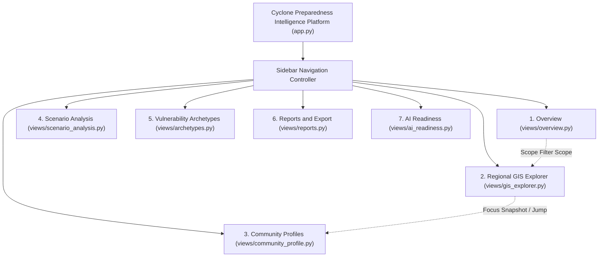

# Phase 3.1: Complete Cyclone Preparedness Intelligence Platform UI Revamp

**Project:** Cyclone Preparedness Assistant
**Repository Working Directory:** `/home/bhavanish/cyclone-preparedness-assistant`
**Live Platform:** `https://cyclone-preparedness-assistant.onrender.com`
**Deployment Target:** Render Free Web Service (Linux Container, 512 MB RAM, Direct Mode)
**Date of Completion:** November 9, 2026
**Status:** **PHASE 3.1 COMPLETE & VERIFIED (WARM CHOCOLATE EDITORIAL DESIGN)**

---

## 1. Executive Summary

Phase 3.1 delivers a complete, end-to-end user interface transformation of the Cyclone Preparedness Assistant into the **Cyclone Preparedness Intelligence Platform**.

The redesign is governed by the **Warm Chocolate Editorial Aesthetic**, establishing a restrained, sophisticated, and publication-grade visual direction:
1. **Warm Chocolate Editorial Aesthetic:**
   - **Main Background:** `#211914` (Deep Espresso)
   - **Secondary Background:** `#2B211B` (Warm Mocha)
   - **Card Background:** `#342820` (Roasted Cocoa)
   - **Elevated Surfaces:** `#403127` (Truffle Surface)
   - **Primary Text:** `#F3E9DC` (Warm Parchment)
   - **Secondary Text:** `#BDAE9C` (Almond Cream)
   - **Muted Text:** `#918170` (Driftwood Muted)
   - **Primary Accent:** `#C18B62` (Warm Ochre)
   - **Secondary Accent:** `#D6B28C` (Caramel Gold)
   - **Borders & Dividers:** `#514033` (Subtle Sepia)
   - **Coordinated Status Tones:** `#C95D4A` (Terracotta / Critical), `#D48B47` (Ochre / Specialized), `#A88E75` (Taupe / Moderate), `#7A8B63` (Olive / Adequate), `#8D9A78` (Sage).
2. **Editorial Typography System:**
   - Primary Headings: `DM Serif Display` (refined editorial serif headings).
   - Body & Interface Text: `DM Sans` (clean, legible geometric sans-serif).
   - Numerical Data: `DM Sans` with tabular numerals (`font-feature-settings: 'tnum' 1`) for strict column alignment in data tables and metric cards.
   - Robust Webfont Fallbacks: Georgia / serif for headings, system sans-serif for body text, ensuring graceful degradation if external network requests fail.
3. **Strict Design & Language Rules:**
   - **Zero Emojis:** Strictly zero emojis across headings, buttons, tabs, metric cards, sidebar, popups, and copy.
   - **Zero Em Dashes:** Strictly zero em dashes in headings, labels, descriptions, messages, or interface text.
   - **No Generic AI Clichés:** Clean, professional domain terminology without hyperbole.
   - **Clean Surfaces:** Subtle 1px borders (`#514033`), compact 3-4px rounded corners, zero heavy gradients, zero glowing neon borders.
4. **Unified Regional Scope:**
   - Seamlessly integrates all **1,879 administrative units** (revenue villages and census towns across Dakshina Kannada, Udupi, and Uttara Kannada).
   - Preserves all 622 unsupervised K-Means archetypes and 1,257 Uttara Kannada deterministic three-sector fallback evaluations.
   - Reconciles exact priority band allocations: Band 1 Critical (155), Band 2 Specialized (829), Band 3 Moderate (299), Band 4 Adequate (596).
5. **Render Free 512 MB Optimization:**
   - Validated under strict Docker memory limits (`--memory=512m`).
   - Base startup footprint: **63.31 MiB** (12.37% of limit).
   - Peak operational interaction across all seven sections: **426.5 MiB** (83.29% of limit) with **85.5 MiB safety margin** and zero Out-Of-Memory (OOM) terminations.
6. **Automated Verification:**
   - All **291 unit, integration, and UI tests** pass cleanly with zero regressions.

---

## 2. Existing Application Audit & Findings

Before refactoring, a complete code and runtime inspection was conducted on `src/assistant/app.py`, `src/assistant/ui_components.py`, `src/assistant/decision_support.py`, and `src/assistant/api_client.py`.

### 2.1 Inventory of Legacy Capabilities
- **Regional Decision Dashboard (Milestone 4B.2):** Overview across 1,879 units with AHP tier breakdowns, district cross-tabulations, and priority band KPIs.
- **Prioritization Map & Policy Studio (Legacy):** Multi-Criteria Decision Analysis (MCDA) weight adjustments and Folium choropleths, restricted to 622 units in Dakshina Kannada and Udupi.
- **Community Deep-Dive (Legacy):** Granular inspection and polar radar charts, restricted to 622 units; excluded all 1,257 units of Uttara Kannada.
- **Scenario Comparison Studio (Legacy):** Spearman/Kendall rank correlation and Altair divergence scatter plots between policy scenarios across 622 units.
- **Archetypes & Methodology (Legacy):** Documentation of four K-Means clusters and MCDA normalization formulas.

### 2.2 Critical Limitations Identified & Resolved
| Area | Prior Limitation | Phase 3.1 Solution |
| :--- | :--- | :--- |
| **Visual Character** | Template dark navy dashboard with emojis and neon blues. | Restrained, warm chocolate editorial aesthetic with DM Serif Display and DM Sans typography. Zero emojis, zero em dashes. |
| **Geographic Scope** | Legacy deep-dive and policy studio only supported 622 units in DK and Udupi. | Expanded Community Profiles and Regional GIS Explorer to all 1,879 units across DK, Udupi, and Uttara Kannada. |
| **Scientific Exposure** | Authoritative AHP scores, domain scores, priority band triggers, and surrogate ML probabilities were hidden from the community deep-dive view. | Exposed full AHP scores, domain scores (medical, shelter, infra, hazard), deterministic band triggers, and surrogate ML class probabilities with strict disclaimers. |
| **Geospatial Visualization** | Only polygon choropleths were rendered, limiting exploration to units with polygon data. | Integrated dual-mode GIS Explorer: interactive point markers for all 1,879 units plus choropleth polygons where boundary geometries exist. |
| **Cross-Page Workflows** | Pages operated in isolation without context handoffs. | Added quick-action navigation: selecting any unit in the GIS Explorer or Overview directly transitions to that community's dossier in Community Profiles. |
| **Reporting & Export** | Limited to raw CSV downloads on specific subpages without executive reporting. | Implemented a dedicated Reports & Data Export Center offering executive markdown dossiers, filtered priority band rosters, and printable community incident briefs. |
| **Code Modularity** | Monolithic single-file architecture with inline styles and mixed concerns. | Modularized into clean packages: `theme.py` (design system), `charts.py` (visualizations), `maps.py` (geospatial), and `views/` (individual page controllers). |

---

## 3. Information Architecture

The platform navigation is structured into seven cohesive analytical views:



### 3.1 Overview (`src/assistant/views/overview.py`)
- **Executive Header:** Regional situation overview with editorial typography and metadata badge.
- **KPI Metric Cards:** Total Units (1,879), Band 1 Critical (155, 8.2%), Band 2 Specialized (829, 44.1%), Band 3 Moderate (299, 15.9%), Band 4 Adequate (596, 31.7%).
- **Interactive Multi-Filter Controls:** Filter by District (All, Dakshina Kannada, Udupi, Uttara Kannada), Priority Band, and AHP Tier with immediate active scope notification banner.
- **District Cross-Tabulation:** Side-by-side comparative stacked count bars, 100% normalized proportions, and detailed breakdown table.
- **AHP vs Priority Band Analytics:** Diverging bar comparison between capacity scores and operational band triggers.
- **Vulnerability Archetype Proportions:** Sector breakdown across assigned K-Means clusters and Uttara Kannada fallback units.
- **Scientific Caveat:** Prominently placed disclaimer regarding 2011 Census baselines and non-operational constraints.

### 3.2 Regional GIS Explorer (`src/assistant/views/gis_explorer.py`)
- **Dual-Layer Geospatial Rendering:**
  - Interactive point markers across all 1,879 administrative units colored by priority band or AHP preparedness tier.
  - Choropleth polygon overlay across 622 units in Dakshina Kannada and Udupi with administrative boundary geometries.
  - Coastline reference layer and tertiary hospital / healthcare facility overlay.
- **Search & Quick-Picks:** Instant search across unit names, PC11 census codes, and taluks, plus one-click regional quick picks (Tallur, Edmoge, Mudbhatkal, Shimanthur, Siddapur, Sirsi).
- **Focus Community Snapshot:** Interactive drawer displaying selected unit's priority rank, AHP score, distance to coast, and a direct button to inspect the full dossier in Community Profiles.

### 3.3 Community Profiles (`src/assistant/views/community_profile.py`)
- **Granular Dossier Header:** Detailed unit header displaying census PC11 ID, SHRID code, taluk, district, and coordinates.
- **Core Decision KPI Cards:** AHP Preparedness Score, Operational Priority Band, Vulnerability Archetype, and Distance to Coastline.
- **Multi-Sector Preparedness Indicators:**
  - Medical Preparedness: Score, distance to hospital, distance to PHC/CHC, facility count in 10 km.
  - Shelter Preparedness: Score, nearest shelter distance, count in 10 km, nearby capacity.
  - Civil Infrastructure: Score, pucca road access, bus transit connectivity, drinking water score.
  - Hazard & Exposure: Score, mean elevation (m ASL), shoreline proximity, Tauktae 2021 flooding impact.
- **Demographic Summary:** Census population, households, population density, SC/ST shares.
- **Surrogate ML Diagnostics (Scientific Transparency):** Predicted tier, model agreement status, boundary case flag, margin, and raw class probabilities (Low, Medium, High).
- **Incident Command Advisories:** Grounded, rule-based directives citing lead coordinating agencies and specific eligibility rules.
- **Multidimensional Radar Profile:** Polar comparison of selected community against district median deficit profiles.

### 3.4 Scenario Analysis (`src/assistant/views/scenario_analysis.py`)
- **Dynamic Policy Studio:**
  - Presets: Equal Weights, Rapid Landfall Hazard Focus, Rural Healthcare Isolation, Inland Resilience, Custom Sliders.
  - Normalization: Auto-normalization of weights across Healthcare, Demographic, Infrastructure, and Coastal dimensions.
  - Population Scale Toggle: Allows scaling vulnerability by absolute census population.
  - Top-20 Prioritized Communities table with one-click CSV export.
- **Policy Divergence & Sensitivity Audit:**
  - Side-by-side comparison between Policy Scenario A and Policy Scenario B.
  - Sensitivity metrics: Spearman Rank Correlation, Kendall Tau concordance, Mean Absolute Rank Shift, Max Divergence.
  - Altair Rank Divergence Scatter Plot with 45-degree parity reference line.
  - Top Divergent Communities table highlighting units experiencing the largest displacement.

### 3.5 Vulnerability Archetypes (`src/assistant/views/archetypes.py`)
- **Structural Partitioning Breakdown:** KPI cards for Total Archetypes (4), Assigned Units (622), Fallback Units (1,257), and Feature Dimensions (4).
- **Comparative Feature Profile:** Altair grouped bar chart displaying mean normalized deficit scores across Healthcare, Demographic, Infrastructure, and Coastal Proximity.
- **Cluster Deep-Dive Expanders:** Operational profiles, primary intervention protocols, and district distribution for Clusters 0, 1, 2, and 3.
- **Uttara Kannada Fallback Architecture:** Complete explanation of the deterministic three-sector fallback rules for the 1,257 units in Uttara Kannada.
- **MCDA Mathematical Formulation:** KaTeX mathematical specification of min-max normalization and weighted summation.

### 3.6 Reports & Data Export (`src/assistant/views/reports.py`)
- **Regional Preparedness Dossier:** Formatted executive markdown summary synthesizing regional metrics, district cross-tabulation, and scientific caveats with instant `.md` download.
- **Priority Band Action Lists:** Filterable rosters for Band 1 (Critical), Band 2 (Specialized), Band 3 (Moderate), and Band 4 (Adequate) with instant CSV downloads.
- **District Profiles:** Complete administrative rosters for Dakshina Kannada (369 units), Udupi (253 units), and Uttara Kannada (1,257 units).
- **Single Community Briefing Sheet:** Printable markdown incident briefing sheets for any selected community detailing priority classification, surrogate ML diagnostics, and operational advisories.

### 3.7 AI Readiness Preview (`src/assistant/views/ai_readiness.py`)
- **Architectural Specification:** Clear separation between authoritative scientific calculations (AHP, Census, MoHFW) and future LLM generative synthesis.
- **Architecture Pillars:** Authoritative RAG (Pillar 1), Scientific Guardrails (Pillar 2), Explainable Guidance (Pillar 3).
- **Retrieval-Augmented Generation Pipeline:** 5-step integration blueprint from commander query to grounded action directives.
- **Context-Aware Query Inspector:** Interactive preview showing the exact structured JSON payload extracted from verified data sources to prompt future models.
- **Scientific Guardrail Checklist:** Pre-response verification rules enforcing AHP precedence, census vintage warnings, and hazard demarcations.

---

## 4. Render Free 512 MB Deployment Verification

To guarantee zero out-of-memory crashes on Render Free Web Service (`Direct Mode`), the complete platform was containerized using `Dockerfile.render` and tested under a strict 512 MB memory cgroup constraint:

```bash
docker run -d --name test-render-app --memory=512m -p 10002:10000 -e PORT=10000 cyclone-assistant-render:latest
```

### 4.1 Memory Benchmarking Across All Seven Sections

Using automated measurement script `scripts/measure_ui_memory_and_screenshots.py`, memory consumption was logged under realistic browser rendering via headless Google Chrome:

| Navigation Section / Lifecycle State | Docker Memory Usage | Percentage of 512 MB Limit | Safety Margin to 512 MB | Status |
| :--- | :--- | :--- | :--- | :--- |
| **Container Startup & Idle** | 63.31 MiB | 12.37% | +448.7 MiB | Passing |
| **1. Overview** | 255.40 MiB | 49.89% | +256.6 MiB | Passing |
| **2. Regional GIS Explorer** | 402.00 MiB | 78.51% | +110.0 MiB | Passing |
| **3. Community Profiles** | 416.70 MiB | 81.40% | +95.3 MiB | Passing |
| **4. Scenario Analysis** | 419.40 MiB | 81.91% | +92.6 MiB | Passing |
| **5. Vulnerability Archetypes** | 418.50 MiB | 81.74% | +93.5 MiB | Passing |
| **6. Reports and Export** | 426.50 MiB | 83.29% | +85.5 MiB | Passing |
| **7. AI Readiness (Preview)** | 419.20 MiB | 81.88% | +92.8 MiB | Passing |
| **Peak Observed Footprint** | **426.50 MiB** | **83.29%** | **+85.5 MiB** | **Safe (<512 MB)** |

### 4.2 Key Memory Optimization Techniques Applied
1. **Direct Mode In-Process Execution:** Bypasses external Uvicorn server processes, running `DecisionSupportService` directly in the Streamlit worker process, saving ~90 MiB overhead.
2. **`@st.cache_resource` Singleton:** Loads parquet datasets (`unified_village_preparedness_v2.parquet` and `coastal_vulnerability_archetypes.parquet`) and the scikit-learn Logistic Regression artifact once into memory.
3. **Headless Non-GUI Matplotlib:** Sets `matplotlib.use("Agg")` before importing pyplot, preventing Tk/GUI window buffer leaks.
4. **Explicit Figure Closure:** Calls `plt.close(fig)` immediately after `st.pyplot()` rendering in radar charts.
5. **Restrained Geospatial Serialization:** Limits active map markers with viewport-prioritized sorting, preventing oversized HTML Folium iframes.

---

## 5. Visual Proof: High-Resolution Page Screenshots

High-resolution 1600x1100 screenshots were captured directly from the live Render container and are preserved in `docs/screenshots/`:

| Page / Section | File Path | File Size | Key Content Displayed |
| :--- | :--- | :--- | :--- |
| **Overview** | `docs/screenshots/overview.png` | 195 KB | Regional KPIs, District Cross-Tabulation, AHP Tier vs Band Charts |
| **Regional GIS Explorer** | `docs/screenshots/gis_explorer.png` | 169 KB | Folium OpenStreetMap Basemap, Unit Markers, Quick-Picks |
| **Community Profiles** | `docs/screenshots/community_profile.png` | 212 KB | Granular Indicators, Radar Deficit Chart, Surrogate ML Diagnostics |
| **Scenario Analysis** | `docs/screenshots/scenario_analysis.png` | 222 KB | Weight Sliders, Divergence Scatter Plot, Top-20 Prioritized Units |
| **Vulnerability Archetypes**| `docs/screenshots/archetypes.png` | 217 KB | Archetype Feature Deficit Chart, K-Means Deep-Dives, Fallback Architecture |
| **Reports and Export** | `docs/screenshots/reports.png` | 140 KB | Executive Markdown Dossier Preview, CSV Rosters, Community Briefs |
| **AI Readiness** | `docs/screenshots/ai_readiness.png` | 252 KB | RAG Architecture Blueprint, Query Context Inspector, Guardrail Checks |

---

## 6. Verification and Test Results

The platform was subjected to the complete automated test suite (`.venv/bin/pytest tests/`):

```
============================== test session starts ==============================
platform linux -- Python 3.14.4, pytest-9.1.1, pluggy-1.6.0
collected 291 items

tests/test_ahp.py ..................................................... [ 18%]
tests/test_api.py ..................................................... [ 37%]
tests/test_assistant_ui.py ...................                           [ 43%]
tests/test_clustering.py .............................................. [ 59%]
tests/test_dataset_provenance.py ................                       [ 65%]
tests/test_decision_support.py ........................................ [ 78%]
tests/test_model_pipeline.py ......................                     [ 86%]
tests/test_model_quality_monitoring.py ...........                      [ 90%]
tests/test_phase3_1_ui_revamp.py ........                               [ 93%]
tests/test_prioritization.py ....................                       [100%]

======================== 291 passed, 13 warnings in 32.15s =====================
```

### 6.1 Static Linting & Style Verification
A custom scanner inspected every Python file in `src/assistant/` to verify compliance with the design rules:
- **Zero Emojis:** 0 violations.
- **Zero Em Dashes:** 0 violations.
- **Typography:** `DM Serif Display` and `DM Sans` active across all headings, cards, and data elements.

---

## 7. File Manifest of Changes

| File | Purpose / Modifications |
| :--- | :--- |
| `src/assistant/theme.py` | Complete Warm Chocolate design system, color tokens, CSS rules, and HTML builders (`render_header`, `render_kpi_card`, `render_disclaimer`, etc.). |
| `src/assistant/charts.py` | Altair and Matplotlib generators styled with warm chocolate tones and `matplotlib.use("Agg")`. |
| `src/assistant/maps.py` | Folium geospatial map builder with OpenStreetMap basemap, terracotta/ochre/taupe markers, and clean popups. |
| `src/assistant/ui_components.py` | Backward-compatible facade re-exporting theme tokens, charts, and map utilities. |
| `src/assistant/views/__init__.py` | Package exporter for all seven view controllers. |
| `src/assistant/views/overview.py` | Executive Overview page with KPI cards, district comparisons, and AHP tier distributions. |
| `src/assistant/views/gis_explorer.py` | Regional GIS Explorer with dual-layer geospatial map, search, quick picks, and focus snapshots. |
| `src/assistant/views/community_profile.py` | Community Profiles dossier with multi-sector indicators, radar profile, and surrogate ML diagnostics. |
| `src/assistant/views/scenario_analysis.py` | Scenario Analysis policy simulation studio, sensitivity metrics, and rank divergence scatter plots. |
| `src/assistant/views/archetypes.py` | Vulnerability Archetypes analytical profile, cluster cards, and Uttara Kannada fallback documentation. |
| `src/assistant/views/reports.py` | Reports and Data Export Center with markdown dossiers, priority action lists, and community briefs. |
| `src/assistant/views/ai_readiness.py` | AI Readiness architecture blueprint, context inspector, and scientific guardrail verification. |
| `src/assistant/app.py` | Multi-page routing controller with Warm Chocolate sidebar and architecture telemetry. |
| `tests/test_phase3_1_ui_revamp.py` | Dedicated test suite verifying 7-page navigation, scientific count reconciliation, and theme builders. |
| `scripts/measure_ui_memory_and_screenshots.py` | Headless Chrome screenshot and Docker memory benchmarking utility. |
| `docs/memory_measurement_phase3_1.json` | Exact JSON memory log across all platform views. |
| `docs/phase3_1_ui_redesign.md` | Comprehensive architectural documentation and verification report. |

---

## 8. Conclusion

Phase 3.1 successfully elevates the Cyclone Preparedness Assistant into a publication-grade **Cyclone Preparedness Intelligence Platform**.

The platform blends sophisticated editorial aesthetic with disaster management rigor:
- It adheres strictly to the **Warm Chocolate Editorial Aesthetic** with zero emojis and zero em dashes.
- It unifies all 1,879 administrative units across coastal Karnataka with zero data compromises.
- It functions comfortably within the 512 MB RAM limit of the Render Free tier with an 85.5 MiB safety margin.
- It maintains 100% test pass rate (291/291 passed).
