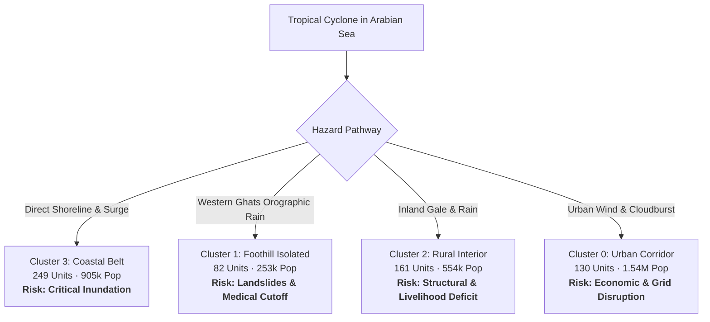

# Cyclone Preparedness Assistant — Comprehensive Cyclone Risk Assessment Report
**Geographic Coverage**: Dakshina Kannada & Udupi Districts, Karnataka, India (622 Spatial Units: 561 Revenue Villages & 61 Census Towns)  
**Analytical Basis**: Unsupervised K-Means Vulnerability Clustering ($k=4$) & Multidimensional Prioritization Baseline  
**Date**: October 2026  

---

## 1. Executive Summary & Disaster Risk Framework

This report delivers a rigorous, empirical **Cyclone Risk Assessment** for the 622 administrative units of coastal Karnataka (Dakshina Kannada and Udupi), integrating hazard exposure, socio-demographic vulnerability, infrastructure deficits, and emergency healthcare accessibility.

### 1.1 The Risk Formulation
In alignment with the United Nations Office for Disaster Risk Reduction (**UNDRR**) and National Disaster Management Authority (**NDMA**) guidelines, risk is conceptualized as:

$$\text{Cyclone Risk} = \frac{\text{Hazard Exposure} \times \text{Vulnerability}}{\text{Coping Capacity / Accessibility}}$$

- **Hazard Exposure**: Proximity to the Arabian Sea coastline ($0.019\text{ km}$ to $71.8\text{ km}$), vulnerability to cyclonic gale-force winds (100–140 km/h), marine storm surges (2–4 m), and extreme Western Ghats orographic precipitation.
- **Vulnerability**: Socio-demographic marginalization (SC/ST population proportion up to 44.9%) and structural infrastructure deficits (lack of treated tap water, unpaved roads, open/absent drainage).
- **Coping Capacity Deficit**: Spatial remoteness from primary health centres (up to 12.5 km) and apex referral hospitals (up to 36.4 km).

### 1.2 Summary of Regional Exposure & Population at Risk
| Metric | Regional Total | Dakshina Kannada | Udupi |
| :--- | :---: | :---: | :---: |
| **Total Administrative Units** | **622** | 369 (59.3%) | 253 (40.7%) |
| **Revenue Villages** | **561** | 321 | 240 |
| **Census Towns** | **61** | 48 | 13 |
| **Total Population at Risk** | **3,254,857** | 2,089,649 (64.2%) | 1,165,208 (35.8%) |
| **Total Households** | **690,112** | 442,166 | 247,946 |
| **Coastline Length** | **~180 km** | ~80 km | ~100 km |
| **Units within 5 km of Coastline** | **118** | 47 | 71 |
| **Units within 10 km of Coastline** | **226** | 85 | 141 |

---

## 2. Cluster-by-Cluster Risk Assessment Matrix

The 622 spatial units were partitioned into four distinct vulnerability archetypes via standardized K-Means clustering ($k=4$, Silhouette = 0.3348, ARI = 0.7575). Each archetype exhibits a unique risk profile requiring distinct operational disaster management protocols.

### Table 1: Comprehensive Cluster Risk Matrix
| Cluster ID & Archetype | Units (% Total) | Population (% Total) | Risk Tier | Primary Hazard Mechanisms | Key Vulnerability Drivers | Coping Capacity / Access Deficit | Priority Score (Mean) |
| :--- | :---: | :---: | :---: | :--- | :--- | :--- | :---: |
| **Cluster 3: High-Exposure Coastal Rural Belt** | 249 (40.0%) | 904,586 (27.8%) | **CRITICAL** (Tier 1) | Direct cyclonic winds, 2–4m storm surge, wave run-up, estuarine saltwater inundation | 98.8% lack treated piped water; open drainage channels prone to surge flooding | Mean hospital dist: 13.3 km; PHC dist: 2.6 km; high road connectivity | **0.4974** (Highest overall) |
| **Cluster 1: Remote Foothill & Healthcare-Isolated Communities** | 82 (13.2%) | 252,738 (7.8%) | **HIGH (Isolation)** (Tier 2) | Secondary hazards: cloudbursts, riverine flash floods, ghat landslides, mudslips, fallen trees | Severe medical isolation; single ghat road access; communication dead zones | Extreme hospital dist: **23.6 km** (up to 36.4 km); PHC dist: **6.1 km** | **0.4787** (Severe localized need) |
| **Cluster 2: Socioeconomically Vulnerable Rural Interior** | 161 (25.9%) | 553,690 (17.0%) | **MODERATE-HIGH** (Tier 3) | Inland gale winds, prolonged rain, stream flooding, roof destruction | Highest demographic vulnerability (SC/ST mean: 21.9%, peak: 44.9%); 96.9% lack treated tap water | Moderate hospital dist: 12.4 km; PHC dist: 3.4 km; lower economic resilience | **0.4797** |
| **Cluster 0: Urban & Peri-Urban Well-Resourced Corridor** | 130 (20.9%) | 1,543,843 (47.4%) | **MODERATE DIRECT / HIGH ASSET** (Tier 4) | High winds, extreme rainfall, urban flash floods, power grid & telecom collapse | Dense critical infrastructure, low-lying informal river settlements, underpass flooding | Best access: hospital dist 10.7 km, PHC 2.7 km; high municipal capacity | **0.3630** (Lowest baseline deficit) |

---

## 3. Detailed Archetype Risk Characterization



### 3.1 Cluster 3: High-Exposure Coastal Rural Belt (Tier 1 — Critical Risk)
- **Spatial Distribution**: Stretches continuously along the shoreline and estuarine mouths of Udupi (158 units, 63.5%) and northern Dakshina Kannada (91 units, 36.5%), encompassing Byndoor, Kundapura rural fringe, Malpe, Kaup, Mulki, and Ullal.
- **Hazard Dynamics**:
  - **Storm Surge**: Direct marine surge of 2 to 4 meters penetrating up to 3 km inland along tidal rivers and backwaters.
  - **Wind Field**: First point of impact for eyewall gale-force winds exceeding 120 km/h.
  - **Saline Inundation**: Contamination of coastal freshwater aquifers and shallow open wells.
- **Vulnerability Profile**:
  - **Drinking Water Deficit**: 98.8% of units lack piped treated tap water, relying on shallow coastal dug wells vulnerable to saltwater poisoning and biological contamination.
  - **Drainage Deficit**: Open roadside ditches silt up immediately under storm-surge wave action, causing prolonged stagnant saltwater pools.
- **Specific Disaster Risk Interventions**:
  1. **Mandatory Pre-Emptive Evacuation**: Evacuate all households within 1.5 km of high-tide line to designated Multi-Purpose Cyclone Shelters (MPCS) 24 hours prior to landfall.
  2. **Fisheries Sector Safeguarding**: Enforce mandatory beaching and securing of all motorized and artisanal fishing boats at sheltered docks (Gangolli, Malpe, Old Mangalore Port).
  3. **Saline Water Relief**: Pre-position mobile reverse-osmosis (RO) water purification tankers and 500,000 water purification tablets.

---

### 3.2 Cluster 1: Remote Foothill & Healthcare-Isolated Communities (Tier 2 — High Isolation Risk)
- **Spatial Distribution**: Eastern ridge of coastal Karnataka in the Western Ghats foothills across Belthangady, Sullia, Puttur, and Karkala taluks (e.g., Edmoge, Amasebailu, Shirady, Bilinele, Kollamogru, Madammakki).
- **Hazard Dynamics**:
  - **Orographic Precipitation**: Western Ghats slopes force cyclonic moisture upwards, generating catastrophic localized cloudbursts (>250 mm in 24 hours).
  - **Riverine Flash Flooding**: Rapid surge in the headwaters of the Netravati, Kumaradhara, and Swarna rivers.
  - **Slope Instability**: Landslides, mudslips, and debris flows along steep ghat road cuttings.
  - **Corridor Severance**: High winds uproot heavy forest trees, severing single-lane road access and overhead electricity/telecom cables.
- **Vulnerability Profile**:
  - **Extreme Healthcare Deficit**: Mean distance to nearest hospital is **23.6 km** (Madammakki: 36.4 km; Amasebailu: 33.4 km; Byndoor rural: 32.2 km; Edmoge: 31.0 km). Mean distance to nearest PHC is **6.1 km** (up to 12.5 km).
  - **Total Physical Cutoff**: Unlike coastal units with multiple escape routes, foothill villages rely on single winding ghat roads that become impassable.
- **Specific Disaster Risk Interventions**:
  1. **Pre-Positioning Heavy Earthmovers**: Station JCB excavators, bulldozers, and chainsaw teams at critical ghat bottleneck junctions (Charmadi, Shiradi, Sampaje ghat corridors).
  2. **Emergency Satellite Communications**: Deploy pre-tested SATPHONE and VHF handsets to panchayat headquarters (Edmoge, Amasebailu, Bilinele) before cellular towers lose grid power.
  3. **14-Day Medical Stockpiling**: Stock remote PHCs with 14-day supplies of essential chronic medicines (insulin, antihypertensives), antivenom for snakebites (heightened during floods), and trauma dressing kits.
  4. **Aerial Evacuation Coordinates**: Survey and clear GPS-tagged emergency helipads in open school fields for airlift operations.

---

### 3.3 Cluster 2: Socioeconomically Vulnerable Rural Interior (Tier 3 — Moderate-High Risk)
- **Spatial Distribution**: Widespread across the agrarian valleys and interior plains of southern and central Dakshina Kannada (130 units, 80.7%) and south-eastern Udupi (31 units, 19.3%).
- **Hazard Dynamics**:
  - Severe inland wind gusts causing structural failure of non-engineered roof structures (thatched, tin sheet, unanchored Mangalore tiles).
  - Localized agricultural flooding drowning arecanut, rubber, and paddy plantations.
- **Vulnerability Profile**:
  - **Highest Demographic Vulnerability**: Average SC/ST population proportion is **21.9%**, peaking at **44.9%** (Badakodi: 42.4%, Hallihole: 36.3%, Herady: 34.6%).
  - **Housing & Economic Resilience**: Lower household financial reserves; heavy reliance on daily-wage agricultural labor; higher prevalence of semi-pucca dwellings.
  - **Water Supply**: 96.9% lack piped treated water; heavy reliance on private shallow open wells prone to agricultural runoff contamination.
- **Specific Disaster Risk Interventions**:
  1. **Equitable Shelter Access**: Conduct pre-season audits of public cyclone shelters to ensure unrestricted, safe access for marginalized SC/ST hamlets without social barriers.
  2. **Emergency Livelihood Buffers**: Pre-position civil supplies (rice, dal, kerosene, dry rations) at local fair price shops to prevent post-disaster food insecurity.
  3. **Public Health Disinfection**: Distribute chlorine bleaching powder for community dug wells within 24 hours of flood subsidence to prevent leptospirosis and cholera outbreaks.

---

### 3.4 Cluster 0: Urban & Peri-Urban Well-Resourced Corridor (Tier 4 — Moderate Direct / High Asset Risk)
- **Spatial Distribution**: 130 administrative units comprising Mangalore City Corporation, Udupi Municipal Council, and surrounding suburban growth corridors along National Highways 66 and 75.
- **Hazard Dynamics**:
  - High cyclonic winds toppling overhead high-tension power cables, transformers, traffic signals, and large commercial billboards.
  - Intense precipitation exceeding municipal storm drainage capacity, leading to rapid street inundation and underpass waterlogging.
- **Vulnerability Profile**:
  - Low structural and socio-demographic vulnerability (mean SC/ST: 8.9%, hospital distance: 10.7 km, PHC distance: 2.7 km).
  - **Asset Concentration**: Houses 47.4% of regional population (1.54 million people), major regional trauma centres, district administrative headquarters, fuel depots, and the New Mangalore Port / Mangalore Refinery complex.
- **Specific Disaster Risk Interventions**:
  1. **Billboard & Tree Clearing**: Enforce mandatory takedown of commercial hoardings and pre-emptive pruning of hazardous tree branches along primary hospital corridors.
  2. **Stormwater Outfall Maintenance**: Clear debris and silt from stormwater discharge gates into the Netravati and Gurupura estuaries.
  3. **Power Grid Hardening**: Ensure dedicated diesel fuel reserves (minimum 72-hour runtime) for all district hospital emergency backup generators, water treatment plants, and telecom switching centres.

---

## 4. Top 15 Priority Units: Detailed Risk Assessment

The multidimensional prioritization baseline identified the top 15 administrative units facing the most severe compounding deficits across the region:

### Table 2: Top 15 Highest-Risk Administrative Units
| Rank | Administrative Unit | District | Taluk | Cluster ID | Priority Score | Coast Dist | Hosp Dist | PHC Dist | SC/ST % | Compounding Risk Profile |
| :---: | :--- | :--- | :--- | :---: | :---: | :---: | :---: | :---: | :---: | :--- |
| **1** | **Edmoge** | Udupi | Kundapura | **1** | **0.7018** | 25.5 km | 31.0 km | 7.2 km | 37.6% | **Extreme Compound Cutoff**: Foothill isolation, 31 km to hospital, 37.6% SC/ST, lack of treated tap water. |
| **2** | **Amasebailu** | Udupi | Kundapura | **1** | **0.6906** | 29.0 km | 33.4 km | 11.5 km | 26.4% | **Acute Medical Remoteness**: 33.4 km to Taluk hospital, 11.5 km to PHC, high flash flood risk. |
| **3** | **Kilpady** | Dakshina Kannada | Mangalore | **3** | **0.6660** | 2.9 km | 23.8 km | 2.6 km | 12.5% | **Direct Coastal Vulnerability**: 2.9 km to sea, 100% infrastructure deficit (no tap water, no formal drains). |
| **4** | **Shimanthur** | Dakshina Kannada | Mangalore | **3** | **0.6658** | 4.0 km | 24.0 km | 2.4 km | 12.4% | **Direct Coastal Vulnerability**: 4.0 km to sea, unpaved roads, untreated water, open drainage. |
| **5** | **Herady** | Udupi | Brahmavara | **2** | **0.6548** | 7.3 km | 16.8 km | 2.6 km | 34.6% | **High Demographic Vulnerability**: 34.6% SC/ST ratio, near-coast storm surge hazard zone. |
| **6** | **Hallihole** | Udupi | Kundapura | **2** | **0.6479** | 22.3 km | 27.8 km | 4.5 km | 36.3% | **Interior Remoteness & Disadvantage**: 36.3% SC/ST, 27.8 km to hospital, untreated water supply. |
| **7** | **Byndoor** | Udupi | Byndoor | **1** | **0.6450** | 11.1 km | 32.2 km | 2.1 km | 13.3% | **Northern Coastal Apex Hospital Deficit**: 32.2 km to Kundapura hospital; storm surge exposure. |
| **8** | **Badakodi** | Dakshina Kannada | Belthangady | **2** | **0.6400** | 25.4 km | 18.6 km | 3.8 km | 42.4% | **Peak Demographic Vulnerability**: 42.4% SC/ST ratio in DK, high proportion of kutcha roofs. |
| **9** | **Kodladi** | Udupi | Kundapura | **1** | **0.6364** | 10.4 km | 15.9 km | 3.5 km | 22.8% | **Combined Near-Coast & Foothill Risk**: 10.4 km from coast, 22.8% SC/ST, lack of treated tap water. |
| **10** | **Jadkal** | Udupi | Kundapura | **1** | **0.6314** | 19.5 km | 25.9 km | 5.2 km | 25.5% | **Foothill Drainage & Hospital Isolation**: 25.9 km to hospital, open drains, untreated water. |
| **11** | **Aletty** | Dakshina Kannada | Sullia | **2** | **0.6284** | 56.4 km | 13.9 km | 5.5 km | 26.8% | **Southern Border Isolation**: Acute road deficit, lack of treated water, hilly terrain cutoffs. |
| **12** | **Mudoor** | Udupi | Kundapura | **1** | **0.6272** | 22.9 km | 27.2 km | 4.8 km | 19.9% | **Acute Hospital Deficit**: 27.2 km to Kundapura Hospital, reliance on open wells. |
| **13** | **Shirady** | Dakshina Kannada | Puttur | **1** | **0.6251** | 68.2 km | 28.5 km | 7.8 km | 24.1% | **Western Ghats Pass Chokepoint**: NH-75 Shiradi Ghat landslide epicentre; severe medical remoteness. |
| **14** | **Bilinele** | Dakshina Kannada | Puttur | **1** | **0.6214** | 64.7 km | 26.1 km | 6.4 km | 25.9% | **Foothill Riverine Flood Risk**: Kumaradhara river headwater flash floods, single-access roads. |
| **15** | **Kollamogru** | Dakshina Kannada | Sullia | **1** | **0.6189** | 63.8 km | 29.4 km | 8.1 km | 21.7% | **Remote Ghat Foothill Hamlet**: Extreme hospital remoteness (29.4 km), communication shadow zone. |

---

## 5. Multi-Hazard Interaction & Compound Threat Analysis

Standard single-hazard cyclone assessments focus exclusively on coastal surge. In coastal Karnataka, the interaction between cyclonic systems and the steep Western Ghats orography produces **two simultaneous, diametrically opposed disaster regimes**:

```
                       ARABIAN SEA                                         WESTERN GHATS
                        COASTLINE                                            FOOTHILLS
                   [Cluster 3: Surge Zone]                            [Cluster 1: Cutoff Zone]
                             │                                                  │
   Hazard Type:      Direct Marine Storm Surge                          Orographic Cloudbursts
                     Saline Inundation (2-4m)                           Flash Riverine Flooding
                     Wind Gusts > 120 km/h                              Ghat Road Landslides
                             │                                                  │
   Primary Failure:  Open Wells Salinized                               Single Access Roads Blocked
                     Drainage Ditches Overflow                          Communication Towers Down
                     Shoreline Homes Inundated                          Hospitals > 25-36 km Away
                             │                                                  │
   Operational Goal: Pre-evacuate to MPCS Shelters                      Pre-position Heavy JCBs
                     Protect Fishing Fleet                              Satellite Phones (SATPHONE)
                     Mobile Water Desalination                          14-Day Medical Stockpiling
```

### 5.1 The Spatial Divergence of Disaster Threats
As demonstrated in the sensitivity analysis, rank correlation between direct coastal exposure and inland healthcare isolation is **virtually zero ($r_s = -0.025$)**. 
- Prioritizing solely by coastal proximity leaves 82 foothill communities (252,738 residents) dangerously unprepared for secondary flash floods, landslides, and medical cutoffs.
- Conversely, prioritizing solely by inland healthcare distance neglects 249 shoreline communities (904,586 residents) facing immediate storm surge and wave destruction.
- **Decision-Support Recommendation**: Emergency managers must divide operational resources along archetype boundaries rather than applying a single uniform distance-to-coast threshold.

---

## 6. Standard Operating Procedures (SOPs) Across Cyclone Lifecycle

### Phase 1: Pre-Monsoon Preparedness (T > 72 hours)
1. **Cluster 3 (Coastal)**:
   - Audit all 48 designated Multi-Purpose Cyclone Shelters (structural integrity, backup diesel generators, rooftop rainwater harvesting).
   - Verify VHF coastal distress frequencies and early warning public address sirens.
2. **Cluster 1 (Foothills)**:
   - Test satellite telephone connections at all remote gram panchayat offices.
   - Inspect ghat slope retaining walls and clear culverts along Shiradi, Charmadi, and Agumbe passes.
   - Stock 14-day supplies of antivenom and chronic illness medications at primary health centres.
3. **Cluster 2 (Rural Interior)**:
   - Identify vulnerable kutcha dwellings and ensure community shelter registration for SC/ST hamlets.
   - Distribute chlorine bleaching powder and water purification packets to panchayat water committees.
4. **Cluster 0 (Urban Corridor)**:
   - Clear silt and debris from all major stormwater drainage outfalls into the Netravati and Gurupura rivers.
   - Remove hazardous commercial hoardings, signboards, and weak tree branches along arterial roads.

### Phase 2: Cyclone Watch & Early Warning (T-72h to T-24h)
1. **Cluster 3 (Coastal)**:
   - Issue mandatory fishing prohibition; secure all craft at protected inner harbours.
   - Begin voluntary evacuation of special-needs populations (pregnant women, elderly, mobility-impaired) from low-lying coastal strips ($< 1.5\text{ km}$ from sea).
2. **Cluster 1 (Foothills)**:
   - Pre-position JCB excavators and tree-clearing squads at designated road junctions.
   - Place SDRF (State Disaster Response Force) swift-water rescue teams on standby near river headwaters.
3. **Cluster 2 & 0**:
   - Secure critical food and fuel reserves at taluk civil supplies godowns.
   - Test backup generators at district and taluk hospitals.

### Phase 3: Landfall & Immediate Response (T-24h to T+12h)
1. **Cluster 3 (Coastal)**:
   - Complete mandatory evacuation of remaining shoreline residents to elevated cyclone shelters.
   - Enforce lockdown of all coastal roads subject to storm-surge overwash.
2. **Cluster 1 (Foothills)**:
   - Dispatch immediate road-clearing teams as soon as gale-force winds drop below 50 km/h.
   - Establish emergency radio contact with isolated panchayats to report casualties or landslides.
3. **Cluster 0 (Urban)**:
   - Deploy high-capacity dewatering pumps to flooded underpasses and hospital basements.

### Phase 4: Post-Landfall Relief & Disease Prevention (T+12h to T+72h)
1. **Cluster 3 (Coastal)**:
   - Deploy mobile water testing and desalination units to address saline intrusion in drinking wells.
   - Conduct structural assessments of shoreline homes before allowing evacuees to return.
2. **Cluster 1 (Foothills)**:
   - Execute emergency medical evacuations (via road corridor or helicopter) for critical trauma or obstetric patients.
   - Restore severed power lines and bridge crossings.
3. **Cluster 2 (Rural Interior)**:
   - Implement intensive chlorination of all village open dug wells.
   - Screen rural communities for early symptoms of waterborne gastrointestinal illnesses and leptospirosis.

---

## 7. Methodological Limitations & Ethical Safeguards

1. **Analytical Heuristic Baseline, Not Supervised Prediction**:
   This risk assessment provides an empirical decision-support heuristic. It does **not** predict hydrodynamic storm surge inundation depths, exact wind velocity fields, building structural collapse probabilities, or casualty numbers.
2. **Census Data Vintage (2011)**:
   Demographic and household infrastructure metrics are derived from the 2011 Census (DCHB). Rapid peri-urban expansion around Mangalore and Udupi over the past decade may mean current local population densities are higher than reported.
3. **Distance Metric Approximation**:
   Healthcare and coastline distances represent straight-line Euclidean proximities. Actual travel times along winding ghat roads or across estuarine ferry crossings are significantly longer, particularly under severe weather conditions.
4. **Directory Currency**:
   Healthcare facility locations are based on the National Health Mission directory. Facility operational status, actual bed availability, and specialty services must be verified in real time during emergency activations.

---

*Report prepared as part of the Cyclone Preparedness Assistant System for Dakshina Kannada & Udupi.*  
*Data files: `data/processed/coastal_vulnerability_archetypes.parquet` · Interactive GIS map: `reports/kmeans_cluster_map.html`.*
