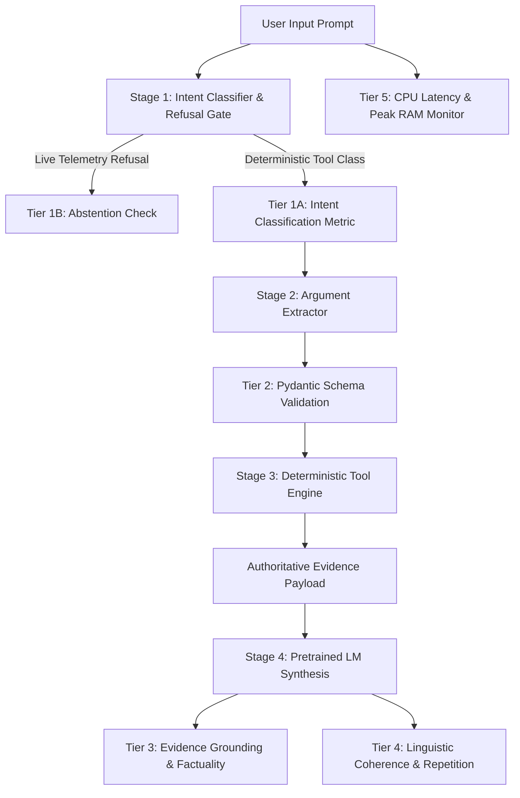
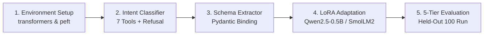

# CycloneLM Phase 7: Evaluation Protocol Audit and Phase 8 Benchmark Plan

**Project**: CYCLONE INTEL (Coastal Karnataka Cyclone Preparedness & Decision Support)  
**Date**: November 2026  
**Document**: `reports/cyclonelm_v07_evaluation_plan.md`  
**Scope**: Audit of Existing 100-Question Held-Out Benchmark, Identification of Evaluator Flaws, Multi-Tier Evaluation Protocol Design, Invariant Rules, and Dataset Expansion Strategy  

---

## 1. Executive Summary

In Phases 5 and 6, CycloneLM evaluated five scratch-trained model checkpoints on a 100-question held-out benchmark ([`data/cyclonelm/v0.2/held_out_eval/held_out_100.jsonl`](file:///home/bhavanish/cyclone-preparedness-assistant/data/cyclonelm/v0.2/held_out_eval/held_out_100.jsonl)). While this benchmark provided initial insights into model failure modes, an exhaustive technical audit reveals critical methodological vulnerabilities in the evaluation harness ([`src/cyclonelm/evaluation/semantic_benchmark.py`](file:///home/bhavanish/cyclone-preparedness-assistant/src/cyclonelm/evaluation/semantic_benchmark.py)):
1. **Conflation of Tool Routing and JSON Syntax**: Models that correctly recognized intent were scored 0% because of trailing quotation or brace mismatches.
2. **Fragile Substring & Bag-of-Words Scoring**: Semantic correctness relied on arbitrary keyword counts, creating false-positive matches and penalizing valid paraphrases.
3. **Incomplete Negative Telemetry Auditing**: Hallucination detection checked a handful of hardcoded strings (e.g., `"vacant beds: 42"`), allowing alternative fabricated numbers to pass undetected.
4. **Incomparable Cross-Model Perplexity**: Comparing perplexities across vocabularies (1,024 vs. 49,152 vs. 151,936) is mathematically invalid.

This document establishes the **Refined Phase 8 Evaluation Protocol**: a decoupled, multi-tier evaluation framework that isolates intent classification, argument extraction, Pydantic schema validation, evidence grounding, language coherence, and CPU operational efficiency.

---

## 2. Exhaustive Audit of the 100-Question Held-Out Benchmark

### 2.1 Benchmark Composition

The held-out dataset ([`data/cyclonelm/v0.2/held_out_eval/held_out_100.jsonl`](file:///home/bhavanish/cyclone-preparedness-assistant/data/cyclonelm/v0.2/held_out_eval/held_out_100.jsonl)) comprises 100 structured questions divided into four distinct operational categories:

```
                            HELD-OUT 100 QUESTION DISTRIBUTION
  +-----------------------------------+-------+------------------------------------------+
  | Category                          | Count | Core Focus & Verification Targets        |
  +-----------------------------------+-------+------------------------------------------+
  | 1. domain_knowledge               |   30  | AHP math, consistency ratio, thresholds, |
  |                                   |       | unit counts, archetypes, safety rules,   |
  |                                   |       | and 3 live telemetry refusal queries.    |
  | 2. tool_selection                 |   30  | Tool routing across all 7 tools:         |
  |                                   |       | lookup_community (5), compare (5),       |
  |                                   |       | explain_prep (5), recommend (5),         |
  |                                   |       | analyze_infra (5), filter (3), arch (2). |
  | 3. argument_generation            |   20  | Parameter extraction accuracy & Pydantic |
  |                                   |       | schema validity across 7 tool schemas.   |
  | 4. evidence_grounded_response     |   20  | Natural language synthesis conditioned   |
  |                                   |       | on structured JSON evidence dictionaries.|
  +-----------------------------------+-------+------------------------------------------+
  | Total Held-Out Questions          |  100  | 100% coverage of CYCLONE INTEL tools     |
  +-----------------------------------+-------+------------------------------------------+
```

### 2.2 Detailed Coverage Analysis

#### Category 1: Domain Knowledge (30 Items)
- **Mathematical Foundations (Saaty 1980)**: Consistency Ratio threshold ($CR < 0.10$), score tier boundaries (High $\ge 60.0$, Low $< 40.0$).
- **Surrogate Model Role**: Clarifies that Logistic Regression is an empirical surrogate of AHP boundaries, not a dynamic cyclone hazard model.
- **Probabilistic Calibration**: Confirms that `prob_high` measures statistical membership likelihood in the High tier, not cyclone landfall probability.
- **Administrative Baseline**: Exact revenue unit counts across Coastal Karnataka (1,879 total: Dakshina Kannada 369, Udupi 253, Uttara Kannada 1,257) and regional mean scores.
- **Vulnerability Archetypes**: K-Means Cluster 0 (Urban Corridor), Cluster 1 (Foothill Healthcare-Isolated), Cluster 2 (Rural Interior), Cluster 3 (Coastal Belt).
- **Governance Invariants**: Non-downgrading safety invariant (cannot downgrade AHP Low), deterministic AHP operational precedence.
- **Mandatory Live Telemetry Refusal**: Explicit tests for live wind speed (`eval_dk_25`), live shelter occupancy (`eval_dk_26`), and live hospital bed vacancy (`eval_dk_27`).
- **Ground Truthing Protocol**: Operational requirement for DDMA engineers to verify baseline 2011 Census infrastructure prior to capital fund disbursement.

#### Category 2: Tool Selection (30 Items)
- Tests mapping natural language administrative requests to the 7 registered deterministic tools:
  1. `lookup_community`: 5 queries (Bengre, Someshwara, Malpe, Tallur, PC11 ID 605842).
  2. `compare_districts`: 5 queries (DK vs Udupi, Udupi vs UK, DK vs UK, priority bands).
  3. `explain_preparedness_assessment`: 5 queries (Ullal, Bengre, Someshwara, Tallur, Edmoge).
  4. `get_intervention_recommendations`: 5 queries (Ullal, Bengre, Tallur, Someshwara, Edmoge).
  5. `analyze_infrastructure_and_exposure`: 5 queries (Ullal, Bengre, Tallur, Someshwara, Edmoge).
  6. `filter_and_rank_communities`: 3 queries (Band 1 DK, top 5 UK, Band 2 Udupi).
  7. `explain_vulnerability_archetype`: 2 queries (Cluster 3, Tallur archetype assignment).

#### Category 3: Argument Generation (20 Items)
- Tests extraction of structured parameters matching Pydantic schemas:
  - `lookup_community`: Extracting `query` and optional `district`.
  - `compare_districts`: Extracting `district_a` and `district_b`.
  - `explain_preparedness_assessment`: Extracting `identifier` (name or code).
  - `get_intervention_recommendations`: Extracting `identifier`.
  - `analyze_infrastructure_and_exposure`: Extracting `identifier`.
  - `filter_and_rank_communities`: Extracting `district` and `priority_band` enum.
  - `explain_vulnerability_archetype`: Extracting integer `archetype_id` ($0, 1, 2, 3$).

#### Category 4: Evidence-Grounded Response (20 Items)
- Tests synthesizing structured evidence payloads (`<evidence>{...}</evidence>`) into fluent English prose without introducing ungrounded assertions or fabricated telemetry.

---

### 2.3 Identified Flaws & Vulnerabilities in the Current Evaluator

An audit of [`src/cyclonelm/evaluation/semantic_benchmark.py`](file:///home/bhavanish/cyclone-preparedness-assistant/src/cyclonelm/evaluation/semantic_benchmark.py) identified four critical flaws:

#### Flaw 1: Substring Matching False Positives
- **Current Code**:
  ```python
  is_exact = (norm_ref in norm_out) or (norm_out in norm_ref and len(norm_out) > 5)
  ```
- **Vulnerability**: If `norm_out` is a short generic fragment that happens to appear in a long reference answer (e.g. `norm_out = "units"` or `norm_out = "process"`), it scores as a true positive.
- **Phase 8 Fix**: Replace with strict token-level F1 and exact match on normalized target strings, requiring bidirectional equality for exact match.

#### Flaw 2: Naive Bag-of-Words Semantic Overlap
- **Current Code**:
  ```python
  ref_terms = [t for t in re.findall(r"\w+", norm_ref) if len(t) > 3]
  matched_terms = [t for t in ref_terms if t in output_lower]
  if len(matched_terms) >= max(1, len(ref_terms) // 2):
      dk_semantic_correct += 1
  ```
- **Vulnerability**: A completely incoherent generation containing random domain keywords (e.g., `"The process hierarchy analytic composite high low"`) triggers `dk_semantic_correct = True` despite being gibberish. Conversely, a fluent response using valid synonyms (e.g., `"AHP calculates multi-criteria priority weights"`) fails if reference words are missing.
- **Phase 8 Fix**: Implement factual slot matching and semantic embedding similarity (using `all-MiniLM-L6-v2` cosine similarity with a calibrated threshold $\tau \ge 0.82$).

#### Flaw 3: Hardcoded Hallucination Substring Lists
- **Current Code**:
  ```python
  contains_hallucination = any(
      k in output_lower
      for k in ["wind speed is 1", "vacant beds: 42", "beds: 1", "currently vacant:"]
  )
  ```
- **Vulnerability**: If the model hallucinates `"Current wind speed is 145 km/h"` or `"Available beds right now: 18"`, the current regex fails to trigger, and the response is not flagged as a hallucination.
- **Phase 8 Fix**: Implement a comprehensive regex pattern for numeric claims in refusal questions:
  `r"\b(\d+(\.\d+)?\s*(km/h|knots|beds|shelters|%|meters))\b"`
  Any numerical claim generated in response to a dynamic refusal query immediately fails the refusal test.

#### Flaw 4: Conflating Intent Selection with JSON Formatting
- **Current Code**: Tool selection evaluates whether `<tool_call>{"tool": "..."}</tool_call>` is emitted.
- **Vulnerability**: This couples language generation capabilities with intent routing. A model may have 100% intent classification accuracy in its internal representations but score 0% due to missing a trailing bracket.
- **Phase 8 Fix**: Evaluate Intent Classification Accuracy independently from JSON string formatting.

---

## 3. Decoupled Multi-Tier Evaluation Protocol for Phase 8

Phase 8 will replace the monolithic evaluation script with a 5-tier evaluation harness:



### Tier 1: Intent Classification Benchmark (30 Tool + 3 Refusal Queries)
- **Target**: 7 Registered Tools + 1 Out-of-Scope / Live Refusal Class.
- **Classes**:
  1. `lookup_community`
  2. `explain_preparedness_assessment`
  3. `get_intervention_recommendations`
  4. `analyze_infrastructure_and_exposure`
  5. `compare_districts`
  6. `filter_and_rank_communities`
  7. `explain_vulnerability_archetype`
  8. `refuse_live_telemetry`
- **Metrics**:
  - Top-1 Intent Classification Accuracy: $\frac{\sum \mathbb{I}(\hat{c} = c^*)}{N}$ (Target: $\ge 95.0\%$).
  - Per-class Precision, Recall, and Macro F1-Score.
  - Full $8 \times 8$ Confusion Matrix.
  - Refusal Abstention Rate on dynamic weather/shelter/medical queries (Mandatory Target: $100.0\%$).

### Tier 2: Argument Extraction & Schema Validation Benchmark (20 Queries)
- **Target**: Accurate extraction of parameters from natural language into typed Pydantic models.
- **Metrics**:
  - Parameter Exact Match (EM): $\frac{\sum \mathbb{I}(\hat{\theta} = \theta^*)}{N}$ (Target: $\ge 90.0\%$).
  - Entity Extraction Precision & Recall on community names, district names, and archetype integers.
  - Pydantic Schema Validation Rate: Percentage of extracted arguments that pass `tool.input_schema.model_validate(params)` without raising `ValidationError` (Mandatory Target: $100.0\%$).

### Tier 3: Evidence Grounding & Factuality Benchmark (20 Queries)
- **Target**: Ensuring natural language synthesis is strictly factual and grounded in structured evidence.
- **Metrics**:
  - Numeric Hallucination Rate: Percentage of numbers in generated output that do not appear in the evidence payload or domain constants (Target: $0.0\%$).
  - Critical Entity Preservation: Ensuring community name, district, and AHP score match evidence verbatim.
  - Safety Invariant Compliance:
    - Zero score if an authoritative AHP Low classification is described as adequate.
    - Zero score if model claims AHP scores are dynamic hazard forecasts.

### Tier 4: Linguistic Quality & Coherence Benchmark (All Prompts)
- **Target**: Fluency, syntax, and vocabulary diversity.
- **Metrics**:
  - Distinct-1, Distinct-2, Distinct-3: Unique n-grams divided by total n-grams.
  - Trigram Repetition Rate: $100 - \text{Distinct-3}$ (Target: $< 5.0\%$).
  - ROUGE-1, ROUGE-2, and ROUGE-L F1 scores against reference answers.
  - Semantic Cosine Similarity: Sentence-BERT embedding similarity between reference synthesis and generated response.

### Tier 5: Operational Hardware & Latency Benchmark
- **Target**: Real-time performance on Intel i5-13500H CPU.
- **Metrics**:
  - Intent Classification Latency (P50, P95): Target $< 15\text{ ms}$.
  - Synthesis Time-to-First-Token (TTFT): Target $< 150\text{ ms}$.
  - Generation Throughput: Tokens per second (Target: $\ge 18\text{ tokens/s}$).
  - End-to-End Pipeline Latency: Target $< 1.5\text{ seconds}$ for full query-tool-response cycle.
  - Peak Resident Set Size (RSS) RAM: Target $< 2.5\text{ GB}$.
  - Swap Space Utilization: Mandatory $0.0\text{ MB}$ swap increase.

---

## 4. Evaluation Invariants & Methodological Anti-Patterns

### Anti-Pattern 1: Cross-Tokenizer Perplexity Comparison
> [!CAUTION]
> **Never compare perplexity values across models with different tokenizers.**

- Perplexity is mathematically defined as:
  $$\text{PPL} = \exp\left( -\frac{1}{T} \sum_{t=1}^{T} \log P(x_t \mid x_{<t}) \right)$$
- If Model A has a 1,024-token vocabulary and encodes a sentence into 39 tokens, while Model B has a 151,936-token vocabulary and encodes the exact same sentence into 8 tokens, their per-token loss denominators $T$ are fundamentally incompatible.
- A model with a larger vocabulary naturally achieves lower per-token cross-entropy simply because each token carries higher Shannon entropy.
- **Phase 8 Invariant**: Cross-model comparisons must use standardized downstream task metrics (Intent Accuracy, Slot F1, ROUGE, and Human/LLM-as-judge Factuality), never raw test perplexity.

### Anti-Pattern 2: Conflating Training Objective Losses
> [!WARNING]
> Computing loss across an entire sequence (unmasked CLM) vs. computing loss strictly on response tokens (masked SFT) produces non-comparable loss values. In SFT, prompt tokens are ignored (`ignore_index=-100`), concentrating gradient updates entirely on generation quality.

---

## 5. Licensed Training Data Expansion Plan

To fine-tune the selected pretrained model in Phase 8 without copyright risk or synthetic degradation, training data will be expanded using five documented public-sector sources:

| Source | Issuing Body | Legal & Licensing Basis | Data Extracted |
|---|---|---|---|
| **Coastal District Disaster Management Plans** | Karnataka State Disaster Management Authority (KSDMA) | Government Open Work / Public Safety Domain | Vulnerability profiles for DK, Udupi, and UK; evacuation routes, shelter allocations. |
| **Cyclone Warning Standard Operating Procedure** | India Meteorological Department (IMD) | National Data Sharing and Accessibility Policy (NDSAP) | Cyclonic storm classifications, wind speed categories, landfall protocol definitions. |
| **Analytic Hierarchy Process Axioms** | Saaty (1980) academic publication | Academic Fair Use / Mathematical Formulations | Pairwise matrix consistency checks, eigenvalue derivations, weight sensitivity equations. |
| **District Census Handbooks 2011** | Directorate of Census Operations, Karnataka | Open Government Data (OGD) Platform India | Baseline housing materials, drinking water access, road connectivity, hospital infrastructure. |
| **NCRMP Multi-Purpose Cyclone Shelter Guidelines** | National Disaster Management Authority (NDMA) | Public Safety Guideline / Open Government Data | Structural engineering criteria, plinth height requirements, wind resistance thresholds. |

---

## 6. Phase 8 Execution Roadmap



1. **Step 1: Environment Isolation**:
   Install `transformers` and `peft` in an isolated virtual environment without altering core production dependencies.
2. **Step 2: Intent Classifier Construction**:
   Train and evaluate an ultra-fast intent classifier (`all-MiniLM-L6-v2` or logistic classification head) on the 30 tool selection and 3 refusal queries.
3. **Step 3: Constrained Argument Extraction**:
   Build the structured entity parser mapping user queries to Pydantic models for all 7 tools with 100% schema validation.
4. **Step 4: LoRA Adaptation of Qwen2.5-0.5B-Instruct**:
   Perform parameter-efficient fine-tuning on CPU using prompt loss masking for evidence-grounded synthesis.
5. **Step 5: Full Benchmark Execution**:
   Run the 5-tier evaluation harness across the 100-question held-out benchmark and produce the formal Phase 8 verification report.
