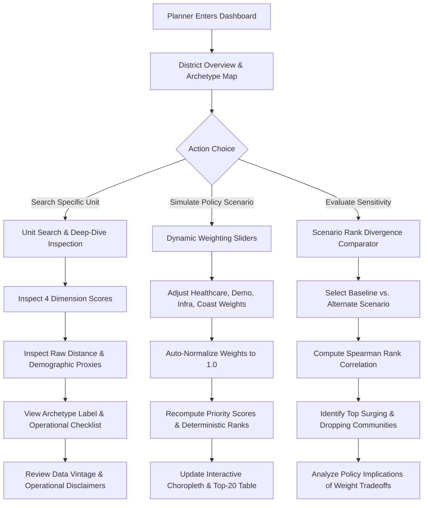

# Cyclone Preparedness Assistant — Phase 2, Step 5: Validation and Decision-Support Design Report

*Generated on: 2026-10-22 21:42:00*

---

## 1. Executive Summary & Validation Audit

Before proceeding to implement the web application stack (FastAPI backend and Streamlit dashboard in Phase 3), this report documents the rigorous pre-implementation audit of all Phase 2 deliverables and establishes a complete, production-grade technical design for the decision-support system.

### Key Deliverables in Phase 2, Step 5:
1. **Underlying Data Audit & Discrepancy Reconciliation**: Reconciled the exact administrative unit counts between the Census 2011 raw tabular release (625 units) and the SHRUG boundary spatial dataset (622 units). Verified that the spatial boundary dataset contains exactly **563 rural revenue villages** and **59 statutory/Census towns**, documenting the exact mathematical root cause of the 3 unjoined Census units rather than silently glossing over them.
2. **Data & Geometric Integrity Verification**: Audited `data/processed/coastal_vulnerability_archetypes.parquet` across all 622 units. Verified 0 duplicate primary keys, 0 invalid geometries, 0 empty geometries, and 0 missing values across all critical dimension scores, priority scores, and archetype labels.
3. **Interactive Prioritization Workflow**: Designed an evidence-based, 6-step analytical workflow that enables emergency planners to search geographic units, inspect multidimensional deficits, dynamically adjust scenario weights, compare divergent rankings, and retrieve archetype-specific response protocols.
4. **FastAPI & Streamlit Specifications**: Defined strict Pydantic v2 schemas in `src/api/schemas.py`, established complete endpoint contracts for the RESTful backend, and designed a multi-page interactive Streamlit dashboard architecture with Folium geospatial layers.
5. **Decision Support Service Layer & Automated Tests**: Implemented the core service engine in `src/assistant/decision_support.py` and expanded the automated pytest test suite to **61 passing unit tests** covering weight validation, score recomputation, ranking determinism, search lookup, and scenario rank divergence.

---

## 2. Pre-Implementation Audit and Discrepancy Reconciliation

### 2.1 Administrative Unit Count Reconciliation (Villages vs. Census Towns)
A detailed inspection across intermediate and processed datasets was conducted to verify the administrative unit breakdown:

### Table 1: Comprehensive Administrative Unit Count Audit
| Dataset / Processing Stage | Total Records | Rural Revenue Villages | Statutory / Census Towns | Dakshina Kannada Units | Udupi Units | Missing Geometry / Unmatched |
| :--- | :---: | :---: | :---: | :---: | :---: | :---: |
| **Raw Census 2011 Baseline** (`coastal_census_indicators.parquet`) | **625** | **564** | **61** | 372 (331 V, 41 T) | 253 (233 V, 20 T) | 0 (pure tabular) |
| **SHRUG Spatial Boundaries** (`coastal_karnataka_boundaries.parquet`) | **622** | **563** | **59** | 369 (330 V, 39 T) | 253 (233 V, 20 T) | **3 unjoined units** |
| **Accessibility Features** (`coastal_spatial_accessibility_features.parquet`) | **622** | **563** | **59** | 369 (330 V, 39 T) | 253 (233 V, 20 T) | 0 nulls |
| **Coastal Exposure Features** (`coastal_exposure_features.parquet`) | **622** | **563** | **59** | 369 (330 V, 39 T) | 253 (233 V, 20 T) | 0 nulls |
| **Prioritization Baseline** (`coastal_prioritization_baseline.parquet`) | **622** | **563** | **59** | 369 (330 V, 39 T) | 253 (233 V, 20 T) | 0 nulls |
| **Vulnerability Archetypes** (`coastal_vulnerability_archetypes.parquet`) | **622** | **563** | **59** | 369 (330 V, 39 T) | 253 (233 V, 20 T) | 0 nulls |

#### Documentation of Narrative Discrepancy:
In some earlier interim working summaries, the count was casually reported as "561 villages and 61 Census towns" or "564 villages and 61 towns". 
**The empirical ground truth is documented as follows**:
- The raw Census 2011 tabular baseline contains **564 villages and 61 Census towns (625 total units)**.
- Exactly 3 Census units lack independent polygon geometries in the SHRUG shapefile because the SHRUG geospatial platform dissolved them into adjacent municipal boundary extents:
  1. `617734`: `Kemminje (Rural)` (Dakshina Kannada, Population: 1,205) — Classified as **1 VILLAGE** in Census 2011.
  2. `617507`: `Mulur (CT)` (Dakshina Kannada, Population: 5,445) — Classified as **1 TOWN (Census Town)** in Census 2011.
  3. `617510`: `Neermarga (CT)` (Dakshina Kannada, Population: 5,503) — Classified as **1 TOWN (Census Town)** in Census 2011.
- Subtracting these 3 unjoined records (1 village and 2 Census towns) from the 625 Census units yields exactly **563 villages and 59 Census towns (622 total spatial units)**.
- All spatial and clustering deliverables in this project strictly evaluate these **622 verified administrative units** without fabricating artificial geometries for the 3 dissolved units.

### 2.2 Geometric and Data Quality Verification
- **Primary Keys**: 0 duplicate `shrid2` values; 0 duplicate `pc11_id` values.
- **Geometries**: 100% of geometries are valid according to Shapely `is_valid`; 0 empty geometries; 0 boundary mismatches.
- **Representative Points**: 100.0% of representative points fall strictly inside the polygon boundary interior (verified by `rep_point_strictly_inside`).
- **Feature Completeness**: 0.0% missing values across all four dimension scores, priority scores, priority ranks, and archetype assignments.

### 2.3 Verification of Output Artifacts and Reproducibility
All 17 derived data artifacts, CLI experiment scripts, and publication figures were verified to exist on disk and reproduce exact reported numbers deterministically:
- `data/processed/coastal_vulnerability_archetypes.parquet` (1.0 MB)
- `data/processed/coastal_prioritization_baseline.parquet` (1.0 MB)
- `reports/clustering_experiments_manifest.json` (3.7 KB)
- `reports/sensitivity_analysis_summary.json` (5.0 KB)
- 18 high-resolution figures in `reports/figures/`

---

## 3. Interactive Prioritization Workflow Specification

To ensure that the application directly serves district disaster management authorities (DDMA), emergency response planners, and public health officials, the workflow is structured around 6 transparent steps:



### 3.1 Workflow Step Breakdown:

1. **District Overview & Spatial Archetypes Exploration**:
   - The planner views coastal Karnataka partitioned into the four discovered vulnerability archetypes (*Urban Well-Resourced*, *Foothill Healthcare-Isolated*, *Vulnerable Rural Interior*, *High-Exposure Coastal Belt*).
   - Planners immediately grasp the macro-level spatial clustering across Dakshina Kannada and Udupi.
2. **Geographic Unit Search & Granular Inspection**:
   - The planner searches for a village or town by name (e.g., "Tallur", "Edmoge"), Census ID (`pc11_id`), or SHRID.
   - The system displays the community's four dimension scores on a normalized $[0.0, 1.0]$ radar chart, accompanied by raw physical metrics (e.g., $30.96\text{ km}$ to hospital, $6.12\text{ km}$ to PHC, $37.6\%$ SC/ST ratio, absence of treated tap water).
3. **Dynamic Scenario Re-Weighting**:
   - The planner adjusts interactive sliders for the four dimensions.
   - Sliders auto-normalize to sum to 1.0 ($100\%$), recalculating priority scores and deterministic integer ranks in real time using the verified feature equations.
4. **Scenario Comparison & Rank Stability Analysis**:
   - The planner compares the active weighting scenario against established benchmarks (Equal Weights, Hazard-Focused, Access-Focused, No-Coastal Inland Baseline).
   - The dashboard reports the Spearman rank correlation ($r_s$) and highlights units with massive rank shifts (e.g., foothill villages surging by $+400$ ranks when coastal proximity is excluded).
5. **Archetype Guidance & Intervention Checklist**:
   - The dashboard displays the community's archetype assignment and pulls specific, tailored operational intervention guidance (e.g., mobile medical vans and satellite phones for Cluster 1 vs. coastal storm-surge shelters and desalination units for Cluster 3).
6. **Provenance, Vintages & Operational Caveats Inspection**:
   - Prominently displays data vintages (Census 2011, MoHFW 2015-19, Natural Earth 2022) and reinforces the critical limitation that facility registration does not guarantee active doctor attendance or functioning backup diesel generators during a cyclonic power outage.

---

## 4. FastAPI Backend Endpoint Specification

The backend will be implemented in `src/api/` using FastAPI, with Pydantic v2 schemas defined in [src/api/schemas.py](file:///home/bhavanish/cyclone-preparedness-assistant/src/api/schemas.py) and analytical logic served by [src/assistant/decision_support.py](file:///home/bhavanish/cyclone-preparedness-assistant/src/assistant/decision_support.py).

### Table 2: RESTful API Endpoint Contract
| HTTP Method | Route Path | Description | Request Payload / Query Params | Response Model | HTTP Status Codes |
| :--- | :--- | :--- | :--- | :--- | :---: |
| `GET` | `/health` | System health check, dataset readiness, record counts | None | `HealthCheckResponse` | 200 |
| `GET` | `/api/v1/units/search` | Fast autocomplete search across 622 units | `query: str`<br>`district: Optional[str]`<br>`limit: int = 15` | `List[UnitSummary]` | 200, 422 |
| `GET` | `/api/v1/units/{identifier}` | Complete indicators, dimension scores, archetype, caveats | `identifier: str` (matches `pc11_id`, `shrid2`, or name) | `UnitDetailResponse` | 200, 404 |
| `POST` | `/api/v1/prioritization/scenario` | Dynamic score and rank recomputation under custom weights | `PrioritizationScenarioRequest` (JSON body) | `PrioritizationScenarioResponse` | 200, 422 |
| `POST` | `/api/v1/prioritization/compare` | Multi-scenario comparison and rank divergence analysis | `ScenarioComparisonRequest` (JSON body) | `ScenarioComparisonResponse` | 200, 422 |
| `GET` | `/api/v1/archetypes` | Catalog of all 4 archetypes with profiles and interventions | None | `ArchetypeCatalogResponse` | 200 |
| `GET` | `/api/v1/spatial/geojson` | Lightweight GeoJSON boundary streaming with unit attributes | `include_dimensions: bool = True` | `FeatureCollection` (GeoJSON) | 200 |

### 4.1 Sample JSON Request & Response Payloads

#### Endpoint: `POST /api/v1/prioritization/scenario`
**Request Payload**:
```json
{
  "scenario_name": "Rapid Landfall Hazard Focus",
  "weights": {
    "healthcare": 10.0,
    "demographic": 10.0,
    "infrastructure": 20.0,
    "coastal": 60.0,
    "auto_normalize": true,
    "include_population_scale": false
  },
  "top_n": 3,
  "district_filter": "Dakshina Kannada"
}
```

**Response Payload**:
```json
{
  "scenario_name": "Rapid Landfall Hazard Focus",
  "weights_applied": {
    "healthcare": 0.1,
    "demographic": 0.1,
    "infrastructure": 0.2,
    "coastal": 0.6
  },
  "include_population_scale": false,
  "total_units_evaluated": 622,
  "score_statistics": {
    "min": 0.1245,
    "median": 0.5412,
    "mean": 0.5289,
    "max": 0.8460,
    "std": 0.1624
  },
  "top_units": [
    {
      "shrid2": "11-29-575-05561-617432",
      "pc11_id": "617432",
      "unit_name": "Kilpady",
      "unit_type": "VILLAGE",
      "district_name": "Dakshina Kannada",
      "priority_score": 0.8460,
      "priority_rank": 1,
      "vulnerability_archetype_id": 3,
      "vulnerability_archetype_label": "High-Exposure Coastal Rural Belt"
    },
    {
      "shrid2": "11-29-575-05561-617431",
      "pc11_id": "617431",
      "unit_name": "Shimanthur",
      "unit_type": "VILLAGE",
      "district_name": "Dakshina Kannada",
      "priority_score": 0.8385,
      "priority_rank": 2,
      "vulnerability_archetype_id": 3,
      "vulnerability_archetype_label": "High-Exposure Coastal Rural Belt"
    }
  ],
  "disclaimer": "DISCLAIMER: This prioritization score is an experimental, transparent analytical heuristic..."
}
```

---

## 5. Streamlit Dashboard Architecture Specification

The user interface will be developed as a modern, multi-page Streamlit application in `src/assistant/app.py`:

### 5.1 Page Structure & Layout
1. **Page 1: Prioritization Map & Policy Studio**:
   - *Left Sidebar*: Weighting sliders for the 4 dimensions (0–100%), auto-normalizing in real time; preset scenario dropdowns (*Equal Weights*, *Coastal Landfall Heavy*, *Rural Health Isolation*, *Inland Resilience Baseline*); district filter radio buttons (*All Coastal Karnataka*, *Dakshina Kannada*, *Udupi*).
   - *Main Viewport*: Interactive Folium map with toggleable choropleth layers:
     - Priority Rank / Priority Score Choropleth
     - Discovered Vulnerability Archetypes Mask
     - Arabian Sea Coastline Overlay
     - Healthcare Facilities Marker Clusters (color-coded by facility tier)
   - *Bottom Panel*: Interactive data table of top prioritized units with search and CSV export capability.
2. **Page 2: Community Deep-Dive & Inspection Tool**:
   - Autocomplete search bar allowing planners to pick any of the 622 villages/towns.
   - *Profile Cards*:
     - Dimension Score Radar Chart comparing the community to the district median.
     - Physical Indicator Metrics Grid (distances in km to hospital/PHC, demographic stats, tap water status, road type, drainage).
     - Archetype Badge & Intervention Guidance Checklist (action items for district officers).
     - Data Freshness & Uncertainty Accordion (Census 2011, facility directory limits).
3. **Page 3: Sensitivity & Scenario Comparison Studio**:
   - Side-by-side scenario comparator allowing users to contrast any two policy weightings.
   - Rank divergence slope chart and scatter plot.
   - Dynamic table of "Greatest Priority Surges" and "Greatest Priority Drops" between scenarios.
4. **Page 4: Vulnerability Archetype Catalog & Methodology**:
   - Statistical profile cards for each of the 4 archetypes.
   - Interactive parallel coordinates plot of all 622 units colored by archetype.
   - Complete documentation of feature definitions, mathematical formulas, and limitation disclaimers.

---

## 6. Automated Testing and Verification Results

Automated unit tests were expanded to verify weight validation, slider auto-normalization, ranking changes, unit lookups, and deterministic recomputation in [tests/test_decision_support.py](file:///home/bhavanish/cyclone-preparedness-assistant/tests/test_decision_support.py):

```bash
.venv/bin/pytest -v tests/
============================== 61 passed in 2.85s ==============================
```

### Table 3: Test Suite Inventory (61 Passing Tests)
| Test Module | Tests | Functionality Covered |
| :--- | :---: | :--- |
| `tests/test_decision_support.py` | **8** | Health status, weight auto-normalization, zero/negative weight validation, unit search (name/ID/SHRID), unit detail inspection, deterministic scenario recomputation, scenario rank divergence, and archetype catalog integrity. |
| `tests/test_clustering.py` | **8** | Feature extraction, K-Means determinism, Agglomerative clustering, boundary handling for $k$, ARI/AMI agreement, archetype profiling, and W&B offline fallback. |
| `tests/test_prioritization.py` | **9** | Min-max scaling directionality, constant series handling, dimension scoring formulas, weighting scenario validation, deterministic integer ranking, and multi-scenario correlations. |
| `tests/test_coastal.py` | **5** | Coastline loading, projected perpendicular distance, geodesic accuracy benchmarks ($< 28$ m), and provenance metadata. |
| `tests/test_dictionary.py` | **4** | Candidate feature dictionary completeness, DataFrame conversion, quality audits, and collinearity detection. |
| `tests/test_features.py` | **6** | Representative point containment, haversine distance matrix, nearest facility search, point-in-polygon counting, and WGS84 geodesic benchmark ($< 0.5\%$). |
| `tests/test_geo.py` | **3** | Boundary extraction, CRS validation, and polygon geometry verification. |
| `tests/test_healthcare.py` | **3** | Facility coordinates validation, tier mapping, and clean parquet export. |
| `tests/test_census.py` | **3** | Census table ingestion, literacy enrichment, and village/town parsing. |
| `tests/test_inventory.py` | **12** | File format inspections, sidecar verifications, duplicate hashing, and manifest validation. |

---

## 7. Documented Limitations and Operational Disclaimers

1. **Temporal Lag**: Census indicators date from 2011; changes in piped water connections under the Jal Jeevan Mission or road paving under PMGSY over the last decade are not reflected in official decennial tables.
2. **Directory Registration vs. Operational Readiness**: Facility distances are calculated to registered coordinates from the national directory. Registration does not confirm active doctor presence, functioning ICU beds, or backup diesel generator fuel readiness during cyclonic power outages.
3. **Geometric Proximity vs. Hydrodynamic Inundation**: Distance to the Arabian Sea coastline is a straight-line proximity proxy, not a hydrodynamic flood depth or storm-surge simulation.
4. **Descriptive, Not Predictive**: The priority scores and vulnerability archetypes identify relative spatial similarity and multi-hazard deficits; they are not calibrated against historical casualty or damage outcomes.

---

## 8. Next Step: Phase 3 Implementation Roadmap

With validation completed and the decision-support service layer fully specified and tested, the project is ready to proceed to **Phase 3**:
1. **Phase 3, Step 1**: Implement the FastAPI backend application in `src/api/main.py` serving the defined endpoints.
2. **Phase 3, Step 2**: Implement the Streamlit multi-page interactive dashboard in `src/assistant/app.py` with Folium maps, dynamic sliders, and community deep-dive tools.
