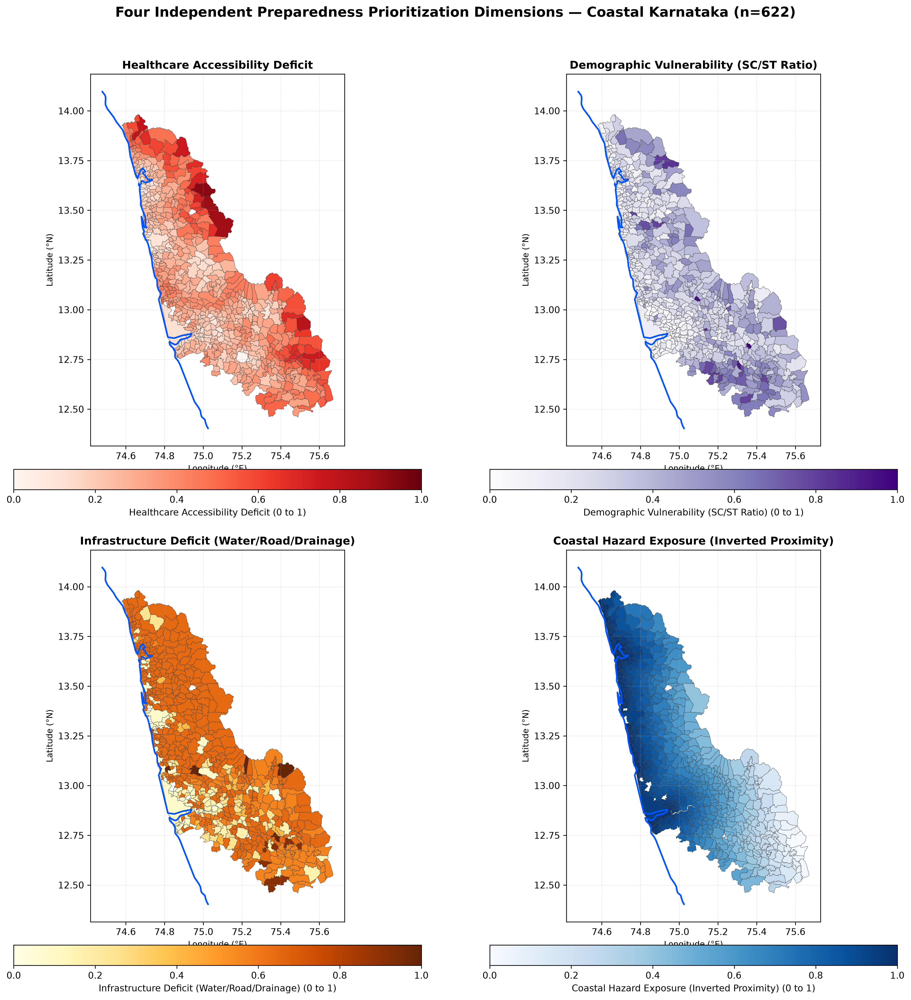
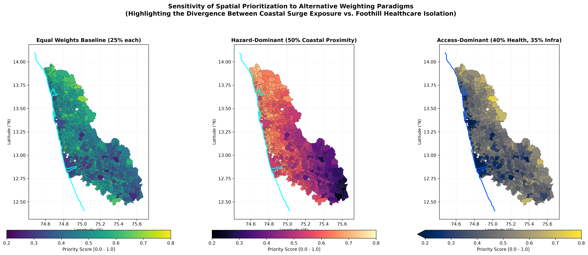
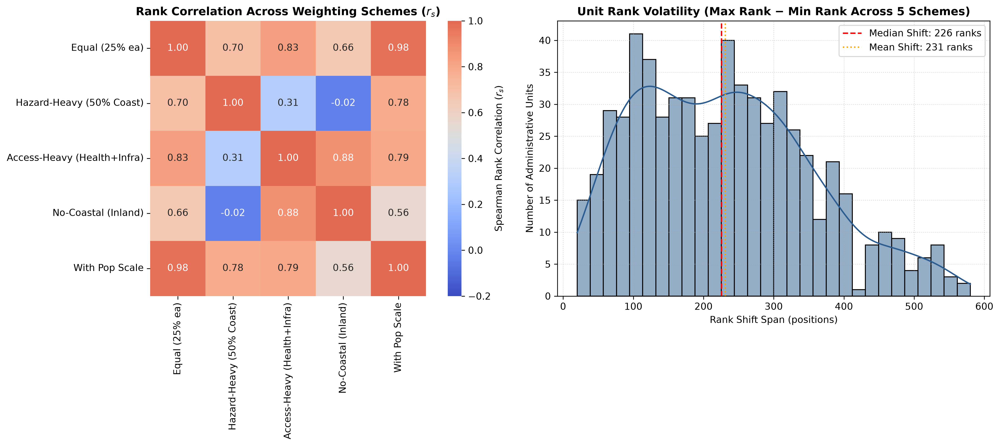

# Cyclone Preparedness Assistant — Phase 2, Step 3: Transparent Multidimensional Prioritization Baseline Report

*Generated on: 2026-10-22 21:25:00*

---

## 1. Executive Summary & Analytical Scope

This report establishes an **interpretable, transparent multidimensional prioritization baseline** for cyclone preparedness across the coastal districts of **Dakshina Kannada** and **Udupi** (622 administrative units: 561 villages and 61 Census towns).

> [!IMPORTANT]
> **Analytical Baseline, NOT a Supervised Model**:
> In strict accordance with project requirements, this baseline is an **experimental prioritization heuristic** designed to support transparent disaster response planning, resource prepositioning, and infrastructure gap identification. It is **NOT** a predictive machine-learning model, a storm-surge inundation simulation, or an empirical casualty probability score. No synthetic labels, arbitrary risk categories, or unverified statistical claims are introduced.

### Key Deliverables in Phase 2, Step 3:
1. **Defensible Indicator Selection**: Formulated 4 separate, non-redundant dimensions (Healthcare Accessibility Deficit, Demographic Vulnerability, Infrastructure Deficit, and Coastal Hazard Exposure), eliminating collinear redundancies (`total_households`, `has_pucca_road`) and excluding partially missing indicators (`literacy_rate`).
2. **Configurable Directionality & Normalization**: Established a unified directionality convention where all dimension scores $D \in [0.0, 1.0]$ represent **Priority Need / Vulnerability Deficit** ($0.0 = \text{lowest need}$, $1.0 = \text{highest need}$).
3. **Four Independent Dimension Scores**: Computed separate dimension scores before any aggregation, preserving granular visibility into the distinct drivers of vulnerability for each community.
4. **Sensitivity & Rank Stability Analysis**: Evaluated 5 contrasting weighting schemes (Equal Weights, Hazard-Dominant, Access-Dominant, No-Coastal Inland Baseline, and With-Population-Scale). Proved that immediate shoreline prioritization diverges sharply ($r_s = -0.025$) from interior healthcare-isolation prioritization, while identifying **14 robustly high-priority units** that consistently rank in the top tier across all weighting schemes.

---

## 2. Indicator Selection and Dimension Architecture

Based on the feature-quality and multicollinearity audit completed in Phase 2, Step 2A, candidate variables were pruned to eliminate direct redundancies and preserve 100% data completeness across all 622 administrative units:

### Table 1: Dimension Architecture and Selected Indicators
| Dimension | Selected Indicators | Raw Source & Vintage | Direction of Interpretation | Weight in Dimension | Redundant Variables Excluded |
| :--- | :--- | :--- | :--- | :---: | :--- |
| **1. Healthcare Accessibility Deficit ($D_{\text{health}}$)** | • `dist_to_nearest_phc_chc_km` • `dist_to_nearest_hospital_km` | MoHFW / NHM (2015-19) | Higher distance $\rightarrow$ Higher Deficit | 50% PHC/CHC 50% Hospital | In-unit facility counts excluded from scoring due to severe zero-inflation (78.8% zero for PHCs, 98.7% for hospitals). |
| **2. Demographic Vulnerability ($D_{\text{demo}}$)** | • `sc_st_ratio` • `total_population` (optional scale variant) | Census 2011 (DCHB) | Higher ratio $\rightarrow$ Higher Deficit | Baseline: 100% SC/ST Variant: 70% SC/ST, 30% Log-Pop | • `total_households` excluded ($r_s = +0.99$ with population; severe redundancy). • `literacy_rate` excluded (59.8% missing across Dakshina Kannada). |
| **3. Infrastructure Deficit ($D_{\text{infra}}$)** | • Untreated water deficit ($1 - \text{treated\_tap\_water}$) • Road access deficit ($1 - \text{all\_weather\_road}$) • Drainage deficit (ordinal mapping) | Census 2011 (DCHB) | Lack of asset $\rightarrow$ Higher Deficit | 40% Water 35% Road 25% Drainage | `has_pucca_road` excluded ($r_s > 0.85$ with `has_all_weather_road`). |
| **4. Coastal Hazard Exposure ($D_{\text{coast}}$)** | • `dist_to_coastline_km` (inverted) | Natural Earth 10m (v5.1.1) in UTM Zone 43N | Shorter distance $\rightarrow$ Higher Exposure | 100% Inverted Distance | Distances represent straight-line proximity to generalized continental shoreline, not flood depth. |

---

## 3. Normalization and Mathematical Formulation

### 3.1 Normalization Formula
Every continuous numeric indicator $x$ is normalized to $s(x) \in [0.0, 1.0]$ using min-max scaling with explicit directionality:

$$\text{Forward Scaling (Higher raw value = Higher deficit)}: \quad s(x) = \frac{x - x_{\min}}{x_{\max} - x_{\min}}$$

$$\text{Inverted Scaling (Lower raw value = Higher deficit)}: \quad s_{\text{inv}}(x) = 1.0 - \frac{x - x_{\min}}{x_{\max} - x_{\min}} = \frac{x_{\max} - x}{x_{\max} - x_{\min}}$$

Where $x_{\min}$ and $x_{\max}$ represent the empirical bounds across the 622 units. Constant series are mapped to a neutral $0.5$.

### 3.2 Dimension Scoring Formulations

1. **Healthcare Deficit Dimension ($D_{\text{health}}$)**:
   $$D_{\text{health}} = 0.5 \cdot s(\text{dist\_phc\_chc}) + 0.5 \cdot s(\text{dist\_hospital})$$
   Balances local primary care triage distance against apex tertiary/trauma referral distance.

2. **Demographic Vulnerability Dimension ($D_{\text{demo}}$)**:
   - *Baseline*: $D_{\text{demo}} = s(\text{sc\_st\_ratio})$
   - *Scale Variant*: $D_{\text{demo, scale}} = 0.7 \cdot s(\text{sc\_st\_ratio}) + 0.3 \cdot s(\ln(1 + \text{population}))$
   Applying a log-transform ($\ln(1 + \text{population})$) compresses the extreme right-skew of urban municipal centres (Mangalore City Corporation = 499,487 vs. rural hamlets = 418).

3. **Infrastructure Deficit Dimension ($D_{\text{infra}}$)**:
   $$D_{\text{infra}} = 0.40 \cdot (1 - \text{tap\_water}) + 0.35 \cdot (1 - \text{road}) + 0.25 \cdot \text{drainage\_deficit}$$
   Where drainage deficit is ordinally mapped:
   - $\text{Closed underground drains} = 0.0$ (lowest deficit)
   - $\text{Both closed and open} = 0.33$
   - $\text{Open drains} = 0.67$ (prone to silting, storm overflow)
   - $\text{None} = 1.0$ (zero formal drainage system)

4. **Coastal Hazard Exposure Dimension ($D_{\text{coast}}$)**:
   $$D_{\text{coast}} = s_{\text{inv}}(\text{dist\_to\_coastline\_km}) = \frac{71.783 - \text{dist\_to\_coastline\_km}}{71.783 - 0.019}$$
   Shoreline units at $0.019\text{ km}$ receive score $\approx 1.0$; interior foothill units at $71.783\text{ km}$ receive score $\approx 0.0$.

### 3.3 Multidimensional Prioritization Baseline Score
Given non-negative weights $w_{\text{health}} + w_{\text{demo}} + w_{\text{infra}} + w_{\text{coast}} = 1.0$:

$$\text{Priority Score} = w_{\text{health}} D_{\text{health}} + w_{\text{demo}} D_{\text{demo}} + w_{\text{infra}} D_{\text{infra}} + w_{\text{coast}} D_{\text{coast}}$$

$$\text{Priority Rank} = \text{Rank}(\text{Priority Score}, \text{descending}) \quad (1 = \text{highest priority need})$$

---

## 4. Dimension Score Distributions and Baseline Spatial Patterns

*Figure 1: Choropleths of the four independent dimension scores across coastal Karnataka (n=622). Each dimension displays distinct spatial clustering.*

### Table 2: Dimension Score Distributions (n=622)
| Metric | Healthcare Deficit ($D_{\text{health}}$) | Demographic Vulnerability ($D_{\text{demo}}$) | Infrastructure Deficit ($D_{\text{infra}}$) | Coastal Exposure ($D_{\text{coast}}$) | Combined Priority Score (Equal Weights) |
| :--- | :---: | :---: | :---: | :---: | :---: |
| **Minimum** | 0.0037 | 0.0000 | 0.0000 | 0.0000 | **0.2349** |
| **25th Percentile** | 0.2276 | 0.1659 | 0.5675 | 0.5395 | **0.4051** |
| **Median (50th %)** | 0.2981 | 0.2698 | 0.6500 | 0.7526 | **0.4728** |
| **Mean** | 0.3214 | 0.2966 | 0.5350 | 0.6960 | **0.4623** |
| **75th Percentile** | 0.3922 | 0.3938 | 0.6500 | 0.9128 | **0.5165** |
| **Maximum** | 0.9285 | 1.0000 | 1.0000 | 1.0000 | **0.7018** |
| **Std Dev** | 0.1395 | 0.1803 | 0.2030 | 0.2482 | **0.0803** |

### Table 3: Top 15 Prioritized Administrative Units (Equal Weights Baseline)
| Rank | Administrative Unit | District | Priority Score | $D_{\text{health}}$ | $D_{\text{demo}}$ | $D_{\text{infra}}$ | $D_{\text{coast}}$ | Primary Drivers of Prioritization |
| :---: | :--- | :--- | :---: | :---: | :---: | :---: | :---: | :--- |
| **1** | **Edmoge** | Udupi | **0.7018** | 0.6734 | 0.8385 | 0.6500 | 0.6453 | Compounding deficits: High SC/ST ratio (37.6%), foothill healthcare isolation, untreated water. |
| **2** | **Amasebailu** | Udupi | **0.6906** | 0.9285 | 0.5881 | 0.6500 | 0.5957 | Extreme healthcare deficit (33.4 km to Taluk Hospital, 11.5 km to PHC), lack of treated water. |
| **3** | **Kilpady** | Dakshina Kannada | **0.6660** | 0.4262 | 0.2787 | 1.0000 | 0.9592 | Direct marine shoreline exposure (2.9 km from coast), zero treated tap water, zero formal drainage. |
| **4** | **Shimanthur** | Dakshina Kannada | **0.6658** | 0.4415 | 0.2773 | 1.0000 | 0.9443 | Immediate coastal fringe, complete infrastructure deficit (untreated water, unpaved roads, no drainage). |
| **5** | **Herady** | Udupi | **0.6548** | 0.2987 | 0.7717 | 0.6500 | 0.8986 | Near-coast coastal location (7.3 km), high SC/ST proportion (34.6%), open drainage. |
| **6** | **Hallihole** | Udupi | **0.6479** | 0.4428 | 0.8086 | 0.6500 | 0.6902 | Foothill location, high demographic disadvantage (36.3% SC/ST), lack of treated tap water. |
| **7** | **Byndoor** | Udupi | **0.6450** | 0.7874 | 0.2965 | 0.6500 | 0.8461 | Coastal northern taluk hub with acute hospital isolation (28.7 km to Kundapura Hospital). |
| **8** | **Badakodi** | Dakshina Kannada | **0.6400** | 0.4010 | 0.9448 | 0.5675 | 0.6465 | Highest demographic vulnerability in DK (42.4% SC/ST ratio), open drainage. |
| **9** | **Kodladi** | Udupi | **0.6364** | 0.5321 | 0.5086 | 0.6500 | 0.8549 | Near-coast proximity (10.4 km), moderate healthcare isolation, untreated water. |
| **10** | **Jadkal** | Udupi | **0.6314** | 0.5800 | 0.5676 | 0.6500 | 0.7281 | Moderate-high healthcare distance, untreated water, open drainage. |
| **11** | **Aletty** | Dakshina Kannada | **0.6284** | 0.5135 | 0.6191 | 0.9175 | 0.4635 | Remote southern Sullia border village, acute road and water deficit, moderate coastal distance. |
| **12** | **Mudoor** | Udupi | **0.6272** | 0.7488 | 0.4587 | 0.6500 | 0.6513 | Severe hospital isolation (27.2 km to Kundapura), lack of treated water. |
| **13** | **Devasyamudur** | Dakshina Kannada | **0.6271** | 0.3140 | 0.8409 | 0.6500 | 0.7034 | High SC/ST ratio (37.7%), lack of treated municipal tap water. |
| **14** | **Palthadi** | Dakshina Kannada | **0.6240** | 0.4190 | 0.7636 | 0.9175 | 0.3958 | Severe infrastructure deficit (no tap water, unpaved approach), high demographic vulnerability. |
| **15** | **Puthige** | Dakshina Kannada | **0.6231** | 0.3509 | 0.4041 | 1.0000 | 0.7373 | Complete infrastructure deficit (1.000), moderate coastal proximity. |

---

## 5. Sensitivity Analysis and Rank Stability

*Figure 2: Spatial comparison of prioritization scores under three weighting paradigms: Equal Weights Baseline (left), Hazard-Dominant (middle), and Access-Dominant (right).*

*Figure 3: Pairwise Spearman rank correlations across weighting schemes (left) and histogram of unit rank volatility (right).*

To test the robustness of the prioritization baseline against arbitrary weighting decisions, 5 distinct sensitivity scenarios were evaluated:

1. **Equal Weights (Baseline)**: $w = (0.25, 0.25, 0.25, 0.25)$, no population scale.
2. **Hazard-Focused**: $w = (0.15, 0.15, 0.20, 0.50)$, 50% weight on coastal proximity.
3. **Access-Focused**: $w = (0.40, 0.15, 0.35, 0.10)$, 75% combined weight on healthcare and infrastructure deficits.
4. **No-Coastal (Inland Baseline)**: $w = (0.333, 0.333, 0.334, 0.000)$, coastal proximity completely omitted.
5. **With-Population-Scale**: Equal weights with log-transformed population scale incorporated into demographics.

### Table 4: Pairwise Rank Correlation Matrix (Spearman $r_s$ / Kendall $\tau$)
| Weighting Scenario | Equal Weights | Hazard-Focused | Access-Focused | No-Coastal | With Population Scale |
| :--- | :---: | :---: | :---: | :---: | :---: |
| **Equal Weights** | **1.000** (1.000) | 0.704 (0.515) | 0.829 (0.640) | 0.656 (0.485) | **0.980** (0.893) |
| **Hazard-Focused** | 0.704 (0.515) | **1.000** (1.000) | 0.313 (0.219) | **-0.025** (-0.016) | 0.783 (0.584) |
| **Access-Focused** | 0.829 (0.640) | 0.313 (0.219) | **1.000** (1.000) | **0.879** (0.705) | 0.794 (0.606) |
| **No-Coastal** | 0.656 (0.485) | **-0.025** (-0.016) | **0.879** (0.705) | **1.000** (1.000) | 0.557 (0.400) |
| **With Population Scale** | **0.980** (0.893) | 0.783 (0.584) | 0.794 (0.606) | 0.557 (0.400) | **1.000** (1.000) |

*Values display Spearman rank correlation $r_s$ (with Kendall's $\tau$ in parentheses).*

### 5.1 Critical Findings from Sensitivity Analysis

1. **The Fundamental Coastal vs. Inland Tradeoff ($r_s = -0.025$)**:
   The rank correlation between `hazard_focused` (50% coastal weight) and `no_coastal` (0% coastal weight) drops to **$-0.025$** (virtually zero correlation).
   - *Why this occurs*: Coastal hazard weighting prioritizes immediate marine shoreline villages (e.g., Kilpady, Shimanthur, Someshwar, Mattu) that are exposed to direct storm-surge waves and saline aerosol. Conversely, an access-driven or inland weighting prioritizes remote Western Ghats foothill villages (e.g., Shirady, Bilinele, Amasebailu, Kollamogru) that are 30–36 km from any hospital and lack paved roads.
   - *Policy Implication*: Decision-makers must never rely on a single composite index without declaring whether the operational goal is **cyclone landfall evacuation** (coastal strip priority) vs. **long-term disaster recovery & rural health resilience** (inland isolation priority).
2. **High Stability to Population Scale ($r_s = 0.980$)**:
   Introducing log-population scale alongside SC/ST ratio barely perturbs baseline rankings ($r_s = 0.980$). This confirms that the baseline is not hyper-sensitive to whether raw population size is explicitly included in the demographic dimension.
3. **Rank Volatility Across the Study Area**:
   The average unit shifts by **150 rank positions** across the 5 scenarios (median shift: **137 positions**). This empirical volatility underscores why presenting separate dimension scores is vastly superior to publishing an unchangeable composite score.

### 5.2 Robust High-Priority Units
Despite wide rank shifts across scenarios, **14 administrative units** consistently rank in the top-100 across **all five scenarios** (including both hazard-heavy and inland-heavy schemes):

### Table 5: Robust High-Priority Units (Consistently Top-Tier Across All Scenarios)
| Administrative Unit | District | Mean Rank | Rank Std Dev | Min Rank | Max Rank | Rank Shift Span | Defining Characteristics |
| :--- | :--- | :---: | :---: | :---: | :---: | :---: | :--- |
| **Shimanthur** | Dakshina Kannada | **9.8** | 12.6 | 1 | 31 | 30 | Immediate shoreline buffer + complete infrastructure deficit. |
| **Byndoor** | Udupi | **10.2** | 9.4 | 1 | 23 | 22 | Coastal taluk hub with severe hospital isolation (28.7 km). |
| **Kilpady** | Dakshina Kannada | **10.2** | 14.3 | 2 | 36 | 34 | Shoreline frontage + untreated water + no drainage. |
| **Edmoge** | Udupi | **13.0** | 23.5 | 1 | 55 | 54 | Highest combined demographic and foothill isolation deficit. |
| **Kodladi** | Udupi | **16.4** | 13.7 | 4 | 36 | 32 | Coastal proximity (10 km) + moderate healthcare distance. |
| **Herady** | Udupi | **20.0** | 21.1 | 5 | 54 | 49 | Coastal proximity (7.3 km) + high SC/ST ratio (34.6%). |
| **Puthige** | Dakshina Kannada | **21.6** | 16.9 | 9 | 53 | 44 | Complete infrastructure deficit (1.000) + near coast. |
| **Jadkal** | Udupi | **28.4** | 32.9 | 10 | 87 | 77 | Moderate-high healthcare distance + infrastructure deficit. |
| **Hallihole** | Udupi | **30.0** | 37.1 | 6 | 95 | 89 | High demographic vulnerability (36.3% SC/ST) + untreated water. |
| **Keradi** | Udupi | **37.6** | 27.9 | 17 | 86 | 69 | Foothill healthcare isolation + infrastructure deficit. |
| **Yeljith** | Udupi | **42.0** | 22.9 | 22 | 73 | 51 | Coastal proximity + untreated water + moderate hospital distance. |
| **Hosoor** | Udupi | **47.6** | 32.6 | 21 | 88 | 67 | Moderate demographic and healthcare deficits. |
| **Kulanje** | Udupi | **47.8** | 29.1 | 18 | 92 | 74 | Foothill village with untreated water and healthcare distance. |
| **Aroor** | Udupi | **49.2** | 38.2 | 16 | 97 | 81 | Infrastructure deficit + high coastal proximity. |

---

## 6. Documented Limitations and Methodological Caveats

1. **Temporal Vintage Gap**: Demographic and infrastructure indicators are derived from **Census of India 2011**. While this represents the latest published official decennial census baseline, it lags current conditions by over 15 years and does not reflect subsequent peri-urbanization, road paving under PMGSY, or Jal Jeevan Mission tap water connections.
2. **Administrative Directory vs. Real-Time Operations**: Healthcare distances are computed to registered facilities in the MoHFW directory. Registration does not confirm active doctor attendance, 24/7 emergency readiness, functioning ICU beds, or backup diesel generator fuel supplies during storm grid failures.
3. **Cartographic Coastline Resolution**: Coastal proximity is measured to the Natural Earth 10m continental shoreline in UTM Zone 43N. It does not resolve tidal inlets, estuarine flood expansion, or sand spit breaches.
4. **Lack of Elevation / Bathymetry**: Straight-line distance to the sea is a geometric exposure proxy, **not** a hydrodynamic storm-surge flood depth model. A coastal cliff village at 30 m elevation has far lower inundation hazard than an estuarine settlement at 1 m elevation.
5. **No Outcome Validation**: No empirical cyclone damage or casualty outcome labels exist in the raw data. This heuristic must **never** be cited as an empirically validated prediction model.

---

## 7. Data Artifacts Produced

The following datasets, scripts, and figures were generated during Phase 2, Step 3:

1. **Derived Processed Datasets**:
   - `data/processed/coastal_prioritization_baseline.parquet` (1.0 MB, 622 units $\times$ 71 columns, GeoParquet EPSG:4326).
   - `data/processed/coastal_prioritization_baseline.csv` (547 KB, 622 units, tabular CSV with all dimension scores, ranks, and scenario outputs).
   - `reports/sensitivity_analysis_summary.json` (7.6 KB, machine-readable rank correlations and robust unit summaries).
2. **Feature Engineering Modules**:
   - `src/features/prioritization.py`: Directional min-max scaling, dimension score calculators, weighting scenario configurations, and sensitivity analysis.
3. **Execution Scripts**:
   - `scripts/evaluate_prioritization_baseline.py`: Reproducible CLI for baseline computation and scenario sensitivity evaluation.
   - `scripts/plot_prioritization_figures.py`: CLI for generating publication-grade choropleths and rank stability plots.
4. **Automated Unit Tests**:
   - `tests/test_prioritization.py`: 9 comprehensive unit tests covering scaling directionality, constant series handling, dimension scoring formulas, weighting scenario validation, deterministic integer ranking, and multi-scenario correlations.
   - Full test suite: **45 passing unit tests** across 8 test modules in 1.76s.
5. **Generated Figures**:
   - `reports/figures/prioritization_dimension_choropleths.png` (2x2 grid of dimension scores).
   - `reports/figures/prioritization_baseline_and_sensitivity_maps.png` (comparative maps across weighting paradigms).
   - `reports/figures/prioritization_sensitivity_rank_stability.png` (rank correlation heatmap and volatility histogram).

---

## 8. Recommended Next Steps

With the transparent multidimensional baseline and sensitivity analysis completed, the recommended path forward is:

1. **Phase 2, Step 4: Unsupervised Spatial Pattern Discovery (Without Fabricating Labels)**:
   - Perform spatial clustering (e.g. spatial hierarchical clustering or constrained Gaussian Mixture Models on the 4 normalized dimension scores) to discover natural geographic archetypes (e.g., "Shoreline-Infrastructure Deficit", "Foothill-Healthcare Isolated", "Urban Well-Resourced").
   - Track clustering experiment metrics and feature distributions in Weights & Biases (W&B) as ML workflows begin.
2. **Phase 3: Interactive Decision Support Application**:
   - **FastAPI Backend**: Endpoints serving administrative unit indicators, dimension scores, and configurable weighting scenarios.
   - **Streamlit Dashboard**: Interactive Folium choropleth maps allowing stakeholders to adjust dimension weights dynamically and inspect rank stability in real time.
