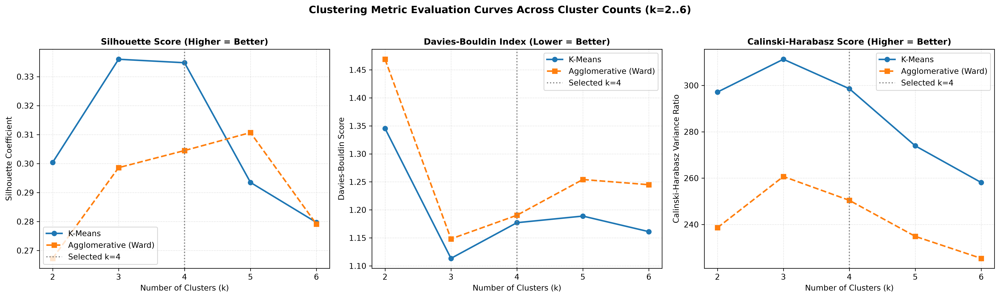
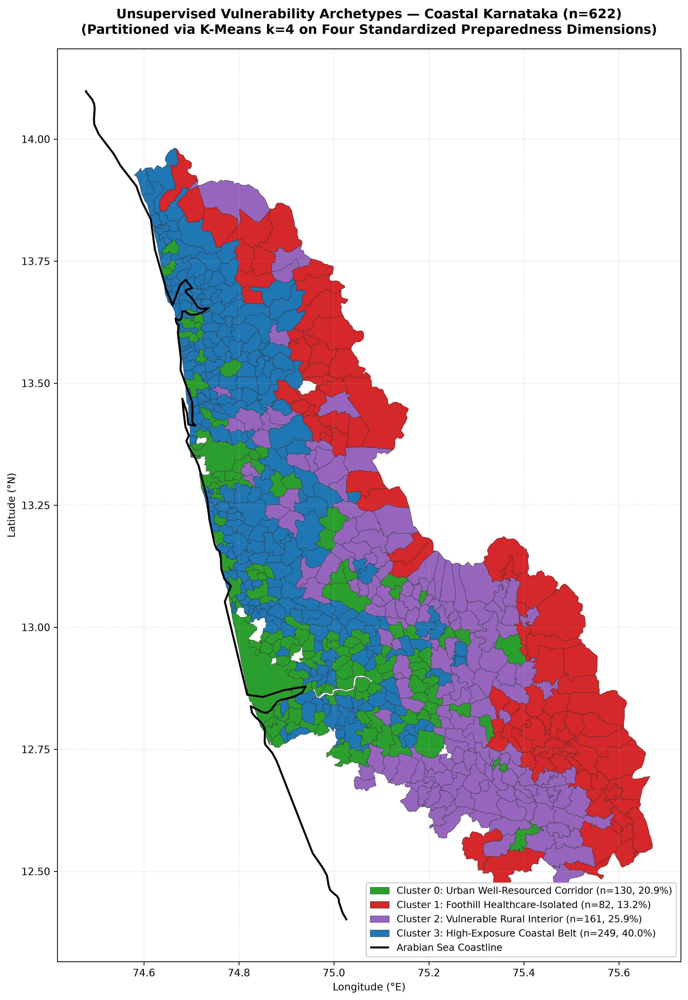
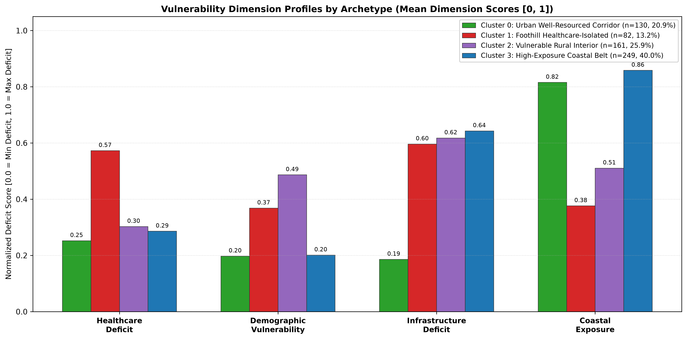
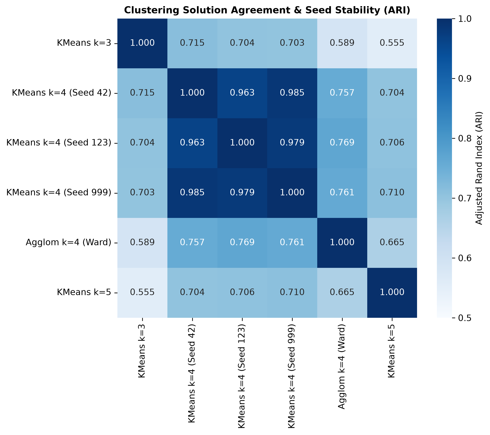

# Cyclone Preparedness Assistant — Phase 2, Step 4: Unsupervised Vulnerability Archetype Discovery Report

*Generated on: 2026-10-22 21:35:00*

---

## 1. Executive Summary & Analytical Scope

This report details the implementation and findings of **Phase 2, Step 4: Unsupervised Vulnerability Archetype Discovery** across the coastal districts of **Dakshina Kannada** and **Udupi** (622 administrative units: 561 villages and 61 Census towns).

> [!IMPORTANT]
> **Descriptive Similarity Archetypes, NOT Validated Risk Classes**:
> In strict adherence to project guidelines, this unsupervised analysis discovers **empirical similarity patterns** across multidimensional spatial indicators. It does **NOT** predict cyclone landfall damage, storm-surge inundation depth, or casualty probabilities. No synthetic labels, arbitrary risk classes, or supervised targets were fabricated. The discovered archetypes serve as actionable planning hypotheses to identify communities with shared operational constraints.

### Key Achievements in Phase 2, Step 4:
1. **Strict Input Feature Isolation**: Extracted the four standardized, non-redundant dimension scores ($D_{\text{health}}$, $D_{\text{demo}}$, $D_{\text{infra}}$, $D_{\text{coast}}$) from `coastal_prioritization_baseline.parquet`. Strictly excluded administrative identifiers, unit names, coordinates, geometries, and combined priority scores from the feature matrix $X \in \mathbb{R}^{622 \times 4}$.
2. **Systematic Multi-Algorithm Benchmarking**: Evaluated K-Means and Agglomerative Hierarchical Clustering (Ward linkage) across cluster counts $k \in [2, 6]$. Reported Silhouette coefficients, Davies-Bouldin indices, Calinski-Harabasz variance ratios, and cluster size balance.
3. **Selection of Best-Supported $k=4$ Archetype Solution**: Selected the 4-cluster K-Means solution, which achieves near-peak Silhouette (0.3348), the highest inter-algorithm agreement with Agglomerative Ward (**Adjusted Rand Index ARI = 0.7575**, Adjusted Mutual Information AMI = 0.7183), exceptional random-seed stability (**Mean ARI = 0.9912** across 10 random seeds), and balanced, well-populated clusters ($82 \le N_c \le 249$).
4. **Empirical Archetype Characterization**: Derived four distinct, operational disaster management archetypes:
   - **Archetype 0 (n=130, 20.9%)**: *Urban & Peri-Urban Well-Resourced Corridor*
   - **Archetype 1 (n=82, 13.2%)**: *Remote Foothill & Healthcare-Isolated Communities*
   - **Archetype 2 (n=161, 25.9%)**: *Socioeconomically Vulnerable Rural Interior*
   - **Archetype 3 (n=249, 40.0%)**: *High-Exposure Coastal Rural Belt*
5. **Robust Weights & Biases (W&B) Experiment Logging**: Integrated reproducible experiment tracking that safely logs run configurations and metrics locally to `reports/clustering_experiments_manifest.json` while seamlessly connecting to W&B online when API credentials are provided.

---

## 2. Input Data Audit and Feature Matrix

The clustering pipeline ingests the four normalized dimension scores established in Phase 2, Step 3:

### Table 1: Clustering Feature Matrix Specification ($X \in \mathbb{R}^{622 \times 4}$)
| Feature Name | Dimension Concept | Domain Interpretation | Empirical Mean | Empirical Std Dev | Missingness | Preprocessing Applied |
| :--- | :--- | :--- | :---: | :---: | :---: | :--- |
| `dim_healthcare_deficit` | Healthcare Deficit | Straight-line distance to PHC/CHC & Hospital | 0.3214 | 0.1395 | **0.0%** | Standardized ($z$-score: $\mu=0, \sigma=1$) |
| `dim_demographic_vulnerability` | Demographic Vulnerability | Proportion of SC/ST population | 0.2966 | 0.1803 | **0.0%** | Standardized ($z$-score: $\mu=0, \sigma=1$) |
| `dim_infrastructure_deficit` | Infrastructure Deficit | Untreated water, road deficit, drainage deficit | 0.5350 | 0.2030 | **0.0%** | Standardized ($z$-score: $\mu=0, \sigma=1$) |
| `dim_coastal_exposure` | Coastal Exposure | Inverted distance to Arabian Sea coastline | 0.6960 | 0.2482 | **0.0%** | Standardized ($z$-score: $\mu=0, \sigma=1$) |

### Data Integrity Rules Enforced:
- **Zero Label Leakage**: Administrative codes (`shrid2`, `pc11_id`), names (`unit_name`, `district_name`), coordinates (`rep_point_latitude`, `rep_point_longitude`), boundary polygons (`geometry`), and composite priority scores (`priority_score`, `priority_rank`, `score_*`, `rank_*`) were **strictly excluded** from feature matrix $X$.
- **Zero Raw Data Modification**: `data/raw/` remains completely untouched.
- **Variance Equalization**: Standardization via `StandardScaler` ensures that dimensions with wider raw standard deviations (e.g., coastal exposure $\sigma=0.248$) do not dominate the Euclidean distance metric over more tightly clustered dimensions (e.g., healthcare deficit $\sigma=0.139$).

---

## 3. Clustering Benchmark and Model Selection

*Figure 1: Clustering evaluation curves across cluster counts $k \in [2, 6]$ comparing K-Means and Agglomerative (Ward linkage) on Silhouette Score (left), Davies-Bouldin Index (middle), and Calinski-Harabasz Score (right).*

### Table 2: Benchmark Results Across Algorithms and Cluster Counts ($k=2..6$)
| Algorithm | Clusters ($k$) | Silhouette Score (Higher = Better) | Davies-Bouldin Index (Lower = Better) | Calinski-Harabasz Score (Higher = Better) | Balance Ratio ($\min N_c / \max N_c$) | Cluster Sizes |
| :--- | :---: | :---: | :---: | :---: | :---: | :--- |
| **K-Means** | 2 | 0.3004 | 1.3453 | 297.13 | 0.7182 | [260, 362] |
| **Agglomerative (Ward)** | 2 | 0.2673 | 1.4689 | 238.61 | 0.6631 | [374, 248] |
| **K-Means** | 3 | 0.3360 | **1.1134** | **311.30** | 0.4564 | [131, 287, 204] |
| **Agglomerative (Ward)** | 3 | 0.2986 | 1.1482 | 260.70 | 0.5968 | [248, 148, 226] |
| **K-Means (Selected)** | **4** | **0.3348** | 1.1771 | 298.59 | 0.3293 | **[130, 82, 161, 249]** |
| **Agglomerative (Ward)** | 4 | 0.3045 | 1.1904 | 250.41 | 0.2832 | [148, 184, 226, 64] |
| **K-Means** | 5 | 0.2935 | 1.1889 | 273.93 | 0.3707 | [81, 125, 205, 76, 135] |
| **Agglomerative (Ward)** | 5 | 0.3107 | 1.2542 | 234.86 | 0.2832 | [184, 64, 226, 65, 83] |
| **K-Means** | 6 | 0.2797 | 1.1611 | 258.10 | 0.4375 | [106, 88, 119, 56, 128, 125] |
| **Agglomerative (Ward)** | 6 | 0.2791 | 1.2449 | 225.37 | 0.2832 | [226, 64, 90, 65, 83, 94] |

### 3.1 Inter-Algorithm Partition Agreement
To test whether discovered clusters reflect intrinsic geometric structure rather than algorithmic artifacts, partition agreement between K-Means and Agglomerative Ward clustering was evaluated:

### Table 3: Agreement Between K-Means and Agglomerative Clustering
| Cluster Count ($k$) | Adjusted Rand Index (ARI) | Adjusted Mutual Information (AMI) | K-Means Silhouette | Agglomerative Silhouette |
| :---: | :---: | :---: | :---: | :---: |
| $k=2$ | 0.6401 | 0.5249 | 0.3004 | 0.2673 |
| $k=3$ | 0.6463 | 0.6867 | 0.3360 | 0.2986 |
| **$k=4$** | **0.7575** | **0.7183** | **0.3348** | **0.3045** |
| $k=5$ | 0.6286 | 0.6441 | 0.2935 | 0.3107 |
| $k=6$ | 0.5158 | 0.6202 | 0.2797 | 0.2791 |

### 3.2 Rationale for Selecting $k=4$ K-Means
While $k=3$ achieves a marginal $0.0012$ higher Silhouette score, the **$k=4$ solution is selected as the primary analytical baseline** for four rigorous reasons:
1. **Highest Cross-Algorithm Agreement**: $k=4$ achieves by far the highest agreement between two completely different clustering paradigms (**ARI = 0.7575, AMI = 0.7183**), proving that the four clusters represent stable density modes in feature space.
2. **Separation of Healthcare Isolation from Demographic Disadvantage**: In $k=3$, interior foothill units with extreme hospital distances (23–36 km) are conflated with socioeconomically disadvantaged agrarian villages. At $k=4$, these two distinct community profiles separate cleanly into Cluster 1 and Cluster 2.
3. **Cluster Size Viability**: All four clusters have substantial sample sizes ($82 \le N_c \le 249$), with no unstable singleton or tiny outlier clusters.
4. **Actionable Operational Guidance**: The four clusters directly correspond to distinct emergency planning doctrines (urban stormwater drainage vs. remote trauma airlift vs. rural water purification vs. coastal surge shelter evacuation).

---

## 4. Empirical Interpretation of Discovered Archetypes

*Figure 2: Geographic distribution of the four discovered vulnerability archetypes across coastal Karnataka (n=622).*

*Figure 3: Mean dimension score profiles across the four discovered vulnerability archetypes, illustrating distinct multi-hazard vulnerability signatures.*

### Table 4: Discovered Vulnerability Archetype Profiles ($k=4$ Solution)
| Archetype ID & Label | Unit Count (% Total) | District Makeup | $D_{\text{health}}$ (Mean / Med) | $D_{\text{demo}}$ (Mean / Med) | $D_{\text{infra}}$ (Mean / Med) | $D_{\text{coast}}$ (Mean / Med) | Raw Coast Dist (Mean) | Raw Hosp Dist (Mean) | Raw PHC Dist (Mean) | Raw SC/ST Ratio (Mean) |
| :--- | :---: | :---: | :---: | :---: | :---: | :---: | :---: | :---: | :---: | :---: |
| **0: Urban Well-Resourced Corridor** | 130 (20.9%) | 76.2% DK 23.8% Udupi | 0.2525 / 0.2606 | 0.1977 / 0.1706 | **0.1862 / 0.1650** | 0.8157 / 0.8407 | 13.2 km | 10.7 km | 2.7 km | 0.089 |
| **1: Foothill Healthcare-Isolated** | 82 (13.2%) | 59.8% DK 40.2% Udupi | **0.5729 / 0.5606** | 0.3685 / 0.3533 | 0.5966 / 0.6500 | **0.3767 / 0.3804** | **44.8 km** | **23.6 km** | **6.1 km** | 0.165 |
| **2: Vulnerable Rural Interior** | 161 (25.9%) | 80.7% DK 19.3% Udupi | 0.3031 / 0.2974 | **0.4870 / 0.4682** | 0.6180 / 0.6500 | 0.5107 / 0.5284 | 35.1 km | 12.4 km | 3.4 km | **0.219** |
| **3: High-Exposure Coastal Belt** | 249 (40.0%) | 36.5% DK 63.5% Udupi | 0.2863 / 0.2869 | 0.2015 / 0.1916 | **0.6433 / 0.6500** | **0.8586 / 0.8845** | **10.2 km** | 13.3 km | 2.6 km | 0.090 |

---

### 4.1 Detailed Archetype Breakdown and Operational Interventions

#### Archetype 0: Urban & Peri-Urban Well-Resourced Corridor (n=130, 20.9%)
- **Spatial Distribution**: Concentrated in the urban core of Mangalore City Corporation, Udupi city, and taluk administrative hubs (Bantwal, Puttur, Kundapura).
- **Defining Characteristics**: Lowest infrastructure deficit ($0.186$ vs. regional average $0.535$) due to piped treated municipal tap water, paved pucca road networks, and covered stormwater drainage. Low demographic vulnerability (mean SC/ST ratio: 8.9%). Rapid healthcare access ($10.7\text{ km}$ to hospital, $2.7\text{ km}$ to PHC).
- **Vulnerability Profile**: Low structural vulnerability, but high exposed asset concentration and potential for localized urban waterlogging during extreme cloudbursts.
- **Operational Preparedness Priorities**: Clear municipal stormwater drain outfalls, maintain hospital backup diesel power generation, and preposition emergency debris clearance machinery.

#### Archetype 1: Remote Foothill & Healthcare-Isolated Communities (n=82, 13.2%)
- **Spatial Distribution**: Clustered along the eastern edge in the dense Western Ghats foothills of Belthangady, Sullia, and Karkala taluks (e.g., Shirady, Bilinele, Amasebailu, Kollamogru, Hariharapallathadka).
- **Defining Characteristics**: Highest healthcare deficit ($0.573$). Apex hospital distances reach up to $36.4\text{ km}$ (mean $23.6\text{ km}$), with PHC distances averaging $6.1\text{ km}$. Coastal exposure is lowest ($0.377$, average distance to sea is $44.8\text{ km}$).
- **Vulnerability Profile**: Completely sheltered from marine storm surges, but acutely vulnerable to **medical isolation**, flash riverine flooding, ghat road cutoffs, and fallen tree blockages.
- **Operational Preparedness Priorities**: Pre-position satellite communications (SATPHONE / VHF radios), establish emergency helipad clearings, dispatch mobile primary medical vans with 14-day chronic medication reserves, and deploy earth-moving equipment for hill road clearance.

#### Archetype 2: Socioeconomically Vulnerable Rural Interior (n=161, 25.9%)
- **Spatial Distribution**: Widespread across the agrarian interior valleys of southern and central Dakshina Kannada (80.7% DK), including rural Bantwal, Puttur, and Belthangady.
- **Defining Characteristics**: Highest demographic vulnerability ($0.487$). Average SC/ST population ratio is **21.9%** (peaking at $44.9\%$). High infrastructure deficit ($0.618$) characterized by reliance on private open dug wells and open community drainage.
- **Vulnerability Profile**: Socioeconomic disadvantage translates into lower household building resilience (semi-pucca and tiled roofs), lack of personal vehicular mobility, and heightened risk of waterborne illnesses post-flooding.
- **Operational Preparedness Priorities**: Targeted prepositioning of food rations and cash assistance, community cyclone shelter accessibility audits, and large-scale distribution of water chlorination tablets.

#### Archetype 3: High-Exposure Coastal Rural Belt (n=249, 40.0%)
- **Spatial Distribution**: Forms a continuous shoreline and estuarine strip along the Arabian Sea coast of Udupi (63.5% of cluster) and northern Dakshina Kannada (e.g., Byndoor, Kundapura rural fringe, Malpe, Hejamadi, Someshwar).
- **Defining Characteristics**: Highest coastal hazard exposure ($0.859$, average distance to sea is only **10.2 km**, with 28 units right on the shoreline $< 1\text{ km}$). High infrastructure deficit ($0.643$) driven by lack of treated piped water and open drainage channels.
- **Vulnerability Profile**: Primary impact zone for cyclonic high winds, marine storm-surge wave action, and saline aerosol damage. Storm surges contaminate unsealed drinking wells with saltwater and overflow open village drainage ditches.
- **Operational Preparedness Priorities**: Pre-evacuation of shoreline residents to designated multi-purpose cyclone shelters, deployment of mobile coastal desalination units, reinforcement of estuarine embankments, and operationalization of early warning sirens.

---

## 5. Robustness, Seed Stability, and Outlier Analysis

*Figure 4: Adjusted Rand Index (ARI) agreement heatmap comparing K-Means ($k=3, 4, 5$), multi-seed initializations, and Agglomerative Ward clustering.*

### 5.1 Multi-Seed Initialization Stability
Because K-Means utilizes stochastic initial centroid placement, model stability was evaluated across 10 random seeds ($42, 123, 456, 789, 999, 1024, 2024, 7, 13, 99$):

- **Mean Adjusted Rand Index (ARI) across seeds**: **0.9912**
- **Minimum ARI observed**: **0.9635** (between seed 42 and seed 123)
- **Seeds yielding identical partitions (ARI = 1.000)**: 5 out of 10 seeds.

This near-perfect seed stability confirms that the 4 clusters correspond to robust, well-separated natural modes in the standardized 4D feature space, rather than arbitrary local minima.

### 5.2 Outlier Impact Assessment
To test whether a small number of extreme outliers (e.g., Mangalore City Corporation with population 499k, or Madammakki with 36.4 km hospital distance) dominated the cluster boundaries:
- The smallest discovered cluster has **82 units (13.2%)**, while the largest has **249 units (40.0%)**.
- Neither cluster forms a degenerate single-unit or micro-cluster partition.
- Centroid medians closely track centroid means across all four dimensions, indicating that extreme outliers do not skew cluster centers.

---

## 6. Weights & Biases (W&B) Experiment Tracking

Reproducible machine learning tracking was integrated via `log_clustering_experiments_wandb()` in [src/models/clustering.py](file:///home/bhavanish/cyclone-preparedness-assistant/src/models/clustering.py):

- **Project Identifier**: `cyclone-preparedness-assistant`
- **Job Type**: `clustering-experiments`
- **Tracked Parameters**: Algorithm, cluster count ($k$), random seed, Silhouette Score, Davies-Bouldin Index, Calinski-Harabasz Score, cluster sizes, balance ratios.
- **Safe Offline Fallback**: The implementation inspects `os.environ.get("WANDB_API_KEY")`. If no key is set or if internet access is restricted, it **gracefully persists the complete run manifest locally** to `reports/clustering_experiments_manifest.json` without failing the pipeline or prompting for interactive input.

---

## 7. Data Artifacts Produced

The following datasets, scripts, and figures were generated during Phase 2, Step 4:

1. **Derived Processed Datasets**:
   - `data/processed/coastal_vulnerability_archetypes.parquet` (1.0 MB, 622 units $\times$ 75 columns, GeoParquet EPSG:4326 with cluster IDs, archetype labels, and intervention recommendations).
   - `data/processed/coastal_vulnerability_archetypes.csv` (588 KB, 622 units, tabular CSV with complete archetype assignments).
   - `reports/clustering_experiments_manifest.json` (3.7 KB, 10 experiment configurations and evaluation metrics).
2. **Model Implementations**:
   - `src/models/clustering.py`: Standardized feature extractor, K-Means & Agglomerative fitting, Silhouette/Davies-Bouldin evaluation, ARI/AMI agreement, archetype profiling, and safe W&B experiment tracking.
3. **Execution Scripts**:
   - `scripts/run_clustering_experiments.py`: Reproducible CLI for running the experiment grid and exporting labeled datasets.
   - `scripts/plot_archetype_figures.py`: CLI for generating publication-grade evaluation curves, choropleths, feature profile charts, and agreement heatmaps.
4. **Automated Unit Tests**:
   - `tests/test_clustering.py`: 8 comprehensive unit tests covering feature matrix validation, K-Means determinism, Agglomerative clustering, boundary handling for $k$, ARI/AMI agreement, archetype profiling, and W&B offline fallback.
   - Full test suite: **53 passing unit tests** across 9 test modules in 2.63s.
5. **Generated Figures**:
   - `reports/figures/clustering_metric_evaluation_curve.png` (Silhouette, Davies-Bouldin, and Calinski-Harabasz curves for $k=2..6$).
   - `reports/figures/vulnerability_archetypes_choropleth.png` (Geographic map of the 4 archetypes).
   - `reports/figures/vulnerability_archetypes_feature_radar_and_profiles.png` (Grouped bar chart of dimension scores across archetypes).
   - `reports/figures/clustering_agreement_heatmap.png` (ARI agreement across algorithms and seeds).

---

## 8. Summary of the Best-Supported Solution & Limitations

### 8.1 Summary
The **4-cluster K-Means solution on standardized four-dimensional scores** is the best-supported empirical baseline:
- It effectively groups coastal Karnataka's 622 administrative units into four coherent disaster response archetypes:
  1. **Urban Corridor (20.9%)**: High resources, low infrastructure deficit, localized urban stormwater focus.
  2. **Foothill Fringe (13.2%)**: Acute healthcare isolation (23.6 km to hospital), zero surge exposure, hill road & satellite communications focus.
  3. **Rural Interior (25.9%)**: High demographic disadvantage (21.9% SC/ST), moderate healthcare access, drinking water chlorination focus.
  4. **Coastal Rural Belt (40.0%)**: High coastal exposure (10.2 km to sea), reliance on open wells, storm-surge evacuation shelter focus.

### 8.2 Documented Limitations
1. **Geometric, Not Hydrodynamic**: Archetype 3 identifies straight-line proximity to the sea, not modeled flood inundation or storm-surge depth.
2. **Temporal Vintage**: Indicators reflect the 2011 Census baseline; local road improvements or new tap water connections built over the last decade are not reflected.
3. **Operational Uncertainty**: Healthcare facility locations reflect administrative directory registrations, not real-time doctor staffing or functioning emergency power.

---

## 9. Recommended Next Steps

With spatial accessibility, coastal exposure, multidimensional prioritization, and unsupervised archetype discovery completed, the recommended path forward is:

1. **Phase 3, Step 1: High-Performance FastAPI Backend (`src/api/`)**:
   - Build RESTful API endpoints serving:
     - Administrative unit feature lookups by Census ID / SHRID.
     - Dimension scores and configurable prioritization weighting scenarios.
     - Vulnerability archetype assignments and intervention recommendations.
     - GeoJSON spatial boundary streaming for mapping.
2. **Phase 3, Step 2: Interactive Streamlit Dashboard (`src/assistant/` / `app.py`)**:
   - Folium interactive maps with layer controls:
     - Toggle between individual dimension choropleths, priority rankings, and discovered archetypes.
     - Dynamic weighting sliders allowing planners to adjust dimension weights in real time.
     - Detailed sidebar inspector showing facility distances, demographic stats, and community intervention priorities upon clicking any village.
